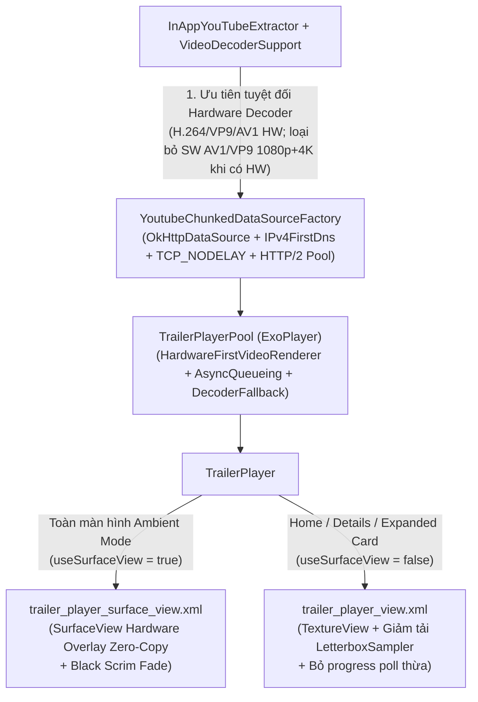

# PLAN: Cập Nhật Mặc Định Chế Độ Môi Trường Xung Quanh & Chống Drop Khung Hình Trailer 1080p/4K (`PLAN-ambient-defaults-and-trailer-smooth-playback`)

> [!IMPORTANT]
> **Trạng thái**: Chờ người dùng duyệt trước khi thực thi (`PRE-EXECUTION PLAN` — tuân thủ quy tắc `/plan`, chưa chỉnh sửa mã nguồn).  
> **Mục tiêu kép**:
> 1. Đặt mặc định **Chế độ Môi trường xung quanh (Ambient Mode)**: **Bật**, Kiểu hiển thị **Trailer**, Âm thanh trailer **Bật**, Bắt đầu sau **1 phút**.
> 2. Xử lý triệt để các nguyên nhân gốc rễ gây **drop khung hình (giật/khựng)** khi phát trailer **1080p và 4K** trên Android TV / TV Box.

---

## 1. Giải Đáp: Video Trailer Đang Phát Bằng Trình Phát Nào?

Toàn bộ video trailer trong ứng dụng (Trang chủ Modern/Classic, Trang Chi tiết, và Chế độ Môi trường xung quanh) **KHÔNG** dùng MPV mà phát bằng **Media3 ExoPlayer** qua một instance singleton dùng chung duy nhất tại [TrailerPlayerPool.kt](file:///f:/MyGithub/NuvioTV-Fast/app/src/main/java/com/nuvio/tv/core/player/TrailerPlayerPool.kt#L58-L426), hiển thị qua [TrailerPlayer.kt](file:///f:/MyGithub/NuvioTV-Fast/app/src/main/java/com/nuvio/tv/ui/components/TrailerPlayer.kt#L87-L411) sử dụng layout [trailer_player_view.xml](file:///f:/MyGithub/NuvioTV-Fast/app/src/main/res/layout/trailer_player_view.xml#L1-L11).

### Đối chiếu Trình phát Trailer vs. Trình phát Phim Chính

| Thành phần | Trình phát Phim Chính (`PlayerRuntimeController`) | Trình phát Trailer Hiện Tại (`TrailerPlayerPool` + `TrailerPlayer`) | Hệ quả với 1080p / 4K |
| :--- | :--- | :--- | :--- |
| **Engine** | Media3 ExoPlayer (hoặc LibMPV) | Media3 ExoPlayer (`TrailerPlayerPool`) | Cùng lõi Media3 nhưng cấu hình yếu hơn hẳn |
| **Video Surface** | `SurfaceView` (Hardware Overlay zero-copy) | **`TextureView` cố định** (`surface_type="texture_view"`) | Ép GPU copy + composite qua OpenGL/Compose mỗi frame, cực nặng ở 1080p60 / 4K |
| **Chọn Bộ Giải Mã** | `HardwareFirstVideoRenderer` (ưu tiên chip giải mã phần cứng) | `DefaultRenderersFactory` thuần + [VideoDecoderSupport.kt](file:///f:/MyGithub/NuvioTV-Fast/app/src/main/java/com/nuvio/tv/data/trailer/VideoDecoderSupport.kt#L53-L54) **chấp nhận cả Software Decoder** | Máy không có chip phần cứng AV1/VP9 4K vẫn bị chọn stream AV1/VP9 chạy bằng **CPU (`c2.android.*`) → rớt khung hình nặng** |
| **MediaCodec Queueing** | Có fallback + cấu hình tối ưu | Chưa bật `forceEnableMediaCodecAsynchronousQueueing()` và `setEnableDecoderFallback(true)` | Dễ stall khi nạp/nhả buffer tốc độ cao ở 4K |
| **Lớp mạng YouTube** | OkHttp với `IPv4FirstDns` + `NoDelaySocketFactory` | [YoutubeChunkedDataSourceFactory.kt](file:///f:/MyGithub/NuvioTV-Fast/app/src/main/java/com/nuvio/tv/data/trailer/YoutubeChunkedDataSourceFactory.kt#L35-L41) dùng `DefaultHttpDataSource` (`HttpURLConnection`), đóng/mở kết nối mới mỗi 10 MB | Ở 4K (~25–35 Mbps), cứ 2–4 giây lại khựng kết nối tại ranh giới chunk |
| **Đọc pixel Letterbox** | Không chạy trên TextureView | [LetterboxDetector.kt](file:///f:/MyGithub/NuvioTV-Fast/app/src/main/java/com/nuvio/tv/core/player/LetterboxDetector.kt#L65-L70) gọi `textureView.getBitmap()` **trên Main Thread mỗi `400ms`** (ở Home/Details) | Gây GPU flush + readback stall 15–40ms định kỳ trên UI thread |

---

## 2. Chẩn Đoán Chi Tiết 6 Nguyên Nhân Gây Drop Khung Hình Trailer 1080p & 4K

1. **`VideoDecoderSupport.canDecode()` không lọc Software Decoder ([VideoDecoderSupport.kt](file:///f:/MyGithub/NuvioTV-Fast/app/src/main/java/com/nuvio/tv/data/trailer/VideoDecoderSupport.kt#L41-L58))**:
   - Hiện gọi `MediaCodecUtil.getDecoderInfos(...).any { it.isFormatSupported(format) }` mà **không kiểm tra `!isSoftwareDecoder(it)`** (`info.softwareOnly`, `c2.android.*`, `omx.google.*`).
   - Trên Android TV 10–14, Android có sẵn software decoder AV1 (`c2.android.av1.decoder` / `dav1d`) và VP9 báo `isFormatSupported = true` cho 1080p/4K. Khi [InAppYouTubeExtractor.kt](file:///f:/MyGithub/NuvioTV-Fast/app/src/main/java/com/nuvio/tv/data/trailer/InAppYouTubeExtractor.kt#L1061-L1077) chấm điểm cao cho `mp4` (chứa `av01`!) hoặc `vp09`, thiết bị không có phần cứng AV1 sẽ **giải mã 1080p/4K bằng CPU**, gây giật và rớt frame rõ rệt.
2. **Bắt buộc `TextureView` + `CompositingStrategy.ModulateAlpha` ngay cả khi phát toàn màn hình trong Ambient Mode ([trailer_player_view.xml](file:///f:/MyGithub/NuvioTV-Fast/app/src/main/res/layout/trailer_player_view.xml#L8), [AmbientSlideshow.kt](file:///f:/MyGithub/NuvioTV-Fast/app/src/main/java/com/nuvio/tv/ui/screens/ambient/AmbientSlideshow.kt#L322-L327))**:
   - `TextureView` đi qua GPU composition thay vì Hardware Overlay (`SurfaceView`).
   - Trên `AmbientSlideshow`, trailer chạy toàn màn hình (`fillMaxSize`), không bo góc, không zoom/letterbox (`cropToFill = false`, `detectLetterbox = false`), nhưng vẫn dùng `TextureView` kèm `graphicsLayer { compositingStrategy = ModulateAlpha }`. Chuyển chế độ toàn màn hình sang **`SurfaceView` + lớp màn che đen (`scrim`) fade alpha phía trên** giúp đi thẳng đường Hardware Overlay (zero-copy) và cho phép Android 11+ kích hoạt `VIDEO_CHANGE_FRAME_RATE_STRATEGY_ONLY_IF_SEAMLESS` đúng nghĩa!
3. **`TrailerPlayerPool` thiếu `HardwareFirstVideoRenderer`, `forceEnableMediaCodecAsynchronousQueueing()` và `setEnableDecoderFallback(true)` ([TrailerPlayerPool.kt](file:///f:/MyGithub/NuvioTV-Fast/app/src/main/java/com/nuvio/tv/core/player/TrailerPlayerPool.kt#L391-L407))**:
   - Không tái sử dụng [HardwareFirstVideoRenderer](file:///f:/MyGithub/NuvioTV-Fast/app/src/main/java/com/nuvio/tv/ui/screens/player/HardwareVideoDecoderSelector.kt#L42-L49) mà trình phát phim chính đã xây sẵn.
   - Chưa bật chế độ nạp buffer MediaCodec bất đồng bộ (`forceEnableMediaCodecAsynchronousQueueing()`), làm tăng độ trễ giải mã ở video bitrate cao (1080p60 / 4K).
   - `bufferForPlaybackMs = 5_000` (dòng 361) vừa kéo dài thời gian chờ khởi phát, trong khi không dùng `OkHttpDataSource` connection pooling làm tăng rủi ro tụt buffer khi đổi chunk.
4. **Hiệu năng mạng ở [YoutubeChunkedDataSourceFactory.kt](file:///f:/MyGithub/NuvioTV-Fast/app/src/main/java/com/nuvio/tv/data/trailer/YoutubeChunkedDataSourceFactory.kt#L34-L42)**:
   - Mỗi lần tạo DataSource dùng `DefaultHttpDataSource` (không chia sẻ pool kết nối TLS/HTTP2, không có `IPv4FirstDns` và `NoDelaySocketFactory`), gây độ trễ mở lại kết nối ở mỗi ranh giới chunk 10 MB trên luồng 4K.
5. **Tác vụ nền cạnh tranh đúng lúc trailer đang phát ở [AmbientSlideshow.kt](file:///f:/MyGithub/NuvioTV-Fast/app/src/main/java/com/nuvio/tv/ui/screens/ambient/AmbientSlideshow.kt#L172-L186) và [TrailerPlayer.kt](file:///f:/MyGithub/NuvioTV-Fast/app/src/main/java/com/nuvio/tv/ui/components/TrailerPlayer.kt#L267-L276)**:
   - `AmbientSlideshow` gọi `loadSlide` (tải + giải mã bitmap 1080p/4K + gọi YouTube API + probe CDN) cho slide kế tiếp **ngay lập tức** cùng lúc trailer hiện tại vừa bắt đầu đệm và giải mã những khung hình đầu.
   - Khi `videoAlpha == 1f`, lớp `Image(bitmap = loaded.backdrop)` phía dưới vẫn tồn tại trong cây Compose dù hoàn toàn vô hình (`alpha = 0f`).
   - `TrailerPlayer` chạy vòng lặp `while (isPlaying) { onProgressChanged(...); delay(250) }` liên tục 4 lần/giây kể cả khi màn hình không cần hiển thị thanh tiến độ (như Ambient Mode).
6. **`LetterboxSampler` trên Home/Details gây GPU readback trên Main Thread ([TrailerPlayer.kt](file:///f:/MyGithub/NuvioTV-Fast/app/src/main/java/com/nuvio/tv/ui/components/TrailerPlayer.kt#L228-L250))**:
   - Gọi `textureView.getBitmap(bitmap)` mỗi `400ms` trên `Dispatchers.Main` gây khựng khung hình định kỳ ở đầu mỗi trailer trên Home Hero & trang Chi tiết (đặc biệt nặng khi phát 4K).

---

## 3. Phần A: Kế Hoạch Đổi Giá Trị Mặc Định Chế Độ Môi Trường Xung Quanh

| Tùy chọn | Hằng số / Trường | Giá trị cũ | **Giá trị mặc định mới** | Ghi chú an toàn |
| :--- | :--- | :---: | :---: | :--- |
| **Bật Chế độ môi trường xung quanh** | `AmbientModeSettings.enabled` | `true` | **`true`** (`DEFAULT_ENABLED`) | Giữ nguyên bật sẵn |
| **Kiểu hiển thị** | `AmbientModeSettings.displayMode` & `AmbientDisplayMode.fromStorage(null)` | `BACKDROP` | **`AmbientDisplayMode.TRAILER`** (`DEFAULT_DISPLAY_MODE`) | Bản `playstore` vẫn tự ép về `BACKDROP` qua `AppFeaturePolicy.inAppTrailerPlaybackEnabled` |
| **Âm thanh trailer** | `AmbientModeSettings.trailerAudioEnabled` | `false` | **`true`** (`DEFAULT_TRAILER_AUDIO_ENABLED`) | Phím âm lượng TV vẫn hoạt động không thoát Ambient Mode (`allowVolumeKeysWhileShowing = true`) |
| **Bắt đầu sau** | `AmbientModeSettings.DEFAULT_TIMEOUT_MINUTES` | `5` (phút) | **`1`** (phút) | Đã có sẵn trong `TIMEOUT_OPTIONS_MINUTES = listOf(1, 2, 5, 10, 15, 30)` |

> [!WARNING]
> **Lưu ý chuỗi văn bản & tương thích kiểm thử**:
> - Chuỗi mô tả `ambient_mode_trailer_audio_subtitle` hiện đang ghi *"muted by default"* ([strings.xml](file:///f:/MyGithub/NuvioTV-Fast/app/src/main/res/values/strings.xml#L417)) và *"(mặc định tắt tiếng)"* ([values-vi/strings.xml](file:///f:/MyGithub/NuvioTV-Fast/app/src/main/res/values-vi/strings.xml#L410)) → cần cập nhật lại cho khớp với mặc định mới (**bật sẵn** / bỏ chú thích tắt tiếng mặc định).
> - Test đồng bộ hồ sơ [ProfileSettingsPluginSyncTest.kt](file:///f:/MyGithub/NuvioTV-Fast/app/src/test/java/com/nuvio/tv/core/sync/ProfileSettingsPluginSyncTest.kt#L84-L106) đang kiểm chứng restore từ giá trị mặc định cũ (`5`, `BACKDROP`, `false`) → cần đảo giá trị test ghi/khôi phục (`10`, `BACKDROP`, `false`) để test thực sự xác minh việc ghi đè lên mặc định mới (`1`, `TRAILER`, `true`).

---

## 4. Phần B: Kiến Trúc Tối Ưu Chống Drop Khung Hình Trailer 1080p & 4K



### Phân rã Từng Giai Đoạn Thực Thi (Phase-by-Phase Breakdown)

#### Giai đoạn 1: Cập Nhật Giá Trị Mặc Định Chế Độ Môi Trường Xung Quanh
- **`[T1.1]` Cập nhật Model & DataStore**:
  - [AmbientModeSettings.kt](file:///f:/MyGithub/NuvioTV-Fast/app/src/main/java/com/nuvio/tv/domain/model/AmbientModeSettings.kt):
    - Đổi `DEFAULT_TIMEOUT_MINUTES = 1`, thêm `DEFAULT_ENABLED = true`, `DEFAULT_DISPLAY_MODE = AmbientDisplayMode.TRAILER`, `DEFAULT_TRAILER_AUDIO_ENABLED = true`.
    - Cập nhật `AmbientDisplayMode.fromStorage(raw)` fallback về `AmbientModeSettings.DEFAULT_DISPLAY_MODE`.
  - [AmbientModeDataStore.kt](file:///f:/MyGithub/NuvioTV-Fast/app/src/main/java/com/nuvio/tv/data/local/AmbientModeDataStore.kt):
    - Dùng các hằng số `DEFAULT_ENABLED`, `DEFAULT_TIMEOUT_MINUTES`, `DEFAULT_TRAILER_AUDIO_ENABLED` khi preference key chưa được ghi.
  - [AmbientSlideshow.kt](file:///f:/MyGithub/NuvioTV-Fast/app/src/main/java/com/nuvio/tv/ui/screens/ambient/AmbientSlideshow.kt): đồng bộ tham số mặc định `displayMode = AmbientModeSettings.DEFAULT_DISPLAY_MODE`, `trailerAudioEnabled = AmbientModeSettings.DEFAULT_TRAILER_AUDIO_ENABLED`.
- **`[T1.2]` Cập nhật Chuỗi Ngôn Ngữ (EN & VI)**:
  - Cập nhật `ambient_mode_trailer_audio_subtitle` trong [strings.xml](file:///f:/MyGithub/NuvioTV-Fast/app/src/main/res/values/strings.xml#L417) và [values-vi/strings.xml](file:///f:/MyGithub/NuvioTV-Fast/app/src/main/res/values-vi/strings.xml#L410) cho đúng mặc định bật âm thanh.

#### Giai đoạn 2: Chặn Giải Mã Phần Mềm (Software Decode) & Tối Ưu Lựa Chọn Codec YouTube
- **`[T2.1]` Nâng cấp [VideoDecoderSupport.kt](file:///f:/MyGithub/NuvioTV-Fast/app/src/main/java/com/nuvio/tv/data/trailer/VideoDecoderSupport.kt)**:
  - Thêm `canHardwareDecode(codecs, width, height, fps): Boolean` lọc rõ bộ giải mã phần cứng bằng `!isSoftwareDecoder(info)` (tái sử dụng tiêu chuẩn `info.softwareOnly` + prefix `omx.google.`, `c2.android.`, `c2.google.`, `omx.ffmpeg.` từ [HardwareVideoDecoderSelector.kt](file:///f:/MyGithub/NuvioTV-Fast/app/src/main/java/com/nuvio/tv/ui/screens/player/HardwareVideoDecoderSelector.kt)).
  - Giữ `canDecode(...)` (cho phép fallback phần mềm chỉ khi thiết bị hoàn toàn không có bất kỳ stream phần cứng nào ở độ phân giải đó).
- **`[T2.2]` Tối ưu Xếp hạng Codec trong [InAppYouTubeExtractor.kt](file:///f:/MyGithub/NuvioTV-Fast/app/src/main/java/com/nuvio/tv/data/trailer/InAppYouTubeExtractor.kt)**:
  - Khi lọc `playableVideo(items)` và xếp hạng trong `rankAdaptiveVideos(...)`:
    - **Ưu tiên tuyệt đối các stream giải mã được bằng Hardware Decoder** (`canHardwareDecode == true`). Nếu có ít nhất 1 stream hardware-decodable trong giới hạn `maxVideoHeight`, loại bỏ toàn bộ stream chỉ giải mã bằng CPU (đặc biệt là `av01` software trên các TV Box cũ không có chip AV1!).
    - Giữa các stream cùng độ phân giải & cùng giải mã phần cứng, ưu tiên codec nhẹ/ổn định trên Android TV (`avc1` H.264 / `vp09` phần cứng trước `av01` khi cùng mức phân giải & fps, giúp nhiệt độ thấp hơn và mượt hơn trên TV Box tầm trung).

#### Giai đoạn 3: Nâng Cấp Lõi Trình Phát `TrailerPlayerPool`, Mạng YouTube & `SurfaceView` cho Ambient Mode
- **`[T3.1]` Tối ưu [TrailerPlayerPool.kt](file:///f:/MyGithub/NuvioTV-Fast/app/src/main/java/com/nuvio/tv/core/player/TrailerPlayerPool.kt)**:
  - Thay video renderer mặc định trong `DefaultRenderersFactory` bằng [HardwareFirstVideoRenderer](file:///f:/MyGithub/NuvioTV-Fast/app/src/main/java/com/nuvio/tv/ui/screens/player/HardwareVideoDecoderSelector.kt#L42-L49) + `.setEnableDecoderFallback(true)` + `.forceEnableMediaCodecAsynchronousQueueing()` (khi `SDK_INT >= 23`).
  - Giữ nguyên giới hạn RAM an toàn (`48 MiB` Low-RAM / `100 MiB` Standard), tinh chỉnh `bufferForPlaybackMs = 2_500` và `bufferForPlaybackAfterRebufferMs = 5_000` để khởi phát trailer nhanh và ổn định hơn.
- **`[T3.2]` Nâng cấp [YoutubeChunkedDataSourceFactory.kt](file:///f:/MyGithub/NuvioTV-Fast/app/src/main/java/com/nuvio/tv/data/trailer/YoutubeChunkedDataSourceFactory.kt)**:
  - Chuyển upstream từ `DefaultHttpDataSource` (`HttpURLConnection`) sang **OkHttp shared client** (dùng `OkHttpDataSource.Factory` sẵn có của Media3 + `IPv4FirstDns` + `NoDelaySocketFactory` + `ConnectionPool` keep-alive) để tái sử dụng kết nối TLS/HTTP2 liên tục qua các chunk 10 MB, loại bỏ độ trễ bắt tay lại khi phát 4K!
- **`[T3.3]` Thêm chế độ `SurfaceView` Zero-Copy cho Toàn màn hình trong [TrailerPlayer.kt](file:///f:/MyGithub/NuvioTV-Fast/app/src/main/java/com/nuvio/tv/ui/components/TrailerPlayer.kt) & [AmbientSlideshow.kt](file:///f:/MyGithub/NuvioTV-Fast/app/src/main/java/com/nuvio/tv/ui/screens/ambient/AmbientSlideshow.kt)**:
  - Tạo layout mới `app/src/main/res/layout/trailer_player_surface_view.xml` (`app:surface_type="surface_view"`, `app:use_controller="false"`, `app:show_buffering="never"`, `app:shutter_background_color="@android:color/black"`).
  - Thêm tham số tùy chọn `useSurfaceView: Boolean = false` và `trackProgress: Boolean = true` cho `TrailerPlayer`:
    - Khi `useSurfaceView = true` (dùng cho `AmbientSlideshow`): inflate `trailer_player_surface_view.xml`, không chạy `LetterboxSampler`, không dùng `ModulateAlpha` lên surface video; thay vào đó `AmbientSlideshow` fade một lớp scrim đen (`Color.Black`) + ảnh backdrop nằm phía trên `SurfaceView` cho hiệu ứng chuyển cảnh mượt tuyệt đối 0-copy!
    - Khi `trackProgress = false` (dùng cho `AmbientSlideshow`): không chạy vòng lặp `while (isPlaying) delay(250)` vô ích.
  - Ở [AmbientSlideshow.kt](file:///f:/MyGithub/NuvioTV-Fast/app/src/main/java/com/nuvio/tv/ui/screens/ambient/AmbientSlideshow.kt):
    - Chỉ compose lớp `Image(bitmap = loaded.backdrop)` khi `backdropAlpha.value > 0f && videoAlpha.value < 1f` (giải phóng hoàn toàn lớp texture backdrop 1080p/4K khỏi pass vẽ GPU trong suốt thời gian trailer đang phát!).
    - Trì hoãn việc `preload` slide tiếp theo sau khi trailer hiện tại đã `renderedFirstFrame` ổn định (thêm delay nhẹ `3_000ms`), tránh tranh chấp CPU/mạng trong những giây đệm đầu của trailer 4K.
  - Ở [TrailerPlayer.kt](file:///f:/MyGithub/NuvioTV-Fast/app/src/main/java/com/nuvio/tv/ui/components/TrailerPlayer.kt) (nhánh `TextureView` cho Home/Details): tăng khoảng cách lấy mẫu `LetterboxDetector` khi độ phân giải > 1080p (hoặc bỏ qua lấy mẫu pixel readback khi đang phát 4K để không gây GPU stall trên Main Thread) và đẩy `bitmap.getPixels` + `detectBar` ra `Dispatchers.Default` sau khi lấy bitmap!

#### Giai đoạn 4: Kiểm Thử Tự Động & Xác Minh (Tests & Verification)
- **`[T4.1]` Cập nhật & Bổ sung Unit Tests**:
  - Cập nhật [ProfileSettingsPluginSyncTest.kt](file:///f:/MyGithub/NuvioTV-Fast/app/src/test/java/com/nuvio/tv/core/sync/ProfileSettingsPluginSyncTest.kt) cho bộ giá trị mặc định Ambient Mode mới (`enabled = true`, `displayMode = TRAILER`, `trailerAudioEnabled = true`, `timeoutMinutes = 1`).
  - Bổ sung unit tests kiểm chứng mặc định `AmbientModeSettings` / `AmbientModeDataStore` và kiểm chứng `InAppYouTubeExtractor` ưu tiên hardware-decodable stream (loại bỏ AV1 software decoder khi thiết bị có H.264/VP9 phần cứng, và fallback an toàn khi không có hardware decoder).
- **`[T4.2]` Biên dịch 2 Biến thể & Chạy Unit Test**:
  - Chạy `:app:compileFullDebugKotlin`, `:app:compilePlaystoreDebugKotlin` và toàn bộ bộ test `ui.screens.ambient.*`, `data.trailer.*`, `core.player.*`, `core.sync.*`.

---

## 5. Phân Công Chuyên Trách (Surgical Task Distribution)

| Mã Task | Giai đoạn | Tác nhân chuyên trách | Tệp tin tác động chính |
| :--- | :---: | :--- | :--- |
| `[T1.1]` | Giai đoạn 1 | `mobile-developer` (Data/Model) | `domain/model/AmbientModeSettings.kt`, `data/local/AmbientModeDataStore.kt`, `ui/screens/ambient/AmbientSlideshow.kt` |
| `[T1.2]` | Giai đoạn 1 | `mobile-developer` (I18n) | `res/values/strings.xml`, `res/values-vi/strings.xml` |
| `[T2.1]` | Giai đoạn 2 | `mobile-developer` (Codec) | `data/trailer/VideoDecoderSupport.kt` |
| `[T2.2]` | Giai đoạn 2 | `mobile-developer` (Extractor) | `data/trailer/InAppYouTubeExtractor.kt` |
| `[T3.1]` | Giai đoạn 3 | `mobile-developer` (ExoPlayer) | `core/player/TrailerPlayerPool.kt` |
| `[T3.2]` | Giai đoạn 3 | `mobile-developer` (Network) | `data/trailer/YoutubeChunkedDataSourceFactory.kt` |
| `[T3.3]` | Giai đoạn 3 | `mobile-developer` (Surface/UI) | `res/layout/trailer_player_surface_view.xml` *(mới)*, `ui/components/TrailerPlayer.kt`, `ui/screens/ambient/AmbientSlideshow.kt` |
| `[T4.1]` | Giai đoạn 4 | `test-engineer` (Unit Tests) | `ProfileSettingsPluginSyncTest.kt`, `AmbientModeSettingsDefaultsTest.kt` *(mới)*, `TrailerServiceCandidateRankingTest.kt` / `InAppYouTubeExtractorHardwareCodecTest.kt` |
| `[T4.2]` | Giai đoạn 4 | `quality-inspector` (Build/Verify) | Gradle compile 2 flavors + unit tests |

---

## 6. Kế Hoạch Kiểm Chứng (Verification Plan)

### A. Tự động (Automated)
```powershell
.\gradlew.bat :app:compileFullDebugKotlin :app:compilePlaystoreDebugKotlin :app:testFullDebugUnitTest `
  --tests "com.nuvio.tv.ui.screens.ambient.*" `
  --tests "com.nuvio.tv.data.trailer.*" `
  --tests "com.nuvio.tv.core.player.*" `
  --tests "com.nuvio.tv.core.sync.ProfileSettingsPluginSyncTest"
```

### B. Thủ công trên Android TV / TV Box (Manual)
1. **Cài mới / Tạo Profile mới**:
   - Vào *Cài đặt → Chế độ môi trường xung quanh*: xác nhận hiển thị mặc định **Bật**, Kiểu hiển thị = **Trailer**, Âm thanh trailer = **Bật**, Bắt đầu sau = **1 phút**.
   - Để yên màn hình Home đúng **1 phút**: Ambient Mode tự kích hoạt, phát trailer toàn màn hình có âm thanh; bấm nút Tăng/Giảm âm lượng trên remote chỉnh âm lượng bình thường không thoát Ambient; bấm các phím khác thoát ngay.
   - Kiểm tra trên biến thể `playstore`: tùy chọn Trailer bị ẩn, tự động chạy `BACKDROP` sau 1 phút.
2. **Đo độ mượt phát Trailer 1080p & 4K**:
   - Bật *Trailer 4K* trong Cài đặt, mở Ambient Mode và Home Hero/Details: quan sát Logcat `InAppYouTubeExtractor` xác nhận chọn codec phần cứng (không rơi vào `c2.android.av1.decoder`), và kiểm tra bằng `adb shell dumpsys gfxinfo` / mắt thường xem khung hình 1080p và 4K trôi mượt, không còn khựng định kỳ tại mốc 400ms hay ranh giới chunk 10 MB.
