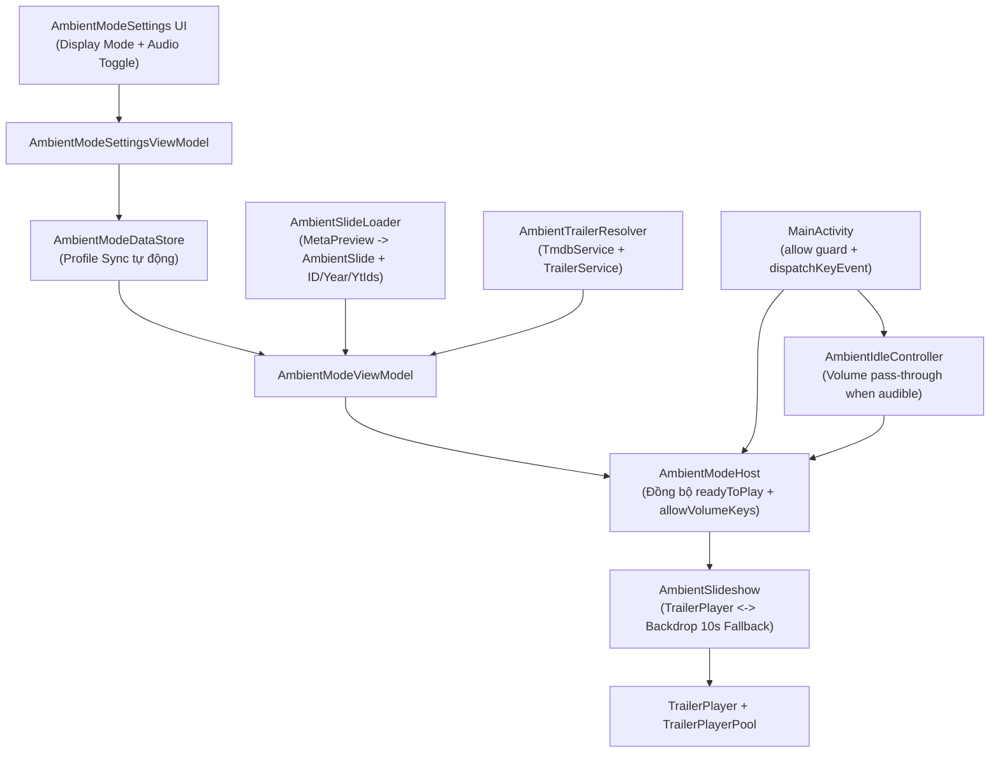

# PLAN: Thêm tùy chọn phát Trailer cho Chế độ môi trường xung quanh (Ambient Mode)

> [!IMPORTANT]
> Kế hoạch này chỉ phục vụ chiến lược thiết kế trước khi viết code (tuân thủ quy trình `/plan`). Mọi quyết định UX (âm thanh, thời lượng phát, fallback ảnh tĩnh xen kẽ, hành vi phím remote) đã được thống nhất với người dùng.

---

## 1. Mục tiêu rõ ràng (Clear Goals)

Mở rộng **Chế độ môi trường xung quanh (Ambient Mode)** để người dùng có thể chọn phát **Trailer toàn màn hình** thay vì chỉ hiển thị slideshow phông nền tĩnh:

1. **Tùy chọn trong Cài đặt Chế độ môi trường xung quanh**:
   - Thêm mục **Kiểu hiển thị (`AmbientDisplayMode`)**:
     - **Phông nền (`BACKDROP`)** — mặc định, giữ nguyên trải nghiệm hiện tại.
     - **Trailer (`TRAILER`)** — phát trailer toàn màn hình các phim từ danh mục đã chọn.
   - Khi đang chọn **Trailer**, hiển thị thêm công tắc **Âm thanh trailer (`trailerAudioEnabled`)** — mặc định **Tắt tiếng (`false`)** để không làm giật mình khi TV tự vào chế độ chờ; bật nếu muốn phát có tiếng.
   - Tự động lưu theo từng Profile trong `AmbientModeDataStore` và tự động đồng bộ qua `ProfileSettingsSyncService`.
   - Tôn trọng chính sách build `AppFeaturePolicy.inAppTrailerPlaybackEnabled`: chỉ hiện tùy chọn Trailer trên bản `full`, ẩn hoàn toàn và luôn chạy `BACKDROP` trên bản `playstore`.
2. **Trải nghiệm phát Trailer mượt mà & xen kẽ thông minh**:
   - Mỗi phim có trailer sẽ **phát hết trailer** rồi tự động chuyển mượt sang phim tiếp theo (có fade-in/fade-out cùng logo & thể loại ở góc dưới bên trái).
   - **Preload song song**: trong khi slide hiện tại đang chạy, tải trước ảnh nền, logo và URL nguồn trailer của slide kế tiếp để chuyển cảnh liền mạch.
   - **Fallback xen kẽ 10 giây**: nếu một phim không có trailer, bị lỗi tải/giải mã, YouTube đang giới hạn tốc độ (`isRateLimited()`), hoặc không kịp render khung hình đầu tiên trong ngưỡng chờ (~8 giây), slide đó sẽ **tự động hiển thị phông nền ảnh tĩnh trong 10 giây** kèm chuyển động Ken Burns rồi mới chuyển tiếp.
3. **Hành vi phím remote chuẩn Ambient Mode**:
   - Bấm bất kỳ phím nào trên remote đều thoát Ambient Mode ngay lập tức và nuốt phím đầu tiên như hiện tại.
   - **Ngoại lệ duy nhất**: khi Ambient Mode đang phát ở chế độ **Trailer có bật âm thanh**, các phím âm lượng (`KEYCODE_VOLUME_UP`, `KEYCODE_VOLUME_DOWN`, `KEYCODE_VOLUME_MUTE`) sẽ **không thoát Ambient Mode** mà chuyển thẳng cho hệ điều hành chỉnh âm lượng TV.

---

## 2. Chuỗi phụ thuộc & Bản đồ tệp tác động (Dependency Chains & Impact Map)



> [!WARNING]
> **4 rủi ro kiến trúc cốt lõi đã phát hiện khi khảo sát mã nguồn (bắt buộc xử lý triệt để)**:
> 1. **Bẫy tự thoát Ambient Mode ngay khi trailer bắt đầu phát (`MainActivity.kt` dòng 1336–1350)**:
>    Hiện tại `MainActivity` truyền `allowed = ... && !isTrailerPlaying` (đọc từ `trailerPlayerPool.isTrailerPlaying`). Nếu Ambient Mode phát trailer qua `TrailerPlayerPool`, ngay khi video chạy thì `isTrailerPlaying` đổi thành `true` → `allowed` thành `false` → `AmbientModeHost` tự gọi `controller.dismiss()`!
>    - **Cách xử lý**: Kiểm tra `val isAmbientShowing by ambientIdleController.isShowing.collectAsState()`. Điều kiện chặn chỉ tính trailer ngoài Ambient: `allowed = !isPlayerActive && !isLiveTvActive && autoNextOverlay == null && (!isTrailerPlaying || isAmbientShowing)`. Đồng thời `LaunchedEffect(isTrailerPlaying)` chỉ gọi `ambientIdleController.onInteraction()` khi `!isTrailerPlaying && !ambientIdleController.isShowing.value`.
> 2. **Tranh chấp thứ tự dừng trailer nền (`onShown = { trailerPlayerPool.stop() }`)**:
>    `AnimatedVisibility(visible = isShowing)` compose ngay trước khi `LaunchedEffect(isShowing)` chạy `onShown()`. Nếu Ambient bắt đầu mở `TrailerPlayer` ngay frame đầu tiên, `trailerPlayerPool.stop()` chạy ngay sau đó sẽ ngắt chính trailer của Ambient.
>    - **Cách xử lý**: Quản lý cờ `readyToPlay` trong `AmbientModeHost` — chỉ chuyển `readyToPlay = true` **sau khi** `onShown()` (dừng trailer cũ của Home/Detail) đã thực thi xong.
> 3. **Tương thích hai flavor `full` và `playstore`**:
>    Bản `playstore` đặt `AppFeaturePolicy.inAppTrailerPlaybackEnabled = false`. Cần tính `effectiveDisplayMode = if (AppFeaturePolicy.inAppTrailerPlaybackEnabled) settings.displayMode else AmbientDisplayMode.BACKDROP` ở cả Settings UI lẫn `AmbientModeHost` / `AmbientSlideshow`.
> 4. **Chống treo màn hình đen & chồng chéo phụ đề trên màn hình chờ**:
>    - URL stream YouTube có thể lỗi decode hoặc chậm mạng: đặt timeout resolve nguồn (~10s) và watchdog `onFirstFrameRendered` (~8s). Nếu quá hạn hoặc gặp `onError`, lập tức chuyển slide đó về hiển thị ảnh phông nền 10 giây (tránh đơ màn hình đen).
>    - Thêm tham số tùy chọn `showSubtitles: Boolean = true` cho `TrailerPlayer` (mặc định `true` để không ảnh hưởng bất kỳ màn hình nào khác; Ambient Mode truyền `false` để phụ đề YouTube không đè lên logo & thể loại ở góc dưới).

### Bảng tệp tác động

| Tệp mã nguồn | Loại | Thay đổi dự kiến |
|---|---|---|
| `app/src/main/java/com/nuvio/tv/domain/model/AmbientModeSettings.kt` | Sửa | Thêm enum `AmbientDisplayMode { BACKDROP, TRAILER }`, thêm `displayMode` (mặc định `BACKDROP`) và `trailerAudioEnabled` (mặc định `false`). |
| `app/src/main/java/com/nuvio/tv/data/local/AmbientModeDataStore.kt` | Sửa | Lưu/đọc `ambient_display_mode` và `ambient_trailer_audio_enabled`; thêm `setDisplayMode(...)`, `setTrailerAudioEnabled(...)`. |
| `app/src/main/res/values/strings.xml` & `values-vi/strings.xml` | Sửa | Thêm chuỗi nhãn/mô tả cho **Kiểu hiển thị** (`Phông nền` / `Trailer`) và **Âm thanh trailer** (EN + VI). |
| `app/src/main/java/com/nuvio/tv/ui/screens/settings/AmbientModeSettingsViewModel.kt` | Sửa | Thêm `setDisplayMode(...)` và `setTrailerAudioEnabled(...)`. |
| `app/src/main/java/com/nuvio/tv/ui/screens/settings/AmbientModeSettings.kt` | Sửa | Hiển thị hàng chọn **Kiểu hiển thị** (`SettingsActionRow` + `SettingsSingleChoiceDialog`) khi `AppFeaturePolicy.inAppTrailerPlaybackEnabled == true`, và công tắc **Âm thanh trailer** khi `displayMode == TRAILER`. |
| `app/src/main/java/com/nuvio/tv/ui/screens/ambient/AmbientSlide.kt` | Sửa | Bổ sung metadata cần cho tra cứu trailer: `itemId`, `imdbId`, `apiType`, `year`, `trailerYtIds`. |
| `app/src/main/java/com/nuvio/tv/ui/screens/ambient/AmbientSlideLoader.kt` | Sửa | Điền đầy đủ `itemId`, `imdbId`, `apiType`, `year` (trích 4 số năm từ `releaseInfo`/`released`), và danh sách `trailerYtIds` (gộp `trailerYtIds` + `trailers.mapNotNull { it.ytId }`). |
| `app/src/main/java/com/nuvio/tv/ui/screens/ambient/AmbientTrailerResolver.kt` | Mới | Class `@Singleton` chuyên trách tra cứu `TrailerPlaybackSource?` cho `AmbientSlide` (ưu tiên `TmdbService` + `TrailerService` với `ignoreUseTrailersGate = true`, fallback `trailerYtIds`, né `ServerItemRef` không có `imdbId`, tôn trọng `isRateLimited()`, áp dụng timeout an toàn). |
| `app/src/main/java/com/nuvio/tv/ui/screens/ambient/AmbientModeViewModel.kt` | Sửa | Inject `AmbientTrailerResolver` và expose `suspend fun resolveTrailer(slide: AmbientSlide): TrailerPlaybackSource?` (có cache tạm trong phiên cho slide đang chạy nếu cần, hủy sạch khi rời Ambient). |
| `app/src/main/java/com/nuvio/tv/ui/components/TrailerPlayer.kt` | Sửa | Thêm tham số `showSubtitles: Boolean = true` (mặc định giữ nguyên hành vi cũ; khi `false` không nạp `subtitleTrack` và không hiển thị phụ đề). |
| `app/src/main/java/com/nuvio/tv/ui/screens/ambient/AmbientSlideshow.kt` | Sửa | Nâng cấp hỗ trợ cả `BACKDROP` và `TRAILER`: preload song song ảnh + trailer slide kế tiếp; phát `TrailerPlayer` toàn màn hình (`cropToFill = true`, `autoCropLetterbox = true`, `detectLetterbox = true`, `showSubtitles = false`, `muted = !trailerAudioEnabled`); chờ phát hết (`onEnded`) rồi fade chuyển slide; fallback mượt về ảnh nền 10 giây khi không có trailer / lỗi / timeout frame đầu. |
| `app/src/main/java/com/nuvio/tv/ui/screens/ambient/AmbientIdleController.kt` | Sửa | Hỗ trợ cờ `allowVolumeKeysWhileShowing`: không thoát Ambient và trả về `false` cho `KEYCODE_VOLUME_UP`, `KEYCODE_VOLUME_DOWN`, `KEYCODE_VOLUME_MUTE` khi đang bật tiếng trailer. |
| `app/src/main/java/com/nuvio/tv/ui/screens/ambient/AmbientModeHost.kt` | Sửa | Đồng bộ `readyToPlay` sau `onShown()`, truyền `effectiveDisplayMode`, `trailerAudioEnabled`, `resolveTrailer` xuống `AmbientSlideshow`, và cập nhật `controller.allowVolumeKeysWhileShowing` theo trạng thái hiện tại. |
| `app/src/main/java/com/nuvio/tv/MainActivity.kt` | Sửa | Sửa điều kiện `allowed` và `LaunchedEffect(isTrailerPlaying)` để trailer do chính Ambient Mode phát không tự kích hoạt `dismiss()`. |
| Unit Tests (`AmbientIdleControllerTest.kt`, `AmbientTrailerResolverTest.kt`, `ProfileSettingsPluginSyncTest.kt`) | Mới/Sửa | Kiểm thử đầy đủ controller phím âm lượng, chiến lược resolve trailer, và đồng bộ profile DataStore cho 2 cài đặt mới. |

---

## 3. Phân rã theo giai đoạn & Phân bổ tác vụ (Phase-by-Phase Breakdown)

### Giai đoạn 1: Model, DataStore & Tài nguyên chuỗi (`Data & Localization`)
- **[T1.1]** Cập nhật `AmbientModeSettings.kt`:
  - Thêm `enum class AmbientDisplayMode(val storageValue: String)` với `BACKDROP("backdrop")` và `TRAILER("trailer")` kèm `fromStorage(raw: String?)`.
  - Bổ sung vào `AmbientModeSettings`:
    - `val displayMode: AmbientDisplayMode = AmbientDisplayMode.BACKDROP`
    - `val trailerAudioEnabled: Boolean = false`
- **[T1.2]** Cập nhật `AmbientModeDataStore.kt`:
  - Thêm `displayModeKey = stringPreferencesKey("ambient_display_mode")` và `trailerAudioEnabledKey = booleanPreferencesKey("ambient_trailer_audio_enabled")`.
  - Thêm `setDisplayMode(mode: AmbientDisplayMode)` và `setTrailerAudioEnabled(enabled: Boolean)`.
- **[T1.3]** Cập nhật chuỗi giao diện trong `values/strings.xml` và `values-vi/strings.xml`:
  - `ambient_mode_display_mode` (*Display Mode* / *Kiểu hiển thị*)
  - `ambient_mode_display_mode_subtitle` (*Choose between artwork backdrops or movie trailers* / *Chọn hiển thị phông nền ảnh hoặc phát trailer phim*)
  - `ambient_mode_display_mode_backdrop` (*Backdrops* / *Phông nền*)
  - `ambient_mode_display_mode_backdrop_desc` (*Cycle full-screen artwork with gentle motion* / *Trình chiếu ảnh phông nền toàn màn hình với hiệu ứng chuyển động nhẹ*)
  - `ambient_mode_display_mode_trailer` (*Trailers* / *Trailer*)
  - `ambient_mode_display_mode_trailer_desc` (*Play full-screen trailers, falling back to backdrops when unavailable* / *Phát trailer toàn màn hình, tự chuyển sang phông nền nếu phim không có trailer*)
  - `ambient_mode_trailer_audio` (*Trailer Audio* / *Âm thanh trailer*)
  - `ambient_mode_trailer_audio_subtitle` (*Play sound during Ambient Mode trailers (muted by default)* / *Bật âm thanh khi phát trailer ở chế độ môi trường xung quanh (mặc định tắt tiếng)*)

### Giai đoạn 2: Màn hình Cài đặt Ambient Mode (`Settings UI`)
- **[T2.1]** Cập nhật `AmbientModeSettingsViewModel.kt`: thêm `setDisplayMode` và `setTrailerAudioEnabled`.
- **[T2.2]** Cập nhật `AmbientModeSettings.kt` (`AmbientModeSettingsCard`):
  - Khi `settings.enabled && AppFeaturePolicy.inAppTrailerPlaybackEnabled`:
    - Hiển thị `SettingsActionRow` cho **Kiểu hiển thị**, mở `SettingsSingleChoiceDialog` chọn giữa `BACKDROP` và `TRAILER`.
    - Khi `settings.displayMode == AmbientDisplayMode.TRAILER`, hiển thị thêm `SettingsToggleRow` cho **Âm thanh trailer**.

### Giai đoạn 3: Metadata Slide & Bộ giải mã nguồn Trailer (`Data Resolution`)
- **[T3.1]** Cập nhật `AmbientSlide.kt` và `AmbientSlideLoader.kt`:
  - Lưu `itemId = id`, `imdbId = imdbId?.takeIf { it.isNotBlank() }`, `apiType = apiType`, `year = extractYear(releaseInfo ?: released)`, `trailerYtIds = (trailerYtIds + trailers.mapNotNull { it.ytId }).map(String::trim).filter(String::isNotBlank).distinct()`.
  - Lưu ý giữ nguyên tiêu chí lọc slide có `backdropUrl` hợp lệ để mọi slide luôn có phông nền fallback đẹp mắt.
- **[T3.2]** Tạo `AmbientTrailerResolver.kt`:
  - Inject `TmdbService` và `TrailerService`.
  - Phương thức `suspend fun resolve(slide: AmbientSlide): TrailerPlaybackSource?`:
    1. Nếu `!AppFeaturePolicy.inAppTrailerPlaybackEnabled` hoặc `trailerService.isRateLimited()` → trả về `null` ngay (không spam YouTube).
    2. Bọc trong `withTimeoutOrNull(TRAILER_RESOLVE_TIMEOUT_MS)` (`10_000L`):
       - Xác định `lookupId = slide.imdbId ?: slide.itemId.takeUnless { ServerItemRef.isServerId(it) }`.
       - Nếu `lookupId != null`: gọi `tmdbService.ensureTmdbId(lookupId, slide.apiType)` rồi gọi `trailerService.getTrailerPlaybackSource(title = slide.title, year = slide.year, tmdbId = tmdbId, type = slide.apiType, ignoreUseTrailersGate = true)`.
       - Nếu TMDB trả về `null`: thử từng `ytId` trong `slide.trailerYtIds.take(2)` qua `trailerService.getTrailerPlaybackSourceFromYouTubeUrl(...)` (ngắt sớm nếu `isRateLimited()`).
    3. Không nuốt `CancellationException` để đảm bảo hủy coroutine tức thì khi người dùng thoát Ambient Mode.
- **[T3.3]** Cập nhật `AmbientModeViewModel.kt`: inject `AmbientTrailerResolver` và cung cấp hàm `resolveTrailer(slide)` cho `AmbientModeHost`.

### Giai đoạn 4: Trình phát Trailer trên Ambient Mode & An toàn vòng đời (`Player & Host Integration`)
- **[T4.1]** Cập nhật `TrailerPlayer.kt`:
  - Thêm tham số `showSubtitles: Boolean = true`.
  - Khi `showSubtitles == false`: bỏ qua lời gọi `resolvedPool?.subtitleFor(trailerUrl)` (để `subtitle = null`), không nạp track phụ đề.
- **[T4.2]** Cập nhật `AmbientIdleController.kt`:
  - Thêm `var allowVolumeKeysWhileShowing: Boolean = false`.
  - Tách helper `isVolumeKey(keyCode: Int)` nhận diện `KEYCODE_VOLUME_UP`, `KEYCODE_VOLUME_DOWN`, `KEYCODE_VOLUME_MUTE`.
  - Trong `consumeKeyEvent(event)`: khi `_isShowing.value && allowVolumeKeysWhileShowing && isVolumeKey(event.keyCode)`, trả về `false` và **không** gọi `dismiss()`.
- **[T4.3]** Cập nhật `AmbientSlideshow.kt`:
  - Nhận thêm `displayMode: AmbientDisplayMode`, `trailerAudioEnabled: Boolean`, `readyToPlay: Boolean`, `resolveTrailer: suspend (AmbientSlide) -> TrailerPlaybackSource?`.
  - Mở rộng `LoadedSlide` chứa thêm `trailerSource: TrailerPlaybackSource?`.
  - Trong `loadSlide(...)`: khi `displayMode == TRAILER`, tải song song `backdrop` + `logo` + `resolveTrailer(slide)`.
  - Chu kỳ phát 1 slide trong vòng lặp:
    - **Có `trailerSource` và `displayMode == TRAILER` và `readyToPlay`**:
      1. Hiển thị `backdrop` (fade-in) + logo + thể loại ở góc dưới trái.
      2. Gắn `TrailerPlayer` với `trailerUrl = source.videoUrl`, `trailerAudioUrl = source.audioUrl`, `isPlaying = true`, `muted = !trailerAudioEnabled`, `cropToFill = true`, `autoCropLetterbox = true`, `detectLetterbox = true`, `showSubtitles = false`.
      3. Dùng `CompletableDeferred<TrailerOutcome>` lắng nghe `onEnded` (`COMPLETED`) và `onError` (`FAILED`), kết hợp `firstFrameDeferred` với watchdog `8_000L`:
         - Nếu `firstFrameRendered` xảy ra đúng hạn: animate alpha video `0f -> 1f` (fade mượt đè lên ảnh nền), chờ cho đến khi trailer kết thúc (`onEnded`) hoặc lỗi giữa chừng (`onError`).
         - Nếu quá 8 giây chưa render frame đầu hoặc `onError` trước khi phát: ngừng `TrailerPlayer`, chạy `applyAmbientMotion` trên `backdrop` đủ `SLIDE_HOLD_MS` (10 giây) như một slide ảnh bình thường!
      4. Fade-out đồng bộ video + backdrop + logo + thể loại → giữ đen `BLACK_HOLD_MS` → chuyển slide tiếp theo (đã preload sẵn!).
    - **Không có `trailerSource` hoặc `displayMode == BACKDROP`**:
      - Chạy đúng quy trình phông nền ảnh tĩnh `SLIDE_HOLD_MS` (10 giây) + Ken Burns motion hiện có.
  - Khi `displayMode` đổi (hoặc `AmbientSlideshow` rời composition): hủy mọi `pending` job, dừng trailer sạch sẽ thông qua `DisposableEffect` sẵn có của `TrailerPlayer`.
- **[T4.4]** Cập nhật `AmbientModeHost.kt`:
  - Tính `effectiveDisplayMode` theo `AppFeaturePolicy.inAppTrailerPlaybackEnabled`.
  - Đồng bộ `controller.allowVolumeKeysWhileShowing = isShowing && effectiveDisplayMode == AmbientDisplayMode.TRAILER && settings.trailerAudioEnabled` (và reset về `false` trong `onDispose`).
  - Bảo đảm thứ tự khởi động an toàn: trong `LaunchedEffect(isShowing)`: khi `isShowing` thành `true`, chạy ẩn bàn phím → `onShown()` (dừng trailer Home/Detail) → `viewModel.onShown()` → đặt `readyToPlay = true`; khi `isShowing` thành `false`, đặt `readyToPlay = false`.
- **[T4.5]** Cập nhật `MainActivity.kt`:
  - Đọc `val isAmbientShowing by ambientIdleController.isShowing.collectAsState()`.
  - Sửa `allowed` của `AmbientModeHost`:
    `!isPlayerActive && !isLiveTvActive && autoNextOverlay == null && (!isTrailerPlaying || isAmbientShowing)`.
  - Sửa `LaunchedEffect(isTrailerPlaying)`: chỉ gọi `ambientIdleController.onInteraction()` khi `!isTrailerPlaying && !ambientIdleController.isShowing.value`.

### Giai đoạn 5: Kiểm thử tự động & Xác minh (`Testing & Verification`)
- **[T5.1]** Thêm `AmbientIdleControllerTest.kt`: test thoát bằng phím D-Pad/OK/Back, test phím Volume pass-through khi `allowVolumeKeysWhileShowing = true`, test phím Volume vẫn thoát khi `allowVolumeKeysWhileShowing = false`.
- **[T5.2]** Thêm `AmbientTrailerResolverTest.kt`: test đường TMDB (`ignoreUseTrailersGate = true`), fallback `trailerYtIds`, bỏ qua `ServerItemRef` không có `imdbId`, dừng sớm khi `isRateLimited()`.
- **[T5.3]** Mở rộng `ProfileSettingsPluginSyncTest.kt`: xác nhận `displayMode = TRAILER` và `trailerAudioEnabled = true` được upload & khôi phục chính xác sau khi xóa dữ liệu local.

---

## 4. Kế hoạch kiểm chứng (Verification Plan)

### A. Kiểm chứng tự động (Automated)
1. Chạy toàn bộ Unit Test liên quan đến Ambient Mode & Profile Sync:
   ```powershell
   .\gradlew.bat :app:testFullDebugUnitTest --tests "com.nuvio.tv.ui.screens.ambient.*" --tests "com.nuvio.tv.core.sync.ProfileSettingsPluginSyncTest"
   ```
2. Kiểm tra biên dịch **cả 2 build flavor** (`full` và `playstore`) để bảo đảm `AppFeaturePolicy` hoạt động đúng và không lỗi biên dịch:
   ```powershell
   .\gradlew.bat :app:compileFullDebugKotlin :app:compilePlaystoreDebugKotlin
   ```

### B. Kiểm chứng thủ công trên Android TV / Emulator (Manual)
1. **Cài đặt & Lưu trữ**:
   - Mở *Cài đặt → Giao diện → Chế độ môi trường xung quanh*.
   - Kiểm tra mục **Kiểu hiển thị** mặc định là **Phông nền** (không hiện công tắc Âm thanh trailer).
   - Chọn **Trailer** → xác nhận công tắc **Âm thanh trailer** xuất hiện với mặc định **Tắt**; thoát app mở lại vẫn giữ đúng cấu hình.
2. **Phát Trailer & Chuyển cảnh**:
   - Đặt thời gian chờ 1 phút, chờ ở màn hình Home để Ambient Mode tự bật.
   - Xác nhận Ambient Mode **không bị tự tắt** khi trailer bắt đầu phát.
   - Kiểm tra video hiển thị toàn màn hình (crop bỏ viền đen letterbox), không có phụ đề đè lên góc dưới, logo & thể loại hiện rõ ràng.
   - Chờ phát hết 1 trailer → xác nhận tự fade chuyển mượt sang phim tiếp theo.
3. **Fallback xen kẽ 10 giây**:
   - Kiểm tra phim không có trailer (hoặc ngắt mạng/giả lập lỗi) → tự hiển thị phông nền ảnh tĩnh 10 giây với hiệu ứng chuyển động nhẹ rồi chuyển sang phim tiếp theo, không đứng đen màn hình.
4. **Âm thanh & Phím Remote**:
   - Khi **Âm thanh trailer = Tắt**: video im lặng; bấm **Volume Up/Down** → thoát Ambient Mode như phím thường.
   - Khi **Âm thanh trailer = Bật**: video có tiếng; bấm **Volume Up/Down/Mute** → chỉnh âm lượng hệ thống mà **không thoát** Ambient Mode; bấm **Back / OK / D-Pad** → thoát Ambient Mode tức thì và tắt hẳn âm thanh trailer.
5. **Chuyển tiếp từ Home đang phát trailer nền**:
   - Đứng trên Home để trailer nền chạy hết rồi chờ thêm thời gian chờ → Ambient Mode bật lên mượt mà, không xung đột `TrailerPlayerPool`.
