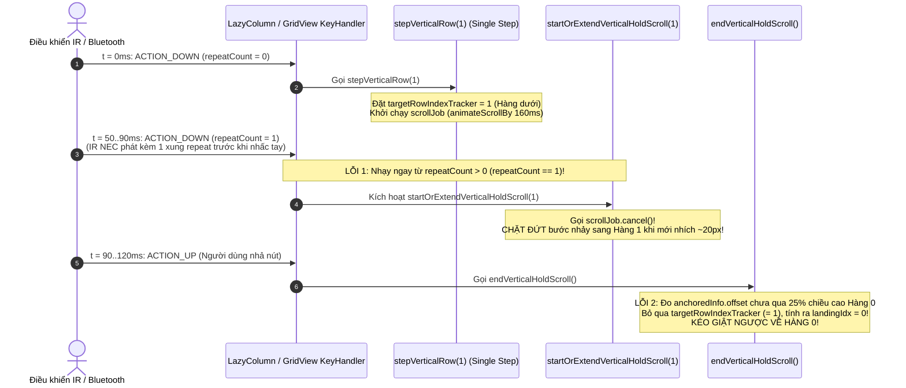
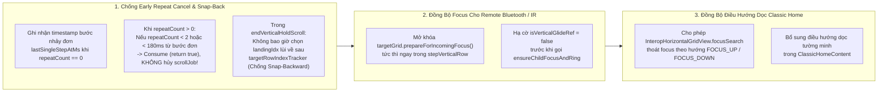

# Kế Hoạch Sửa Lỗi D-Pad Down Chỉ Nhận Khi Nhấn Giữ Trên Điều Khiển Bluetooth / Hồng Ngoại Ở Màn Hình Home

> **Mục tiêu**: Khắc phục triệt để lỗi trên một số Android TV Box sử dụng điều khiển Hồng ngoại (IR) hoặc Bluetooth khi bấm phím di chuyển xuống (D-Pad DOWN) 1 lần (single tap) không xuống được mà phải nhấn giữ (hold) mới xuống được ở màn hình Home, trong khi các mục khác hoạt động bình thường.

---

## 1. Phân Tích Hiện Trạng & Đặc Tính Điều Khiển (IR / Bluetooth)

### 1.1. Hiện Tượng Thực Tế
- **Thiết bị gặp lỗi**: Một số Android TV Box sử dụng **điều khiển Hồng ngoại (IR)** (driver `meson-ir`, `remotectl`, `sunxi-ir`...) hoặc **điều khiển Bluetooth / USB 2.4G** (có cấu hình key repeat nhạy hoặc tích hợp Air Mouse).
- **Biểu hiện**:
  - Tại màn hình **Home**: Bấm 1 lần nút `DPAD_DOWN` thì không xuống được hàng dưới (hoặc nhích nhẹ rồi bị kéo giật ngược lại hàng cũ).
  - Phải **nhấn giữ (Hold)** nút `DPAD_DOWN` thì mới di chuyển xuống được hàng tiếp theo.
  - Phím Trái / Phải / Enter ở màn hình Home và phím `DPAD_DOWN` ở tất cả các màn hình khác (Chi tiết phim, Tìm kiếm, Live TV, Cài đặt...) hoạt động hoàn toàn bình thường.

---

## 2. Nguyên Nhân Gốc Rễ (Root Cause Analysis - RCA)



### 2.1. Nguyên Nhân 1 (Trực tiếp nhất): Xung đột "Early Repeat Cancel & Snap-Back" khi Remote IR / Bluetooth phát `repeatCount = 1` trong một lần bấm
1. **Cơ chế phần cứng của điều khiển Hồng ngoại (IR) & Bluetooth**:
   - Theo giao thức Hồng ngoại NEC (chuẩn phổ biến nhất trên các Android TV Box), sau khi phát mã lệnh đầu tiên (`repeatCount = 0`), mắt nhận IR nhận ngay xung lặp đầu tiên sau ~40ms - 108ms. Nhiều điều khiển Bluetooth HID cũng có `repeat_delay` ngắn.
   - Khi người dùng bấm nút **Xuống** 1 lần bình thường (thời gian ngón tay ấn và nhả nút vật lý mất khoảng **80ms - 130ms**), hệ thống phát sinh chuỗi sự kiện:
     - `t = 0ms`: `ACTION_DOWN (repeatCount = 0)`
     - `t = 50ms - 100ms`: `ACTION_DOWN (repeatCount = 1)` *(phát sinh trước khi ngón tay kịp nhả nút)*
     - `t = 90ms - 130ms`: `ACTION_UP`
2. **Cách `ModernHomeRowsList.kt` & `ModernInteropHorizontalGridView.kt` xử lý sai chuỗi sự kiện này**:
   - **Tại `t = 0ms` (`repeatCount = 0`)**:
     - `stepVerticalRow(1)` được gọi: Đặt `targetRowIndexTracker = 1` (Hàng kế tiếp) và chạy `scrollJob` (`animateScrollBy` trong `160ms`).
   - **Tại `t = 50ms - 100ms` (`repeatCount = 1`)**:
     - Cả `LazyColumn.onPreviewKeyEvent` ([ModernHomeRowsList.kt](file:///f:/MyGithub/NuvioTV-Fast/app/src/main/java/com/nuvio/tv/ui/screens/home/ModernHomeRowsList.kt#L1235)), `ModernInteropHorizontalGridView.dispatchKeyEvent` ([ModernInteropHorizontalGridView.kt](file:///f:/MyGithub/NuvioTV-Fast/app/src/main/java/com/nuvio/tv/ui/screens/home/ModernInteropHorizontalGridView.kt#L635)) và `VerticalRingOverlayHost` ([ModernHomeRowsList.kt](file:///f:/MyGithub/NuvioTV-Fast/app/src/main/java/com/nuvio/tv/ui/screens/home/ModernHomeRowsList.kt#L178)) đều kiểm tra điều kiện **`if (event.repeatCount > 0)`**.
     - Chỉ với `repeatCount == 1`, hệ thống lập tức hiểu nhầm là người dùng đang "nhấn giữ cuộn nhanh" và gọi `startOrExtendVerticalHoldScroll(1)`.
     - Dòng 795 của `startOrExtendVerticalHoldScroll(1)` gọi **`scrollJob?.cancel()`** — **hủy bỏ ngay lập tức** animation bước nhảy 1 hàng của `stepVerticalRow(1)` khi danh sách mới chỉ nhích được ~15-30px!
   - **Tại `t = 90ms - 130ms` (`ACTION_UP` - kết thúc cú bấm 1 lần)**:
     - Hàm `endVerticalHoldScroll()` ([ModernHomeRowsList.kt](file:///f:/MyGithub/NuvioTV-Fast/app/src/main/java/com/nuvio/tv/ui/screens/home/ModernHomeRowsList.kt#L683-L696)) chạy để tìm hàng hạ cánh (`landingIdx`):
       ```kotlin
       val anchoredInfo = findAnchoredRowInfo(visible, probeY, lastNonEmptyIdx)
       val baseIdx = (anchoredInfo?.index ?: targetRowIndexTracker).coerceIn(0, lastNonEmptyIdx)
       val landingIdx = when {
           dir > 0 && anchoredInfo != null &&
               anchoredInfo.offset < -(anchoredInfo.size * 0.25f) && ... -> baseIdx + 1
           ...
           else -> baseIdx
       }
       ```
     - Vì `scrollJob` đã bị hủy giữa chừng và vận tốc khởi đầu của Hold Glide rất chậm (`520 dp/s`), Hàng 0 mới chỉ dịch chuyển được vài chục pixel (chưa vượt qua ngưỡng **25% chiều cao hàng** `-(anchoredInfo.size * 0.25f)`).
     - Do đó, `anchoredInfo` trả về **Hàng 0 (`baseIdx = 0`)** và `landingIdx` bằng **`0` (Hàng cũ)**!
     - `endVerticalHoldScroll()` ghi đè `targetRowIndexTracker` từ `1` ngược về `0`, ghi đè `navTargetRowKey` về Hàng 0, và gọi `animateScrollBy` **kéo giật màn hình ngược trở lại Hàng 0**!
3. **Tại sao Nhấn Giữ lại xuống được?**:
   - Khi cố tình **nhấn giữ** nút xuống đủ lâu (> 250ms), `verticalHoldJob` kéo Hàng 0 vượt qua 25% chiều cao hàng, lúc đó `endVerticalHoldScroll()` mới cho phép `landingIdx = baseIdx + 1`.
4. **Tại sao các mục khác và phím Trái/Phải lại bình thường trên cùng điều khiển đó?**:
   - Ở các màn hình khác và ở phím Trái/Phải trên Home: **Không có cơ chế Hold Glide hủy bước nhảy đơn rồi snap ngược về vị trí cũ**. Khi `repeatCount = 1` đến sớm (< 55ms hoặc < 115ms), các nơi khác chỉ đơn giản `return true` (bỏ qua xung repeat đầu) và bảo toàn 100% bước nhảy của `repeatCount = 0`.

---

### 2.2. Nguyên Nhân 2: Sự bất đối xứng khi xử lý Focus của Điều khiển Bluetooth (Air Mouse / TouchMode) & Khoá Focus Hàng Dưới
- Nhiều điều khiển Bluetooth / USB 2.4G có tích hợp chuột bay (Air Mouse) hoặc chế độ `TouchMode`. Khi focus chưa nằm sâu trong view con `LeanbackCardViewHolder.root` hoặc khi `targetGrid` của hàng dưới đang bị khóa `FOCUS_BLOCK_DESCENDANTS` (từ commit `276b0f1ca`):
  - Khi **nhấn giữ (`repeatCount > 0`)**: `LazyColumn.onPreviewKeyEvent` bắt sự kiện ngay từ tầng Compose gốc nên luôn cuộn được.
  - Khi **bấm 1 lần (`repeatCount == 0`)**: `LazyColumn.onPreviewKeyEvent` bỏ qua (`return false`), trong khi `targetGrid` ở hàng dưới chưa được mở khóa `descendantFocusability` trước khi `requestFocus()`, hoặc cờ `isVerticalGlideRef` chưa hạ trước khi gọi `ensureChildFocusAndRing`.

---

### 2.3. Nguyên Nhân 3 (Nếu thiết bị dùng giao diện Classic Home): `InteropHorizontalGridView.focusSearch` chặn thoát focus dọc
- Trong [InteropHorizontalGridView.kt](file:///f:/MyGithub/NuvioTV-Fast/app/src/main/java/com/nuvio/tv/ui/leanback/container/InteropHorizontalGridView.kt#L234-L258) (dùng cho `CatalogRowSection` ở Classic Home):
  - Hàm `focusSearch` chặn mọi kết quả nằm ngoài hàng (`!isChildOfThis(result)` trả về chính `focused`).
  - Khác với `SearchScreen` hay `MetaDetailsScreen` (đều truyền `onNavigateDown` tường minh vào `CatalogRowSection`), [ClassicHomeContent.kt](file:///f:/MyGithub/NuvioTV-Fast/app/src/main/java/com/nuvio/tv/ui/screens/home/ClassicHomeContent.kt#L864) **không truyền `onNavigateDown` / `onNavigateUp`**.
  - Hệ quả: Ở Classic Home, bấm 1 lần (`repeatCount == 0`) bị chặn cứng trong hàng; chỉ khi nhấn giữ (`repeatCount > 0`) thì `.dpadVerticalFastScroll` của `LazyColumn` mới kích hoạt và kéo xuống được.

---

## 3. Giải Pháp Kỹ Thuật Chi Tiết (Architecture Blueprint)



### 3.1. Chi Tiết Các Bước Sửa Đổi

#### Bước 1: Bảo vệ Bước Nhảy Đơn (`stepVerticalRow`) khỏi Xung Lặp Sớm của Remote IR / Bluetooth
- Trong `ModernHomeRowsList.kt` và `ModernInteropHorizontalGridView.kt`:
  1. Thêm biến theo dõi thời점 bước nhảy đơn gần nhất: `lastVerticalSingleStepAtMs` (dùng `SystemClock.uptimeMillis()`).
  2. Mỗi khi `stepVerticalRow(sign)` thực thi ở `repeatCount == 0`, cập nhật `lastVerticalSingleStepAtMs = SystemClock.uptimeMillis()`.
  3. Khi nhận sự kiện `DPAD_DOWN` / `DPAD_UP` với `repeatCount > 0`:
     - Kiểm tra ngưỡng kích hoạt Hold Glide:
       ```kotlin
       private const val VERTICAL_HOLD_MIN_REPEAT_COUNT = 2
       private const val VERTICAL_HOLD_GRACE_PERIOD_MS = 180L
       ```
     - Nếu ` verticalHoldDirectionRef.get() == 0` (chưa vào chế độ Hold Glide) mà `event.repeatCount < VERTICAL_HOLD_MIN_REPEAT_COUNT` HOẶC `(now - lastVerticalSingleStepAtMs) < VERTICAL_HOLD_GRACE_PERIOD_MS`:
       - **Chỉ consume sự kiện (`return true`) mà KHÔNG gọi `startOrExtendVerticalHoldScroll`!**
       - Điều này đảm bảo xung `repeatCount = 1` phát ra từ điều khiển Hồng ngoại (IR) / Bluetooth không bao giờ hủy `scrollJob` của phát bấm đơn đầu tiên.

#### Bước 2: Chặn Tuyệt Đối Hiện Tượng Kéo Giật Ngược Hàng (`Snap-Backward`) trong `endVerticalHoldScroll()`
- Trong `ModernHomeRowsList.kt` (`endVerticalHoldScroll`):
  - Sau khi tính `rawLandingIdx` từ `anchoredInfo`:
    - Nếu `dir > 0` (đang nhấn xuống):
      ```kotlin
      val landingIdx = maxOf(rawLandingIdx, targetRowIndexTracker).coerceIn(0, lastNonEmptyIdx)
      ```
    - Nếu `dir < 0` (đang nhấn lên):
      ```kotlin
      val landingIdx = minOf(rawLandingIdx, targetRowIndexTracker).coerceIn(0, lastNonEmptyIdx)
      ```
  - Đảm bảo một khi `stepVerticalRow` đã tiến tới hàng kế tiếp (`targetRowIndexTracker`), việc nhả nút không bao giờ kéo lùi người dùng về lại hàng cũ!

#### Bước 3: Mở Khóa Focus Tức Thời & Chuẩn Hóa `handoffOverlayToGrid`
- Trong `ModernInteropHorizontalGridView.kt`:
  - Thêm `prepareForIncomingFocus()` để mở `descendantFocusability = ViewGroup.FOCUS_AFTER_DESCENDANTS` ngay trên UI thread khi `stepVerticalRow` chọn hàng đích.
- Trong `ModernHomeRowsList.kt`:
  - Trong `handoffOverlayToGrid`, đặt `isVerticalGlideRef.set(false)` trước khi gọi `grid.ensureChildFocusAndRing(...)`.

#### Bước 4: Mở Khóa Focus Dọc Cho `InteropHorizontalGridView` (Classic Home)
- Trong `InteropHorizontalGridView.kt`:
  - Trong `focusSearch(focused: View?, direction: Int)`: Chỉ giữ focus nội bộ đối với phương ngang (`towardStartDir`, `towardEndDir`). Đối với phương dọc (`View.FOCUS_DOWN`, `View.FOCUS_UP`), trả về `super.focusSearch(focused, direction)` để hệ thống / Compose FocusManager chuyển focus xuống hàng dưới bình thường khi bấm 1 lần.

---

## 4. Kế Hoạch Triển Khai Từng Giai Đoạn (Phased Execution Plan)

### Giai Đoạn 1: Xử lý Xung Lặp Sớm (IR/Bluetooth) & Chống Snap-Backward trong `ModernHomeRowsList.kt`
- **File**: [ModernHomeRowsList.kt](file:///f:/MyGithub/NuvioTV-Fast/app/src/main/java/com/nuvio/tv/ui/screens/home/ModernHomeRowsList.kt)
- **Nhiệm vụ**:
  - Thêm `lastVerticalSingleStepAtMs` và ngưỡng bảo vệ `VERTICAL_HOLD_MIN_REPEAT_COUNT = 2` / `VERTICAL_HOLD_GRACE_PERIOD_MS = 180L` tại cả `LazyColumn.onPreviewKeyEvent` và `VerticalRingOverlayHost`.
  - Sửa công thức `landingIdx` trong `endVerticalHoldScroll()` để không bao giờ lùi ngược lại trước `targetRowIndexTracker`.
  - Chuẩn hóa thứ tự hạ cờ `isVerticalGlideRef` trong `handoffOverlayToGrid`.

### Giai Đoạn 2: Đồng Bộ Ngưỡng Repeat & Mở Khóa Focus trong `ModernInteropHorizontalGridView.kt`
- **File**: [ModernInteropHorizontalGridView.kt](file:///f:/MyGithub/NuvioTV-Fast/app/src/main/java/com/nuvio/tv/ui/screens/home/ModernInteropHorizontalGridView.kt)
- **Nhiệm vụ**:
  - Áp dụng cùng ngưỡng bảo vệ repeat (`repeatCount >= 2` và grace period `180ms`) trước khi gọi `onVerticalHoldScroll` trong `dispatchKeyEvent`.
  - Bổ sung `prepareForIncomingFocus()` để mở khóa ngay `descendantFocusability = FOCUS_AFTER_DESCENDANTS` khi chuyển hàng.

### Giai Đoạn 3: Khắc Phục `focusSearch` Trục Dọc trong `InteropHorizontalGridView.kt` (Classic Home)
- **File**: [InteropHorizontalGridView.kt](file:///f:/MyGithub/NuvioTV-Fast/app/src/main/java/com/nuvio/tv/ui/leanback/container/InteropHorizontalGridView.kt)
- **Nhiệm vụ**:
  - Cập nhật `focusSearch` để không chặn `View.FOCUS_DOWN` và `View.FOCUS_UP` khi `onNavigateDown` / `onNavigateUp` không xử lý.

### Giai Đoạn 4: Kiểm Thử & Nghiệm Thu (Verification)
- **Nhiệm vụ**:
  - Viết và chạy Unit Test kiểm chứng kịch bản Remote IR / Bluetooth gửi `ACTION_DOWN(repeatCount=0)` kèm `ACTION_DOWN(repeatCount=1)` sau 50ms rồi `ACTION_UP` sau 90ms.
  - Chạy toàn bộ test suite `com.nuvio.tv.ui.screens.home.*`.

---

## 5. Kế Hoạch Kiểm Thử & Nghiệm Thu (Verification Plan)

### 5.1. Kiểm Thử Tự Động (Automated Tests)
- Chạy lệnh kiểm thử Gradle:
  ```powershell
  ./gradlew testDebugUnitTest --tests "com.nuvio.tv.ui.screens.home.*"
  ```

### 5.2. Kiểm Thử Thực Tế Trên Thiết Bị (Manual Scenarios)
1. **Kịch bản Remote Hồng ngoại (IR) / Bluetooth bấm 1 lần (Single Press)**:
   - Bấm nút Xuống 1 lần bình thường (kể cả bấm nhanh hoặc bấm đằm tay ~100-150ms phát sinh `repeatCount = 1`).
   - *Kỳ vọng*: Màn hình luôn chuyển dứt khoát xuống hàng kế tiếp, tuyệt đối không bị hủy giữa chừng hay kéo giật ngược về hàng cũ.
2. **Kịch bản Nhấn Giữ (Long Hold)**:
   - Nhấn và giữ nút Xuống (> 200ms).
   - *Kỳ vọng*: Chế độ cuộn nhanh (Hold Glide) kích hoạt mượt mà, khi nhả nút hạ cánh chính xác tại hàng đang hiển thị.
3. **Kịch bản Classic Home & Modern Home**:
   - Kiểm tra cả 2 chế độ bố cục Home (Modern và Classic), bấm 1 lần nút Xuống đều di chuyển xuống hàng dưới mượt mà.

---

> [!IMPORTANT]
> **Điểm Cốt Lõi Của Bản Kế Hoạch Này**:
> Giải quyết trực tiếp sự khác biệt phần cứng của **Điều khiển Hồng ngoại (IR) & Bluetooth** (hiện tượng phát kèm xung `repeatCount = 1` trong một lần bấm đơn làm `startOrExtendVerticalHoldScroll` hủy mất `scrollJob` của `stepVerticalRow` và `endVerticalHoldScroll` kéo giật ngược về hàng cũ).
