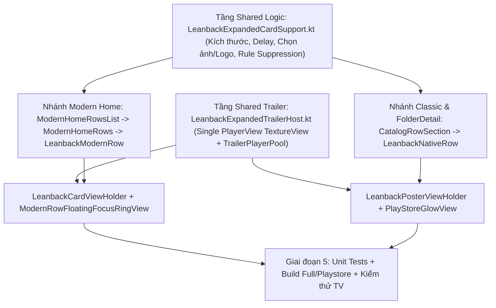

# PLAN: Khắc Phục Tính Năng "Mở Rộng Poster Đang Chọn Thành Phông Nền" (`PLAN-fix-focused-poster-backdrop-expand`)

> [!IMPORTANT]
> **Trạng thái**: Kế hoạch chiến lược chờ duyệt (`PRE-EXECUTION PLAN` — chưa chỉnh sửa bất kỳ file mã nguồn nào).  
> **Mục tiêu**: Khôi phục hoạt động đầy đủ, mượt 60fps cho tùy chọn **Mở rộng poster đang chọn thành phông nền** (`layout_expand_poster` / `focusedPosterBackdropExpandEnabled`) cùng các tùy chọn đi kèm (**Độ trễ mở rộng phông nền**, **Tự động phát trailer trong Thẻ mở rộng**, **Tắt tiếng trailer**, **Vị trí phát trailer**) trên toàn bộ kiến trúc **Android Leanback Native** của **Modern Home**, **Classic Home** và **FolderDetailScreen** — đồng thời giữ nguyên 100% hiệu năng cuộn, quản lý focus ring và tái sử dụng `RecycledViewPool`.

---

## 1. Phân Tích Nguyên Nhân Gốc Rễ (Root Cause Analysis)

### Chuỗi dữ liệu hiện tại & Hai điểm đứt gãy

Qua rà soát toàn bộ luồng từ `LayoutCardSettings.kt` → `LayoutPreferenceDataStore.kt` → `HomeViewModelPresentationPipeline.kt` → `HomeUiState.kt` → các màn hình Home và lớp Leanback Native:

1. **Tầng Cài đặt & Quản lý Trạng thái hoạt động bình thường**:
   - Người dùng bật/tắt cài đặt tại [LayoutCardSettings.kt](file:///f:/MyGithub/NuvioTV-Fast/app/src/main/java/com/nuvio/tv/ui/screens/settings/LayoutCardSettings.kt#L208-L275), lưu vào [LayoutPreferenceDataStore.kt](file:///f:/MyGithub/NuvioTV-Fast/app/src/main/java/com/nuvio/tv/data/local/LayoutPreferenceDataStore.kt#L89-L90) và đồng bộ đầy đủ vào [HomeUiState.kt](file:///f:/MyGithub/NuvioTV-Fast/app/src/main/java/com/nuvio/tv/ui/screens/home/HomeUiState.kt#L44-L49) qua [HomeViewModelPresentationPipeline.kt](file:///f:/MyGithub/NuvioTV-Fast/app/src/main/java/com/nuvio/tv/ui/screens/home/HomeViewModelPresentationPipeline.kt#L123-L137).
   - Trên Modern Home, bộ đếm trễ `LaunchedEffect` tại [ModernHomeContent.kt](file:///f:/MyGithub/NuvioTV-Fast/app/src/main/java/com/nuvio/tv/ui/screens/home/ModernHomeContent.kt#L293-L322) vẫn chạy đúng và cập nhật `expandedCatalogFocusKey.value = selection.focusKey` sau khoảng `focusedPosterBackdropExpandDelaySeconds`.

2. **Điểm đứt gãy #1 — Modern Home (`ModernHomeRowsList` → `LeanbackModernRow`)**:
   - Khi chuyển các hàng Modern Home từ Compose `ModernCarouselCard` sang **Leanback Native `HorizontalGridView`**, [ModernHomeRowsList.kt](file:///f:/MyGithub/NuvioTV-Fast/app/src/main/java/com/nuvio/tv/ui/screens/home/ModernHomeRowsList.kt#L464-L473) vẫn nhận đầy đủ các tham số `effectiveExpandEnabled`, `effectiveAutoplayEnabled`, `trailerPlaybackTarget`, `expandedCatalogFocusKey`, `expandedTrailerPreviewUrl`, `expandedTrailerPreviewAudioUrl`, `alwaysShowLandscapeClearlogo`, `focusedPosterBackdropTrailerMuted`, `onBackdropInteraction`, `onExpandedCatalogFocusKeyChange` — **nhưng hoàn toàn không truyền bất kỳ tham số nào xuống `ModernRowSection(...)`** ([ModernHomeRowsList.kt](file:///f:/MyGithub/NuvioTV-Fast/app/src/main/java/com/nuvio/tv/ui/screens/home/ModernHomeRowsList.kt#L2080-L2122)).
   - [ModernHomeRows.kt](file:///f:/MyGithub/NuvioTV-Fast/app/src/main/java/com/nuvio/tv/ui/screens/home/ModernHomeRows.kt#L267-L302), [LeanbackModernRow.kt](file:///f:/MyGithub/NuvioTV-Fast/app/src/main/java/com/nuvio/tv/ui/screens/home/LeanbackModernRow.kt#L30-L63) và [LeanbackModernRowAdapter.kt](file:///f:/MyGithub/NuvioTV-Fast/app/src/main/java/com/nuvio/tv/ui/screens/home/LeanbackModernRowAdapter.kt#L248-L297) chỉ dựng thẻ cố định `cardWidthPx × cardHeightPx`, không có cơ chế mở rộng `16:9`, không chuyển ảnh sang backdrop/landscapePoster, không vẽ gradient + clearlogo/title, và không hỗ trợ phát trailer bên trong thẻ mở rộng (`EXPANDED_CARD`).
   - Ngoài ra, [ModernRowFloatingFocusRingView.kt](file:///f:/MyGithub/NuvioTV-Fast/app/src/main/java/com/nuvio/tv/ui/screens/home/ModernRowFloatingFocusRingView.kt#L242-L316) đang neo cứng tọa độ X theo mép đầu hàng (`computeAnchoredRingX`) và chỉ resize khi gọi `moveToTarget`, chưa đồng bộ kích thước/vị trí thực tế khi thẻ mở rộng hoặc ở cuối hàng ngắn.

3. **Điểm đứt gãy #2 — Classic Home & FolderDetail (`CatalogRowSection` → `LeanbackNativeRow`)**:
   - Tại [CatalogRowSection.kt](file:///f:/MyGithub/NuvioTV-Fast/app/src/main/java/com/nuvio/tv/ui/components/CatalogRowSection.kt#L57-L63), toàn bộ 7 tham số của tính năng mở rộng poster và trailer trong thẻ mở rộng đang bị vô hiệu hóa bằng `@Suppress("UNUSED_PARAMETER")`:
     - `focusedPosterBackdropExpandEnabled`
     - `focusedPosterBackdropExpandDelaySeconds`
     - `focusedPosterBackdropTrailerEnabled`
     - `focusedPosterBackdropTrailerMuted`
     - `trailerPreviewUrls` / `trailerPreviewAudioUrls` / `onRequestTrailerPreview`
   - Do đó cả [ClassicHomeContent.kt](file:///f:/MyGithub/NuvioTV-Fast/app/src/main/java/com/nuvio/tv/ui/screens/home/ClassicHomeContent.kt#L1095-L1101) lẫn [FolderDetailScreen.kt](file:///f:/MyGithub/NuvioTV-Fast/app/src/main/java/com/nuvio/tv/ui/screens/collection/FolderDetailScreen.kt#L800-L805) đều truyền dữ liệu vào ngõ cụt.
   - [LeanbackCardItem.kt](file:///f:/MyGithub/NuvioTV-Fast/app/src/main/java/com/nuvio/tv/ui/leanback/model/LeanbackCardItem.kt#L17-L29), [LeanbackNativeRow.kt](file:///f:/MyGithub/NuvioTV-Fast/app/src/main/java/com/nuvio/tv/ui/leanback/LeanbackNativeRow.kt#L46-L80), [LeanbackUniversalAdapter.kt](file:///f:/MyGithub/NuvioTV-Fast/app/src/main/java/com/nuvio/tv/ui/leanback/adapter/LeanbackUniversalAdapter.kt#L28-L39) và [LeanbackPosterViewHolder.kt](file:///f:/MyGithub/NuvioTV-Fast/app/src/main/java/com/nuvio/tv/ui/leanback/holder/LeanbackPosterViewHolder.kt#L32-L53) chưa mang dữ liệu backdrop/logo/metadata mở rộng và chưa có cơ chế mở rộng kích thước card + `PlayStoreGlowView` + nhãn thông tin chi tiết + trailer.

---

## 2. Kiến Trúc Giải Pháp & Chuỗi Phụ Thuộc (Architecture & Dependency Chains)

### Sơ đồ phụ thuộc kiến trúc



### Quy tắc thiết kế cốt lõi (Khớp đặc tả chuẩn NuvioTV + Tối ưu 60fps Leanback)

| Khía cạnh | Quy chuẩn áp dụng |
| :--- | :--- |
| **Tỷ lệ mở rộng** | Poster dọc (`!isLandscape`): `expandedWidthPx = (cardHeightPx * 16f / 9f).roundToInt().coerceAtLeast(cardWidthPx)`. Poster ngang (`isLandscape`): giữ nguyên `cardWidthPx` (chỉ đổi overlay/metadata/trailer, không đổi width). |
| **Phạm vi thẻ được phép mở rộng** | Chỉ mở rộng thẻ Catalog thực sự (`ModernPayload.Catalog` hoặc `LeanbackCardItem.Poster` có `!isSeeAll && !isPlaceholder`). **Không** mở rộng Continue Watching, Upcoming, CollectionFolder, See All, hay Placeholder shimmer. |
| **Tôn trọng `HERO_MEDIA_NO_EXPAND`** | Trên Modern Home, nếu `effectiveAutoplayEnabled && trailerPlaybackTarget == FocusedPosterTrailerPlaybackTarget.HERO_MEDIA_NO_EXPAND` thì **chặn mở rộng thẻ** (`suppressCardExpansionForHeroTrailer = true`), chỉ phát trailer ở Hero phía trên đúng như thiết kế của commit `4ad1e8bc4`. |
| **Quy tắc chọn ảnh & Clearlogo khi mở rộng** | - Nếu `!alwaysShowLandscapeClearlogo && !landscapePoster.isNullOrBlank()`: hiển thị `landscapePoster` (không đè gradient + clearlogo, trừ khi trailer đã render frame đầu).<br>- Ngược lại: hiển thị `backdropUrl` (ưu tiên `enrichedBackdropUrl` → `backdrop` → `poster`), phủ gradient đen đáy (`0%..45% Transparent` → `100% Black 0.76f`) + `clearlogo` (`FIT_START`, chiều cao ~`34% cardHeightPx`, rộng tối đa `62–75%`) hoặc fallback `title` màu trắng (tối đa 2 dòng). |
| **Chống nhấp nháy & Prefetch 0ms** | - Ngay khi thẻ Catalog giữ focus ổn định (~150ms), prefetch sẵn ảnh backdrop (`expandedWidthPx × cardHeightPx`) và clearlogo vào Coil MemoryCache.<br>- Khi chuyển từ poster → backdrop, **giữ nguyên drawable hiện tại cho tới khi ảnh backdrop tải xong** (không xóa `setImageDrawable(null)` về nền xám). |
| **Animation & Viền Focus 60fps** | - Khi `animationsEnabled == true`: chạy `ValueAnimator.ofInt(startW, targetW)` (`160ms`, `DecelerateInterpolator`) cập nhật `cardContainer.layoutParams.width`, `root.layoutParams.width`, `glowView.layoutParams.width` (Classic) hoặc đồng bộ `ModernRowFloatingFocusRingView` (Modern).<br>- Khi thu gọn (mất focus, nhấn phím điều hướng, chuyển hàng, mở sidebar, hoặc `unbind()` vào pool): **hủy animator và snap ngay về `cardWidthPx`**. |
| **Đồng bộ Focus Ring (Modern)** | Trong lúc `ModernRowFloatingFocusRingView` chạy resize theo thẻ mở rộng: tạm hạ `LAYER_TYPE_SOFTWARE` trong `160ms` animation (chỉ vẽ viền hardware sắc nét), bật lại software blur glow ngay khi kết thúc để tránh cấp phát bitmap software mỗi frame; đồng thời căn `translationX` theo tọa độ thực `offsetDescendantRectToMyCoords` khi thẻ mở rộng nằm gần cuối hàng ngắn (không bị lệch khỏi thẻ ở cả LTR & RTL). |
| **Tránh tràn mép phải (Viewport Fit)** | Khi một thẻ gần cuối hàng mở rộng khiến `cardRight > gridView.width - gridView.paddingEnd` (hoặc `< paddingStart` ở RTL), cuộn ngang nhẹ đúng phần bị tràn (`smoothScrollBy`) để thẻ mở rộng luôn hiển thị trọn vẹn. |
| **Nhãn bên dưới (Classic & FolderDetail)** | Khi `focusedPosterBackdropExpandEnabled && showLabels`: cố định sẵn chiều cao vùng nhãn (`~60dp * fontScale`) để chiều cao hàng (`totalRowHeightPx`) **không bao giờ thay đổi**. Khi mở rộng, chuyển nhãn thành dòng metadata (`Loại • Thể loại • Số mùa • Năm • ★ IMDb` + badge `ageRating`) và tối đa 2 dòng `description`. |
| **Tự động phát Trailer trong Thẻ mở rộng** | Sử dụng **một đối tượng `LeanbackExpandedTrailerHost` duy nhất** gắn on-demand vào `trailerContainer` của đúng ViewHolder đang mở rộng (`R.layout.trailer_player_view` dùng `TextureView` tôn trọng `clipToOutline` bo góc). Tái sử dụng `TrailerPlayerPool` singleton hiện có, cập nhật `onOwnerBounds` cho tính năng *Tiếp tục trailer trong Chi tiết*, che bằng backdrop cover fade-out khi `onRenderedFirstFrame()`, và `detach + stopIfOwner` ngay khi mất focus / cuộn / rời màn hình / `unbind()`. |

> [!WARNING]
> **Rủi ro kỹ thuật & Biện pháp phòng ngừa bắt buộc**:
> 1. **Ô nhiễm `RecycledViewPool`**: Nếu một `ViewHolder` bị recycle khi đang mở rộng hoặc đang chạy `ValueAnimator` / đang gắn `PlayerView`, thẻ tái sử dụng sau đó sẽ bị méo kích thước hoặc kẹt video. **Bắt buộc**: trong `unbind()` và `onViewDetachedFromWindow`, hủy `ValueAnimator`, detach `LeanbackExpandedTrailerHost`, ẩn overlay backdrop/logo/metadata mở rộng, và reset `layoutParams.width = cardWidthPx` ngay lập tức.
> 2. **Reset timer khi giữ phím Center/Enter (Long-press Menu — #2574)**: Phím điều hướng (`DPAD_LEFT/RIGHT/UP/DOWN`, `BACK`) mới được phép thu gọn và kích hoạt lại timer (`onBackdropInteraction()`); **tuyệt đối không reset timer khi nhấn `DPAD_CENTER` / `ENTER`**, tránh làm thẻ co giật khi người dùng nhấn giữ mở menu tùy chọn.
> 3. **Focus rời sang Sidebar hoặc cuộn dọc (#2815)**: Thẻ chỉ được phép mở rộng khi `root.hasFocus()` thực sự đang true, hàng đang là hàng active, không trong trạng thái `isHoldingHorizontalKey`, không trong `isVerticalGlideActive` / `isScrollInProgress`, và Sidebar đang đóng.
> 4. **Flavor Playstore (`AppFeaturePolicy.inAppTrailerPlaybackEnabled == false`)**: Chỉ tắt nhánh phát trailer trong thẻ mở rộng; phần **mở rộng poster thành phông nền (ảnh backdrop + clearlogo + metadata)** vẫn phải hoạt động bình thường trên cả flavor `Full` và `Playstore`.

---

## 3. Phân Chia Giai Đoạn Thực Thi & Phân Công Chuyên Môn (Phase-by-Phase Breakdown)

### Giai đoạn 1 — Xây dựng Tầng Dùng Chung (Core Logic & Shared Trailer Host)
*Chuyên môn phụ trách*: **Android Architecture / Media Specialist**

- **`[T1.1]` Tạo [LeanbackExpandedCardSupport.kt](file:///f:/MyGithub/NuvioTV-Fast/app/src/main/java/com/nuvio/tv/ui/leanback/core/LeanbackExpandedCardSupport.kt)**:
  - Chứa các hằng số chuẩn (`BACKDROP_ASPECT_RATIO = 16f / 9f`, `EXPAND_ANIMATION_DURATION_MS = 160L`, `MIN_EXPAND_DEBOUNCE_MS = 150L`, `CLASSIC_ZERO_DELAY_DEBOUNCE_MS = 370L`).
  - Các pure functions dễ kiểm thử đơn vị:
    - `computeExpandedCardWidthPx(baseWidthPx, cardHeightPx, isLandscape): Int`
    - `computeExpandDelayMs(delaySeconds, isModern): Long`
    - `shouldSuppressModernCardExpansion(effectiveAutoplayEnabled, trailerPlaybackTarget): Boolean`
    - `resolveExpandedMediaVisuals(...)`: trả về model chọn ảnh (`backdropUrl` vs `landscapePoster` vs fallback `poster`), cờ hiển thị gradient, cờ hiển thị clearlogo/title.
    - `buildExpandedMetaTokens(item, showImdbRatings, genreTranslator): List<String>` (cho Classic/FolderDetail).
    - `shouldResetExpandTimerForKeyCode(keyCode): Boolean` (loại trừ `DPAD_CENTER` / `ENTER` / `NUMPAD_ENTER`).
- **`[T1.2]` Tạo [LeanbackExpandedTrailerHost.kt](file:///f:/MyGithub/NuvioTV-Fast/app/src/main/java/com/nuvio/tv/ui/leanback/core/LeanbackExpandedTrailerHost.kt)**:
  - Quản lý vòng đời 1 `PlayerView` (`R.layout.trailer_player_view`, `TextureView`) gắn/gỡ động vào `FrameLayout` bên trong thẻ đang mở rộng.
  - Kết nối `TrailerPlayerPool` (`acquire()`, `onMediaLoaded()`, `onOwnerBounds()`, `stopIfOwner()`, `claimHandoff()`), hỗ trợ `MergingMediaSource` (video + audio tách rời của YouTube 1080p/4K qua `YoutubeChunkedDataSourceFactory`), cờ `muted`, `cropToFill` (`RESIZE_MODE_ZOOM` + `overscanZoom` trên Modern, `RESIZE_MODE_FIT` + nền đen trên Classic), lắng nghe `onRenderedFirstFrame()` / `onEnded()` / `onError()` và tự dừng khi Lifecycle chuyển `ON_PAUSE`/`ON_STOP`.

### Giai đoạn 2 — Khôi Phục Mở Rộng Poster Trên Modern Home
*Chuyên môn phụ trách*: **Leanback Home UI Specialist**

- **`[T2.1]` Nối lại trạng thái mở rộng qua [ModernHomeRowsList.kt](file:///f:/MyGithub/NuvioTV-Fast/app/src/main/java/com/nuvio/tv/ui/screens/home/ModernHomeRowsList.kt) & [ModernHomeRows.kt](file:///f:/MyGithub/NuvioTV-Fast/app/src/main/java/com/nuvio/tv/ui/screens/home/ModernHomeRows.kt)**:
  - Đọc `expandedCatalogFocusKey`, `enrichedPreviews`, `trailerPreviewUrls`, `trailerPreviewAudioUrls`, `effectiveExpandEnabled`, `effectiveAutoplayEnabled`, `trailerPlaybackTarget`, `alwaysShowLandscapeClearlogo`, `focusedPosterBackdropTrailerMuted`, `onBackdropInteraction`, `onExpandedCatalogFocusKeyChange` và truyền xuống đúng `ModernRowSection` đang sở hữu thẻ mở rộng (tối ưu: chỉ truyền `expandedItemKey: String?` khác `null` cho đúng hàng chứa thẻ đó để tránh recompose các hàng còn lại!).
  - Áp dụng `shouldSuppressModernCardExpansion` để tôn trọng `HERO_MEDIA_NO_EXPAND`.
  - Bổ sung cập nhật `onBackdropInteraction()` khi nhấn phím điều hướng trong `ModernInteropHorizontalGridView` mà thẻ đang mở rộng hoặc đang chờ đếm trễ.
- **`[T2.2]` Mở rộng [LeanbackModernRow.kt](file:///f:/MyGithub/NuvioTV-Fast/app/src/main/java/com/nuvio/tv/ui/screens/home/LeanbackModernRow.kt) & [LeanbackModernRowAdapter.kt](file:///f:/MyGithub/NuvioTV-Fast/app/src/main/java/com/nuvio/tv/ui/screens/home/LeanbackModernRowAdapter.kt)**:
  - Thêm các lớp view gọn nhẹ vào `LeanbackCardViewHolder` (khởi tạo `GONE` để không tốn draw cost khi không mở rộng):
    - `mediaClipContainer` (clip `cornerRadiusPx` chung cho ảnh + trailer + gradient).
    - `trailerSlotContainer` (`FrameLayout` trống để attach/detach `LeanbackExpandedTrailerHost` khi phát trailer `EXPANDED_CARD`).
    - `expandedBackdropImage` (`ImageView` crossfade mượt từ poster sang backdrop mà không nháy placeholder).
    - `expandedGradientView` (`View` với `GradientDrawable` Bottom-to-Top).
    - `expandedLogoImage` (`ImageView` `FIT_START` ở `BOTTOM|START`) và `expandedTitleText` (`TextView` trắng fallback khi không có/lỗi logo).
  - Bổ sung `ValueAnimator` mở rộng/thu gọn `width` (`cardWidthPx` ↔ `expandedWidthPx`) + cơ chế prefetch backdrop/logo sớm khi focus ổn định + bảo đảm `unbind()` hủy animator, detach trailer và reset width tuyệt đối.
  - Bổ sung hàm `setExpandedState(...)` trên `LeanbackRowAdapter` cập nhật trực tiếp `ViewHolder` đang hiển thị (không cần `notifyItemChanged` toàn hàng gây chớp focus!).
- **`[T2.3]` Đồng bộ [ModernRowFloatingFocusRingView.kt](file:///f:/MyGithub/NuvioTV-Fast/app/src/main/java/com/nuvio/tv/ui/screens/home/ModernRowFloatingFocusRingView.kt) & [ModernInteropHorizontalGridView.kt](file:///f:/MyGithub/NuvioTV-Fast/app/src/main/java/com/nuvio/tv/ui/screens/home/ModernInteropHorizontalGridView.kt)**:
  - Thêm `syncExpandedTargetBounds(target: View, isAnimatingWidth: Boolean)` trên `ModernRowFloatingFocusRingView`: tự động cập nhật `width`, `translationX` (bám đúng `target` thực tế cả khi thẻ ở cuối hàng ngắn, cả LTR và RTL), và tối ưu `LAYER_TYPE_NONE` trong lúc đang kéo giãn chiều rộng → bật lại `LAYER_TYPE_SOFTWARE` glow sau khi animation dừng.
  - Tự động điều chỉnh cuộn ngang nhẹ (`ensureExpandedCardInViewport`) nếu thẻ mở rộng bị chạm mép màn hình.
  - Thu gọn tức thì khi người dùng bắt đầu hold-scroll ngang hoặc vertical glide.

### Giai đoạn 3 — Khôi Phục Mở Rộng Poster Trên Classic Home & FolderDetailScreen
*Chuyên môn phụ trách*: **Leanback Universal Components Specialist**

- **`[T3.1]` Mở rộng model [LeanbackCardItem.kt](file:///f:/MyGithub/NuvioTV-Fast/app/src/main/java/com/nuvio/tv/ui/leanback/model/LeanbackCardItem.kt)**:
  - Bổ sung các thuộc tính tùy chọn có giá trị mặc định (giữ tương thích ngược 100% với Search/Library/Detail) vào `LeanbackCardItem.Poster`:
    - `backdropUrl: String? = null`
    - `landscapePosterUrl: String? = null`
    - `logoUrl: String? = null`
    - `description: String? = null`
    - `ageRating: String? = null`
    - `expandedMetaTokens: List<String> = emptyList()`
- **`[T3.2]` Nối lại logic trong [CatalogRowSection.kt](file:///f:/MyGithub/NuvioTV-Fast/app/src/main/java/com/nuvio/tv/ui/components/CatalogRowSection.kt)**:
  - Gỡ bỏ `@Suppress("UNUSED_PARAMETER")` cho toàn bộ 7 tham số mở rộng & trailer.
  - Điền đủ `backdropUrl`, `landscapePosterUrl`, `logoUrl`, `description`, `ageRating`, `expandedMetaTokens` vào `LeanbackCardItem.Poster` (chỉ tính `expandedMetaTokens` khi `focusedPosterBackdropExpandEnabled` bật để không tốn chi phí thừa ở các màn khác).
  - Quản lý `LaunchedEffect` bộ đếm trễ mở rộng cho thẻ đang focus trong hàng (dựa trên `focusedPosterBackdropExpandEnabled`, `focusedPosterBackdropExpandDelaySeconds`, `rowHasFocusRef`, `LocalSidebarExpanded`, `LocalLifecycleOwner`, `interactionNonce`, loại trừ `SEE_ALL` và `__placeholder_*`).
  - Kích hoạt `onRequestTrailerPreview` khi cần (nhất là trên `FolderDetailScreen` chưa có sẵn timer request trailer như `ClassicHomeContent`).
  - Truyền cấu hình mở rộng, `expandedItemKey`, `alwaysShowLandscapeClearlogo` (`LocalAlwaysBackdropWithLogo.current`), `trailerPreviewUrl`, `trailerPreviewAudioUrl`, `focusedPosterBackdropTrailerMuted`, `onTrailerEnded`, `onBackdropInteraction` xuống `LeanbackNativeRow`.
- **`[T3.3]` Nâng cấp [LeanbackNativeRow.kt](file:///f:/MyGithub/NuvioTV-Fast/app/src/main/java/com/nuvio/tv/ui/leanback/LeanbackNativeRow.kt), [LeanbackUniversalAdapter.kt](file:///f:/MyGithub/NuvioTV-Fast/app/src/main/java/com/nuvio/tv/ui/leanback/adapter/LeanbackUniversalAdapter.kt), [LeanbackPosterViewHolder.kt](file:///f:/MyGithub/NuvioTV-Fast/app/src/main/java/com/nuvio/tv/ui/leanback/holder/LeanbackPosterViewHolder.kt) & [InteropHorizontalGridView.kt](file:///f:/MyGithub/NuvioTV-Fast/app/src/main/java/com/nuvio/tv/ui/leanback/container/InteropHorizontalGridView.kt)**:
  - Khi `backdropExpandEnabled && showLabels`: giữ cố định `labelHeightDp` đủ cho vùng metadata + 2 dòng mô tả (`60dp * fontScale`) để hàng không bị nhảy chiều cao khi mở rộng.
  - Thêm các view mở rộng trong `LeanbackPosterViewHolder` (mặc định `GONE`): `trailerSlotContainer`, `expandedBackdropImage`, `expandedGradientView`, `expandedLogoImage`, `expandedOverlayTitleText`, `expandedMetaContainer` (`metaTokensText` + `ageRatingBadge`), `expandedDescriptionText`.
  - Cập nhật đồng bộ `cardContainer.width`, `root.width`, `glowView.width`, và `focusBorderDrawable` (tự redraw theo bounds mới của `cardContainer`) theo từng frame `ValueAnimator`, kèm tự cuộn vào viewport nếu tràn mép phải và dọn sạch hoàn toàn trong `unbind()`.
  - Tích hợp `LeanbackExpandedTrailerHost` cho `Autoplay Trailer in Expanded Card` trên Classic Home & FolderDetail.

### Giai đoạn 4 — Tinh Chỉnh Edge Cases & Tương Tác Chéo (Integration Polish)
*Chuyên môn phụ trách*: **QA / Integration Engineer**

- **`[T4.1]` Kiểm tra tương tác với `FolderDetailScreen.kt` & `ClassicHomeContent.kt`**:
  - Đảm bảo `FolderDetailScreen` khi ở chế độ `FollowLayoutContent` (Modern và Classic) và `RowsContent` đều truyền `onRequestTrailerPreview` và xử lý `LocalAlwaysBackdropWithLogo` nhất quán với `HomeScreen`.
  - Đảm bảo khi chuyển layout trong Cài đặt (Modern ↔ Classic ↔ Grid) hoặc bật/tắt `modernLandscapePostersEnabled`, trạng thái mở rộng và trailer host cũ được thu gọn & giải phóng sạch.
- **`[T4.2]` Kiểm tra tương thích `Continue Trailer in Details` & `Playstore` flavor**:
  - Xác nhận khi người dùng bấm mở trang Chi tiết ngay khi trailer đang chạy trong thẻ mở rộng, `TrailerPlayerPool` có đủ `ownerBounds` và `loadedVideoUrl` để bàn giao mượt mà (nếu bật `focusedPosterTrailerContinueInDetails`).
  - Xác nhận trên flavor `Playstore` (`AppFeaturePolicy.inAppTrailerPlaybackEnabled = false`), poster vẫn mở rộng ra ảnh backdrop + clearlogo bình thường mà không cố khởi tạo trailer.

### Giai đoạn 5 — Kiểm Thử Tự Động & Nghiệm Thu Toàn Diện
*Chuyên môn phụ trách*: **Test & Verification Engineer**

- **`[T5.1]` Viết Unit Tests mới (`LeanbackExpandedCardSupportTest.kt`)**:
  - Kiểm thử `computeExpandedCardWidthPx` (portrait 2:3 → 16:9, landscape giữ nguyên, giá trị biên).
  - Kiểm thử `computeExpandDelayMs` (`0s` debounce an toàn, `1..10s`).
  - Kiểm thử `shouldSuppressModernCardExpansion` cho cả 3 chế độ `EXPANDED_CARD`, `HERO_MEDIA`, `HERO_MEDIA_NO_EXPAND` khi autoplay bật/tắt.
  - Kiểm thử `resolveExpandedMediaVisuals` cho đủ tổ hợp `landscapePoster`, `backdrop`, `poster`, `alwaysShowLandscapeClearlogo`, `trailerFirstFrameRendered`.
  - Kiểm thử `shouldResetExpandTimerForKeyCode` (D-Pad/Back trả `true`; Center/Enter trả `false`).
  - Kiểm thử `buildExpandedMetaTokens` (Movie, Series có số mùa, IMDb bật/tắt, khoảng năm `2020–2024`).
- **`[T5.2]` Chạy Build & Regression Tests**:
  - Biên dịch cả 2 biến thể `FullDebug` và `PlaystoreDebug`.
  - Chạy toàn bộ test suite `com.nuvio.tv.ui.leanback.*`, `com.nuvio.tv.ui.screens.home.*`, `com.nuvio.tv.core.player.*`.
- **`[T5.3]` Kiểm thử thủ công trên Android TV / Emulator**:
  - Xác minh theo bảng kịch bản ở Mục 4.

---

## 4. Kế Hoạch Kiểm Chứng (Verification Plan)

### A. Kiểm chứng Tự động (Automated)
```powershell
.\gradlew.bat :app:compileFullDebugKotlin :app:compilePlaystoreDebugKotlin :app:testFullDebugUnitTest `
  --tests "com.nuvio.tv.ui.leanback.*" `
  --tests "com.nuvio.tv.ui.screens.home.*" `
  --tests "com.nuvio.tv.core.player.*"
```

### B. Kiểm chứng Thủ công trên Thiết bị TV / Giả lập (Manual Checklist)
1. **Modern Home (Poster dọc)**:
   - Bật *Mở rộng poster đang chọn thành phông nền*, đặt độ trễ `1s` và `3s` → dừng ở một poster Catalog → sau đúng thời gian chờ, poster mở rộng mượt sang tỷ lệ `16:9`, hiện ảnh backdrop + gradient + clearlogo (hoặc tiêu đề trắng), viền focus & glow ôm sát khung mở rộng không lệch.
   - Bấm D-Pad Trái/Phải/Lên/Xuống → thẻ thu gọn ngay lập tức không kẹt width; giữ lì D-Pad cuộn nhanh vẫn mượt 60fps.
   - Dừng ở thẻ *Continue Watching*, *Upcoming*, *Collection Folder*, hoặc di chuyển sang *Sidebar* → thẻ không mở rộng hoặc lập tức thu gọn.
   - Dừng ở thẻ gần cuối hàng (hoặc hàng ít phim) → thẻ mở rộng không bị cắt mép phải, viền focus ôm khít thẻ.
   - Nhấn giữ nút OK/Center trên thẻ đang mở rộng để mở menu ngữ cảnh → thẻ không bị giật co lại rồi mở ra.
2. **Modern Home + Tự động phát Trailer**:
   - Vị trí phát = **Thẻ mở rộng**: thẻ mở rộng sang `16:9` và phát trailer bên trong khung bo góc, ẩn lớp phủ backdrop khi khung hình đầu tiên xuất hiện, tắt tiếng đúng cài đặt; kết thúc trailer thì thu gọn lại.
   - Vị trí phát = **Khu vực Nổi bật**: thẻ vẫn mở rộng ảnh backdrop, trailer phát ở Hero phía trên.
   - Vị trí phát = **Khu vực Nổi bật (Không Mở rộng)**: thẻ giữ nguyên kích thước poster dọc, trailer phát ở Hero phía trên.
   - Chế độ **Poster ngang (Landscape)** + Autoplay Trailer ở **Thẻ mở rộng**: thẻ giữ nguyên kích thước `16:9` và phát trailer ngay trong thẻ.
3. **Classic Home & FolderDetailScreen**:
   - Bật *Mở rộng poster đang chọn thành phông nền* → dừng ở poster Catalog → mở rộng sang `16:9`, hiển thị ảnh backdrop + clearlogo + dòng metadata + mô tả bên dưới mà **không làm nhảy giật chiều cao hàng**.
   - Bật *Tự động phát trailer trong Thẻ mở rộng* → trailer phát đúng bên trong thẻ mở rộng.
   - Dừng ở thẻ *Xem tất cả (See All)* → không mở rộng.
4. **Hiệu năng & Cài đặt phụ trợ**:
   - Tắt *Hoạt ảnh (Animations)* → thẻ mở rộng/thu gọn snap tức thì không lỗi layout.
   - Cuộn dài qua 50+ thẻ rồi quay lại → không có thẻ nào bị dính kích thước mở rộng cũ từ `RecycledViewPool`.
   - Kiểm tra cả hướng giao diện RTL (ví dụ tiếng Ả Rập) → viền focus và hướng mở rộng không bị lệch tọa độ.

---

## 5. Xác Nhận Tuân Thủ Quy Tắc Dự Án (`DNA_REF` Validation)

- [x] **No Code Violation**: Chưa sửa đổi bất kỳ file mã nguồn nào trong bước `/plan`.
- [x] **Language Protocol**: Tài liệu bằng Tiếng Việt; tên lớp/hàm/biến/comment thiết kế bằng Tiếng Anh chuẩn codebase.
- [x] **Code Quality (`code-quality.md`)**: Tách hằng số, không dùng magic numbers, tách logic tính toán thuần túy thành các hàm ngắn gọn dễ test >80% coverage.
- [x] **Systematic Debugging (`debug.md`)**: Sửa tận gốc ở cả 2 nhánh Modern & Classic Leanback thay vì vá triệu chứng, kèm unit test và regression checks.
- [x] **Docs Sync (`docs-update.md`)**: Không thêm skill/workflow/rule/agent mới nên không phát sinh thay đổi tài liệu `.agent/`.
