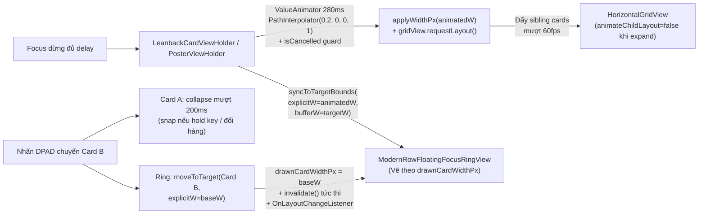

# Kế Hoạch Khắc Phục Lỗi Co Giãn Poster & Khung Viền Khi Mở Rộng Thành Phông Nền

> [!IMPORTANT]
> **Mục tiêu cốt lõi**: Khôi phục hoàn toàn hiệu ứng **co giãn mượt mà cả 2 chiều (giãn ra 16:9 & co vào 2:3)** tương đương bản gốc Compose và **chấm dứt triệt để lỗi khung viền (`ModernRowFloatingFocusRingView` / `PlayStoreGlowView`) không co lại** khi chuyển focus sang poster khác, áp dụng đồng bộ cho cả **Modern Home**, **Classic Home**, và **Collection FolderDetail** — đồng thời giữ nguyên quy tắc **chỉ phát trailer khi người dùng bật tự động phát trailer**.

---

## 1. Phân Tích Tận Gốc Nguyên Nhân (Root-Cause Diagnosis)

Toàn bộ 2 triệu chứng người dùng gặp khi test trực tiếp trên thiết bị đã được truy vết chính xác tới từng dòng mã nguồn:

### 1.1. Lỗi 1: Không có hiệu ứng co giãn ra/vào mượt như bản gốc

| # | Nguyên nhân gốc rễ (Đã xác minh) | Vị trí mã nguồn | Hệ quả trực tiếp trên TV |
|---|---|---|---|
| **R1** | **`ValueAnimator.cancel()` luôn gọi đồng bộ `onAnimationEnd()`**: trong Android Framework, hủy animator vẫn chạy `onAnimationEnd()`, mà handler hiện tại không kiểm tra cờ `isCancelled` nên lập tức gọi `applyWidthPx(targetWidthPx, heightPx)` (nhảy thẳng lên 16:9!). Khi `snapshotFlow` bắn lại do `enrichedPreviews` hoặc `trailerUrl` vừa cập nhật trong 160ms đầu, `applyExpandedState` gọi lại `animateOrSnapWidth` → `cancel()` → nhảy bụp lên `targetWidthPx` → `startW == targetWidthPx` → thoát luôn không chạy animation! | [LeanbackModernRowAdapter.kt](file:///f:/MyGithub/NuvioTV-Fast/app/src/main/java/com/nuvio/tv/ui/screens/home/LeanbackModernRowAdapter.kt#L656-L708), [LeanbackPosterViewHolder.kt](file:///f:/MyGithub/NuvioTV-Fast/app/src/main/java/com/nuvio/tv/ui/leanback/holder/LeanbackPosterViewHolder.kt#L617-L659) | Hiệu ứng giãn bị giết chết ngay từ frame đầu; poster nhảy bụp sang 16:9 hoặc hủy dở bị ghi đè ngược về 16:9. |
| **R2** | **Leanback `HorizontalGridView` xung đột layout khi đổi width 60fps**: cả Modern và Classic đều bật `setHasFixedSize(true)` và `setAnimateChildLayout(animationsEnabled)`, trong khi `applyWidthPx()` chỉ đổi `cardContainer/root.layoutParams.width` mà không chủ động yêu cầu `gridView.requestLayout()` đúng nhịp và không tắt `animateChildLayout` khi co giãn. | [LeanbackModernRow.kt](file:///f:/MyGithub/NuvioTV-Fast/app/src/main/java/com/nuvio/tv/ui/screens/home/LeanbackModernRow.kt#L310-L312), [ModernInteropHorizontalGridView.kt](file:///f:/MyGithub/NuvioTV-Fast/app/src/main/java/com/nuvio/tv/ui/screens/home/ModernInteropHorizontalGridView.kt#L364), [LeanbackNativeRow.kt](file:///f:/MyGithub/NuvioTV-Fast/app/src/main/java/com/nuvio/tv/ui/leanback/LeanbackNativeRow.kt#L366-L368), [InteropHorizontalGridView.kt](file:///f:/MyGithub/NuvioTV-Fast/app/src/main/java/com/nuvio/tv/ui/leanback/container/InteropHorizontalGridView.kt#L133) | Các poster nằm kế bên không trượt đẩy sang phải mượt từng frame như `AnimatedWidthNode` / `animateDpAsState` ở bản gốc. |
| **R3** | **Mọi đường thu gọn (Collapse) đều bị ép snap 0ms**: khi bấm DPAD sang card khác hoặc mất focus, code gọi `collapseExpandedCardImmediate()` / `resetExpandedStateImmediate()` / `animated = false`. | [ModernInteropHorizontalGridView.kt](file:///f:/MyGithub/NuvioTV-Fast/app/src/main/java/com/nuvio/tv/ui/screens/home/ModernInteropHorizontalGridView.kt#L688-L690), [InteropHorizontalGridView.kt](file:///f:/MyGithub/NuvioTV-Fast/app/src/main/java/com/nuvio/tv/ui/leanback/container/InteropHorizontalGridView.kt#L482-L484), [LeanbackModernRowAdapter.kt](file:///f:/MyGithub/NuvioTV-Fast/app/src/main/java/com/nuvio/tv/ui/screens/home/LeanbackModernRowAdapter.kt#L164-L166), [LeanbackModernRowAdapter.kt](file:///f:/MyGithub/NuvioTV-Fast/app/src/main/java/com/nuvio/tv/ui/screens/home/LeanbackModernRowAdapter.kt#L1127), [LeanbackUniversalAdapter.kt](file:///f:/MyGithub/NuvioTV-Fast/app/src/main/java/com/nuvio/tv/ui/leanback/adapter/LeanbackUniversalAdapter.kt#L110) | Card thu nhỏ giật cục tức thì thay vì co mượt về poster như bản gốc. |
| **R4** | **Đường cong & thời lượng quá gắt + backdrop đè ngay tại frame 0**: `CARD_EXPAND_ANIMATION_DURATION_MS = 160L` với `DecelerateInterpolator()` đẩy >70% hành trình trong 3 frame đầu, đồng thời `onCacheHit` hiện `backdropImage` (`alpha = 1f`) ngay khi card còn ở chiều rộng poster. | [LeanbackCardExpandSpec.kt](file:///f:/MyGithub/NuvioTV-Fast/app/src/main/java/com/nuvio/tv/ui/leanback/core/LeanbackCardExpandSpec.kt#L16), [LeanbackModernRowAdapter.kt](file:///f:/MyGithub/NuvioTV-Fast/app/src/main/java/com/nuvio/tv/ui/screens/home/LeanbackModernRowAdapter.kt#L457-L460), [LeanbackPosterViewHolder.kt](file:///f:/MyGithub/NuvioTV-Fast/app/src/main/java/com/nuvio/tv/ui/leanback/holder/LeanbackPosterViewHolder.kt#L425-L428) | So với bản gốc Classic (`animateDpAsState` spring ~300ms) và Modern (`LinearOutSlowInEasing`), cảm giác thị giác bị "nhảy hình" thay vì "giãn mượt". |

---

### 1.2. Lỗi 2: Khung viền không co vào khi chuyển qua card khác

| # | Nguyên nhân gốc rễ (Đã xác minh) | Vị trí mã nguồn | Hệ quả trực tiếp trên TV |
|---|---|---|---|
| **R5** | **Đọc `target.width` cũ (pre-layout stale width)**: `applyWidthPx()` chỉ mới gán `cardContainer.layoutParams.width`, Android chưa chạy measure/layout pass nên `cardContainer.width` vẫn bằng **width 16:9 cũ**. Ngay dòng kế tiếp `notifyFocusedCardBoundsChanged()` → `syncToTargetBounds()` lại đọc `target.width`! | [LeanbackModernRowAdapter.kt](file:///f:/MyGithub/NuvioTV-Fast/app/src/main/java/com/nuvio/tv/ui/screens/home/LeanbackModernRowAdapter.kt#L683-L690), [LeanbackModernRowAdapter.kt](file:///f:/MyGithub/NuvioTV-Fast/app/src/main/java/com/nuvio/tv/ui/screens/home/LeanbackModernRowAdapter.kt#L1145-L1153), [ModernRowFloatingFocusRingView.kt](file:///f:/MyGithub/NuvioTV-Fast/app/src/main/java/com/nuvio/tv/ui/screens/home/ModernRowFloatingFocusRingView.kt#L300), [ModernRowFloatingFocusRingView.kt](file:///f:/MyGithub/NuvioTV-Fast/app/src/main/java/com/nuvio/tv/ui/screens/home/ModernRowFloatingFocusRingView.kt#L380) | Khi thu gọn tại chỗ hoặc ngay trước khi chuyển focus, ring đọc nhầm chiều rộng 16:9 cũ. |
| **R6** | **`ModernRowFloatingFocusRingView` vẽ theo `this.width` và bị kẹt khi `requestLayout()` rơi vào `isInLayout` / Compose `AndroidView`**: `onDraw()` lấy trực tiếp `width - 2*pad`. Khi `collapseExpandedCardImmediate()` kích layout trên `HorizontalGridView` đúng lúc `setSelectedPositionSmooth()` gọi `onChildViewHolderSelected` → `moveToTarget(cardB)`, `focusRing.layoutParams = lp` chạy trong lúc `isInLayout` nên `requestLayout()` bị nuốt; `lp.width` đã đổi sang `baseW + 2*pad` nhưng **`this.width` thực tế vẫn kẹt ở `expandedW + 2*pad`**. Mọi lần `moveToTarget()` sau đó chỉ kiểm tra `if (lp.width != targetWidth)` (trả về `false`!) nên **khung viền kẹt rộng 16:9 mãi mãi**! | [ModernRowFloatingFocusRingView.kt](file:///f:/MyGithub/NuvioTV-Fast/app/src/main/java/com/nuvio/tv/ui/screens/home/ModernRowFloatingFocusRingView.kt#L222-L223), [ModernRowFloatingFocusRingView.kt](file:///f:/MyGithub/NuvioTV-Fast/app/src/main/java/com/nuvio/tv/ui/screens/home/ModernRowFloatingFocusRingView.kt#L328-L333), [ModernRowFloatingFocusRingView.kt](file:///f:/MyGithub/NuvioTV-Fast/app/src/main/java/com/nuvio/tv/ui/screens/home/ModernRowFloatingFocusRingView.kt#L382-L387), [ModernRowFloatingFocusRingView.kt](file:///f:/MyGithub/NuvioTV-Fast/app/src/main/java/com/nuvio/tv/ui/screens/home/ModernRowFloatingFocusRingView.kt#L416) | Chuyển sang card bên cạnh nhưng khung viền vẫn to bằng kích thước 16:9 của card cũ, không chịu co lại! |
| **R7** | **Thiếu dọn trạng thái animation & thiếu `OnLayoutChangeListener` trong `ModernRowFloatingFocusRingView`**: `moveToTarget()` không reset `isAnimatingTargetSize = false`, không bỏ qua fast-path `keepColorIfVisible` khi kích thước đang lệch, và không gắn `OnLayoutChangeListener` lên `currentTargetView`. Ngoài ra `startOrExtendVerticalHoldScroll` lấy `measuredRect[2]` đang giãn 16:9 để vẽ overlay ring trượt dọc. | [ModernRowFloatingFocusRingView.kt](file:///f:/MyGithub/NuvioTV-Fast/app/src/main/java/com/nuvio/tv/ui/screens/home/ModernRowFloatingFocusRingView.kt#L280-L312), [ModernHomeRowsList.kt](file:///f:/MyGithub/NuvioTV-Fast/app/src/main/java/com/nuvio/tv/ui/screens/home/ModernHomeRowsList.kt#L1353-L1388) | Nếu chuyển card khi đang giãn dở hoặc giữ phím lên/xuống lúc card đang giãn, ring bị kẹt mất glow hoặc giữ kích thước 16:9. |

---

## 2. Kiến Trúc Giải Pháp (Technical Solution Design)

> [!WARNING]
> **Nguyên tắc chống kẹt khung viền tuyệt đối (Zero-Stale Guarantee)**: `ModernRowFloatingFocusRingView.onDraw()` sẽ **không bao giờ** phụ thuộc mù quáng vào `this.width` để quyết định độ rộng khung vẽ nữa. Thay vào đó, nó vẽ theo cặp thuộc tính tường minh `drawnCardWidthPx x drawnCardHeightPx` (kẹp an toàn trong bounds của View) và chỉ cấp phát/mở rộng `layoutParams.width` **1 lần** cho toàn chu kỳ giãn (tối ưu 60fps, tránh spam `requestLayout()` lên Compose `AndroidViewHolder`), sau đó co `layoutParams.width` an toàn (có kiểm tra `width != desiredW || lp.width != desiredW` và hoãn `post` nếu `isInLayout`) khi chuyển card hoặc kết thúc co!

### 2.1. Chuẩn hóa đặc tả hiệu ứng (`LeanbackCardExpandSpec.kt`)
- Cập nhật hằng số chuyển động chuẩn mượt cho Android TV:
  - `CARD_EXPAND_ANIMATION_DURATION_MS = 280L` (tương đương cảm giác spring ~300ms của bản gốc Compose, đủ để mắt thấy rõ hiệu ứng giãn rộng mượt mà đẩy các poster bên cạnh).
  - `CARD_COLLAPSE_ANIMATION_DURATION_MS = 200L` (co gọn nhanh và êm).
  - `BACKDROP_FADE_IN_DURATION_MS = 180L` (hòa chuyển mượt từ poster sang backdrop kể cả khi ảnh đã có sẵn trong memory cache).
  - Hàm tạo interpolator chuẩn `createExpandInterpolator(): Interpolator` dùng `PathInterpolator(0.2f, 0f, 0f, 1f)` (Material Emphasized Decelerate).
- Bổ sung 2 hàm thuần túy (pure functions, có unit test) để dùng thống nhất giữa Modern Home & Classic Home:
  - `resolveEffectiveCardDimensionPx(explicitPx, layoutParamPx, measuredPx, fallbackPx)`: ưu tiên kích thước tường minh → `layoutParams` (nếu view đang chờ layout hoặc vừa đổi `LayoutParams`) → `measured` → `fallback`, chặn đứng lỗi đọc stale `view.width`.
  - `shouldRetainRunningWidthAnimation(isRunning, currentTargetWidthPx, desiredTargetWidthPx)`: tránh hủy & khởi động lại `ValueAnimator` khi `enrichedPreviews` hoặc `trailerUrl` cập nhật giữa chừng.

### 2.2. Nâng cấp `ModernRowFloatingFocusRingView.kt` (Triệt tiêu 100% lỗi khung viền)
1. **Tách biệt kích thước vẽ (`drawnCardWidthPx`, `drawnCardHeightPx`) khỏi kích thước buffer View (`width`, `height`)**:
   - `onDraw()` vẽ `ringPath` theo `pad .. pad + drawnCardWidthPx` và `pad .. pad + drawnCardHeightPx` (clamped không vượt quá `width - pad`, `height - pad`).
   - `syncRainbowShader()` cache theo `(drawnCardWidthPx, drawnCardHeightPx, colors)` thay vì `(width, height)`.
   - `ensureViewBufferSize(minCardWidthPx, minCardHeightPx, allowShrink)`:
     - Khi giãn: gọi với `minCardWidthPx = bufferCardWidthPx` (width đích 16:9) và `allowShrink = false` → chỉ đổi `layoutParams` **đúng 1 lần đầu**, các frame 60fps tiếp theo chỉ cập nhật `drawnCardWidthPx` + `invalidate()` (0 `requestLayout()`!).
     - Khi co xong / chuyển card (`moveToTarget` / `showFixedOverlayAt`): gọi với `allowShrink = true` và kiểm tra **`lp.width != desiredW || width != desiredW || measuredWidth != desiredW`**; nếu `isInLayout` đang true thì `post { applyLayoutParamsIfNeeded() }` để chắc chắn buffer luôn thu gọn giải phóng bộ nhớ software layer!
2. **Gắn `OnLayoutChangeListener` nhẹ lên `currentTargetView`**:
   - Khi chuyển sang `target` mới trong `moveToTarget()` / `syncToTargetBounds()`, tự động gỡ listener khỏi target cũ và gắn lên target mới (và gỡ sạch trong `hideRing()` & `onDetachedFromWindow()`).
   - Mỗi khi `target` hoàn tất layout pass (ví dụ sau khi Card A bên trái co lại làm Card B dịch tọa độ X sang trái, hoặc sau khi Card A tự thu gọn tại chỗ), listener lập tức đồng bộ `translationX`/`translationY` (và `drawnCardWidthPx` nếu không đang trong tween).
3. **Dọn sạch state mỗi lần `moveToTarget()`**:
   - Luôn reset `isAnimatingTargetSize = false` + `syncSoftwareLayer()`.
   - Nhận thêm tham số `explicitCardWidthPx: Int? = null`, `explicitCardHeightPx: Int? = null`, `useLivePosition: Boolean = false`.
   - Điều kiện fast-path `keepColorIfVisible` phải kiểm tra đủ: `currentTargetView === target && !isAnimatingTargetSize && !isTrackingExpandedTarget && drawnCardWidthPx == resolvedCardW && drawnCardHeightPx == resolvedCardH`.
   - `onParentScrolled()` và `onScrollSettled()` luôn lấy `drawnCardWidthPx` thay vì `width - 2*glowMarginPx`, và bám live coordinate của `currentTargetView` khi `isTrackingExpandedTarget` hoặc khi hàng đang có card collapsing.

### 2.3. Hiệu ứng co giãn 2 chiều mượt 60fps trên Modern Home & Classic Home
1. **Bảo vệ `ValueAnimator` (`LeanbackModernRowAdapter.kt` & `LeanbackPosterViewHolder.kt`)**:
   - Lưu `animatingTargetWidthPx: Int = -1`. Nếu đang chạy animation tới đúng `targetWidthPx` (`shouldRetainRunningWidthAnimation == true`) → giữ nguyên animation đang chạy, không `cancel()`.
   - Thêm `var isCancelled = false` trong `AnimatorListenerAdapter`; set `isCancelled = true` trong `onAnimationCancel()`, và trong `onAnimationEnd()` lập tức return nếu `isCancelled` (chỉ dọn `widthAnimator = null` nếu `widthAnimator === animation`).
   - Sử dụng `LeanbackCardExpandSpec.createExpandInterpolator()` với duration `280ms` (expand) và `200ms` (collapse).
2. **Đẩy sibling mượt từng frame trong `HorizontalGridView`**:
   - Ở cả `LeanbackModernRow.kt` và `LeanbackNativeRow.kt`:
     - Đặt `setHasFixedSize(!backdropExpandEnabled)` (hoặc cập nhật động khi `backdropExpandEnabled` thay đổi).
     - Đặt `setAnimateChildLayout(animationsEnabled && !backdropExpandEnabled)` để tránh Leanback `GridLayoutManager` chồng chéo layout transition nội bộ lên `ValueAnimator` 60fps của chúng ta (cuộn ngang `setSelectedPositionSmooth` vẫn mượt bình thường!).
   - Trong `applyWidthPx(widthPx, heightPx)` của cả `LeanbackCardViewHolder` & `LeanbackPosterViewHolder`:
     - Cập nhật `cardContainer.layoutParams`, `root.layoutParams` (và `glowView.layoutParams` ở Classic Home — kiểm tra cả `width != safeW` để phòng trường hợp bị nuốt layout trong `isInLayout`).
     - Gọi `gridView?.requestLayout()` khi `!gridView.isInLayout` (và `invalidateOutline()` trên `mediaClipContainer`) để buộc `GridLayoutManager` tính lại vị trí tất cả các poster bên phải đồng bộ từng frame.
3. **Hòa chuyển Backdrop mượt (Crossfade khi mở rộng)**:
   - Ở cả `LeanbackCardViewHolder` & `LeanbackPosterViewHolder`: khi `applyExpandedState(expanded = true, animated = true)` và `!wasExpanded && adapter.animationsEnabled()`, ngay cả khi ảnh hit memory cache (`onCacheHit`), vẫn fade-in mượt `backdropImage` (`alpha 0f -> 1f` trong `180ms`) để mắt thấy rõ poster giãn rộng ra rồi hòa dần sang phông nền 16:9 thay vì cắt ảnh tức thì ở frame 0.
4. **Hoạt ảnh thu gọn (Collapse) thông minh — mượt như bản gốc mà không xung đột cuộn**:
   - Thêm `collapseExpandedCard(animated: Boolean)` trên `LeanbackRowAdapter` và `LeanbackUniversalAdapter` (giữ nguyên `collapseExpandedCardImmediate()` như wrapper gọi `animated = false`).
   - **Khi nhấn đơn DPAD Left/Right (`event.repeatCount == 0 && animationsEnabled`)**:
     - Gọi `collapseExpandedCard(animated = true)`:
       - Tắt trailer & ẩn expanded overlay ngay lập tức, rồi chạy `ValueAnimator` thu hẹp card cũ từ `currentW -> baseW` trong `200ms` (cho phép chạy kể cả khi card cũ vừa mất focus, chỉ snap tức thì nếu card bị recycle/`unbind` hoặc đổi hàng).
       - Khi focus nhảy sang Card B: `ModernRowFloatingFocusRingView` lập tức thu `drawnCardWidthPx = baseW` của Card B (không còn bóng dáng 16:9!), đồng thời bật chế độ bám live coordinates (`useLivePosition = true`) trong suốt lúc hàng có `hasAnimatingWidthCard == true` để khung viền ôm chặt Card B trượt mượt về keyline `startPadding` khi Card A bên trái co lại!
       - Khi `collapse` animator kết thúc, nếu hàng đã đứng yên (`SCROLL_STATE_IDLE`), đồng bộ lại vị trí ring (`onScrollSettled()`).
   - **Khi giữ phím chạy nhanh (`repeatCount > 0`), chuyển hàng lên/xuống (`prepareForRowChange`), đóng/hủy row, hoặc tắt animation**:
     - Dùng `collapseExpandedCard(animated = false)` (snap 0ms) + truyền `explicitCardWidthPx = baseW` cho ring để giữ phản hồi tức thời 60fps.
   - **Khi bấm phím biên thu gọn tại chỗ** (như Left ở item 0, Up ở row đầu, Down ở row cuối mà `ModernHomeRowsList.kt` chặn không rời focus):
     - `updateExpandedCardState` gọi `vh.applyExpandedState(expanded = false, animated = true)` → card co mượt `200ms` và khung viền co mượt đồng bộ theo từng frame!
   - **Bảo vệ trượt dọc (`ModernHomeRowsList.kt`)**:
     - Trong `startOrExtendVerticalHoldScroll()`, gọi `prepareForRowChange()` trên row đang active trước khi lấy kích thước overlay ring, và sử dụng `defaultW` của row (không lấy `measuredRect[2]` lúc đang giãn 16:9).

---

## 3. Phân Rã Nhiệm Vụ Theo Giai Đoạn (Phase-by-Phase Task Breakdown)

### Giai đoạn 1: Chuẩn hóa Spec & Helper thuần túy
- **`[T1.1]`** Cập nhật `LeanbackCardExpandSpec.kt`: thêm `CARD_EXPAND_ANIMATION_DURATION_MS = 280L`, `CARD_COLLAPSE_ANIMATION_DURATION_MS = 200L`, `BACKDROP_FADE_IN_DURATION_MS = 180L`, `createExpandInterpolator()`, `resolveEffectiveCardDimensionPx(...)`, và `shouldRetainRunningWidthAnimation(...)`.

### Giai đoạn 2: Sửa triệt để `ModernRowFloatingFocusRingView` & Modern Home
- **`[T2.1]`** Tái cấu trúc `ModernRowFloatingFocusRingView.kt`:
  - Vẽ theo `drawnCardWidthPx` x `drawnCardHeightPx` + sync rainbow shader theo kích thước vẽ.
  - Quản lý buffer `ensureViewBufferSize(minW, minH, allowShrink)` an toàn với `isInLayout` (kiểm tra `lp.width != desired || width != desired || measuredWidth != desired`).
  - Tự động gắn/gỡ `OnLayoutChangeListener` theo `currentTargetView` (zero leak).
  - Reset `isAnimatingTargetSize = false` trong `moveToTarget()`, sửa fast-path `keepColorIfVisible`, sửa `onParentScrolled()` & `onScrollSettled()` dùng `drawnCardWidthPx` và bám live position khi hàng đang co/giãn.
- **`[T2.2]`** Cập nhật `LeanbackModernRowAdapter.kt`:
  - Thêm cờ `isCancelled` cho `AnimatorListenerAdapter` + `animatingTargetWidthPx` để không hủy nhầm animation khi enrichment/trailer cập nhật.
  - Truyền `explicitCardWidthPx` & `bufferCardWidthPx` sang `notifyFocusedCardBoundsChanged` / `notifyCardFocused`.
  - Hỗ trợ `collapseExpandedCard(animated: Boolean)` và `hasAnimatingWidthCard`; fade-in mượt `backdropImage` kể cả khi `onCacheHit` lúc mới giãn; gọi `gridView?.requestLayout()` an toàn trong `applyWidthPx`.
- **`[T2.3]`** Cập nhật `ModernInteropHorizontalGridView.kt`, `LeanbackModernRow.kt`, và `ModernHomeRowsList.kt`:
  - `ModernInteropHorizontalGridView`: dùng `collapseExpandedCard(animated = event.repeatCount == 0 && animationsEnabled)` cho phím đơn ngang, snap khi hold/chuyển hàng; truyền `explicitCardWidthPx` & `useLivePosition = rowAdapter?.hasAnimatingWidthCard == true` sang ring; đồng bộ lại ring sau khi collapse kết thúc.
  - `LeanbackModernRow`: cấu hình `setHasFixedSize(!backdropExpandEnabled)` và `setAnimateChildLayout(animationsEnabled && !backdropExpandEnabled)` cả trong `factory` và `update`.
  - `ModernHomeRowsList`: đảm bảo `startOrExtendVerticalHoldScroll` collapse row cũ và luôn dùng `defaultW` cho overlay ring trượt dọc.

### Giai đoạn 3: Đồng bộ Classic Home & Collection FolderDetail
- **`[T3.1]`** Cập nhật `LeanbackPosterViewHolder.kt` & `LeanbackUniversalAdapter.kt`:
  - Thêm cờ `isCancelled` cho `AnimatorListenerAdapter` + `animatingTargetWidthPx` (chống giết animation khi metadata/trailer cập nhật).
  - Hỗ trợ `collapseExpandedCard(animated: Boolean)` mượt `200ms`, fade-in mượt `backdropImage` khi `onCacheHit`, sửa `applyWidthPx` kiểm tra `glowView.width != targetGlowW` & gọi `gridView?.requestLayout()`.
- **`[T3.2]`** Cập nhật `InteropHorizontalGridView.kt` & `LeanbackNativeRow.kt`:
  - Dùng `collapseExpandedCard(animated = event.repeatCount == 0 && animationsEnabled)` trên phím đơn ngang.
  - Cấu hình `setHasFixedSize(!focusedPosterBackdropExpandEnabled)` và `setAnimateChildLayout(animationsEnabled && !focusedPosterBackdropExpandEnabled)` cả trong `factory` và `update`.

### Giai đoạn 4: Kiểm thử Tự Động & Xác Minh Trên Android TV
- **`[T4.1]`** Bổ sung unit test trong `LeanbackCardExpandSpecTest.kt` kiểm chứng `resolveEffectiveCardDimensionPx`, `shouldRetainRunningWidthAnimation`, thời lượng expand/collapse, và logic không tự phát trailer khi tắt.
- **`[T4.2]`** Chạy build biên dịch cả 2 flavor (`:app:compileFullDebugKotlin`, `:app:compilePlaystoreDebugKotlin`) và chạy toàn bộ test suite `:app:testFullDebugUnitTest` liên quan tới `ui.leanback` & `ui.screens.home`, đảm bảo 0 lỗi, 0 warning mới.

---

## 4. Bảng Phân Bổ Tác Vụ Chi Tiết (Surgical Task Distribution)

| Mã Task | Nhóm / Vai trò | Tệp đích (Target Files) | Phạm vi thay đổi chính |
|---|---|---|---|
| `[T1.1]` | Core Spec | [LeanbackCardExpandSpec.kt](file:///f:/MyGithub/NuvioTV-Fast/app/src/main/java/com/nuvio/tv/ui/leanback/core/LeanbackCardExpandSpec.kt) | Hằng số duration `280ms`/`200ms`/`180ms`, `PathInterpolator`, helper kích thước & giữ animation |
| `[T2.1]` | Modern Focus Ring | [ModernRowFloatingFocusRingView.kt](file:///f:/MyGithub/NuvioTV-Fast/app/src/main/java/com/nuvio/tv/ui/screens/home/ModernRowFloatingFocusRingView.kt) | Vẽ theo `drawnCardWidthPx`, buffer layout 1 lần + shrink `isInLayout`-safe, `OnLayoutChangeListener`, reset state |
| `[T2.2]` | Modern Card VH | [LeanbackModernRowAdapter.kt](file:///f:/MyGithub/NuvioTV-Fast/app/src/main/java/com/nuvio/tv/ui/screens/home/LeanbackModernRowAdapter.kt) | `isCancelled` guard, giữ animation đang chạy, collapse mượt 200ms, backdrop crossfade, `requestLayout` sibling |
| `[T2.3]` | Modern Grid & List | [ModernInteropHorizontalGridView.kt](file:///f:/MyGithub/NuvioTV-Fast/app/src/main/java/com/nuvio/tv/ui/screens/home/ModernInteropHorizontalGridView.kt), [LeanbackModernRow.kt](file:///f:/MyGithub/NuvioTV-Fast/app/src/main/java/com/nuvio/tv/ui/screens/home/LeanbackModernRow.kt), [ModernHomeRowsList.kt](file:///f:/MyGithub/NuvioTV-Fast/app/src/main/java/com/nuvio/tv/ui/screens/home/ModernHomeRowsList.kt) | Animated collapse khi nhấn đơn, live ring position khi có card đang co, `setHasFixedSize`/`setAnimateChildLayout`, bảo vệ vertical glide overlay |
| `[T3.1]` | Classic Card VH | [LeanbackPosterViewHolder.kt](file:///f:/MyGithub/NuvioTV-Fast/app/src/main/java/com/nuvio/tv/ui/leanback/holder/LeanbackPosterViewHolder.kt), [LeanbackUniversalAdapter.kt](file:///f:/MyGithub/NuvioTV-Fast/app/src/main/java/com/nuvio/tv/ui/leanback/adapter/LeanbackUniversalAdapter.kt) | `isCancelled` guard, giữ animation đang chạy, collapse mượt 200ms, backdrop crossfade, bảo vệ kích thước `glowView` |
| `[T3.2]` | Classic Grid & Row | [InteropHorizontalGridView.kt](file:///f:/MyGithub/NuvioTV-Fast/app/src/main/java/com/nuvio/tv/ui/leanback/container/InteropHorizontalGridView.kt), [LeanbackNativeRow.kt](file:///f:/MyGithub/NuvioTV-Fast/app/src/main/java/com/nuvio/tv/ui/leanback/LeanbackNativeRow.kt) | Animated collapse khi nhấn đơn, `setHasFixedSize`/`setAnimateChildLayout` đồng bộ |
| `[T4.1]` | Unit Tests | [LeanbackCardExpandSpecTest.kt](file:///f:/MyGithub/NuvioTV-Fast/app/src/test/java/com/nuvio/tv/ui/leanback/LeanbackCardExpandSpecTest.kt) | Test cho dimension resolver, animation retention, duration & gating |
| `[T4.2]` | Verification | Gradle Build & Test | `:app:compileFullDebugKotlin`, `:app:compilePlaystoreDebugKotlin`, `:app:testFullDebugUnitTest` |

---

## 5. Kế Hoạch Kiểm Thử & Nghiệm Thu (Verification Plan)

### 5.1. Kiểm thử tự động (Automated Verification)
1. Biên dịch không lỗi & không phát sinh warning mới trên cả 2 build variant:
   - `.\gradlew.bat :app:compileFullDebugKotlin :app:compilePlaystoreDebugKotlin`
2. Chạy unit test:
   - `.\gradlew.bat :app:testFullDebugUnitTest --tests "com.nuvio.tv.ui.leanback.*" --tests "com.nuvio.tv.ui.screens.home.*"`

### 5.2. Checklist kiểm thử trực tiếp trên Android TV (Manual QA)
- [ ] **Modern Home — Giãn ra mượt**: Bật *Mở rộng poster đang chọn thành phông nền*, dừng trên 1 poster 2:3 → poster giãn mượt sang 16:9 (~280ms), các poster bên phải trượt dịch sang phải đồng bộ, ảnh backdrop fade-in mềm mại, khung viền ôm khít giãn theo từng frame.
- [ ] **Modern Home — Chuyển sang card bên cạnh (DPAD Right / Left)**:
  - Nhấn phải khi đang giãn 16:9 → **khung viền lập tức co gọn về đúng kích thước poster 2:3 của card mới**, không bao giờ bị kẹt rộng 16:9; card cũ co mượt về 2:3.
  - Nhấn trái khi đang giãn 16:9 → khung viền ôm khít card bên trái (2:3), card bên phải co mượt về 2:3.
  - Nhấn chuyển giữa chừng khi card mới giãn được 50% → không bị nhảy giật sang 16:9 và không bị mất glow.
  - Giữ lì phím Phải/Trái để lướt nhanh → card cũ thu gọn ngay lập tức, khung viền 2:3 ổn định 60fps.
- [ ] **Modern Home — Phím biên & Đổi hàng (DPAD Up / Down)**:
  - Ở card đầu tiên đang giãn, bấm Trái (hoặc ở hàng đầu bấm Lên) → card co mượt về 2:3, khung viền co mượt đồng bộ theo card về đúng 2:3.
  - Nhấn / giữ Lên-Xuống sang hàng khác khi đang giãn → overlay ring trượt dọc luôn dùng kích thước 2:3 chuẩn, không mang kích thước 16:9 sang hàng mới.
- [ ] **Classic Home & Collection FolderDetail**:
  - Giãn mượt ~280ms, đẩy poster kế bên mượt, viền `LeanbackFocusBorderDrawable` & glow `PlayStoreGlowView` khớp kích thước ở cả 2:3 và 16:9, chuyển card co mượt không kẹt khung.
- [ ] **Regressions bảo toàn**:
  - Tắt trailer autoplay → chỉ giãn phông nền, **không** phát trailer.
  - Bật trailer autoplay → phát trailer đúng như đã cấu hình.
  - Tắt *Mở rộng poster đang chọn thành phông nền* → hành vi mặc định giữ nguyên 100%, không tăng tải bộ nhớ hay drop frame.
