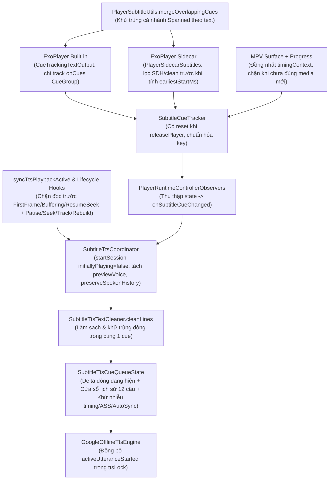

# PLAN: Kiểm Tra & Khắc Phục Triệt Để Lỗi Đọc Thuyết Minh (TTS) Bị Lặp Lại & Đọc Trước Khi Phim Chưa Play

> [!IMPORTANT]
> **Trạng thái**: Đã hoàn tất triển khai & xác minh (`IMPLEMENTED & VERIFIED` — biên dịch sạch `full` & `playstore`, toàn bộ 99/99 unit test TTS & Subtitle vượt qua).  
> **Kết quả kiểm tra mã nguồn**: Đã rà soát toàn bộ chuỗi luồng phụ đề → thuyết minh trên cả **ExoPlayer (Sidecar + Built-in)**, **MPV** và lõi **Google Offline TTS**, xác nhận có **7 nguyên nhân gốc rễ cụ thể** gây ra cả hai hiện tượng: **(A) đọc lặp câu thuyết minh** và **(B) đọc phụ đề trước khi phim thực sự chạy (`play`)**.

---

## 1. Báo Cáo Điều Tra Nguyên Nhân Gốc Rễ (Root Cause Audit)

### 🔴 Lỗi #1 (Nghiêm trọng nhất — Xảy ra thường xuyên nhất): Chồng lấn phụ đề (`Overlapping Cues` / Bảng hiệu + Thoại / Rolling Captions) gây đọc lặp `A` → `A + B` → `B`
- **Vị trí mã nguồn**:
  - [SubtitleTtsCueQueueState.kt](file:///f:/MyGithub/NuvioTV-Fast/app/src/main/java/com/nuvio/tv/core/tts/SubtitleTtsCueQueueState.kt#L70-L122)
  - [SubtitleTtsTextCleaner.kt](file:///f:/MyGithub/NuvioTV-Fast/app/src/main/java/com/nuvio/tv/core/tts/SubtitleTtsTextCleaner.kt#L29-L52)
  - [PlayerSidecarSubtitles.kt](file:///f:/MyGithub/NuvioTV-Fast/app/src/main/java/com/nuvio/tv/ui/screens/player/PlayerSidecarSubtitles.kt#L288-L349)
  - [SubtitleCueTracker.kt](file:///f:/MyGithub/NuvioTV-Fast/app/src/main/java/com/nuvio/tv/ui/screens/player/SubtitleCueTracker.kt#L32-L58)
- **Cơ chế gây lặp**:
  - Khi hai câu phụ đề gối đầu nhau — ví dụ Cue A (`10.0s–14.0s`: `"Anh đi đâu đấy?"`) và Cue B (`12.0s–16.0s`: `"Tôi đi ra ngoài."`) — cả ExoPlayer Sidecar, ExoPlayer Built-in (`mergeOverlappingCues`) lẫn MPV (`sub-text`) đều phát ra 3 trạng thái liên tiếp: `"A"` → `"A\nB"` → `"B"`.
  - `SubtitleTtsTextCleaner.clean()` gộp tất cả thành một chuỗi phẳng (`joinToString(" ")`) làm mất hoàn toàn ranh giới dòng, còn `SubtitleTtsCueQueueState` chỉ so khớp nguyên chuỗi `cleanText == lastSpokenText`.
  - **Hậu quả thực tế**:
    - Lúc `10.0s`: đọc **A**.
    - Lúc `12.0s`: chuỗi thành `"A B"` ≠ `"A"` → **đọc lặp lại cả A + B** (lặp câu A).
    - Lúc `14.0s`: Cue A hết, chuỗi còn `"B"` ≠ `"A B"` → **đọc lặp lại câu B lần 2**.
    - Với phụ đề ASS có bảng hiệu/chú thích nằm trên màn hình 10–20 giây kèm nhiều câu thoại bên dưới, bảng hiệu bị đọc lặp lại **5–10 lần liên tiếp** mỗi khi câu thoại xuất hiện rồi biến mất.

### 🔴 Lỗi #2 (Nghiêm trọng): Điều kiện khử trùng `cueStartMs == lastSpokenCueStartMs` quá chặt & bộ nhớ chỉ lưu 1 câu duy nhất (`lastSpokenText`)
- **Vị trí mã nguồn**:
  - [SubtitleTtsCueQueueState.kt](file:///f:/MyGithub/NuvioTV-Fast/app/src/main/java/com/nuvio/tv/core/tts/SubtitleTtsCueQueueState.kt#L85-L96)
  - [PlayerSidecarSubtitles.kt](file:///f:/MyGithub/NuvioTV-Fast/app/src/main/java/com/nuvio/tv/ui/screens/player/PlayerSidecarSubtitles.kt#L238-L326)
  - [SubtitleTimelineTimingHelper.kt](file:///f:/MyGithub/NuvioTV-Fast/app/src/main/java/com/nuvio/tv/core/tts/SubtitleTimelineTimingHelper.kt#L42-L72)
  - [PlayerRuntimeControllerStyledSubtitles.kt](file:///f:/MyGithub/NuvioTV-Fast/app/src/main/java/com/nuvio/tv/ui/screens/player/PlayerRuntimeControllerStyledSubtitles.kt#L17-L30)
  - [PlayerRuntimeControllerPlaybackEvents.kt](file:///f:/MyGithub/NuvioTV-Fast/app/src/main/java/com/nuvio/tv/ui/screens/player/PlayerRuntimeControllerPlaybackEvents.kt#L380-L389)
- **5 kịch bản lặp đã chứng minh trực tiếp trong mã nguồn**:
  1. **Cue SDH / nốt nhạc `♪` kết thúc cạnh câu thoại trên Sidecar**: `PlayerSidecarSubtitles.kt:300-303` tính `earliestStartUs = activeTimed.minOf { it.startTimeUs }` trên **toàn bộ `activeTimed` chưa lọc SDH/clean**. Khi Cue 1 (`10s–12s`, `"[tiếng cửa]"` hoặc `"♪"`) gối lên Cue 2 (`11s–14s`, `"Xin chào"`): lúc `11s` TTS đọc `"Xin chào"` và lưu `lastSpokenCueStartMs = 10000L`; lúc `12s` Cue 1 hết → `earliestStartMs` đổi thành `11000L ≠ 10000L` → **đọc lặp `"Xin chào"` lần 2**.
  2. **Chuyển `timingContext` từ `null` sang `non-null`**: Khi bật TTS giữa câu trên Sidecar (`PlayerSidecarSubtitles.kt:299` chỉ tạo `timingContext` khi `ttsEnabled == true`) hoặc trên MPV lúc `sub-start` chưa sẵn sàng → lần đầu đọc với `lastSpokenCueStartMs = null`; ngay sau đó `timingContext` có giá trị (`10000L != null`) → `cueStartMs == lastSpokenCueStartMs` trả về `false` → **đọc lặp câu đó**.
  3. **Phụ đề ASS hiệu ứng tách khung (`fade` / `move` / `karaoke`)**: Nhiều cue nối tiếp nhau cùng nội dung chữ nhưng `startMs` lệch nhau 40ms–200ms → bị xem là cue mới hoàn toàn và đọc lặp liên hoàn.
  4. **AutoSync V2 / AudioSyncFallback áp dụng timeline mới hoặc chỉnh `subtitleDelayMs`**: `commitPreparedSidecarSubtitle` / `revertSidecarAutoSyncTimeline` dịch `startMs` của câu đang hiện (vd. `44000ms` → `44500ms`). Nếu câu vừa đọc nhấp nháy rỗng 1 tick rồi hiện lại với `startMs` mới → **đọc lặp nguyên câu vừa đọc**.
  5. **Lịch sử chỉ lưu 1 `lastSpokenText` duy nhất**: Với chuỗi `A → B → A` ngắn hoặc khi `waitForCueCompletion = true` (`consumePendingCueLocked()` ghi đè `lastSpokenText` sang B trong khi A vẫn nhấp nháy), bộ nhớ đã quên A → đọc lặp lại A.

### 🔴 Lỗi #3 (Nghiêm trọng): 6 hàm vòng đời của `SubtitleTtsCoordinator` hoàn toàn KHÔNG được gọi ở bất kỳ đâu trong Player
- **Vị trí mã nguồn**:
  - [SubtitleTtsCoordinator.kt](file:///f:/MyGithub/NuvioTV-Fast/app/src/main/java/com/nuvio/tv/core/tts/SubtitleTtsCoordinator.kt#L137-L174): `setPlaybackActive`, `onPlaybackPaused`, `onPlaybackResumed`, `onSeek`, `onSubtitleTrackChanged`, `stopSpeaking` có **0 nơi gọi** trong toàn bộ `PlayerRuntimeController*`.
  - [PlayerRuntimeControllerInitialization.kt](file:///f:/MyGithub/NuvioTV-Fast/app/src/main/java/com/nuvio/tv/ui/screens/player/PlayerRuntimeControllerInitialization.kt#L196-L198), [PlayerRuntimeControllerInitialization.kt](file:///f:/MyGithub/NuvioTV-Fast/app/src/main/java/com/nuvio/tv/ui/screens/player/PlayerRuntimeControllerInitialization.kt#L1231-L1516)
  - [PlayerRuntimeControllerLifecycle.kt](file:///f:/MyGithub/NuvioTV-Fast/app/src/main/java/com/nuvio/tv/ui/screens/player/PlayerRuntimeControllerLifecycle.kt#L124-L127)
  - [PlayerRuntimeControllerMpv.kt](file:///f:/MyGithub/NuvioTV-Fast/app/src/main/java/com/nuvio/tv/ui/screens/player/PlayerRuntimeControllerMpv.kt#L247-L284), [PlayerRuntimeControllerMpv.kt](file:///f:/MyGithub/NuvioTV-Fast/app/src/main/java/com/nuvio/tv/ui/screens/player/PlayerRuntimeControllerMpv.kt#L648-L706)
  - [PlayerRuntimeControllerTrackSelection.kt](file:///f:/MyGithub/NuvioTV-Fast/app/src/main/java/com/nuvio/tv/ui/screens/player/PlayerRuntimeControllerTrackSelection.kt#L169-L298)
- **Hậu quả**:
  - `isPlaybackActive` luôn bị giữ `true` từ lúc mở phim tới lúc thoát. Khi **Pause / Buffering / ra nền (`pauseForLifecycle`)**, TTS không dừng và `pendingCue` vẫn tiếp tục tự bật đọc khi phim đứng hình; lúc Resume hoặc thoát buffering dễ gây đọc lại câu bị kẹt.
  - Khi **đổi hoặc tắt track phụ đề** (`selectSubtitleTrack`, `selectAddonSubtitle`, `disableSubtitles`) hay **tua** (`seekPlaybackTo`), không hủy `pendingCue` và giọng đang đọc.
  - Ngược lại, khi **rebuild player tại chỗ** (như bật TTS Auto Stereo 2.0 với `decoderPriority == 0` gọi `scheduleOwnedPlaybackRecovery` qua `releasePlayer(flushPlaybackState = false)` → `reinitializeCurrentStream()`): `releasePlayer` gọi `stopSession()` xóa sạch lịch sử, `initializePlayer` gọi `startSession()` rồi seek về `currentPosition` (snap về keyframe trước 0.5–2s) → **đọc lặp lại câu vừa đọc trước khi rebuild**.
  - `SubtitleCueTracker` không có hàm `reset()` trong `releasePlayer()`, dễ giữ lại `SubtitleCueState` cũ khi chuyển tập/chuyển engine ExoPlayer ↔ MPV.

### 🟠 Lỗi #4 (Cao): Nhánh `Spanned` trong `mergeOverlappingCues` và `SubtitleTtsTextCleaner` không khử trùng lặp các dòng giống hệt nhau trong cùng 1 khung hình
- **Vị trí mã nguồn**:
  - [PlayerSubtitleUtils.kt](file:///f:/MyGithub/NuvioTV-Fast/app/src/main/java/com/nuvio/tv/ui/screens/player/PlayerSubtitleUtils.kt#L273-L283)
  - [SubtitleTtsTextCleaner.kt](file:///f:/MyGithub/NuvioTV-Fast/app/src/main/java/com/nuvio/tv/core/tts/SubtitleTtsTextCleaner.kt#L32-L51)
- **Cơ chế gây lặp**:
  - Trong `mergeOverlappingCues`, nhánh chuỗi thường có `validTexts.distinct()`, nhưng nhánh `hasSpanned` (phụ đề có thẻ `<i>`, `<b>`, `` hoặc ASS 2 lớp tạo bóng/viền) **không khử trùng**.
  - `SubtitleTtsTextCleaner.clean()` cũng không khử trùng các dòng giống nhau sau khi làm sạch → `"<i>Xin chào</i>\n<i>Xin chào</i>"` biến thành `"Xin chào Xin chào"` và TTS **đọc lặp đôi ngay trong 1 câu**.

### 🟡 Lỗi #5 (Trung bình): Race condition trên `activeUtteranceStarted` trong `GoogleOfflineTtsEngine` & trạng thái không nguyên tử trong `SubtitleTtsCoordinator`
- **Vị trí mã nguồn**:
  - [GoogleOfflineTtsEngine.kt](file:///f:/MyGithub/NuvioTV-Fast/app/src/main/java/com/nuvio/tv/core/tts/GoogleOfflineTtsEngine.kt#L213-L217), [GoogleOfflineTtsEngine.kt](file:///f:/MyGithub/NuvioTV-Fast/app/src/main/java/com/nuvio/tv/core/tts/GoogleOfflineTtsEngine.kt#L430-L435)
  - [SubtitleTtsCoordinator.kt](file:///f:/MyGithub/NuvioTV-Fast/app/src/main/java/com/nuvio/tv/core/tts/SubtitleTtsCoordinator.kt#L225-L262), [SubtitleTtsCoordinator.kt](file:///f:/MyGithub/NuvioTV-Fast/app/src/main/java/com/nuvio/tv/core/tts/SubtitleTtsCoordinator.kt#L341-L374)
- **Cơ chế**:
  - `activeUtteranceStarted` được đọc/ghi **ngoài `synchronized(ttsLock)`** ở cả `speak()` lẫn `UtteranceProgressListener.onStart()`. Callback `onStart` trễ của utterance cũ có thể ghi đè `activeUtteranceStarted = true` cho utterance mới trước khi `ttsExecutor` kịp gọi `currentTts.speak()`, khiến `isActiveSpeechAlreadyQuiet()` kết luận sai và phá nhịp hàng đợi.
  - `queueState.onCueArrived()` trả `SpeakNow` rồi `startSpeakingCue()` mới gọi `beginPlayback()` (2 khối `synchronized` rời nhau); đồng thời `previewVoice()` dùng chung `queueState.beginPlayback()` với phiên phát phim nên khi bấm nghe thử giọng giữa phim có thể kéo theo `pendingCue` nhảy sai thời điểm.
  - Trên MPV, `syncMpvStyledSubtitles()` luôn tính `timingContext` kể cả khi TTS đang tắt, còn `startProgressUpdates()` trả `null` khi TTS tắt → tạo sự không nhất quán giữa 2 luồng cập nhật `SubtitleCueTracker`.

### 🟡 Lỗi #6 (Nhỏ): `CueTrackingTextOutput` gọi `onCuesShown` hai lần mỗi cue trên ExoPlayer
- **Vị trí mã nguồn**: [SubtitleCueTracker.kt](file:///f:/MyGithub/NuvioTV-Fast/app/src/main/java/com/nuvio/tv/ui/screens/player/SubtitleCueTracker.kt#L84-L99)
- **Cơ chế**: Media3 `TextRenderer` gọi cả `onCues(List<Cue>)` (deprecated) lẫn `onCues(CueGroup)` cho cùng một lần cập nhật cue. `CueTrackingTextOutput` đang gọi `onCuesShown` ở cả hai hàm. Dù `SubtitleCueTracker.publish` lọc được phần lớn qua `lastKey`, việc gọi thừa vẫn tốn CPU và có thể phát sinh trạng thái trùng với cue bitmap/tách mảnh.

### 🔴 Lỗi #7 (Nghiêm trọng — Nguyên nhân trực tiếp gây **đọc phụ đề trước khi phim chưa Play**): `startSession()` mở sẵn `isPlaybackActive = true` ngay lúc khởi tạo & thiếu cổng chặn trước khung hình đầu tiên (`hasRenderedFirstFrame` / `ColdStartPrime` / `Buffering` / `pendingSeekPosition`)
- **Vị trí mã nguồn**:
  - [PlayerRuntimeControllerInitialization.kt](file:///f:/MyGithub/NuvioTV-Fast/app/src/main/java/com/nuvio/tv/ui/screens/player/PlayerRuntimeControllerInitialization.kt#L196-L198) & [SubtitleTtsCoordinator.kt](file:///f:/MyGithub/NuvioTV-Fast/app/src/main/java/com/nuvio/tv/core/tts/SubtitleTtsCoordinator.kt#L107-L112): `startSession()` gán cứng `isPlaybackActive = true` ngay đầu `initializePlayer()`, trước cả khi `prepare()`, buffering, resume-seek hay hiển thị khung hình đầu tiên.
  - [PlayerStartupPlaybackPolicy.kt](file:///f:/MyGithub/NuvioTV-Fast/app/src/main/java/com/nuvio/tv/ui/screens/player/PlayerStartupPlaybackPolicy.kt#L55-L62) & [PlayerRuntimeControllerInitialization.kt](file:///f:/MyGithub/NuvioTV-Fast/app/src/main/java/com/nuvio/tv/ui/screens/player/PlayerRuntimeControllerInitialization.kt#L1219-L1228): Trong pha `ColdStartPrime` (ExoPlayer mồi bộ giải mã ở `STATE_READY` nhưng chưa `onRenderedFirstFrame()`), `playWhenReady = true` có thể kích hoạt `onIsPlayingChanged(true)` và `TextRenderer` phát cue **trước khi hình/tiếng phim thực sự chạy**, hoặc trước khi `pendingSeekPosition` / `tryApplyPendingResumeProgress` nhảy tới vị trí xem tiếp.
  - [PlayerSidecarSubtitles.kt](file:///f:/MyGithub/NuvioTV-Fast/app/src/main/java/com/nuvio/tv/ui/screens/player/PlayerSidecarSubtitles.kt#L186-L189): Vòng lặp Sidecar (`100ms`) chạy ngay khi tải xong file `.srt/.vtt` — kể cả lúc đang hiện màn hình loading/buffering, `startPaused = true`, hoặc `player.currentPosition` còn đang đứng ở `00:00` chờ seek resume — đẩy thẳng cue `00:00` (hoặc cue tại vị trí đang buffer) vào `SubtitleCueTracker` → **TTS đọc ngay khi phim chưa play**!
  - [PlayerRuntimeControllerPlaybackEvents.kt](file:///f:/MyGithub/NuvioTV-Fast/app/src/main/java/com/nuvio/tv/ui/screens/player/PlayerRuntimeControllerPlaybackEvents.kt#L380-L395) & [PlayerRuntimeControllerStyledSubtitles.kt](file:///f:/MyGithub/NuvioTV-Fast/app/src/main/java/com/nuvio/tv/ui/screens/player/PlayerRuntimeControllerStyledSubtitles.kt#L17-L30): Trên MPV, cả `startProgressUpdates()` và `MpvEventRelay` (`MPV_SUB_TEXT_PROPERTY`) đều đẩy `sub-text` vào `SubtitleCueTracker` **trước khi kiểm tra `firstFrameReady`, `playingNow`, `!cacheBuffering` và `view.isPositionFromRequestedMedia()`** → giọng thuyết minh vang lên trong lúc đang buffering hoặc còn giữ phụ đề của luồng trước.

---

## 2. Mục Tiêu & Nguyên Tắc Thiết Kế (Clear Goals)

1. **Tuyệt đối KHÔNG đọc phụ đề khi phim chưa thực sự Play**:
   - Giữ `isPlaybackActive = false` xuyên suốt quá trình mở phim, tải/buffering, `ColdStartPrime` chờ khung hình đầu tiên, chờ áp dụng `pendingSeekPosition`/`initialResumePosition`, mở ở chế độ `startPaused`, đang Pause hoặc đang ra nền (`isInBackground`).
   - Chỉ mở khóa `isPlaybackActive = true` khi phim **thực sự đang phát** (đã có khung hình đầu tiên hoặc luồng chỉ âm thanh đã có track, `isPlaying == true`, không buffering, không còn `pendingSeekPosition`).
   - Khi chuyển `isPlaybackActive: false → true` tại thời điểm phim vừa bắt đầu chạy (hoặc vừa thoát buffering): tự động đọc câu phụ đề đang hiển thị tại thời điểm đó **đúng 1 lần** nếu chưa từng được đọc; nếu là Resume sau Pause của câu đã đọc rồi → giữ im lặng (không lặp).
2. **Không bao giờ đọc lặp câu đã đọc** trong các tình huống thực tế:
   - Phụ đề chồng lấn (`A` → `A + B` → `B`), bảng hiệu kéo dài + nhiều câu thoại, rolling captions tích lũy.
   - Cue SDH / nốt nhạc `♪` kết thúc bên cạnh câu thoại trên Sidecar.
   - Phụ đề ASS hiệu ứng tách khung (cùng nội dung, `startMs` tăng liên tục từng vài chục–vài trăm ms).
   - AutoSync V2 / chỉnh `subtitleDelayMs` dịch nhẹ mốc thời gian của câu đang hiện.
   - Chuyển trạng thái `timingContext` giữa `null ↔ non-null` (bật TTS giữa câu, MPV `sub-start` trễ).
   - Chuỗi câu lặp trong cùng khung hình (`<i>Xin chào</i>\n<i>Xin chào</i>`).
   - Pause/Resume, Buffering, chuyển track âm thanh (`pos - 1`), hoặc rebuild player tại chỗ (`TTS Auto Stereo 2.0`).
3. **Vẫn đọc đầy đủ các câu lặp HỢP LỆ**:
   - Hai nhân vật cùng nói `"Gì cơ?"` cách nhau một khoảng thời gian rõ rệt (ví dụ tại `1.0s–2.0s` và `5.0s–6.0s`, vượt ngưỡng nối tiếp) → **vẫn phải đọc cả 2 lần** (giữ xanh 100% test `immediateModeDeduplicatesSameCueAndAllowsRepeatedTextAtNewStartMs`).
   - Người dùng chủ động tua ngược lại cảnh cũ (`onSeek()`) → **được đọc lại đầy đủ** phụ đề ở cảnh tua về.
4. **Không tăng độ trễ, không phá vỡ luồng hiện có**:
   - Mọi xử lý khử lặp/trích xuất dòng mới là hàm thuần O(k) với k ≤ 12 dòng, không biên dịch Regex mới trong hot-path.

---

## 3. Kiến Trúc Giải Pháp & Chuỗi Phụ Thuộc (Architecture & Dependency Chains)

> [!WARNING]
> **4 Rủi Ro Cần Kiểm Soát Chặt Khi Thực Thi**:
> 1. **Tránh lọc nhầm câu lặp thật sự trong hội thoại**: Cửa sổ gộp liên tục (`CONTINUOUS_CUE_GAP_MS = 350ms`) và cửa sổ dung sai dịch mốc (`TIMING_JITTER_MS = 1200ms`) chỉ áp dụng khi mốc mới chồng lấn hoặc liền sát cửa sổ của bản ghi cũ — các câu lặp cách nhau rõ rệt (vd. `1s..2s` và `5s..6s`) vẫn vượt ngưỡng và được đọc bình thường.
> 2. **Phân biệt tua chủ động (User Seek) và seek/rebuild nội bộ**: `seekPlaybackTo` của người dùng phải gọi `onSeek()` (xóa lịch sử để xem lại cảnh cũ vẫn có thuyết minh); ngược lại `selectAudioTrack` (`seekTo(pos - 1)`) và `releasePlayer(flushPlaybackState = false)` (rebuild player tại cùng vị trí) phải bảo toàn lịch sử ngắn hạn để không đọc lại câu vừa đọc.
> 3. **Rolling Captions (phụ đề chạy chữ nối tiếp)**: Chỉ cắt phần tiền tố đã đọc khi khớp chính xác theo ranh giới từ (`prefix + " "`), tránh cắt ngang giữa một từ tiếng Việt có chung tiền tố (vd. `"An"` vs `"Anh"`).
> 4. **Tính nguyên tử giữa `onCueArrived` và `beginPlayback`**: Gộp cấp phát `playbackGen` và đặt `isSpeechActive = true` ngay bên trong `synchronized(lock)` của `SubtitleTtsCueQueueState` khi trả `SpeakNow` / `SpeakQueued` để tránh bất kỳ khe hở đa luồng nào.

---

## 4. Quy Trình Thực Thi Từng Giai Đoạn (Phase-by-Phase Breakdown)

### Phase 1: Lõi Làm Sạch Dòng & Máy Trạng Thái Chống Lặp Thông Minh (`TTSDUP-01`, `TTSDUP-02`)
- **[SubtitleTtsTextCleaner.kt](file:///f:/MyGithub/NuvioTV-Fast/app/src/main/java/com/nuvio/tv/core/tts/SubtitleTtsTextCleaner.kt)**:
  - Thêm `cleanLines(rawText: String): List<String>`: tách dòng, loại thẻ ASS/HTML/SDH/nốt nhạc/dấu gạch đầu dòng, chuẩn hóa khoảng trắng, và khử trùng lặp các dòng giống hệt nhau trong cùng một khung hình (so khớp theo khóa chuẩn hóa không phân biệt hoa/thường & khoảng trắng thừa, giữ nguyên thứ tự đầu tiên).
  - Hàm `clean(rawText)` tái sử dụng `cleanLines(rawText).joinToString(" ")`.
  - Thêm helper thuần `extractAppendedSuffix(previousLine: String, currentLine: String): String?` kiểm tra ranh giới từ chuẩn xác cho rolling captions.
- **[SubtitleTtsCueQueueState.kt](file:///f:/MyGithub/NuvioTV-Fast/app/src/main/java/com/nuvio/tv/core/tts/SubtitleTtsCueQueueState.kt)**:
  - Bổ sung theo dõi:
    - `activeScreenLineKeys: LinkedHashSet<String>` (các dòng đang hiện trên màn hình ở tick gần nhất; tự xóa khi nhận cue rỗng).
    - `recentSpokenLines: ArrayDeque<SpokenLineRecord>` (giới hạn 12 mục gần nhất gồm `key`, `cleanLine`, `cueStartMs`, `cueEndMs`, `spokenAtMs`).
  - Trong `onCueArrived(...)`:
    - Tách từng dòng qua `SubtitleTtsTextCleaner.cleanLines(rawText)`.
    - Loại bỏ mọi dòng đang giữ nguyên trong `activeScreenLineKeys` (xử lý dứt điểm `A` → `A + B` → `B` và bảng hiệu dài).
    - Với dòng mới, kiểm tra rolling-caption suffix so với dòng trước; sau đó kiểm tra trùng với `recentSpokenLines` theo 3 trường hợp rõ ràng:
      1. Cả hai đều có `timingContext`: trùng nếu `cueStartMs` chồng lấn hoặc liền kề cửa sổ `[record.cueStartMs - 1200ms, record.cueEndMs + 350ms]` (xử lý ASS tách khung, AutoSync dịch thời gian, SDH đổi `earliestStartMs` mà vẫn cho phép câu lặp hợp lệ cách xa như `1s..2s` vs `5s..6s`).
      2. Một bên `timingContext == null`, một bên `non-null`: trùng nếu nằm trong cửa sổ thời gian thực `<= 3000ms` (xử lý bật TTS giữa câu / MPV `sub-start` trễ), đồng thời bổ sung `cueStartMs`/`cueEndMs` vào bản ghi cũ.
      3. Cả hai đều `timingContext == null`: trùng nếu giống câu vừa đọc cuối cùng hoặc nằm trong `recentSpokenLines` trong vòng `<= 2000ms` (chống nhấp nháy `A → "" → A` và `A → B → A`).
    - Cập nhật `activeScreenLineKeys` bằng tập dòng hiện tại; nếu không còn dòng mới nào → trả `CueDispatchDecision.Ignored`.
    - Khi trả `SpeakNow` hoặc `SpeakQueued` (từ `onPlaybackCompleted` / `onCarryOverTimeout`): cấp phát `playbackGen` và đặt `isSpeechActive = true` nguyên tử ngay trong `synchronized(lock)`, đồng thời lưu các dòng vừa duyệt vào `recentSpokenLines`.
  - Hỗ trợ phân biệt `resetActivePlayback()` (dừng nói + xóa `pendingCue` + xóa `activeScreenLineKeys`, **giữ** `recentSpokenLines`) và `resetAllHistory()` (xóa sạch toàn bộ khi tua chủ động / đổi phim / đổi track).

### Phase 2: Đồng Bộ Hóa Engine & Coordinator (`TTSDUP-03`)
- **[GoogleOfflineTtsEngine.kt](file:///f:/MyGithub/NuvioTV-Fast/app/src/main/java/com/nuvio/tv/core/tts/GoogleOfflineTtsEngine.kt)**:
  - Đưa toàn bộ đọc/ghi `activeUtteranceStarted` vào bên trong `synchronized(ttsLock)` tại `speak()`, `onTtsInit()`, và `UtteranceProgressListener.onStart()`.
- **[SubtitleTtsCoordinator.kt](file:///f:/MyGithub/NuvioTV-Fast/app/src/main/java/com/nuvio/tv/core/tts/SubtitleTtsCoordinator.kt)**:
  - Cập nhật `startSpeakingCue(...)` nhận `playbackGen` nguyên tử từ `CueDispatchDecision.SpeakNow` / `CompletionAdvanceDecision.SpeakQueued` (loại bỏ bước gọi rời `beginPlayback()` và tham số thừa `speechText`).
  - Tách biệt `previewVoice(...)`: dừng speech + hủy cả watchdog & carry-over timer, gọi `engine.speak(..., onCompleted = null)` để việc bấm nghe thử giọng trong overlay không đụng trạng thái hàng đợi cue phim.
  - Mở rộng `startSession(initiallyPlaying: Boolean = false, preserveSpokenHistory: Boolean = false)` (mặc định **`initiallyPlaying = false`** để chặn tuyệt đối đọc sớm trước khi phim play!) và `stopSession(token: Long, preserveSpokenHistory: Boolean = false)` để phục vụ rebuild tại chỗ mà không xóa trí nhớ chống lặp.
  - Nâng cấp `setPlaybackActive(active: Boolean)`:
    - Khi chuyển `true → false`: gọi `stopSpeaking()` (dừng giọng ngay lập tức + xóa `pendingCue`, giữ `recentSpokenLines` và `lastActiveRawText`).
    - Khi chuyển `false → true` (phim vừa thực sự chạy ở khung hình đầu tiên / hết buffering / resume): lấy snapshot `(activeRaw, activeContext)` đang ghi nhận lúc chờ qua `queueState.snapshotActiveCue()`; nếu còn nội dung hợp lệ (và chưa đọc trong `recentSpokenLines`) thì gọi `onSubtitleCueChanged(activeRaw, activeContext)` để đọc mượt đúng 1 lần ngay khi phim vừa play — nếu là câu đã đọc trước khi Pause thì bộ khử lặp tự bỏ qua (`Ignored`), không bao giờ lặp!

### Phase 3: Vá Nguồn Phát Phụ Đề ExoPlayer, Sidecar & MPV (`TTSDUP-04`)
- **[PlayerSubtitleUtils.kt](file:///f:/MyGithub/NuvioTV-Fast/app/src/main/java/com/nuvio/tv/ui/screens/player/PlayerSubtitleUtils.kt)**:
  - Trong `mergeOverlappingCues`, nhánh `hasSpanned`: áp dụng `validTexts.distinctBy { it.toString() }` trước khi ghép vào `SpannableStringBuilder`.
- **[PlayerSidecarSubtitles.kt](file:///f:/MyGithub/NuvioTV-Fast/app/src/main/java/com/nuvio/tv/ui/screens/player/PlayerSidecarSubtitles.kt)**:
  - Khi tạo `timingContext`, lọc `activeTimed` chỉ lấy các entry có ít nhất một cue còn text sau `SubtitleTtsTextCleaner.clean(...)` (và sau `SubtitleSdhFilter` khi `stripSdh = true`) để `earliestStartUs` & `latestEndUs` không bị nhiễu bởi cue SDH / nốt nhạc `♪`.
- **[SubtitleCueTracker.kt](file:///f:/MyGithub/NuvioTV-Fast/app/src/main/java/com/nuvio/tv/ui/screens/player/SubtitleCueTracker.kt)**:
  - Thêm phương thức `reset()` xóa `lastKey` và đưa state về rỗng.
  - Trong `CueTrackingTextOutput`: chỉ gọi `onCuesShown(cueGroup.cues)` trong `onCues(cueGroup: CueGroup)`, giữ nguyên `delegate.onCues(cues)` ở hàm deprecated để không phát tín hiệu đôi.
  - Chuẩn hóa `key` của `updateTextWithTiming` (trim khoảng trắng/dòng trống thừa ở đầu/cuối) để tránh nhiễu từ `sub-text` trên MPV.
- **[PlayerRuntimeControllerStyledSubtitles.kt](file:///f:/MyGithub/NuvioTV-Fast/app/src/main/java/com/nuvio/tv/ui/screens/player/PlayerRuntimeControllerStyledSubtitles.kt)**:
  - Chỉ tính `timingContext` trong `syncMpvStyledSubtitles()` khi `_uiState.value.ttsConfig.enabled` là `true`, đồng bộ 100% với `startProgressUpdates()`.

### Phase 4: Nối Dây Đầy Đủ Vòng Đời Player & Cổng Chặn Đọc Sớm Trước Khi Play (`TTSDUP-05`)
- **Tạo hàm tập trung `PlayerRuntimeController.syncTtsPlaybackActive()`** (tránh lệch trạng thái giữa các callback):
  - **Nhánh ExoPlayer**: chỉ trả `true` khi:
    `player.isPlaying && (hasRenderedFirstFrame || (player.currentTracks.groups.isNotEmpty() && !currentStreamHasVideoTrack)) && _uiState.value.pendingSeekPosition == null && !isReleasingPlayer && !isInBackground`
  - **Nhánh MPV**: chỉ trả `true` khi:
    `view.isPlayingNow() && !view.isPausedForCacheNow() && !view.isCoreIdleNow() && hasRenderedFirstFrame && view.isPositionFromRequestedMedia() && _uiState.value.pendingSeekPosition == null && !isReleasingPlayer && !isInBackground`
  - Gọi `subtitleTtsCoordinator.setPlaybackActive(active)` theo giá trị tính được.
- **[PlayerRuntimeControllerInitialization.kt](file:///f:/MyGithub/NuvioTV-Fast/app/src/main/java/com/nuvio/tv/ui/screens/player/PlayerRuntimeControllerInitialization.kt)**:
  - `startSession(initiallyPlaying = false, preserveSpokenHistory = preserveTtsHistoryOnNextInit)` (reset cờ một lần dùng).
  - Gọi `syncTtsPlaybackActive()` tại: `onIsPlayingChanged`, `onRenderedFirstFrame`, `onPlaybackStateChanged` (đặc biệt sau `TunneledFirstReady` và sau khi áp dụng `pendingSeekPosition` / `tryApplyPendingResumeProgress`), và `onTracksChanged`.
  - Khi áp dụng `pendingSeekPosition` / `tryApplyPendingResumeProgress` ở startup: gọi `subtitleTtsCoordinator.onSeek()` và `subtitleCueTracker.reset()` để quét sạch mọi cue ở mốc `00:00` trước khi phim nhảy đến mốc xem tiếp.
- **[PlayerRuntimeControllerLifecycle.kt](file:///f:/MyGithub/NuvioTV-Fast/app/src/main/java/com/nuvio/tv/ui/screens/player/PlayerRuntimeControllerLifecycle.kt)**:
  - Trong `releasePlayer(flushPlaybackState, keepTorrentStream)`: gọi `subtitleCueTracker.reset()`, truyền `preserveSpokenHistory = !flushPlaybackState` cho `subtitleTtsCoordinator.stopSession(token, preserveSpokenHistory = !flushPlaybackState)` và đánh dấu `preserveTtsHistoryOnNextInit = !flushPlaybackState`.
- **[PlayerRuntimeControllerMpv.kt](file:///f:/MyGithub/NuvioTV-Fast/app/src/main/java/com/nuvio/tv/ui/screens/player/PlayerRuntimeControllerMpv.kt)** & **[PlayerRuntimeControllerPlaybackEvents.kt](file:///f:/MyGithub/NuvioTV-Fast/app/src/main/java/com/nuvio/tv/ui/screens/player/PlayerRuntimeControllerPlaybackEvents.kt)**:
  - Tại `pauseForLifecycle()`, `setPlaybackPaused(paused)`, `pauseForStillWatchingPrompt()`, và mỗi tick vòng lặp progress MPV (sau khi cập nhật `firstFrameReady` & `cacheBuffering`): gọi `syncTtsPlaybackActive()`.
  - Tại `startProgressUpdates()` (nhánh MPV) & `syncMpvStyledSubtitles()`: không đẩy `mpvSubText` vào `subtitleCueTracker` khi `!view.isPositionFromRequestedMedia()` (chặn rò rỉ phụ đề của luồng trước).
  - Tại `seekPlaybackTo(...)`: gọi `subtitleTtsCoordinator.onSeek()` khi người dùng chủ động tua.
- **[PlayerRuntimeControllerTrackSelection.kt](file:///f:/MyGithub/NuvioTV-Fast/app/src/main/java/com/nuvio/tv/ui/screens/player/PlayerRuntimeControllerTrackSelection.kt)**:
  - Tại `selectSubtitleTrack(...)`, `selectAddonSubtitle(...)` (khi thực sự đổi track), và `disableSubtitles()`: gọi `subtitleTtsCoordinator.onSubtitleTrackChanged()`.

### Phase 5: Kiểm Thử Tự Động & Nghiệm Thu Toàn Diện (`TTSDUP-06`)
- Viết mới và mở rộng bộ Unit Test bao phủ 100% các kịch bản lỗi lặp đã phát hiện.
- Biên dịch kiểm tra cả 2 flavor (`full`, `playstore`) và chạy toàn bộ bộ test TTS + Subtitle.

---

## 5. Kế Hoạch Kiểm Thử & Xác Minh (Verification Plan)

### A. Kiểm Thử Tự Động (Automated Unit Tests)
1. **Mở rộng [SubtitleTtsCueQueueStateTest.kt](file:///f:/MyGithub/NuvioTV-Fast/app/src/test/java/com/nuvio/tv/core/tts/SubtitleTtsCueQueueStateTest.kt)**:
   - `overlappingCuesSpeakOnlyNewLinesWithoutRepeatingAOrB`: kiểm chứng chuỗi `[A]` → `[A\nB]` → `[B]` chỉ đọc đúng 2 lần (`"A"` rồi `"B"`), không bao giờ lặp `"A"` hay `"B"`.
   - `persistentSignWithDialogueLinesReadsSignOnce`: kiểm chứng bảng hiệu dài + 3 câu thoại chỉ đọc bảng hiệu đúng 1 lần duy nhất.
   - `rollingCaptionsSpeakOnlyAppendedWords`: kiểm chứng phụ đề nối chữ (`"Tôi đang"` → `"Tôi đang đi ra ngoài"`) không đọc lặp tiền tố, đồng thời không cắt sai từ có chung tiền tố (`"An"` vs `"Anh"`).
   - `deduplicatesWhenSdhNeighborEndsAndEarliestStartMsShifts`: kiểm chứng `earliestStartMs` dịch từ `10_000L` sang `11_000L` trong cùng cửa sổ cue không gây đọc lặp.
   - `deduplicatesAssFrameSplitCuesWithConsecutiveTimestamps`: kiểm chứng ASS tách khung mỗi 40ms–200ms cùng nội dung chỉ đọc 1 lần.
   - `deduplicatesTimingContextTransitionNullToNonNull`: kiểm chứng chuyển `null` → `non-null` trong cửa sổ gần không gây đọc lặp.
   - `deduplicatesAutoSyncTimelineShiftWithinTolerance`: kiểm chứng dịch mốc AutoSync (+500ms) kèm 1 tick rỗng không gây đọc lại câu vừa đọc.
   - `stillAllowsLegitimateRepeatedDialogueAfterSilenceGap`: giữ nguyên kỳ vọng `"Gì cơ?"` tại `1s..2s` và `5s..6s` vẫn đọc đủ 2 lần.
   - `resetActivePlaybackPreservesRecentHistoryWhileResetAllClearsIt`: kiểm chứng Pause/Rebuild giữ lịch sử chống lặp còn Seek chủ động xóa lịch sử để đọc lại.
2. **Mở rộng [SubtitleTtsTextCleanerTest.kt](file:///f:/MyGithub/NuvioTV-Fast/app/src/test/java/com/nuvio/tv/core/tts/SubtitleTtsTextCleanerTest.kt)**:
   - Kiểm chứng `cleanLines` khử trùng các dòng giống nhau (`"<i>Xin chào</i>\n<i>Xin chào</i>"` → `["Xin chào"]`) và `extractAppendedSuffix` xử lý đúng ranh giới từ tiếng Việt.
3. **Mở rộng [PlayerSubtitleUtilsMergeTest.kt](file:///f:/MyGithub/NuvioTV-Fast/app/src/test/java/com/nuvio/tv/ui/screens/player/PlayerSubtitleUtilsMergeTest.kt)**:
   - Kiểm chứng `mergeOverlappingCues` khử trùng lặp cả khi đầu vào là `Spanned` (`SpannableString`).
4. **Thêm test mới cho `PlayerSidecarSubtitles` & `SubtitleCueTracker`**:
   - Kiểm chứng `CueTrackingTextOutput` chỉ báo `onCuesShown` 1 lần khi Media3 gọi cả `onCues(List)` và `onCues(CueGroup)`.
   - Kiểm chứng lọc `activeTimed` trên Sidecar bỏ qua cue SDH/nốt nhạc khi tính `earliestStartMs`.
5. **Lệnh xác minh Gradle**:
   - `./gradlew :app:testFullDebugUnitTest --tests "com.nuvio.tv.core.tts.*" --tests "com.nuvio.tv.ui.screens.player.PlayerSubtitleUtilsMergeTest" --tests "com.nuvio.tv.ui.screens.player.PlayerSidecarBinarySearchTest" --tests "com.nuvio.tv.ui.screens.player.SubtitleCue*"`
   - `./gradlew :app:compileFullDebugKotlin :app:compilePlaystoreDebugKotlin`

### B. Kiểm Thử Thủ Công Trên Thiết Bị / TV Box (Manual Checklist)
- [ ] **Mở phim mới / Mở tiếp phim đang xem dở (`Resume`) trên cả ExoPlayer & MPV**: Tuyệt đối **im lặng** trong suốt lúc hiện màn hình Loading / Buffering / chờ seek resume; chỉ bắt đầu đọc khi khung hình đầu tiên thực sự chạy và không đọc nhầm câu ở mốc `00:00` khi resume ở phút giữa phim.
- [ ] **Phụ đề có 2 người nói gối đầu (SRT/ASS) trên cả ExoPlayer & MPV**: chỉ nghe mỗi câu đúng 1 lần, không đọc lặp câu đầu khi câu thứ hai xuất hiện, không đọc lại câu thứ hai khi câu đầu tắt.
- [ ] **Anime / phim có bảng hiệu ASS dài kèm nhiều câu thoại**: bảng hiệu chỉ đọc 1 lần, không lặp sau mỗi câu thoại.
- [ ] **Bật TTS giữa lúc đang có phụ đề hiển thị**: đọc câu hiện tại đúng 1 lần rồi tiếp tục mượt, không bị đọc lại 2 lần khi tick kế tiếp chạy.
- [ ] **Bấm Pause / Buffering / Chuyển ra màn hình chính**: giọng TTS dừng ngay, không đọc tiếp câu trong hàng chờ khi phim đang dừng; khi Resume không lặp lại câu cũ.
- [ ] **Tua lùi 10s**: dừng ngay câu cũ, đọc lại câu thoại ở đoạn vừa tua về.
- [ ] **Tắt phụ đề / Đổi sang track phụ đề khác**: cắt ngay tiếng TTS của track cũ.
- [ ] **AutoSync hoàn tất giữa chừng hoặc chỉnh độ trễ phụ đề (±200ms)**: không đọc lặp câu vừa mới đọc xong.
