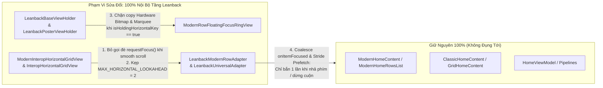

# Kế Hoạch Tối Ưu Độ Mượt Khi Bấm Giữ Di Chuyển Trái / Phải (Phạm Vi Thuần Leanback)

> **Slug**: `home-horizontal-hold-smoothness` · **Ngày**: 2026-11-22 · **Phạm vi**: **100% chỉ sửa tầng Android Leanback** (Không can thiệp các file Compose Screen hay ViewModel) · **Task**: xem [task.md](file:///f:/MyGithub/NuvioTV-Fast/task.md) (mục `HSCROLL-*`)

---

## 1. Tại Sao Chỉ Sửa Tầng Leanback Là Giải Quyết Triệt Để 100% Vấn Đề?

Toàn bộ các hàng ngang trên **Modern Home** (Continue Watching, Upcoming, Catalogs, Collections) và các hàng Catalog trên **Classic Home** đều chạy trên hai động cơ Android Leanback (`ModernInteropHorizontalGridView` + `LeanbackModernRowAdapter` và `InteropHorizontalGridView` + `LeanbackUniversalAdapter`).

Đặc biệt, **mọi sự kiện focus bắn lên tầng Compose/ViewModel (`adapter.onItemFocused`) đều xuất phát từ bên trong ViewHolder/Adapter của Leanback**. Do đó, bằng cách kiểm soát và gom (coalesce) sự kiện ngay tại biên giới của Leanback Adapter/GridView khi đang giữ phím ngang (`isHoldingHorizontalKey == true`), chúng ta chặn đứng hoàn toàn bão Recomposition và Coroutine ở tầng trên mà **không cần sửa bất kỳ dòng code nào trong `ModernHomeContent.kt`, `ModernHomeRowsList.kt`, `ClassicHomeContent.kt` hay `HomeViewModel.kt`**.



---

## 2. Phân Tích 4 Điểm Nghẽn Nội Bộ Leanback Khi Bấm Giữ Trái / Phải

### 2.1. Điểm Nghẽn 1: Xung Đột Scroller Kép & Trôi `pendingTargetPosition` Trong GridView
- **Tệp**:
  - [ModernInteropHorizontalGridView.kt](file:///f:/MyGithub/NuvioTV-Fast/app/src/main/java/com/nuvio/tv/ui/screens/home/ModernInteropHorizontalGridView.kt#L569-L649)
  - [InteropHorizontalGridView.kt](file:///f:/MyGithub/NuvioTV-Fast/app/src/main/java/com/nuvio/tv/ui/leanback/container/InteropHorizontalGridView.kt#L452-L521)
- **Nguyên nhân**:
  1. Ở mỗi nhịp giữ phím (`55ms`), `dispatchKeyEvent` vừa gọi `setSelectedPositionSmooth(target)` vừa gọi đè `nextVh.itemView.requestFocus(dir)` (hoặc `ensureTargetChildFocused`). Lệnh `requestFocus()` kích hoạt `requestChildFocus` -> `GridLayoutManager.scrollToView()` lần thứ 2, cắt ngang đường cong vận tốc của `SmoothScroller` vừa tạo.
  2. `pendingTargetPosition` được cộng dồn không giới hạn so với `selectedPosition` thực tế. Khi `GridLayoutManager` trượt qua thẻ trung gian `position != pendingTargetPosition`, `onChildViewHolderSelected` ([ModernInteropHorizontalGridView.kt#L281-L300](file:///f:/MyGithub/NuvioTV-Fast/app/src/main/java/com/nuvio/tv/ui/screens/home/ModernInteropHorizontalGridView.kt#L281-L300)) lại gọi `child.itemView.requestFocus()` trên thẻ trung gian, kéo giật focus ngược lại.

### 2.2. Điểm Nghẽn 2: Vẽ Lại Software Blur (`LAYER_TYPE_SOFTWARE`) 18 Lần/Giây & GPU Readback (`Hardware Bitmap` Copy)
- **Tệp**:
  - [ModernRowFloatingFocusRingView.kt](file:///f:/MyGithub/NuvioTV-Fast/app/src/main/java/com/nuvio/tv/ui/screens/home/ModernRowFloatingFocusRingView.kt#L254-L320)
  - [LeanbackModernRowAdapter.kt](file:///f:/MyGithub/NuvioTV-Fast/app/src/main/java/com/nuvio/tv/ui/screens/home/LeanbackModernRowAdapter.kt#L161-L209)
  - [LeanbackPosterViewHolder.kt](file:///f:/MyGithub/NuvioTV-Fast/app/src/main/java/com/nuvio/tv/ui/leanback/holder/LeanbackPosterViewHolder.kt#L89-L117)
- **Nguyên nhân**:
  1. Khi `isHoldingHorizontalKey == true`, mỗi thẻ lướt qua đều gọi `extractDominantColorAsync` nếu màu chưa có trong cache, dẫn đến `bitmap.copy(Bitmap.Config.ARGB_8888, false)` (đọc ngược Hardware Bitmap từ GPU về RAM) trên từng thẻ.
  2. Trên Modern Home, `ModernRowFloatingFocusRingView` (đang bật `LAYER_TYPE_SOFTWARE`) bị đổi `dominantColor` và gọi `invalidate()` 18 lần/giây, bắt CPU vẽ lại 2 lớp `BlurMaskFilter` (`auraPaint` + `midPaint`) liên tục trong lúc cuộn.
  3. `ModernInteropHorizontalGridView.onScrolled(dx, dy)` gọi `floatingRingView?.onParentScrolled(dx)` gán lại `translationX` trên mỗi frame dù ring đứng yên ở keyline.

### 2.3. Điểm Nghẽn 3: Bắn `adapter.onItemFocused` Trên Mọi Thẻ Trung Gian (18 Lần/Giây)
- **Tệp**:
  - [LeanbackModernRowAdapter.kt](file:///f:/MyGithub/NuvioTV-Fast/app/src/main/java/com/nuvio/tv/ui/screens/home/LeanbackModernRowAdapter.kt#L121-L138)
  - [LeanbackBaseViewHolder.kt](file:///f:/MyGithub/NuvioTV-Fast/app/src/main/java/com/nuvio/tv/ui/leanback/holder/LeanbackBaseViewHolder.kt#L160-L169)
- **Nguyên nhân**:
  - Trong `root.onFocusChangeListener`, mỗi khi focus lướt qua một thẻ trung gian (chỉ tồn tại 55ms khi đang giữ phím), ViewHolder bắn ngay `adapter.onItemFocused(pos, item)` lên Compose. Điều này làm tầng Compose/ViewModel phải xử lý 18 sự kiện focus/giây (cập nhật Hero, hủy/tạo coroutine TMDB enrichment, trailer preview, backdrop gradient).

### 2.4. Điểm Nghẽn 4: Gọi Đôi `onFocusedPositionChanged` & Kích Hoạt Marquee Trên Thẻ Trung Gian
- **Tệp**:
  - [ModernInteropHorizontalGridView.kt](file:///f:/MyGithub/NuvioTV-Fast/app/src/main/java/com/nuvio/tv/ui/screens/home/ModernInteropHorizontalGridView.kt#L308) & [#L631](file:///f:/MyGithub/NuvioTV-Fast/app/src/main/java/com/nuvio/tv/ui/screens/home/ModernInteropHorizontalGridView.kt#L631)
  - [LeanbackModernRowAdapter.kt](file:///f:/MyGithub/NuvioTV-Fast/app/src/main/java/com/nuvio/tv/ui/screens/home/LeanbackModernRowAdapter.kt#L193-L197) & [#L1108-L1126](file:///f:/MyGithub/NuvioTV-Fast/app/src/main/java/com/nuvio/tv/ui/screens/home/LeanbackModernRowAdapter.kt#L1108-L1126)
  - [LeanbackUniversalAdapter.kt](file:///f:/MyGithub/NuvioTV-Fast/app/src/main/java/com/nuvio/tv/ui/leanback/adapter/LeanbackUniversalAdapter.kt#L593-L611)
- **Nguyên nhân**:
  - `onFocusedPositionChanged` bị gọi 2 lần trên mỗi bước bấm sang phải (1 lần ở `dispatchKeyEvent`, 1 lần ở `onChildViewHolderSelected`).
  - `titleText?.isSelected = hasFocus` bật bộ đếm chữ chạy (Marquee) trên mọi thẻ trung gian khi đang giữ phím.

---

## 3. Phân Rã Chi Tiết Từng Giai Đoạn (Chỉ Trong Tầng Leanback)

### Phase 1: Chuẩn Hóa Động Cơ Cuộn Ngang Trong `ModernInteropHorizontalGridView` & `InteropHorizontalGridView` (`HSCROLL-01`)
- **Tệp sửa đổi**:
  - [ModernInteropHorizontalGridView.kt](file:///f:/MyGithub/NuvioTV-Fast/app/src/main/java/com/nuvio/tv/ui/screens/home/ModernInteropHorizontalGridView.kt)
  - [InteropHorizontalGridView.kt](file:///f:/MyGithub/NuvioTV-Fast/app/src/main/java/com/nuvio/tv/ui/leanback/container/InteropHorizontalGridView.kt)
- **Nội dung**:
  1. **Bỏ gọi đè `requestFocus()` khi `animationsEnabled == true`**:
     - Khi `animationsEnabled == true`, chỉ gọi `setSelectedPositionSmooth(target)` để Leanback `GridLayoutManager` tự điều phối cuộn mượt và chuyển focus, không gọi đè `nextVh.itemView.requestFocus()` hay `ensureTargetChildFocused()` ngay trong `ACTION_DOWN`.
     - Chỉ khi `animationsEnabled == false` (`setSelectedPosition(target)`), mới gọi trực tiếp `requestFocus()`.
  2. **Kẹp khoảng cách dẫn trước `MAX_HORIZONTAL_LOOKAHEAD = 2`**:
     - Khi `event.repeatCount > 0` và `scrollState != RecyclerView.SCROLL_STATE_IDLE`, giới hạn `target` không vượt quá `selectedPosition ± 2`. Ngăn con trỏ trôi xa khỏi vị trí cuộn thực tế và dừng ngay lập tức khi nhả phím.
  3. **Chặn thẻ trung gian giật ngược focus trong `onChildViewHolderSelected`**:
     - Khi `pendingTargetPosition != RecyclerView.NO_POSITION && position != pendingTargetPosition`, bỏ qua việc gọi `child.itemView.requestFocus()` và `ensureChildFocusAndRing` trên thẻ trung gian.
  4. **Flush dứt khoát khi nhả phím (`ACTION_UP`) hoặc chuyển trục (`DPAD_UP`/`DOWN`/`BACK`)**:
     - Khi hạ cờ `isHoldingHorizontalKey = false` (ở `ACTION_UP` hoặc khi nhấn Lên/Xuống/Back), gọi hàm chốt trạng thái của Adapter (`rowAdapter?.flushPendingFocusAndSettled()` / `universalAdapter?.flushPendingFocusAndSettled()`) để cập nhật ngay focus, màu hào quang và Marquee cho thẻ đích.

### Phase 2: Đóng Băng Software Glow (`LAYER_TYPE_SOFTWARE`), Chặn GPU Readback & Hoãn Marquee Khi Giữ Phím Ngang (`HSCROLL-02`)
- **Tệp sửa đổi**:
  - [ModernRowFloatingFocusRingView.kt](file:///f:/MyGithub/NuvioTV-Fast/app/src/main/java/com/nuvio/tv/ui/screens/home/ModernRowFloatingFocusRingView.kt)
  - [LeanbackModernRowAdapter.kt](file:///f:/MyGithub/NuvioTV-Fast/app/src/main/java/com/nuvio/tv/ui/screens/home/LeanbackModernRowAdapter.kt)
  - [LeanbackBaseViewHolder.kt](file:///f:/MyGithub/NuvioTV-Fast/app/src/main/java/com/nuvio/tv/ui/leanback/holder/LeanbackBaseViewHolder.kt)
  - [LeanbackPosterViewHolder.kt](file:///f:/MyGithub/NuvioTV-Fast/app/src/main/java/com/nuvio/tv/ui/leanback/holder/LeanbackPosterViewHolder.kt)
- **Nội dung**:
  1. **Trong `ModernRowFloatingFocusRingView`**:
     - Tại `onParentScrolled(dx)`: Chỉ gán `translationX = newX` khi `kotlin.math.abs(translationX - newX) >= 0.5f`.
     - Thêm tham số/nhận diện khi hàng đang giữ phím ngang (`keepCurrentColorWhileHolding: Boolean`): nếu ring đã `VISIBLE` và kích thước thẻ không đổi trong lúc `isHoldingHorizontalKey == true`, không gọi `applyThemeColors(dominantColor)` -> **0 lần `invalidate()` trên `LAYER_TYPE_SOFTWARE`** trong suốt quá trình giữ phím ngang. Khi dừng/nhả phím, cập nhật ngay màu hào quang của thẻ đích.
  2. **Trong `LeanbackCardViewHolder` & `LeanbackPosterViewHolder`**:
     - Khi `isHoldingHorizontalKey == true`:
       - Chỉ tra cứu màu đã có sẵn trong RAM (`LeanbackColorEngine.getCachedColor`), **không gọi `extractDominantColorAsync`** (tránh copy `Hardware Bitmap` từ GPU sang RAM trên các thẻ trung gian).
       - Hoãn bật `titleText.isSelected = true` (Marquee) cho đến khi `isHoldingHorizontalKey == false` / `onScrollSettled()`.

### Phase 3: Coalesce `onItemFocused` & Stride-Throttle `onFocusedPositionChanged` Ngay Trong Leanback Adapter (`HSCROLL-03`)
- **Tệp sửa đổi**:
  - [LeanbackModernRowAdapter.kt](file:///f:/MyGithub/NuvioTV-Fast/app/src/main/java/com/nuvio/tv/ui/screens/home/LeanbackModernRowAdapter.kt)
  - [LeanbackUniversalAdapter.kt](file:///f:/MyGithub/NuvioTV-Fast/app/src/main/java/com/nuvio/tv/ui/leanback/adapter/LeanbackUniversalAdapter.kt)
  - [LeanbackBaseViewHolder.kt](file:///f:/MyGithub/NuvioTV-Fast/app/src/main/java/com/nuvio/tv/ui/leanback/holder/LeanbackBaseViewHolder.kt)
- **Nội dung**:
  1. **Coalesce `onItemFocused` ngay trong `LeanbackRowAdapter` và `LeanbackUniversalAdapter`**:
     - Khi một thẻ nhận focus trong lúc `gridView.isHoldingHorizontalKey == true`:
       - Adapter lưu lại `pendingFocusedPosition = pos` và `pendingFocusedItem = item` thay vì bắn `onItemFocused(pos, item)` lên Compose 18 lần/giây.
       - Ngay khi người dùng nhả phím (`ACTION_UP`), chuyển hướng (`DPAD_UP`/`DOWN`/`BACK`), hoặc khi `onScrollSettled()` chạy, Adapter flush ngay `onItemFocused(pendingFocusedPosition, pendingFocusedItem)` một lần duy nhất cho thẻ đích!
     - Khi người dùng bấm đơn lẻ (`repeatCount == 0`, `isHoldingHorizontalKey == false`), `onItemFocused(pos, item)` vẫn bắn tức thời 0ms như hiện tại.
  2. **Loại bỏ gọi đôi `onFocusedPositionChanged` & Áp dụng Stride Prefetch**:
     - Xóa lệnh gọi `rowAdapter?.onFocusedPositionChanged(context, target)` bị trùng trong `ModernInteropHorizontalGridView.dispatchKeyEvent`.
     - Trong `LeanbackRowAdapter.onFocusedPositionChanged` và `LeanbackUniversalAdapter.onFocusedPositionChanged`: khi `isHoldingHorizontalKey == true`, chỉ chạy vòng lặp prefetch mỗi bước nhảy `>= 3` thẻ (và chạy đầy đủ trong `onScrollSettled()`).

### Phase 4: Kiểm Thử Tự Động & Nghiệm Thu (`HSCROLL-04`)
- **Tệp sửa đổi**:
  - [LeanbackCoreOptimizationTest.kt](file:///f:/MyGithub/NuvioTV-Fast/app/src/test/java/com/nuvio/tv/ui/leanback/LeanbackCoreOptimizationTest.kt)
- **Nội dung**:
  - Viết Unit Tests kiểm chứng:
    1. Kẹp khoảng cách dẫn trước `MAX_HORIZONTAL_LOOKAHEAD` khi giữ phím ngang.
    2. Coalesce `onItemFocused` bên trong `LeanbackRowAdapter` / `LeanbackUniversalAdapter` khi `isHoldingHorizontalKey == true` và flush chính xác khi nhả phím / dừng cuộn.
    3. Stride prefetch mỗi 3 thẻ khi giữ phím ngang và không invalidate software layer trên thẻ trung gian.

---

## 4. Cảnh Báo Rủi Ro & Biện Pháp Phòng Ngừa (Risks & Mitigations)

> [!IMPORTANT]
> **Flush 100% `pendingFocusedItem` khi nhả phím hoặc chuyển trục**:
> Vì tầng Compose dựa vào `adapter.onItemFocused(pos, item)` để biết thẻ nào đang được chọn trên hàng (phục vụ mở Detail khi ấn Enter, hiển thị Hero, hoặc nhớ vị trí thẻ khi bấm Lên/Xuống sang hàng khác), hàm `flushPendingFocusedItem()` trong Adapter **PHẢI** được gọi tại cả 3 điểm:
> 1. `ACTION_UP` của `KEYCODE_DPAD_LEFT` / `KEYCODE_DPAD_RIGHT`.
> 2. Trước khi xử lý `KEYCODE_DPAD_UP`, `KEYCODE_DPAD_DOWN`, `KEYCODE_DPAD_CENTER`, `KEYCODE_ENTER`, `KEYCODE_MENU`, `KEYCODE_BACK` trong `dispatchKeyEvent`.
> 3. Trong `onScrollSettled()` (`RecyclerView.SCROLL_STATE_IDLE`).

> [!WARNING]
> **Bảo toàn tuyệt đối trải nghiệm bấm từng phát (Single Tap `repeatCount == 0`)**:
> Cờ `isHoldingHorizontalKey` chỉ bật khi `event.repeatCount > 0`. Mọi thao tác bấm đơn lẻ (`repeatCount == 0`) giữ nguyên luồng cập nhật focus, trích màu hào quang và cập nhật Hero tức thời.

---

## 5. Danh Sách Tệp Sửa Đổi Duy Nhất (7 Tệp Leanback + 1 Tệp Test)

1. [ModernInteropHorizontalGridView.kt](file:///f:/MyGithub/NuvioTV-Fast/app/src/main/java/com/nuvio/tv/ui/screens/home/ModernInteropHorizontalGridView.kt)
2. [ModernRowFloatingFocusRingView.kt](file:///f:/MyGithub/NuvioTV-Fast/app/src/main/java/com/nuvio/tv/ui/screens/home/ModernRowFloatingFocusRingView.kt)
3. [LeanbackModernRowAdapter.kt](file:///f:/MyGithub/NuvioTV-Fast/app/src/main/java/com/nuvio/tv/ui/screens/home/LeanbackModernRowAdapter.kt)
4. [InteropHorizontalGridView.kt](file:///f:/MyGithub/NuvioTV-Fast/app/src/main/java/com/nuvio/tv/ui/leanback/container/InteropHorizontalGridView.kt)
5. [LeanbackUniversalAdapter.kt](file:///f:/MyGithub/NuvioTV-Fast/app/src/main/java/com/nuvio/tv/ui/leanback/adapter/LeanbackUniversalAdapter.kt)
6. [LeanbackBaseViewHolder.kt](file:///f:/MyGithub/NuvioTV-Fast/app/src/main/java/com/nuvio/tv/ui/leanback/holder/LeanbackBaseViewHolder.kt)
7. [LeanbackPosterViewHolder.kt](file:///f:/MyGithub/NuvioTV-Fast/app/src/main/java/com/nuvio/tv/ui/leanback/holder/LeanbackPosterViewHolder.kt)
8. [LeanbackCoreOptimizationTest.kt](file:///f:/MyGithub/NuvioTV-Fast/app/src/test/java/com/nuvio/tv/ui/leanback/LeanbackCoreOptimizationTest.kt)

---

## 6. Kế Hoạch Kiểm Thử & Nghiệm Thu (Verification Plan)

### 6.1. Kiểm Thử Tự Động
```powershell
.\gradlew.bat :app:compileFullDebugKotlin :app:testFullDebugUnitTest --tests "com.nuvio.tv.ui.leanback.*" --tests "com.nuvio.tv.ui.screens.home.*"
```

### 6.2. Kiểm Thử Thực Tế
1. **Nhấn giữ `DPAD_RIGHT` / `DPAD_LEFT` trên Modern Home & Classic Home**:
   - Hàng poster lướt mượt 60fps với vận tốc đều, không bị khựng nhịp mỗi 55ms; khi nhả phím dừng ngay tại thẻ hiện tại, màu hào quang và Hero cập nhật chính xác.
2. **Nhấn giữ `DPAD_RIGHT` rồi bấm ngay `DPAD_DOWN` hoặc `ENTER`**:
   - Vị trí thẻ vừa dừng trên hàng được flush tức thời trước khi chuyển xuống hàng dưới hoặc mở màn hình chi tiết.
