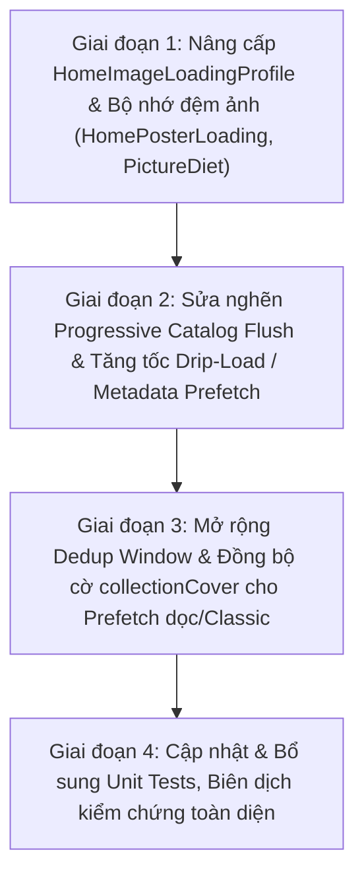

# PLAN: Tối Ưu Tải Nhanh & Tải Trước Nhiều Hơn Cho Màn Hình Home (`PLAN-home-loading-boost`)

> [!IMPORTANT]
> **Trạng thái**: Chờ người dùng duyệt trước khi thực thi (`PRE-EXECUTION PLAN` — chưa sửa bất kỳ file mã nguồn nào).  
> **Mục tiêu**: Tăng tốc độ hiển thị thực tế khi mở màn hình Home và khi cuộn D-Pad, đồng thời mở rộng vừa phải cửa sổ tải trước (catalog + poster ngang/dọc + metadata + cache ảnh) theo đúng phân tầng RAM để **nhanh hơn, sẵn sàng nhiều phim hơn** mà không gây giật khung hình hay tràn RAM trên TV Box yếu.

---

## 1. Phân Tích Điểm Nghẽn Hiện Tại & Cơ Hội Tối Ưu

Qua rà soát toàn bộ pipeline màn hình Home, có **4 điểm chính** có thể tối ưu để đạt hiệu quả rõ rệt nhất:

1. **Nút thắt "1 Addon chậm ngâm các hàng đã tải xong" (`HomeViewModelCatalogPipeline.kt` & `HomeViewModel.kt`)**:
   - Tại [HomeViewModelCatalogPipeline.kt](file:///f:/MyGithub/NuvioTV-Fast/app/src/main/java/com/nuvio/tv/ui/screens/home/HomeViewModelCatalogPipeline.kt#L486-L488), khi hàng đầu tiên tải xong (`hasRenderedFirstCatalog = true`), các hàng Eager thứ 2, 3, 4, 5 về ngay sau đó **bị bỏ qua không gọi `scheduleUpdateCatalogRows()`** nếu vẫn còn 1 hàng chậm chưa xong (`pendingCatalogLoads > 0`). Chúng bị kẹt ở trạng thái placeholder cho tới đợt `Safety flush` lúc `800ms` (hoặc kẹt hàng giây nếu về sau mốc `800ms`).
   - Ngoài ra, `scheduleUpdateCatalogRows()` tại [HomeViewModel.kt](file:///f:/MyGithub/NuvioTV-Fast/app/src/main/java/com/nuvio/tv/ui/screens/home/HomeViewModel.kt#L936-L956) đang dùng `catalogUpdateJob?.cancel()` (trailing debounce thuần túy), nên khi nhiều catalog về liên tiếp cách nhau `70–100ms`, thời điểm vẽ UI cứ bị hủy và đẩy lùi ra sau.
2. **Cấu hình `HomeImageLoadingProfile` còn khá dè dặt (đặc biệt trên Box ≥ 3 GB RAM)**:
   - Hiện tại máy `STANDARD` (> 2.3 GB RAM) chỉ tải trước `6` hàng Eager, `12` thẻ ngang, `3` hàng dọc × `8` thẻ; máy `LOW_RAM` chỉ `4` hàng Eager, `8` thẻ ngang, `2` hàng dọc × `6` thẻ. Có thể nâng nhẹ **+20% đến +33%** ở mọi chỉ số mà vẫn nằm rất xa giới hạn RAM/Socket.
3. **Độ trễ nghỉ giữa các bước Drip-Load & Hover Metadata còn dài**:
   - `STARTUP_GRACE_PERIOD_MS = 1500ms`, `dripLazyCatalogs` chờ `350ms` + `150ms`/lô 2 hàng, và các debounce làm giàu Hero / tải sẵn trang Chi tiết (`350ms` / `500ms` / `300ms`) có thể rút ngắn ~25–30% để phản hồi nhạy hơn khi dừng D-Pad.
4. **Bộ nhớ đệm ảnh & Bộ nhớ khóa chống trùng (`PictureDiet.kt`, `HomePosterLoading.kt`, `LeanbackArtworkLoader.kt`)**:
   - Khi tải trước nhiều hàng và nhiều poster hơn, cần nới nhẹ trần `MemoryCache` và bộ lọc `MAX_PREFETCHED_KEYS` (từ `512` → `768`) để các poster vừa tải trước không bị đẩy khỏi RAM trước khi người dùng cuộn tới, đồng thời gắn đủ cờ `.collectionCover()` cho nhánh prefetch dọc.

---

## 2. Bảng Đối Chiếu Tham Số Đề Xuất (Trước vs. Sau)

### A. Cấu hình phần cứng `HomeImageLoadingProfile` ([HomePosterLoading.kt](file:///f:/MyGithub/NuvioTV-Fast/app/src/main/java/com/nuvio/tv/core/image/HomePosterLoading.kt))

| Tham số | Box RAM Thấp (≤ 2.3 GB) Trước → **Sau** | Box Tiêu Chuẩn (> 2.3 GB) Trước → **Sau** | Ý nghĩa thực tế |
| :--- | :---: | :---: | :--- |
| `okHttpMaxRequests` | `32` → **`40`** | `48` → **`64`** | Mở rộng làn tải HTTP song song cho ảnh bìa |
| `okHttpMaxRequestsPerHost` | `16` → **`20`** | `32` → **`40`** | Tải nhanh hơn khi hầu hết ảnh cùng trỏ về `image.tmdb.org` / RPDB |
| `connectionPoolMaxIdle` | `12` → **`16`** | `20` → **`28`** | Giữ ấm nhiều kết nối TLS/HTTP2 hơn khi cuộn qua lại |
| `bitmapDecodeParallelism` | `4` → **`4`** *(giữ nguyên)* | `6` → **`8`** | Box mạnh giải mã loạt poster đầu nhanh hơn ~30%; box yếu giữ 4 tránh nghẽn CPU |
| `catalogConcurrency` | `4` → **`5`** | `6` → **`8`** | Gọi song song nhiều catalog addon hơn lúc khởi động |
| `eagerCatalogRows` | `4` → **`5`** | `6` → **`8`** | Hiện sẵn nhiều hàng ngay khi vừa vào Home |
| `dripAheadRows` | `3` → **`5`** | `6` → **`8`** | Tổng số hàng nạp sẵn không cần đợi cuộn tăng từ `7 → 10` (thấp) và `12 → 16` (chuẩn) |
| `lazyPrefetchAheadModern` | `3` → **`4`** | `4` → **`6`** | Kích hoạt tải catalog bên dưới sớm hơn khi cuộn dọc Modern Home |
| `lazyPrefetchAheadClassic` | `2` → **`3`** | `3` → **`4`** | Kích hoạt tải catalog sớm hơn trên Classic Home |
| `verticalPrefetchRows` | `2` → **`3`** | `3` → **`4`** | Dựng sẵn ảnh cho 3–4 hàng tiếp theo bên dưới màn hình |
| `verticalPrefetchItems` | `6` → **`8`** | `8` → **`10`** | Phủ kín toàn bộ chiều ngang màn hình TV 1080p cho từng hàng bên dưới |
| `horizontalPrefetchAhead` | `8` → **`10`** | `12` → **`16`** | Cuộn ngang liên tục 10–16 phim không gặp ô trống |
| `horizontalPrefetchBehind` | `2` → **`3`** | `2` → **`4`** | Lùi trái mượt hơn không phải giải mã lại |

### B. Tốc độ Hiển thị Catalog, Drip-Load, Metadata & Cache

| Hạng mục | File | Trước | **Sau** | Tác dụng |
| :--- | :--- | :---: | :---: | :--- |
| **Cơ chế Flush UI Catalog** | [HomeViewModelCatalogPipeline.kt](file:///f:/MyGithub/NuvioTV-Fast/app/src/main/java/com/nuvio/tv/ui/screens/home/HomeViewModelCatalogPipeline.kt), [HomeViewModel.kt](file:///f:/MyGithub/NuvioTV-Fast/app/src/main/java/com/nuvio/tv/ui/screens/home/HomeViewModel.kt) | Chặn các hàng Eager giữa chừng + trailing cancel | **Coalesced window (`80ms` đầu / `90ms` giữa đợt)** | Hàng nào tải xong hiện ra ngay theo nhịp gom `80–90ms`, không bị 1 addon chậm giam giữ |
| **Drip-Load Delay & Batch** | [HomeViewModelCatalogPipeline.kt](file:///f:/MyGithub/NuvioTV-Fast/app/src/main/java/com/nuvio/tv/ui/screens/home/HomeViewModelCatalogPipeline.kt) | Nghỉ `350ms`, lô `2` hàng / `150ms` | Nghỉ **`200ms`**, lô **`2–3` hàng / `100ms`** | Các hàng dưới màn hình âm thầm đầy dữ liệu nhanh hơn gần gấp đôi |
| **Startup Grace Period** | [HomeViewModel.kt](file:///f:/MyGithub/NuvioTV-Fast/app/src/main/java/com/nuvio/tv/ui/screens/home/HomeViewModel.kt) | `1_500ms` | **`1_000ms`** | Làm giàu Hero sớm hơn `0.5s` sau khi mở app |
| **Focus / Adjacent / Detail Prefetch** | [HomeViewModel.kt](file:///f:/MyGithub/NuvioTV-Fast/app/src/main/java/com/nuvio/tv/ui/screens/home/HomeViewModel.kt) | `350ms` / `500ms` / `300ms` | **`250ms` / `360ms` / `220ms`** | Hero cập nhật nhanh hơn, bấm vào phim mở Chi tiết nhạy hơn |
| **MDBList Batch Prefetch** | [HomeViewModelMdbListBatchPrefetch.kt](file:///f:/MyGithub/NuvioTV-Fast/app/src/main/java/com/nuvio/tv/ui/screens/home/HomeViewModelMdbListBatchPrefetch.kt) | `take(12)`, `Semaphore(3)`, `250ms` | **`take(16)`**, **`Semaphore(4)`**, **`180ms`** | Điểm đánh giá IMDb/MDBList sẵn sàng cho nhiều phim đầu hàng hơn |
| **RAM Cache Ảnh Poster** | [PictureDiet.kt](file:///f:/MyGithub/NuvioTV-Fast/app/src/main/java/com/nuvio/tv/core/image/PictureDiet.kt), [HomePosterLoading.kt](file:///f:/MyGithub/NuvioTV-Fast/app/src/main/java/com/nuvio/tv/core/image/HomePosterLoading.kt) | `40 MiB` (nhỏ) / `176 MiB` (lớn) | **`48 MiB`** (nhỏ) / **`208 MiB`** (lớn) | Giữ vừa lượng ảnh prefetch tăng thêm trong RAM, giảm giải mã lại |
| **Prefetch Dedup Set & Metadata LRU** | [LeanbackArtworkLoader.kt](file:///f:/MyGithub/NuvioTV-Fast/app/src/main/java/com/nuvio/tv/ui/leanback/core/LeanbackArtworkLoader.kt), [ModernHomeRowsList.kt](file:///f:/MyGithub/NuvioTV-Fast/app/src/main/java/com/nuvio/tv/ui/screens/home/ModernHomeRowsList.kt), [HomeViewModel.kt](file:///f:/MyGithub/NuvioTV-Fast/app/src/main/java/com/nuvio/tv/ui/screens/home/HomeViewModel.kt) | Dedup `512`, Meta LRU `64` | Dedup **`768`**, Meta LRU **`96`** | Không quên sớm trạng thái đã prefetch khi duyệt nhiều hàng |

> [!WARNING]
> **Ràng buộc an toàn được giữ nguyên 100%**:
> - Vẫn giữ nguyên khóa ngắt tải khi giữ lì D-Pad (`isHoldScrolling`, `isVerticalGlideRef`) để cuộn nhanh luôn đạt 60fps.
> - Vẫn giữ `OpenFilesGuard.isHigh()` chặn drip-load nếu thiết bị sắp chạm trần File Descriptor.
> - Bổ sung cờ `isCollectionCover` cho cả nhánh prefetch dọc ở `ModernHomeRowsList.kt` và `ClassicHomeContent.kt` để ảnh Bộ sưu tập luôn đi qua bộ điều tiết 4-slot, không bao giờ lấn băng thông của poster chính.

---

## 3. Sơ Đồ Các Giai Đoạn Thực Thi (Phase-by-Phase Breakdown)



- **Giai đoạn 1 (`[T1.1]`–`[T1.2]`) — Cấu hình tải & RAM Cache**:
  - `[T1.1]` Nâng cấp các thông số `LOW_RAM`, `STANDARD` và `LARGE_BOX_ARTWORK_CACHE_BYTES` (`208 MiB`) trong [HomePosterLoading.kt](file:///f:/MyGithub/NuvioTV-Fast/app/src/main/java/com/nuvio/tv/core/image/HomePosterLoading.kt).
  - `[T1.2]` Nâng nhẹ `SMALL_BOX_PICTURE_CACHE_BYTES` lên `48 MiB` trong [PictureDiet.kt](file:///f:/MyGithub/NuvioTV-Fast/app/src/main/java/com/nuvio/tv/core/image/PictureDiet.kt).
- **Giai đoạn 2 (`[T2.1]`–`[T2.3]`) — Tăng tốc Pipeline Dữ liệu Home & Metadata**:
  - `[T2.1]` Gỡ bỏ cổng chặn hàng Eager trong [HomeViewModelCatalogPipeline.kt](file:///f:/MyGithub/NuvioTV-Fast/app/src/main/java/com/nuvio/tv/ui/screens/home/HomeViewModelCatalogPipeline.kt) và chuyển `scheduleUpdateCatalogRows()` trong [HomeViewModel.kt](file:///f:/MyGithub/NuvioTV-Fast/app/src/main/java/com/nuvio/tv/ui/screens/home/HomeViewModel.kt) sang cơ chế **coalesced window không tự hủy lùi vô hạn**; đồng thời giảm delay & nâng kích thước lô `scheduleBackgroundDripLazyCatalogs`.
  - `[T2.2]` Tinh chỉnh các hằng số `STARTUP_GRACE_PERIOD_MS`, `EXTERNAL_META_PREFETCH_*`, `DETAIL_META_PREFETCH_DEBOUNCE_MS`, và nâng `MAX_ENRICHMENT_CACHE_SIZE` / `MAX_PREFETCH_CACHE_SIZE` lên `96` trong [HomeViewModel.kt](file:///f:/MyGithub/NuvioTV-Fast/app/src/main/java/com/nuvio/tv/ui/screens/home/HomeViewModel.kt).
  - `[T2.3]` Nâng `take(16)`, `Semaphore(4)` và giảm debounce xuống `180ms` trong [HomeViewModelMdbListBatchPrefetch.kt](file:///f:/MyGithub/NuvioTV-Fast/app/src/main/java/com/nuvio/tv/ui/screens/home/HomeViewModelMdbListBatchPrefetch.kt).
- **Giai đoạn 3 (`[T3.1]`–`[T3.2]`) — Tối ưu Prefetch Ảnh Ngang/Dọc**:
  - `[T3.1]` Nâng `MAX_PREFETCHED_KEYS` lên `768` (trim batch `192`) trong [LeanbackArtworkLoader.kt](file:///f:/MyGithub/NuvioTV-Fast/app/src/main/java/com/nuvio/tv/ui/leanback/core/LeanbackArtworkLoader.kt) và `PREFETCH_DEDUP_MAX_SIZE` tương ứng ở [ModernHomeRowsList.kt](file:///f:/MyGithub/NuvioTV-Fast/app/src/main/java/com/nuvio/tv/ui/screens/home/ModernHomeRowsList.kt) & [ClassicHomeContent.kt](file:///f:/MyGithub/NuvioTV-Fast/app/src/main/java/com/nuvio/tv/ui/screens/home/ClassicHomeContent.kt) (cùng `nestedPrefetchItemCount = 3` trên Classic Home).
  - `[T3.2]` Truyền đầy đủ `isCollectionCover` cho các lời gọi `LeanbackArtworkLoader.prefetch(...)` theo chiều dọc trong [ModernHomeRowsList.kt](file:///f:/MyGithub/NuvioTV-Fast/app/src/main/java/com/nuvio/tv/ui/screens/home/ModernHomeRowsList.kt) và [ClassicHomeContent.kt](file:///f:/MyGithub/NuvioTV-Fast/app/src/main/java/com/nuvio/tv/ui/screens/home/ClassicHomeContent.kt).
- **Giai đoạn 4 (`[T4.1]`–`[T4.2]`) — Cập nhật Unit Tests & Kiểm chứng**:
  - `[T4.1]` Cập nhật các kỳ vọng profile trong [HomePosterLoadingTest.kt](file:///f:/MyGithub/NuvioTV-Fast/app/src/test/java/com/nuvio/tv/core/image/HomePosterLoadingTest.kt), [LeanbackCoreOptimizationTest.kt](file:///f:/MyGithub/NuvioTV-Fast/app/src/test/java/com/nuvio/tv/ui/leanback/LeanbackCoreOptimizationTest.kt), [PictureDietTest](file:///f:/MyGithub/NuvioTV-Fast/app/src/test/java/com/nuvio/tv/core/image/) (nếu có) và bổ sung test xác minh cơ chế coalesced catalog flush.
  - `[T4.2]` Biên dịch `:app:compileFullDebugKotlin`, `:app:compilePlaystoreDebugKotlin` và chạy toàn bộ bộ test `core.image.*`, `ui.leanback.*`, `ui.screens.home.*`.

---

## 4. Kế Hoạch Kiểm Chứng (Verification Plan)

1. **Tự động (Automated)**:
   ```powershell
   .\gradlew.bat :app:compileFullDebugKotlin :app:compilePlaystoreDebugKotlin :app:testFullDebugUnitTest `
     --tests "com.nuvio.tv.core.image.*" `
     --tests "com.nuvio.tv.ui.leanback.*" `
     --tests "com.nuvio.tv.ui.screens.home.*"
   ```
2. **Thủ công trên TV / Giả lập (Manual)**:
   - Mở lạnh ứng dụng vào màn Home: các hàng đầu tiên xuất hiện nối tiếp nhau ngay khi từng addon trả dữ liệu (không còn hiện tượng đứng chờ addon chậm nhất), poster hiện nhanh và đầy cả chiều ngang.
   - Cuộn dọc 3–4 hàng liên tiếp và cuộn ngang 10–15 thẻ: ảnh đã có sẵn trong RAM, không nháy nền trống; giữ lì phím D-Pad vẫn mượt 60fps.
