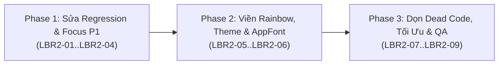

# Kế Hoạch Rà Soát Sâu Vòng 2 & Hoàn Thiện Toàn Diện Android Leanback (`tet2`)

> **Bối cảnh**: Tài liệu này là kết quả rà soát độc lập **Vòng 2** toàn bộ hệ thống Android Leanback (`ui/leanback/`, `ui/screens/home/LeanbackModern*`, `ModernInteropHorizontalGridView`, `ModernRowFloatingFocusRingView`, `ModernHomeRows*`, và toàn bộ 10 màn hình/section tiêu thụ Leanback) **sau khi hoàn tất Đợt 1** ([PLAN-leanback-ux-ui-audit.md](file:///f:/MyGithub/NuvioTV-Fast/PLAN-leanback-ux-ui-audit.md)) cùng 2 bản vá Release (`RELEASE-FIX-01`, `RELEASE-FIX-02`).
> **Mục tiêu**: Đánh giá trung thực 100% những phần đã ổn định vs những **regression mới phát sinh**, **lỗi tinh vi còn sót**, và **hạng mục dọn dẹp Đợt 1 làm chưa trọn** — chốt thành lộ trình dứt điểm gọn nhẹ trước khi commit/release.

---

## 1. Kết Luận Nhanh: Đợt 1 Đã Ổn Đến Đâu?

**Đánh giá tổng thể**: Khoảng **~80% hệ thống Leanback đã ổn định và sạch crash** (đã xác minh bản `fullRelease` chạy trên MuMu Android TV emulator `127.0.0.1:16416` với `0` crash trong `logcat -b crash`). Tuy nhiên, rà soát chi tiết từng dòng mã nguồn phát hiện **6 lỗi/regression mức P1**, **3 tinh chỉnh UX/hiệu năng mức P2**, và **3 nhóm dead code / việc dở dang từ Đợt 1** cần xử lý dứt điểm để đạt mức hoàn thiện sản phẩm.

### Bảng Đối Chiếu Nghiệm Thu Đợt 1

| Hạng mục Đợt 1 | Trạng thái thực tế sau rà soát Vòng 2 | Ghi chú kiểm chứng trực tiếp từ mã nguồn |
| :--- | :---: | :--- |
| **`RELEASE-FIX-01` & `02`** (Crash mở app & Live TV bản Release) | ✅ **Ổn 100%** | `@Keep` + `proguard-rules.pro` + sanitize Gson cũ đã pass `assembleFullRelease` & chạy thực tế 0 crash |
| **`LB-01` (`BUG-01`)** — Kẹt `isHoldScrolling` & ảnh đen trống | ✅ **Ổn 100%** | Đã reset ở `finishOverlayRingToCurrentGrid`, `DisposableEffect`, refresh toàn bộ hàng visible & `onScrollSettled()` |
| **`LB-02` (`BUG-02`, `BUG-03`)** — `isLastRow` & `ACTION_UP` giật focus | ⚠️ **Ổn 85%** | `dispatchKeyEvent` đã ổn, nhưng `focusSearch` thiếu `.coerceAtMost(totalItems - 1)` & `handleBoundaryNavigation` vẫn nuốt phím khi callback là default `{ false }` (`R2-BUG-04`) |
| **`LB-03` (`BUG-09`, `BUG-10`)** — Double-dispatch & `updateConfig` guard | ⚠️ **Ổn 90%** | Hết gọi trùng và hết crash layout, nhưng 4 callback `onNavigate*` trên cả 2 adapter giờ thành dead code (`R2-CLEAN-01`) |
| **`LB-04` (`BUG-04`, `BUG-12`, `BUG-16`)** — Watched, Scroll Jump, Debounce | ❌ **Có Regression & Sót** | `lastAppliedInitialPosition` khởi tạo sai gây mất khôi phục vị trí khi `items` nạp async (`R2-BUG-03`); `FolderDetailScreen` & Modern Home vẫn không tự cập nhật badge Watched (`R2-BUG-02`) |
| **`LB-05` (`BUG-06`, `BUG-07`)** — `requestInitialFocus` & Adaptive Columns | ⚠️ **Ổn 85%** | Số cột động hoạt động chuẩn, nhưng `DiscoverGrid` bỏ rơi `firstItemFocusRequester` & `FolderDetailScreen` nhiều tab không focus Tab 0 lúc mở lần đầu (`R2-BUG-05`) |
| **`LB-06` (`BUG-08`)** — Tắt Blur Glow khi `animationsEnabled == false` | ✅ **Ổn 100%** | Đã tắt `LAYER_TYPE_SOFTWARE` và blur trên cả `ModernRowFloatingFocusRingView` và `VerticalRingOverlayHost` |
| **`LB-07` (`BUG-14`)** — `LeanbackThemeStyle` & `fontScale` | ❌ **Chưa trọn vẹn** | Mất hoàn toàn `PosterBorderStyle.RAINBOW` (biến thành đỏ đơn sắc), Universal bỏ qua `borderWidthDp`, `NONE` vẫn vẽ glow ở Universal, chưa đồng bộ `AppFont` (`R2-BUG-01`, `R2-CLEAN-03`) |
| **`LB-08` (`BUG-11`, `13`, `15`)** — Episode, RTL, SeeAll, Fallback, Menu, A11y | ⚠️ **Ổn 90%** | Universal rất tốt; Modern Home còn sót `leftMargin/rightMargin` ở `progressBar`, thiếu fallback title khi lỗi ảnh, thiếu `"Watched"` ở `contentDescription` (`R2-BUG-07`) |
| **`LB-09` (`BUG-05`)** — Parity Modern Home | ⚠️ **Ổn 70%** | Đã có Watched / Blur NextUp / CoverEmoji, nhưng Watched không tự rebind khi data không đổi, prefetch quên truyền `blurred`, progressBar chưa dùng `themeStyle.accentColor` (`R2-BUG-02`) |
| **`LB-10`** — Dọn Dead Code & Hợp nhất Core | ⚠️ **Ổn 70%** | `LeanbackBlurFilterCache` & `LeanbackColorEngine` 1-map LRU đã xong; nhưng 4 Detail Sections vẫn còn `listState`, `CollectionSection` quên `blockDefaultRestore`, `LeanbackNativeGrid` gọi trùng `setItemViewCacheSize(12)` (`R2-CLEAN-01`, `R2-CLEAN-02`) |
| **`LB-11` (`BUG-17`)** — Hardware Bitmaps an toàn | ✅ **Ổn 95%** | Chống crash `Config.HARDWARE` an toàn; chỉ cần tránh copy bitmap khi `isHoldScrolling == true` (`R2-BUG-09`) |
| **`LB-12`** — `LibraryScreen` sang `LeanbackNativeGrid` | ⏸️ **Chưa làm** | Vẫn là hạng mục tùy chọn mở rộng (tách riêng, chỉ làm khi bạn xác nhận) |

---

## 2. Danh Sách Chi Tiết Các Lỗi & Điểm Cần Khắc Phục (Vòng 2)

> [!WARNING]
> **6 vấn đề mức P1 bên dưới ảnh hưởng trực tiếp tới hành vi hiển thị và điều hướng thực tế trên TV** (mất viền Rainbow, badge Đã xem không đổi trên Modern Home & Folder Detail, mất khôi phục vị trí cuộn ngang, focus kẹt/rơi trên Discover & Folder). Nên ưu tiên xử lý dứt điểm trước khi phát hành bản chính thức.

### 🔴 Nhóm P1 — Lỗi Chức Năng & Regression Cần Sửa Ngay (6 Hạng Mục)

| Mã | Vị trí mã nguồn | Mô tả chi tiết & Bằng chứng |
| :--- | :--- | :--- |
| **R2-BUG-01** | [LeanbackThemeStyle.kt](file:///f:/MyGithub/NuvioTV-Fast/app/src/main/java/com/nuvio/tv/ui/leanback/core/LeanbackThemeStyle.kt#L33-L84), [FocusRingStyle.kt](file:///f:/MyGithub/NuvioTV-Fast/app/src/main/java/com/nuvio/tv/ui/theme/FocusRingStyle.kt#L13-L107), [LeanbackBaseViewHolder.kt](file:///f:/MyGithub/NuvioTV-Fast/app/src/main/java/com/nuvio/tv/ui/leanback/holder/LeanbackBaseViewHolder.kt#L55-L67), [L231-L256](file:///f:/MyGithub/NuvioTV-Fast/app/src/main/java/com/nuvio/tv/ui/leanback/holder/LeanbackBaseViewHolder.kt#L231-L256), [ModernRowFloatingFocusRingView.kt](file:///f:/MyGithub/NuvioTV-Fast/app/src/main/java/com/nuvio/tv/ui/screens/home/ModernRowFloatingFocusRingView.kt#L170-L193) | **Hỏng viền `PosterBorderStyle.RAINBOW`, sai pha màu `SOLID_*`, bỏ qua `borderWidthDp` & lệch hành vi `NONE`**: 1. `rememberLeanbackThemeStyle()` chỉ đọc `posterFocusRingStyle.solidColor`, bỏ qua `gradientColors`. Vì `PosterFocusRingStyle.solidColor = Color(0xFFFF2A55)`, khi người dùng chọn **Viền Cầu Vồng (RAINBOW)** thì toàn bộ thẻ Leanback biến thành **viền đỏ đơn sắc**. 2. Khi chọn `SOLID_RED` / `SOLID_BLUE` / `SOLID_GOLD`, hàm `resolveFocusedBorderColor()` vẫn pha trộn 28% màu poster (`blendARGB(dominantColor, focusRingColor, 0.72f)`), làm sai lệch màu đơn sắc người dùng chọn. 3. `LeanbackBaseViewHolder` dùng cứng `chrome.borderWidthPx` (`2.0dp`) mà hoàn toàn bỏ qua `themeStyle.borderWidthDp` (`2.5dp`). 4. Khi chọn `PosterBorderStyle.NONE` (`hideFocusBorder == true`), `ModernRowFloatingFocusRingView` tắt cả viền lẫn glow, nhưng `LeanbackBaseViewHolder` chỉ ẩn viền mà **vẫn bật `glowView`** gây bất nhất giữa Modern Home và Classic/Detail/Search. |
| **R2-BUG-02** | [LeanbackModernRowAdapter.kt](file:///f:/MyGithub/NuvioTV-Fast/app/src/main/java/com/nuvio/tv/ui/screens/home/LeanbackModernRowAdapter.kt#L306-L339), [L539-L564](file:///f:/MyGithub/NuvioTV-Fast/app/src/main/java/com/nuvio/tv/ui/screens/home/LeanbackModernRowAdapter.kt#L539-L564), [L830](file:///f:/MyGithub/NuvioTV-Fast/app/src/main/java/com/nuvio/tv/ui/screens/home/LeanbackModernRowAdapter.kt#L830), [L911-L925](file:///f:/MyGithub/NuvioTV-Fast/app/src/main/java/com/nuvio/tv/ui/screens/home/LeanbackModernRowAdapter.kt#L911-L925), [ModernHomeRowsList.kt](file:///f:/MyGithub/NuvioTV-Fast/app/src/main/java/com/nuvio/tv/ui/screens/home/ModernHomeRowsList.kt#L763-L770), [FolderDetailScreen.kt](file:///f:/MyGithub/NuvioTV-Fast/app/src/main/java/com/nuvio/tv/ui/screens/collection/FolderDetailScreen.kt#L410-L422) | **Modern Home & Folder Detail không tự cập nhật badge "Đã xem" + lệch Cache Key Blur + ProgressBar sai màu theme**: 1. Trên Modern Home, `LeanbackRowAdapter.submitItems()` kiểm tra `if (items === newItems) return` và `hasSameCardVisuals()` không xét trạng thái watched. Khi người dùng đánh dấu Đã xem / Chưa xem một phim, danh sách `ModernCarouselItem` không đổi reference → badge `✓` **không bao giờ tự cập nhật** trên màn hình cho đến khi cuộn recycle đi. 2. Tại `FolderDetailScreen.kt:410`, `remember(items, globalLandscape, uiState.selectedTabIndex)` gọi `isItemWatched(item)` nhưng **thiếu dependency trạng thái watched** → badge `✓` cũng bị đóng băng. 3. `prefetchItemAt` (dòng 916) và vertical prefetch ở `ModernHomeRowsList.kt:763` **quên truyền `blurred = shouldBlur`** cho `ContinueWatchingItem.NextUp` khi bật làm mờ tập chưa xem → prefetch vào key không có `_blur`, lúc hiển thị lại miss cache và giải mã lần 2. 4. `progressBar` của `LeanbackCardViewHolder` (dòng 830) chưa dùng `themeStyle.accentColor` và không cập nhật khi đổi theme. |
| **R2-BUG-03** | [LeanbackNativeRow.kt](file:///f:/MyGithub/NuvioTV-Fast/app/src/main/java/com/nuvio/tv/ui/leanback/LeanbackNativeRow.kt#L158), [L185-L195](file:///f:/MyGithub/NuvioTV-Fast/app/src/main/java/com/nuvio/tv/ui/leanback/LeanbackNativeRow.kt#L185-L195), [L286-L292](file:///f:/MyGithub/NuvioTV-Fast/app/src/main/java/com/nuvio/tv/ui/leanback/LeanbackNativeRow.kt#L286-L292), [LeanbackModernRow.kt](file:///f:/MyGithub/NuvioTV-Fast/app/src/main/java/com/nuvio/tv/ui/screens/home/LeanbackModernRow.kt#L123), [L153-L164](file:///f:/MyGithub/NuvioTV-Fast/app/src/main/java/com/nuvio/tv/ui/screens/home/LeanbackModernRow.kt#L153-L164), [L286-L292](file:///f:/MyGithub/NuvioTV-Fast/app/src/main/java/com/nuvio/tv/ui/screens/home/LeanbackModernRow.kt#L286-L292) | **Regression từ `LB-04`: mất khôi phục `initialFocusPosition` khi `items` nạp bất đồng bộ (async)**: Cả `LeanbackNativeRow` và `LeanbackModernRow` khởi tạo `lastAppliedInitialPosition = initialFocusPosition` (thay vì `-1`). Nếu lúc tạo view `items` đang rỗng (`initialFocusPosition = 5`), `factory` bỏ qua `setSelectedPosition(5)`. Khi dữ liệu về đủ, `update` kiểm tra `initialFocusPosition != lastAppliedInitialPosition` cho kết quả `5 != 5` (`false`) nên bỏ qua luôn! Đồng thời `LaunchedEffect` ở `LeanbackNativeRow.kt:189` không có attach listener và quên cập nhật `lastAppliedInitialPosition`. |
| **R2-BUG-04** | [InteropVerticalGridView.kt](file:///f:/MyGithub/NuvioTV-Fast/app/src/main/java/com/nuvio/tv/ui/leanback/container/InteropVerticalGridView.kt#L190-L201), [L351](file:///f:/MyGithub/NuvioTV-Fast/app/src/main/java/com/nuvio/tv/ui/leanback/container/InteropVerticalGridView.kt#L351), [L425-L432](file:///f:/MyGithub/NuvioTV-Fast/app/src/main/java/com/nuvio/tv/ui/leanback/container/InteropVerticalGridView.kt#L425-L432), [LeanbackNativeGrid.kt](file:///f:/MyGithub/NuvioTV-Fast/app/src/main/java/com/nuvio/tv/ui/leanback/LeanbackNativeGrid.kt#L54-L57) | **Bất nhất `focusSearch` vs `dispatchKeyEvent` và hành vi biên trong `InteropVerticalGridView`**: 1. Ở `focusSearch(FOCUS_DOWN)` dòng 191, `val targetPos = actualPos + cols; if (targetPos < totalItems)` thiếu `.coerceAtMost(totalItems - 1)` như `dispatchKeyEvent` dòng 378 → không rơi được xuống phần tử cuối của hàng cuối thiếu cột khi đi qua nhánh `focusSearch`. 2. Dòng 351 viết lại biểu thức inline thay vì gọi `isVerticalGridLastRow(actualPos, totalItems, cols)`. 3. `LeanbackNativeGrid` đặt default `{ false }` (non-null) cho 3 callback biên và không expose `onNavigateRightOnLastColumn` (luôn `null`), trong khi `handleBoundaryNavigation()` chỉ trả `false` khi `callback == null` còn mọi callback non-null đều `return true` → khiến biên phải hành xử khác 3 biên còn lại và không phân biệt được "không cấu hình biên" vs "chặn cứng". |
| **R2-BUG-05** | [SearchDiscoverSection.kt](file:///f:/MyGithub/NuvioTV-Fast/app/src/main/java/com/nuvio/tv/ui/screens/search/SearchDiscoverSection.kt#L531), [L585-L638](file:///f:/MyGithub/NuvioTV-Fast/app/src/main/java/com/nuvio/tv/ui/screens/search/SearchDiscoverSection.kt#L585-L638), [FolderDetailScreen.kt](file:///f:/MyGithub/NuvioTV-Fast/app/src/main/java/com/nuvio/tv/ui/screens/collection/FolderDetailScreen.kt#L283-L290), [L346-L348](file:///f:/MyGithub/NuvioTV-Fast/app/src/main/java/com/nuvio/tv/ui/screens/collection/FolderDetailScreen.kt#L346-L348), [L469](file:///f:/MyGithub/NuvioTV-Fast/app/src/main/java/com/nuvio/tv/ui/screens/collection/FolderDetailScreen.kt#L469), [CollectionSection.kt](file:///f:/MyGithub/NuvioTV-Fast/app/src/main/java/com/nuvio/tv/ui/screens/detail/CollectionSection.kt#L32), [L79-L89](file:///f:/MyGithub/NuvioTV-Fast/app/src/main/java/com/nuvio/tv/ui/screens/detail/CollectionSection.kt#L79-L89) | **3 lỗi kết nối Focus ở các màn hình tiêu thụ Leanback**: 1. `DiscoverGrid` nhận `firstItemFocusRequester` từ `SearchScreen` nhưng **không gắn `.focusRequester(firstItemFocusRequester)`** vào `LeanbackNativeGrid` → nếu màn Search gọi `firstItemFocusRequester.requestFocus()` để nhảy từ ô tìm kiếm/filter xuống lưới, focus sẽ thất bại. 2. `FolderDetailScreen` khi mở Folder có `tabs.size > 1` lần đầu (`hasSavedFocus == false`): `requestInitialFocus = false` trên Grid, nhưng không có `LaunchedEffect` nào request focus vào `tabFocusRequesters[selectedTabIndex]` → **màn hình mở ra không có mục nào được focus**! Ngoài ra `gridScrollToTopTrigger++` (dòng 347) tăng nhưng không truyền xuống Grid để cuộn về đầu trang khi click lại tab. 3. `CollectionSection` nhận `blockDefaultRestore: Boolean` nhưng **quên truyền `isFocusEnabled = !blockDefaultRestore`** xuống `LeanbackNativeRow` và thiếu `focusProperties { canFocus = false }` (khác với `MoreLikeThisSection` & `CastSection`), dễ gây cướp focus khi vào trang Chi tiết phim. |
| **R2-BUG-06** | [LeanbackUniversalAdapter.kt](file:///f:/MyGithub/NuvioTV-Fast/app/src/main/java/com/nuvio/tv/ui/leanback/adapter/LeanbackUniversalAdapter.kt#L323-L331), [LeanbackPosterViewHolder.kt](file:///f:/MyGithub/NuvioTV-Fast/app/src/main/java/com/nuvio/tv/ui/leanback/holder/LeanbackPosterViewHolder.kt#L337-L350), [LeanbackEpisodeViewHolder.kt](file:///f:/MyGithub/NuvioTV-Fast/app/src/main/java/com/nuvio/tv/ui/leanback/holder/LeanbackEpisodeViewHolder.kt#L244), [L300-L310](file:///f:/MyGithub/NuvioTV-Fast/app/src/main/java/com/nuvio/tv/ui/leanback/holder/LeanbackEpisodeViewHolder.kt#L300-L310) | **Rò rỉ Focus Guard & Recycle State trên nhánh Universal**: 1. Trong `LeanbackUniversalAdapter.kt:326`, lần `rv.post` thứ 2 của Placeholder-to-Data Focus Guard **quên kiểm tra `mayTake`** (bên `LeanbackRowAdapter.kt:722` có check `rv.mayTakeFocus()`). Nếu người dùng chuyển sang hàng khác giữa 2 frame trong lúc nạp dữ liệu, hàng cũ có thể giật ngược focus. 2. `LeanbackPosterViewHolder.unbind()` và `LeanbackEpisodeViewHolder.unbind()` chưa reset `titleText?.isSelected = false` (marquee), `badgeView/watchedBadgeView/progressBar = GONE` khi trả ViewHolder về `RecycledViewPool`. 3. `LeanbackEpisodeViewHolder.kt:244` quên lọc `!imageUrl.trim().isPlaceholder()` trước khi gán `boundImageUrl` và gọi loader. |

---

### 🟡 Nhóm P2 — Tinh Chỉnh UX / UI / Hiệu Năng (3 Hạng Mục)

| Mã | Vị trí mã nguồn | Mô tả chi tiết |
| :--- | :--- | :--- |
| **R2-BUG-07** | [LeanbackModernRowAdapter.kt](file:///f:/MyGithub/NuvioTV-Fast/app/src/main/java/com/nuvio/tv/ui/screens/home/LeanbackModernRowAdapter.kt#L79-L82), [L296-L301](file:///f:/MyGithub/NuvioTV-Fast/app/src/main/java/com/nuvio/tv/ui/screens/home/LeanbackModernRowAdapter.kt#L296-L301), [L382-L399](file:///f:/MyGithub/NuvioTV-Fast/app/src/main/java/com/nuvio/tv/ui/screens/home/LeanbackModernRowAdapter.kt#L382-L399), [L824-L825](file:///f:/MyGithub/NuvioTV-Fast/app/src/main/java/com/nuvio/tv/ui/screens/home/LeanbackModernRowAdapter.kt#L824-L825) | **Sót chi tiết UX trên `LeanbackCardViewHolder` (Modern Home)**: 1. `progressBar` vẫn dùng `leftMargin`/`rightMargin` thay vì `marginStart`/`marginEnd` (chưa chuẩn RTL như nhánh Universal). 2. Khi ảnh poster bị lỗi tải (hoặc thiếu ảnh, không phải emoji folder) và `showLabels == false`, Modern Home chưa hiện `fallbackTitleText` căn giữa (nhánh Universal đã có ở `LeanbackPosterViewHolder`). 3. `root.contentDescription` trên Modern Home thiếu hậu tố `", Watched"` khi phim đã xem. |
| **R2-BUG-08** | [CatalogRowSection.kt](file:///f:/MyGithub/NuvioTV-Fast/app/src/main/java/com/nuvio/tv/ui/components/CatalogRowSection.kt#L196-L197), [LeanbackNativeRow.kt](file:///f:/MyGithub/NuvioTV-Fast/app/src/main/java/com/nuvio/tv/ui/leanback/LeanbackNativeRow.kt#L93-L98) | **Cấp phát thừa khi recompose & bảo vệ chiều cao hàng Episode rỗng**: 1. `CatalogRowSection.kt:196` chạy `catalogRow.items.map { latestIsItemWatched(it) }` cấp phát `List<Boolean>` mới ở **mọi lần recomposition** (dù chỉ đổi focus card). Có thể tính nhẹ bằng chữ ký bitmask / hash (0 cấp phát) hoặc chỉ so sánh thay đổi trước khi xây lại `leanbackItems`. 2. `LeanbackNativeRow.kt:93` nhận diện `Episode` bằng `items.firstOrNull() is LeanbackCardItem.Episode` — an toàn nếu caller đặt `showLabels = false`, nhưng nên có chú thích/kiểm soát rõ tránh giật chiều cao `44.dp` khi `items` đang rỗng. |
| **R2-BUG-09** | [LeanbackColorEngine.kt](file:///f:/MyGithub/NuvioTV-Fast/app/src/main/java/com/nuvio/tv/ui/leanback/core/LeanbackColorEngine.kt#L88-L98), [L162-L170](file:///f:/MyGithub/NuvioTV-Fast/app/src/main/java/com/nuvio/tv/ui/leanback/core/LeanbackColorEngine.kt#L162-L170) | **Tránh copy full-size Hardware Bitmap trong lúc cuộn nhanh**: Khi bật `Hardware Bitmaps`, `bitmap.copy(ARGB_8888, false)` cấp phát tạm một software bitmap kích thước đầy đủ trên CPU chỉ để downsample xuống `14×14`. Nên bỏ qua trích màu nếu `LeanbackArtworkLoader.isHoldScrolling == true` (hoặc khi thẻ không còn focus lúc tác vụ thực thi) để không tạo áp lực GC trong lúc giữ phím cuộn nhanh. |

---

### 🧹 Nhóm Dọn Dẹp Dead Code & Hạng Mục Đợt 1 Chưa Hoàn Tất (3 Hạng Mục)

| Mã | Vị trí mã nguồn | Mô tả chi tiết |
| :--- | :--- | :--- |
| **R2-CLEAN-01** | [LeanbackUniversalAdapter.kt](file:///f:/MyGithub/NuvioTV-Fast/app/src/main/java/com/nuvio/tv/ui/leanback/adapter/LeanbackUniversalAdapter.kt#L38-L41), [LeanbackNativeRow.kt](file:///f:/MyGithub/NuvioTV-Fast/app/src/main/java/com/nuvio/tv/ui/leanback/LeanbackNativeRow.kt#L117-L120), [LeanbackNativeGrid.kt](file:///f:/MyGithub/NuvioTV-Fast/app/src/main/java/com/nuvio/tv/ui/leanback/LeanbackNativeGrid.kt#L96-L99), [L208](file:///f:/MyGithub/NuvioTV-Fast/app/src/main/java/com/nuvio/tv/ui/leanback/LeanbackNativeGrid.kt#L208), [LeanbackModernRowAdapter.kt](file:///f:/MyGithub/NuvioTV-Fast/app/src/main/java/com/nuvio/tv/ui/screens/home/LeanbackModernRowAdapter.kt#L454-L457), [LeanbackModernRow.kt](file:///f:/MyGithub/NuvioTV-Fast/app/src/main/java/com/nuvio/tv/ui/screens/home/LeanbackModernRow.kt#L89-L92) | **Xóa 4 callback chết `onNavigateDown/Up/Left/Back` trên cả 2 Adapter & bỏ gọi trùng `setItemViewCacheSize(12)`**: Sau khi `BUG-09` gỡ key listener trên ViewHolder, 4 field này trên `LeanbackUniversalAdapter` và `LeanbackRowAdapter` không còn nơi nào gọi nhưng vẫn được truyền và gán lại ở mọi lần `AndroidView.update`. Đồng thời bỏ `setItemViewCacheSize(12)` trùng lặp ở `LeanbackNativeGrid.kt:208` (đã đặt ở `InteropVerticalGridView.kt:56`). |
| **R2-CLEAN-02** | [CastSection.kt](file:///f:/MyGithub/NuvioTV-Fast/app/src/main/java/com/nuvio/tv/ui/screens/detail/CastSection.kt#L26), [CollectionSection.kt](file:///f:/MyGithub/NuvioTV-Fast/app/src/main/java/com/nuvio/tv/ui/screens/detail/CollectionSection.kt#L24), [MoreLikeThisSection.kt](file:///f:/MyGithub/NuvioTV-Fast/app/src/main/java/com/nuvio/tv/ui/screens/detail/MoreLikeThisSection.kt#L26), [TrailerSection.kt](file:///f:/MyGithub/NuvioTV-Fast/app/src/main/java/com/nuvio/tv/ui/screens/detail/TrailerSection.kt#L24), [CastDetailScreen.kt](file:///f:/MyGithub/NuvioTV-Fast/app/src/main/java/com/nuvio/tv/ui/screens/cast/CastDetailScreen.kt#L680-L681), [L721](file:///f:/MyGithub/NuvioTV-Fast/app/src/main/java/com/nuvio/tv/ui/screens/cast/CastDetailScreen.kt#L721) | **Hoàn tất dọn `listState` thừa (từ `LB-10`) & tham số thừa ở `FilmographyRow`**: Đổi chữ ký `listState: LazyListState? = null` (bỏ cấp phát thừa `rememberLazyListState()` mặc định, vẫn giữ tương thích caller từ `MetaDetailsScreen.kt` để giảm xung đột khi merge `dev` — hoặc xóa hẳn ở cả `MetaDetailsScreen.kt` dòng 1370–1373 nếu muốn sạch tuyệt đối). Dọn `hasRequestedInitialFocus`/`upFocusRequester` thừa trong `FilmographyRow` và gán `rowKey = "cast_filmography_${filmographyFilter.name}"`. |
| **R2-CLEAN-03** | [Theme.kt](file:///f:/MyGithub/NuvioTV-Fast/app/src/main/java/com/nuvio/tv/ui/theme/Theme.kt#L45-L135), [Type.kt](file:///f:/MyGithub/NuvioTV-Fast/app/src/main/java/com/nuvio/tv/ui/theme/Type.kt#L14-L39), [LeanbackThemeStyle.kt](file:///f:/MyGithub/NuvioTV-Fast/app/src/main/java/com/nuvio/tv/ui/leanback/core/LeanbackThemeStyle.kt) | **Đồng bộ `AppFont` (`Inter` / `DM Sans` / `Open Sans`) vào Native `TextView`**: Hiện mới có 3 font variable trong `res/font/`. Expose `LocalAppFont` từ `Theme.kt` và cache `ResourcesCompat.getFont(context, fontRes)` trong `LeanbackThemeStyle` để tiêu đề/phụ đề/badge trên thẻ Leanback đồng bộ 100% font chữ với Compose UI. |

---

## 3. Rủi Ro & Nguyên Tắc Bảo Toàn Khi Thực Thi Vòng 2

> [!IMPORTANT]
> **Cam kết Rollback từng mục**: Mọi sửa đổi của Vòng 2 khi triển khai PHẢI được ghi tiếp thành các mã **`R2-BUG-01`..`R2-CLEAN-03`** vào cuối file [LEANBACK_FIX_CHANGELOG.md](file:///f:/MyGithub/NuvioTV-Fast/LEANBACK_FIX_CHANGELOG.md) kèm file/dòng và hướng dẫn khôi phục, để bạn có thể yêu cầu hoàn tác từng đoạn độc lập nếu có bất kỳ vấn đề nào.

> [!WARNING]
> **Không làm nặng `onDraw` hoặc tăng overdraw khi vẽ `PosterBorderStyle.RAINBOW`**:
> - Trên `ModernRowFloatingFocusRingView`: dùng 1 `LinearGradient` cached theo kích thước `(width, height)` gán vào `borderPaint.shader` (chỉ tạo lại khi kích thước đổi, 0 cấp phát trong `onDraw`).
> - Trên `LeanbackBaseViewHolder`: tạo 1 `LeanbackFocusBorderDrawable` nhẹ (kế thừa `Drawable`, tái sử dụng trên mỗi ViewHolder, cache `LinearGradient` theo `bounds`) thay thế `GradientDrawable` chỉ cho viền focus → vẽ sắc nét cả solid lẫn cầu vồng (`RAINBOW`) trên cả hình chữ nhật bo góc lẫn vòng tròn Avatar, không tăng thêm View con nào!

> [!NOTE]
> **Quyết định có chủ đích giữ nguyên**:
> - **10 tham số `@Suppress("UNUSED_PARAMETER")` trong `CatalogRowSection.kt`** và các tham số truyền vào `ModernHomeRowsList.kt`: Khuyến nghị **GIỮ NGUYÊN chữ ký public** để hạn chế tối đa merge conflict mỗi khi đồng bộ nhánh `origin/dev` (chỉ xử lý các logic thực sự ảnh hưởng người dùng).
> - **`LB-12` (`LibraryScreen` Tab Saved → `LeanbackNativeGrid`)**: Vẫn giữ trạng thái **tùy chọn riêng** — không gộp mặc định vào Vòng 2 trừ khi bạn xác nhận muốn chuyển luôn màn Library.

---

## 4. Lộ Trình Thực Thi Vòng 2 (3 Phase Tinh Gọn)

### Phase 1: Sửa Triệt Để Các Lỗi P1 (Watched Reactivity, Scroll Restore, Focus Grid/Consumer)
- **LBR2-01** (`R2-BUG-02`): Khôi phục reactivity badge Watched trên Modern Home (`LeanbackRowAdapter.refreshWatchedStates()` / tracking chữ ký watched mà không ép rebind toàn hàng) & `FolderDetailScreen.kt` (đưa chữ ký watched vào `remember`); đồng bộ `blurred` cho prefetch NextUp ở `LeanbackRowAdapter` & `ModernHomeRowsList`; đồng bộ `themeStyle.accentColor` cho `progressBar` trên Modern Home.
- **LBR2-02** (`R2-BUG-03`): Khởi tạo `lastAppliedInitialPosition = -1` trong cả `LeanbackNativeRow` và `LeanbackModernRow`, chỉ cập nhật sau khi áp dụng thành công `setSelectedPosition` trên `items.isNotEmpty()`, kèm attach listener an toàn để không mất khôi phục vị trí cuộn ngang khi data tải async.
- **LBR2-03** (`R2-BUG-04`, `R2-BUG-06`): Đồng bộ `focusSearch(FOCUS_DOWN)` dùng `.coerceAtMost(totalItems - 1)` & gọi `isVerticalGridLastRow(...)`; chuẩn hóa `handleBoundaryNavigation` và expose `onNavigateRightOnLastColumn` nhất quán trong `InteropVerticalGridView` / `LeanbackNativeGrid`; thêm check `mayTake` ở lần `rv.post` thứ 2 của `LeanbackUniversalAdapter`; làm sạch `unbind()` của `LeanbackPosterViewHolder` & `LeanbackEpisodeViewHolder` và lọc `isPlaceholder()` ở `LeanbackEpisodeViewHolder`.
- **LBR2-04** (`R2-BUG-05`): Gắn `firstItemFocusRequester` vào `LeanbackNativeGrid` của `DiscoverGrid` (`SearchDiscoverSection.kt`); bổ sung auto-focus Tab đầu & nối `gridScrollToTopTrigger` trong `FolderDetailScreen.kt`; truyền `isFocusEnabled = !blockDefaultRestore` + `focusProperties { canFocus = false }` trong `CollectionSection.kt`.

### Phase 2: Hoàn Thiện `PosterBorderStyle` (`RAINBOW`/`SOLID_*`/`NONE`), `borderWidthDp`, `AppFont` & Modern UX Polish
- **LBR2-05** (`R2-BUG-01`, `R2-CLEAN-03`): Mở rộng `LeanbackThemeStyle` mang đủ `borderStyle: PosterBorderStyle`, `gradientColors: IntArray`, `typeface: Typeface?` (từ `LocalAppFont` trong `Theme.kt` + `ResourcesCompat.getFont` cached).
  - Tạo `LeanbackFocusBorderDrawable` hỗ trợ cả màu đơn sắc và cầu vồng (`LinearGradient`) cho `LeanbackBaseViewHolder`, áp dụng đúng `themeStyle.borderWidthDp`, và tắt `glowView` nhất quán khi `hideFocusBorder == true` (`NONE`).
  - Nâng cấp `ModernRowFloatingFocusRingView` vẽ `LinearGradient` cho `RAINBOW`, giữ thuần sắc cho `SOLID_*` và chỉ pha màu động ở chế độ `THEME` (hoặc theo cấu hình rõ ràng).
  - Áp dụng `themeStyle.typeface` vào các `TextView` trên 4 ViewHolder.
- **LBR2-06** (`R2-BUG-07`, `R2-BUG-08`, `R2-BUG-09`): Sửa `marginStart`/`marginEnd` cho `progressBar` Modern Home, bổ sung `fallbackTitleText` khi lỗi ảnh mà `showLabels == false`, thêm `", Watched"` vào `contentDescription` Modern Home; tối ưu `watchedSignature` trong `CatalogRowSection.kt` tránh cấp phát List thừa mỗi recomposition; chặn trích màu `LeanbackColorEngine` trên Hardware Bitmap trong lúc `isHoldScrolling == true`.

### Phase 3: Dọn Dead Code Còn Sót, Cập Nhật Changelog Rollback & Xác Minh Toàn Diện
- **LBR2-07** (`R2-CLEAN-01`, `R2-CLEAN-02`): Xóa 4 callback chết `onNavigateDown/Up/Left/Back` trên `LeanbackUniversalAdapter` và `LeanbackRowAdapter` cùng chỗ gán ở `LeanbackNativeRow`, `LeanbackNativeGrid`, `LeanbackModernRow`, và test helper; xóa `setItemViewCacheSize(12)` trùng ở `LeanbackNativeGrid.kt:208`; đổi `listState: LazyListState? = null` (bỏ `= rememberLazyListState()` cấp phát thừa) ở 4 Detail Sections (`CastSection`, `CollectionSection`, `MoreLikeThisSection`, `TrailerSection`); dọn `FilmographyRow` trong `CastDetailScreen.kt`.
- **LBR2-08**: Ghi chép chi tiết từng mã `R2-BUG-01..R2-CLEAN-03` vào [LEANBACK_FIX_CHANGELOG.md](file:///f:/MyGithub/NuvioTV-Fast/LEANBACK_FIX_CHANGELOG.md) theo đúng cấu trúc cho phép rollback riêng lẻ từng mục.
- **LBR2-09**: Bổ sung Unit Tests cho các lỗi Vòng 2 + chạy build & kiểm thử thực tế trên Android TV / MuMu Emulator.

---

## 5. Kế Hoạch Kiểm Thử & Xác Minh (Verification Plan)

### 5.1. Kiểm Thử Tự Động (Unit Tests & Build)
Mở rộng [LeanbackCoreOptimizationTest.kt](file:///f:/MyGithub/NuvioTV-Fast/app/src/test/java/com/nuvio/tv/ui/leanback/LeanbackCoreOptimizationTest.kt):
1. **`LeanbackThemeStyleBorderTest`**: Kiểm tra đủ 7 giá trị `PosterBorderStyle` (`THEME`, `RAINBOW` có đủ mảng màu gradient, `SOLID_WHITE/RED/BLUE/GOLD` không bị pha lệch màu, `NONE` đặt `hideFocusBorder = true`).
2. **`ModernRowWatchedReactivityTest`**: Kiểm tra khi `items` giữ nguyên reference nhưng `isCatalogItemWatched` đổi kết quả từ `false → true`, adapter phát hiện đúng vị trí thay đổi và rebind chỉ đúng thẻ đó (không `notifyDataSetChanged`).
3. **`ModernRowBlurPrefetchParityTest`**: Kiểm tra `ContinueWatchingItem.NextUp` khi `blurUnwatchedEpisodes = true` sinh đúng key cache có hậu tố `_blur` và `allowHardware = false` ở cả `loadIntoImageView` lẫn `prefetch`.
4. **`VerticalGridFocusSearchPartialLastRowTest`**: Kiểm tra nhánh tính toán đích xuống hàng cuối thiếu cột luôn kẹp `.coerceAtMost(totalItems - 1)` nhất quán giữa `focusSearch` và `dispatchKeyEvent`.
5. **Biên dịch & kiểm thử**:
   - `./gradlew :app:compileFullDebugKotlin :app:testFullDebugUnitTest --tests "com.nuvio.tv.ui.leanback.LeanbackCoreOptimizationTest"`
   - `./gradlew :app:assembleFullRelease` (bảo đảm không phát sinh lỗi R8 / Shrinker trên bản Release).

### 5.2. Kiểm Thử Thủ Công Trên Android TV / MuMu Emulator
1. **Viền Poster & Font chữ**: Đổi lần lượt `PosterBorderStyle` qua `RAINBOW` → `SOLID_GOLD` → `NONE` → `THEME` và đổi `AppFont` (`Inter` / `DM Sans` / `Open Sans`) — xác nhận cả Modern Home, Classic Home, Catalog See All, Detail đều đổi tức thì, viền cầu vồng hiển thị dải đa sắc mượt, `NONE` không còn glow thừa.
2. **Đánh dấu Đã xem (Watched)**: Bấm giữ (`Menu`/Long-press OK) đánh dấu Đã xem trên **Modern Home**, **Classic Home**, **Folder Detail**, **Catalog See All** — xác nhận badge `✓` bật/tắt ngay lập tức không cần cuộn đi cuộn lại.
3. **Khôi phục vị trí cuộn ngang**: Cuộn hàng sang thẻ số 8 → vào Chi tiết phim → bấm Back quay lại (kể cả khi hàng nạp lại async) → xác nhận vị trí cuộn ngang quay đúng thẻ số 8.
4. **Điều hướng Discover & Folder Detail**:
   - Mở Folder có nhiều Tab lần đầu → xác nhận focus nằm ngay ở Tab đầu (không bị "mù focus").
   - Bấm xuống từ thanh Filter Discover / thanh Tab Folder → vào đúng lưới; bấm lên từ hàng 0 → về đúng Filter/Tab không bị giật ngược.
5. **Release Sanity Check**: Cài APK Release lên MuMu emulator, mở app, lướt nhanh Modern Home, mở Live TV, mở Detail & Search — xác nhận `logcat -b crash` sạch 0 lỗi.
