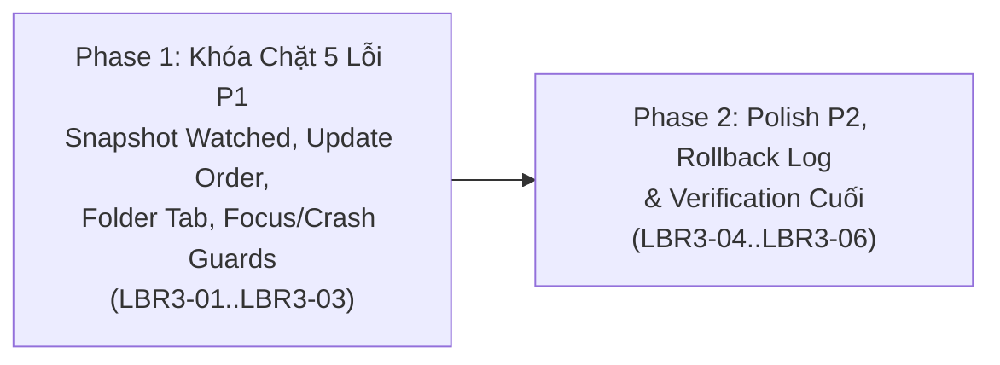

# Kế Hoạch Rà Soát Sâu Vòng 3 — Chốt Hạ Lỗi Tầng Sâu Android Leanback (`tet2`)

> **Bối cảnh**: Sau khi hoàn tất Đợt 1 ([PLAN-leanback-ux-ui-audit.md](file:///f:/MyGithub/NuvioTV-Fast/PLAN-leanback-ux-ui-audit.md)), 2 bản vá Release (`RELEASE-FIX-01`, `RELEASE-FIX-02`) và Đợt 2 ([PLAN-leanback-deep-review-r2.md](file:///f:/MyGithub/NuvioTV-Fast/PLAN-leanback-deep-review-r2.md)), tài liệu này là kết quả kiểm toán **Vòng 3** đi sâu vào tầng **Compose Snapshot Recomposition**, **thứ tự lifecycle `AndroidView.update`**, **focus isolation**, và **race condition giữa các frame** trên toàn bộ 18 file trong `ui/leanback/`, 6 file Modern Home Leanback và toàn bộ màn hình tiêu thụ.
> **Mục tiêu**: Khép lại **7 lỗi tinh vi cuối cùng** (5 mức P1 + 2 mức P2) để hệ thống Leanback đạt trạng thái hoàn chỉnh, ổn định 100% trước khi commit/release.

---

## 1. Đánh Giá Trung Thực Sau Vòng 2

- **Đã vững ~92% và sạch crash 100%**:
  - Bản `fullRelease` chạy trên MuMu Android TV (`127.0.0.1:16416`, PID `8556`) với `0` crash và `0` cảnh báo Leanback trong `logcat`.
  - 18/18 Unit Tests trong [LeanbackCoreOptimizationTest.kt](file:///f:/MyGithub/NuvioTV-Fast/app/src/test/java/com/nuvio/tv/ui/leanback/LeanbackCoreOptimizationTest.kt) đều PASS.
  - Toàn bộ lõi phụ trợ đã được rà từng dòng và xác nhận sạch lỗi: [PillProgressBarDrawable.kt](file:///f:/MyGithub/NuvioTV-Fast/app/src/main/java/com/nuvio/tv/ui/leanback/core/PillProgressBarDrawable.kt), [LeanbackUpdatePlanner.kt](file:///f:/MyGithub/NuvioTV-Fast/app/src/main/java/com/nuvio/tv/ui/leanback/adapter/LeanbackUpdatePlanner.kt), [LeanbackBlurFilterCache.kt](file:///f:/MyGithub/NuvioTV-Fast/app/src/main/java/com/nuvio/tv/ui/leanback/core/LeanbackBlurFilterCache.kt), [LeanbackPoolManager.kt](file:///f:/MyGithub/NuvioTV-Fast/app/src/main/java/com/nuvio/tv/ui/leanback/pool/LeanbackPoolManager.kt), [PlayStoreGlowView.kt](file:///f:/MyGithub/NuvioTV-Fast/app/src/main/java/com/nuvio/tv/ui/leanback/core/PlayStoreGlowView.kt), [DpadThrottleModifier.kt](file:///f:/MyGithub/NuvioTV-Fast/app/src/main/java/com/nuvio/tv/ui/util/DpadThrottleModifier.kt), [TmdbEntityBrowseScreen.kt](file:///f:/MyGithub/NuvioTV-Fast/app/src/main/java/com/nuvio/tv/ui/screens/tmdb/TmdbEntityBrowseScreen.kt), [CastDetailScreen.kt](file:///f:/MyGithub/NuvioTV-Fast/app/src/main/java/com/nuvio/tv/ui/screens/cast/CastDetailScreen.kt), và 4 Detail Sections (`Episodes`, `Cast`, `MoreLikeThis`, `Trailer`, `Collection`).
- **Còn 7 lỗi tinh vi tầng sâu (5 P1 + 2 P2)** mới lộ diện khi truy vết xuyên suốt Compose Snapshot ↔ AndroidView ↔ RecyclerView ở Vòng 3 — trong đó có 2 lỗi phát sinh trực tiếp từ cách xử lý ở Vòng 2 (`R3-BUG-02`, `R3-BUG-03`) và 1 lỗi do cơ chế stable lambda của `HomeScreen.kt` (`R3-BUG-01`).

---

## 2. Danh Sách Chi Tiết 7 Vấn Đề Phát Hiện Ở Vòng 3

> [!WARNING]
> **5 vấn đề P1 dưới đây là các lỗi logic / race condition thật sự** (không phải cosmetic): nếu không sửa, người dùng sẽ gặp tình trạng đánh dấu "Đã xem" trên Modern Home vẫn không hiện tích xanh ngay, click Tab trong Folder Detail bị cướp focus hoặc cuộn nhầm vị trí, khôi phục vị trí cuộn ngang bị trượt khi nạp async, và nguy cơ ném `IllegalArgumentException` khi view con bị recycle giữa 2 frame layout.

### 🔴 Nhóm P1 — Lỗi Logic & Race Condition Cần Sửa Ngay (5 Hạng Mục)

| Mã | Vị trí mã nguồn | Mô tả chi tiết & Bằng chứng |
| :--- | :--- | :--- |
| **R3-BUG-01** | [HomeScreen.kt](file:///f:/MyGithub/NuvioTV-Fast/app/src/main/java/com/nuvio/tv/ui/screens/home/HomeScreen.kt#L153-L156), [LeanbackModernRow.kt](file:///f:/MyGithub/NuvioTV-Fast/app/src/main/java/com/nuvio/tv/ui/screens/home/LeanbackModernRow.kt#L60), [L330-L349](file:///f:/MyGithub/NuvioTV-Fast/app/src/main/java/com/nuvio/tv/ui/screens/home/LeanbackModernRow.kt#L330-L349) | **Badge "Đã xem" (`✓`) trên Modern Home vẫn bị Compose skip recomposition**: `HomeScreen.kt:154` bọc `isCatalogItemWatched` trong `remember { ... }` (identity không bao giờ đổi) và chỉ đọc `latestMovieWatchedStatus.value` khi lambda được gọi. Vì cả `ModernRowSection` lẫn `LeanbackModernRow` **không hề gọi `isCatalogItemWatched(...)` trong thân Composable**, nên khi `uiState.movieWatchedStatus` đổi, Compose **bỏ qua recomposition của `LeanbackModernRow`** → `AndroidView.update` không chạy → `adapter.syncWatchedStateChanges()` (đã viết ở Vòng 2) **không bao giờ được kích hoạt**. **Giải pháp**: Tính `watchedMaskHash: Int` (0 allocation, giống `CatalogRowSection`) ngay trong thân Composable `LeanbackModernRow` và sử dụng trong `AndroidView.update` để Compose tự đăng ký Snapshot Observer cho đúng hàng hiển thị mà không phá vỡ tối ưu stable lambda của `HomeScreen`. |
| **R3-BUG-02** | [LeanbackNativeRow.kt](file:///f:/MyGithub/NuvioTV-Fast/app/src/main/java/com/nuvio/tv/ui/leanback/LeanbackNativeRow.kt#L305-L312), [L370](file:///f:/MyGithub/NuvioTV-Fast/app/src/main/java/com/nuvio/tv/ui/leanback/LeanbackNativeRow.kt#L370), [LeanbackModernRow.kt](file:///f:/MyGithub/NuvioTV-Fast/app/src/main/java/com/nuvio/tv/ui/screens/home/LeanbackModernRow.kt#L305-L312), [L349](file:///f:/MyGithub/NuvioTV-Fast/app/src/main/java/com/nuvio/tv/ui/screens/home/LeanbackModernRow.kt#L349) | **Thứ tự ngược trong `AndroidView.update`: `setSelectedPosition` chạy TRƯỚC `adapter.submitItems(items)`**: Ở cả `LeanbackNativeRow` và `LeanbackModernRow`, khối `if (initialFocusPosition != lastAppliedInitialPosition) { gridView.setSelectedPosition(initialFocusPosition); lastAppliedInitialPosition = initialFocusPosition }` nằm **trước** `adapter.submitItems(items)` ở cuối `update`. Khi `items` chuyển từ rỗng (`0`) sang có dữ liệu (`20`), `setSelectedPosition(5)` bị gọi khi `adapter.itemCount == 0` nên bị kẹp về `0`, nhưng `lastAppliedInitialPosition` đã bị gán `5` → dữ liệu nạp xong ở dòng cuối vẫn đứng ở `0`! **Giải pháp**: Di chuyển khối đồng bộ `initialFocusPosition` xuống **sau** `adapter.submitItems(items)` và kiểm tra `initialFocusPosition in 0 until adapter.itemCount`. |
| **R3-BUG-03** | [FolderDetailScreen.kt](file:///f:/MyGithub/NuvioTV-Fast/app/src/main/java/com/nuvio/tv/ui/screens/collection/FolderDetailScreen.kt#L285), [L353-L355](file:///f:/MyGithub/NuvioTV-Fast/app/src/main/java/com/nuvio/tv/ui/screens/collection/FolderDetailScreen.kt#L353-L355), [L445-L450](file:///f:/MyGithub/NuvioTV-Fast/app/src/main/java/com/nuvio/tv/ui/screens/collection/FolderDetailScreen.kt#L445-L450), [L485-L487](file:///f:/MyGithub/NuvioTV-Fast/app/src/main/java/com/nuvio/tv/ui/screens/collection/FolderDetailScreen.kt#L485-L487) | **Regression Vòng 2 trong `FolderDetailScreen`: race condition 1 frame & cướp focus khi click Tab**: Truyền `restoreFocusNonce = gridScrollToTopTrigger` xuống `LeanbackNativeGrid` gây ra 2 lỗi: 1. Khi bấm `OK` lên Tab đang chọn (`gridScrollToTopTrigger++`), trong cùng frame đó `focusedIndex` chưa kịp về `0` (vì `LaunchedEffect(gridScrollToTopTrigger)` chạy sau composition), nên `LeanbackNativeGrid` nhận `restoreFocusNonce` mới với `initialFocusPosition` cũ (VD `20`) → nhảy xuống thẻ `20` thay vì về `0`. 2. Khi bấm `OK` chuyển sang Tab khác, `gridScrollToTopTrigger` tăng `> 0` làm Tab mới sinh ra `restoreFocusNonce > 0` → **cướp focus từ Tab xuống Grid** (phá vỡ `requestInitialFocus = false`). **Giải pháp**: Bỏ `restoreFocusNonce = gridScrollToTopTrigger`; giữ ref `activeGridView` qua `onGridCreated` của `LeanbackNativeGrid` và chỉ cuộn mượt `activeGridView?.setSelectedPositionSmooth(0)` + đặt `focusedIndex = 0` khi click lại đúng Tab đang chọn (`index == uiState.selectedTabIndex`) mà không giật focus khỏi Tab. |
| **R3-BUG-04** | [InteropVerticalGridView.kt](file:///f:/MyGithub/NuvioTV-Fast/app/src/main/java/com/nuvio/tv/ui/leanback/container/InteropVerticalGridView.kt#L98-L156), [InteropHorizontalGridView.kt](file:///f:/MyGithub/NuvioTV-Fast/app/src/main/java/com/nuvio/tv/ui/leanback/container/InteropHorizontalGridView.kt#L211-L217), [ModernInteropHorizontalGridView.kt](file:///f:/MyGithub/NuvioTV-Fast/app/src/main/java/com/nuvio/tv/ui/screens/home/ModernInteropHorizontalGridView.kt#L381-L384) | **Thiếu `clearFocusDepth` guard trên `InteropVerticalGridView` & nguy cơ crash `requestChildFocus` khi view con bị detach**: 1. `InteropVerticalGridView` override `getRootView() = this` nhưng **không có `clearFocusDepth`** như `InteropHorizontalGridView` & `ModernInteropHorizontalGridView` → dễ bị kéo focus ngược khi `clearFocus()` gọi `rootViewRequestFocus()`. 2. `InteropVerticalGridView.focusSearch()` trả về `null` khi `isBusyLayout == true` (thay vì `focused ?: findFocus() ?: this`), dễ làm rơi focus khỏi màn hình khi bấm nhanh lúc đang layout. 3. Cả 3 GridView trong `requestChildFocus` khi `isBusyLayout` đều chạy `post { super.requestChildFocus(child, focused) }` mà **không kiểm tra `isAttachedToWindow && child != null && isDescendant(child)`** → nếu ViewHolder bị recycle giữa 2 frame, `ViewGroup.requestChildFocus` ném `IllegalArgumentException("parameter must be a descendant of this view")`. |
| **R3-BUG-05** | [InteropHorizontalGridView.kt](file:///f:/MyGithub/NuvioTV-Fast/app/src/main/java/com/nuvio/tv/ui/leanback/container/InteropHorizontalGridView.kt#L44), [L352](file:///f:/MyGithub/NuvioTV-Fast/app/src/main/java/com/nuvio/tv/ui/leanback/container/InteropHorizontalGridView.kt#L352), [LeanbackUniversalAdapter.kt](file:///f:/MyGithub/NuvioTV-Fast/app/src/main/java/com/nuvio/tv/ui/leanback/adapter/LeanbackUniversalAdapter.kt#L306-L335), [LeanbackNativeGrid.kt](file:///f:/MyGithub/NuvioTV-Fast/app/src/main/java/com/nuvio/tv/ui/leanback/LeanbackNativeGrid.kt#L105-L128) | **`InteropHorizontalGridView.mayTakeFocus()` luôn `true` khi `canTakeFocus == null` & trượt focus khi quay về hàng sâu trên `LeanbackNativeGrid`**: 1. `mayTakeFocus()` viết `hasFocus() || canTakeFocus?.invoke() != false`. Vì `LeanbackNativeRow` không truyền `canTakeFocus` (`null`), biểu thức này **luôn là `true`** kể cả khi người dùng đã chuyển sang hàng khác! Hậu quả: `ACTION_UP` và Placeholder-to-Data Focus Guard trong `LeanbackUniversalAdapter` có thể giật ngược focus về hàng cũ vừa rời đi. 2. Trong `LeanbackNativeGrid.executeAttachedGridFocus()`, khi quay về từ trang Detail ở thẻ sâu (VD item #40), dùng `setSelectedPositionSmooth(40)` kèm duy nhất **1 lần `grid.post`** → ViewHolder #40 chưa kịp layout xong sau 1 frame nên `findViewHolderForAdapterPosition(40)` vẫn là `null`, khiến card không nhận focus visual. **Giải pháp**: (a) Tách `canReclaimFocus()` kiểm tra `isFocusable && !isNavigatingToSidebar && descendantFocusability != FOCUS_BLOCK_DESCENDANTS && (if (canTakeFocus != null) canTakeFocus?.invoke() != false else hasFocus() || !hasExternalWindowFocus())`; (b) Dùng `setSelectedPosition(targetIdx)` (jump tức thì cho focus restore) kèm retry tối đa 8 frame có guard `isAttachedToWindow`. |

---

### 🟡 Nhóm P2 — Tối Ưu Cấp Phát & Đồng Nhất Thẩm Mỹ Hào Quang (2 Hạng Mục)

| Mã | Vị trí mã nguồn | Mô tả chi tiết |
| :--- | :--- | :--- |
| **R3-BUG-06** | [LeanbackModernRowAdapter.kt](file:///f:/MyGithub/NuvioTV-Fast/app/src/main/java/com/nuvio/tv/ui/screens/home/LeanbackModernRowAdapter.kt#L956-L968), [LeanbackBaseViewHolder.kt](file:///f:/MyGithub/NuvioTV-Fast/app/src/main/java/com/nuvio/tv/ui/leanback/holder/LeanbackBaseViewHolder.kt#L238-L241) | **Cấp phát thừa `PillProgressBarDrawable` ở lần bind đầu Modern Home & khóa sàn `borderWidthDp`**: 1. `LeanbackRowAdapter.onCreateViewHolder()` quên khởi tạo `lastProgressAccentColor = themeStyle.accentColor` (mặc định bằng `0`) → mọi thẻ Modern Home vừa inflate đều tạo lại `PillProgressBarDrawable` lần 2 ngay trong `bind()` đầu tiên. 2. `LeanbackBaseViewHolder.kt:238` dùng `.coerceAtLeast(borderWidthPx.toFloat())` khiến không thể cấu hình `borderWidthDp < 2.0f` — đổi về `.coerceAtLeast(2f)`. |
| **R3-BUG-07** | [LeanbackThemeStyle.kt](file:///f:/MyGithub/NuvioTV-Fast/app/src/main/java/com/nuvio/tv/ui/leanback/core/LeanbackThemeStyle.kt#L70-L95), [LeanbackBaseViewHolder.kt](file:///f:/MyGithub/NuvioTV-Fast/app/src/main/java/com/nuvio/tv/ui/leanback/holder/LeanbackBaseViewHolder.kt#L147-L152), [L256-L263](file:///f:/MyGithub/NuvioTV-Fast/app/src/main/java/com/nuvio/tv/ui/leanback/holder/LeanbackBaseViewHolder.kt#L256-L263), [ModernRowFloatingFocusRingView.kt](file:///f:/MyGithub/NuvioTV-Fast/app/src/main/java/com/nuvio/tv/ui/screens/home/ModernRowFloatingFocusRingView.kt#L161-L170) | **Đồng tông màu Hào Quang (Glow) khi chọn viền đơn sắc `SOLID_*`**: Khi người dùng chọn `SOLID_RED` / `SOLID_BLUE` / `SOLID_GOLD` / `SOLID_WHITE`, viền card đã thuần sắc nhưng lớp hào quang (`PlayStoreGlowView` & `ModernRowFloatingFocusRingView`) vẫn phát sáng theo màu chủ đạo poster (VD viền đỏ nhưng hào quang xanh lá). Thêm helper `LeanbackThemeStyle.resolveGlowColor(dominantColor)` trả đúng `focusRingColor` cho 4 chế độ `SOLID_*`, và giữ hào quang động theo `dominantColor` của poster cho `THEME` và `RAINBOW`. |

---

## 3. Rủi Ro & Cam Kết Bảo Toàn

> [!IMPORTANT]
> **Không phá vỡ kiến trúc Stable Lambda của `HomeScreen.kt`**: Khi sửa `R3-BUG-01`, giữ nguyên hoàn toàn cơ chế `remember { ... }` trong `HomeScreen.kt:154`. Việc đọc `watchedMaskHash` chỉ đặt gọn trong `LeanbackModernRow.kt`, đảm bảo chỉ những hàng đang hiển thị trên viewport có trạng thái watched đổi mới chạy `AndroidView.update` — **0 ảnh hưởng hiệu năng cuộn dọc 60fps của Modern Home**.

> [!IMPORTANT]
> **Ghi tiếp Rollback Changelog**: Mọi mã sửa Vòng 3 (`R3-BUG-01` → `R3-BUG-07`) khi thực thi sẽ được ghi bổ sung thành mục **Vòng 3** trong [LEANBACK_FIX_CHANGELOG.md](file:///f:/MyGithub/NuvioTV-Fast/LEANBACK_FIX_CHANGELOG.md) để bạn có thể yêu cầu hoàn tác độc lập bất kỳ đoạn nào.

> [!NOTE]
> **Phạm vi tách biệt**:
> - `LB-12` (`LibraryScreen` Tab Saved sang `LeanbackNativeGrid`) vẫn là hạng mục tùy chọn mở rộng riêng, chưa nằm trong 7 mục sửa lõi trên.
> - Không động chạm mã nguồn TorrServer hay Live TV đang ổn định trên nhánh `tet2`.

---

## 4. Lộ Trình Triển Khai Vòng 3 (2 Phase Cực Gọn)

### Phase 1: Xử Lý Dứt Điểm 5 Lỗi P1 Tầng Sâu
- **LBR3-01** (`R3-BUG-01`, `R3-BUG-02`):
  - Tính `watchedMaskHash` (0 cấp phát) trong thân Composable của `LeanbackModernRow.kt` và đảm bảo `AndroidView.update` kích hoạt `adapter.syncWatchedStateChanges(items)` khi `movieWatchedStatus` thay đổi.
  - Chuyển khối đồng bộ `initialFocusPosition` xuống **sau** `adapter.submitItems(items)` trong cả `LeanbackNativeRow.kt` và `LeanbackModernRow.kt`, chỉ gọi `setSelectedPosition` khi `initialFocusPosition in 0 until adapter.itemCount`.
- **LBR3-02** (`R3-BUG-03`):
  - Sửa `FolderDetailScreen.kt`: gỡ `restoreFocusNonce = gridScrollToTopTrigger`, lưu ref `activeGridView` qua `onGridCreated` trên `LeanbackNativeGrid`, và chỉ cuộn mượt `activeGridView?.setSelectedPositionSmooth(0)` + đặt `focusedIndex = 0` khi click lại đúng Tab đang chọn (`index == uiState.selectedTabIndex`).
- **LBR3-03** (`R3-BUG-04`, `R3-BUG-05`):
  - Bổ sung `clearFocusDepth` guard cho `clearFocus()`/`requestFocus()` và trả `focused ?: findFocus() ?: this` khi `isBusyLayout` trong `InteropVerticalGridView.focusSearch()`.
  - Bảo vệ `post { super.requestChildFocus(child, focused) }` bằng kiểm tra `isAttachedToWindow && child != null && isDescendant(child)` ở cả `InteropVerticalGridView`, `InteropHorizontalGridView`, và `ModernInteropHorizontalGridView`.
  - Siết chặt `InteropHorizontalGridView.canReclaimFocus()` cho `ACTION_UP` và Placeholder-to-Data Focus Guard trong `LeanbackUniversalAdapter` (không cướp ngược focus khi `canTakeFocus == null` và focus đã sang hàng khác).
  - Nâng cấp `LeanbackNativeGrid.executeAttachedGridFocus()` dùng `setSelectedPosition(targetIdx)` kèm retry đa frame (tối đa 8 frame) khi khôi phục focus về thẻ sâu (VD item #40).

### Phase 2: Tinh Chỉnh P2, Cập Nhật Changelog & Nghiệm Thu Cuối
- **LBR3-04** (`R3-BUG-06`, `R3-BUG-07`):
  - Khởi tạo `lastProgressAccentColor = themeStyle.accentColor` trong `LeanbackRowAdapter.onCreateViewHolder()` (tránh tạo trùng `PillProgressBarDrawable` ở lần bind đầu).
  - Sửa `.coerceAtLeast(2f)` cho `resolvedBorderWidthPx` trong `LeanbackBaseViewHolder.kt`.
  - Thêm `LeanbackThemeStyle.resolveGlowColor(dominantColor)` để 4 chế độ `SOLID_*` phát hào quang đồng tông với viền đơn sắc và áp dụng vào `LeanbackBaseViewHolder` + `ModernRowFloatingFocusRingView`.
- **LBR3-05**: Cập nhật mục **Vòng 3 (`R3-BUG-01`..`R3-BUG-07`)** vào [LEANBACK_FIX_CHANGELOG.md](file:///f:/MyGithub/NuvioTV-Fast/LEANBACK_FIX_CHANGELOG.md).
- **LBR3-06**: Bổ sung Unit Tests cho `resolveGlowColor`, thứ tự sync watched/initialFocus, chạy `./gradlew :app:testFullDebugUnitTest --tests "com.nuvio.tv.ui.leanback.LeanbackCoreOptimizationTest"` + `./gradlew :app:assembleFullRelease` + cài đặt và kiểm tra thực tế trên MuMu Android TV (`logcat -b crash` sạch 0 lỗi).

---

## 5. Kế Hoạch Kiểm Thử & Xác Minh (Verification Plan)

### 5.1. Kiểm Thử Tự Động (Unit Tests & Release Build)
1. Bổ sung unit tests vào [LeanbackCoreOptimizationTest.kt](file:///f:/MyGithub/NuvioTV-Fast/app/src/test/java/com/nuvio/tv/ui/leanback/LeanbackCoreOptimizationTest.kt):
   - **`LeanbackThemeStyle.resolveGlowColor`**: Xác nhận `SOLID_RED/BLUE/GOLD/WHITE` trả đúng `focusRingColor`, còn `THEME`/`RAINBOW` trả đúng `dominantColor` (fallback nếu `0`).
   - **`WatchedMaskHash` stability**: Xác nhận khi đổi 1 phần tử watched thì hash thay đổi ngay lập tức, đổi lại về cũ thì hash quay về đúng giá trị cũ.
2. Chạy lệnh kiểm thử & build:
   - `./gradlew :app:compileFullDebugKotlin :app:testFullDebugUnitTest --tests "com.nuvio.tv.ui.leanback.LeanbackCoreOptimizationTest"`
   - `./gradlew :app:assembleFullRelease`

### 5.2. Kiểm Thử Thủ Công Trên MuMu Android TV (`127.0.0.1:16416`)
1. **Modern Home — Đánh dấu Đã xem**: Nhấn giữ OK / nút Menu trên 1 poster → chọn Đánh dấu Đã xem → xác nhận badge `✓` hiện lên **NGAY LẬP TỨC** mà không cần cuộn hàng hay chuyển màn hình.
2. **Folder Detail nhiều Tab**:
   - Mở Folder có ≥2 Tab lần đầu → xác nhận focus nằm ngay ở Tab 0.
   - Xuống lưới cuộn tới hàng 4 → bấm lên lại Tab 0 → bấm OK lên Tab 0 → xác nhận lưới cuộn mượt về đầu trang mà focus vẫn ở Tab 0.
   - Bấm phải + OK sang Tab 1 → xác nhận focus ở yên trên Tab 1, không bị cướp xuống lưới.
3. **Catalog See All — Quay về thẻ sâu**: Cuộn xuống hàng thứ 8 (thẻ ~40) → vào Chi tiết phim → bấm Back → xác nhận focus nhảy chính xác về đúng thẻ ~40 có đầy đủ viền focus.
4. **Viền Đơn Sắc & Cầu Vồng**: Chuyển `PosterBorderStyle` sang `SOLID_GOLD` / `SOLID_RED` (viền + hào quang đồng tông) rồi `RAINBOW` (viền cầu vồng + hào quang theo màu poster) rồi `NONE` (không viền, không hào quang).
5. **Logcat Release Check**: Cài `NuvioTV-1.6.9-x86_64.apk`, lướt nhanh Modern Home + Live TV + Search + Detail → xác nhận `logcat -b crash` hoàn toàn trống.
