# KẾ HOẠCH CHI TIẾT: Khắc Phục Lỗi Điều Hướng D-Pad, Lỗi Load Phim Nhảy Về Đầu, Thanh Danh Mục Chập Chờn & Lỗi Tìm Kiếm (Android Leanback Native)

## 📌 Bối cảnh & Nguyên nhân Gốc Rễ

Sau quá trình rà soát mã nguồn chuyên sâu, 3 nhóm lỗi nghiêm trọng mà bạn phản ánh đã được xác định chính xác nguyên nhân gốc rễ như sau:

---

### 1. Lỗi khi di chuyển sang trái LUÔN bị trỏ về các danh mục (Sidebar / Categories)
* **Nguyên nhân 1 (`MainActivity.kt:1675-1680`)**: Tại `ModernSidebarScaffold`, một listener `onKeyEvent` toàn cục bắt phím `Key.DirectionLeft` và gọi `focusManager.moveFocus(FocusDirection.Left)`. Khi bất kỳ component con nào trong Compose không xử lý hoặc để lọt phím Trái, sự kiện nổi lên scaffold và focus bị cưỡng ép kéo sang Sidebar / Danh mục.
* **Nguyên nhân 2 (`InteropHorizontalGridView.kt:181-193`)**: 
  * Điều kiện `if (currentPos <= 0)` bắt cả trường hợp `selectedPosition == -1` (`RecyclerView.NO_POSITION`), khiến ngay cả khi view chưa kịp đồng bộ vị trí focus thực tế, phím Trái vẫn bị tính là đang ở biên và gọi `openSidebar()`.
  * Ngoài ra, khi người dùng vừa chuyển từ hàng trên xuống thẻ số 0, hoặc đang ở thẻ số 0 và bấm phím Trái một lần duy nhất, hệ thống lập tức mở Sidebar thay vì yêu cầu nhấn xác nhận có chủ đích (double-tap/bounce).
* **Nguyên nhân 3 (`SearchInputField.kt`, `SearchDiscoverSection.kt`)**: Vẫn còn các callback `openSidebar()` trực tiếp gắn trên phím Trái ở các picker/text field.

---

### 2. Lỗi khi di chuyển xuống dưới để load phim mới thì bị trỏ về phim đầu tiên & thanh danh mục hiện chập chờn
* **Nguyên nhân 1 (`LeanbackNativeGrid.kt:113-118`)**:
  ```kotlin
  LaunchedEffect(restoreFocusNonce, items.size) {
      val grid = gridViewRef
      if (grid != null && grid.isAttachedToWindow && initialFocusPosition in items.indices) {
          executeGridFocus(grid, initialFocusPosition)
      }
  }
  ```
  `items.size` bị đặt nhầm vào dependency key của `LaunchedEffect`. Mỗi khi người dùng cuộn xuống dưới cùng để nạp trang mới (pagination: ví dụ từ 20 thẻ lên 40 thẻ), `items.size` tăng lên, `LaunchedEffect` bị kích hoạt lại và cưỡng ép `executeGridFocus(grid, initialFocusPosition)` (với `initialFocusPosition = 0`). **Focus bị giật ngược trở lại thẻ đầu tiên ở đỉnh màn hình!**
* **Nguyên nhân 2 (Thanh danh mục hiện chập chờn)**: 
  Chính vì focus bị giật ngược về thẻ 0 ở đỉnh màn hình, toàn bộ lưới cuộn ngược lên trên cùng khiến thanh danh mục / header / pill hiển thị trở lại. Khi người dùng nhấn nút Xuống để duyệt tiếp, nó lại ẩn đi; đến khi load trang tiếp theo lại bị giật về 0 và hiện ra tiếp -> tạo ra hiện tượng chập chờn, nhấp nháy liên tục.
* **Nguyên nhân 3 (`LeanbackUniversalAdapter.kt:104-107`)**:
  Khi danh sách nạp thêm item (append), `submitItems` gọi `notifyDataSetChanged()`. Việc này xóa và tạo lại bindings của toàn bộ ViewHolders trên màn hình, gây mất focus tạm thời và làm giật layout. Cần tối ưu bằng `notifyItemRangeInserted(oldSize, newSize - oldSize)` khi chỉ thêm item vào cuối danh sách.
* **Nguyên nhân 4 (`LeanbackNativeRow.kt:130`)**:
  `items.size` cũng nằm trong `LaunchedEffect(isPendingFocus, pendingFocusNonce, initialFocusPosition, items.size)`, khiến các hàng ngang cũng có nguy cơ bị reset focus khi load thêm item.

---

### 3. Lỗi mục Tìm kiếm không di chuyển xuống dưới được & gõ xong bấm OK bị mất focus (chỉ di chuyển được sang phải)
* **Nguyên nhân 1 (`SearchScreen.kt:1385-1393` & `SearchInputField.kt`)**:
  ```kotlin
  KeyEvent.KEYCODE_DPAD_DOWN -> {
      if (canMoveToResults) {
          if (keyEvent.nativeKeyEvent.action == KeyEvent.ACTION_DOWN) {
              keyboardController?.hide()
              onMoveToResults()
          }
          return@onPreviewKeyEvent true
      }
  }
  ```
  * `canMoveToResults` chỉ `true` khi độ dài từ khóa $\ge 2$ và đã có dữ liệu `catalogRows`. Khi chưa gõ hoặc đang ở màn hình tìm kiếm ban đầu, `canMoveToResults = false`, **phím DPAD_DOWN bị chặn hoàn toàn!**
  * Khi có mục Tìm kiếm gần đây (Recent Searches), mã nguồn chỉ gán phím `DPAD_RIGHT` (`clearHistoryKey`) để nhảy vào nút "Xóa lịch sử", mà hoàn toàn **không cho phép bấm DPAD_DOWN** để đi xuống danh sách tìm kiếm gần đây. Do đó người dùng chỉ có thể bấm sang phải!
* **Nguyên nhân 2 (Gõ xong bấm OK bị mất focus)**:
  * Khi người dùng gõ xong bấm Enter / OK trên bàn phím TV, `onSubmit()` được gọi nhưng chỉ ẩn bàn phím (`keyboardController?.hide()`) mà không có cơ chế chuyển Compose Focus một cách xác định xuống hàng kết quả đầu tiên.
  * Trong `CatalogRowSection.kt`, `rowFocusRequester` và `entryFocusRequester` được khai báo nhưng **không hề được gắn vào Compose Modifier** của `LeanbackNativeRow`. Do đó việc gọi `requestFocus()` từ Compose bị rơi vào khoảng không, khiến toàn bộ giao diện rơi vào trạng thái mất focus ("không thể bấm được gì").

---

## 🎯 Mục Tiêu Đạt Được Sau Khi Sửa

1. **Khóa chặt biên Trái**:
   - Nhấn Trái khi đang duyệt phim trong hàng / lưới sẽ di chuyển về thẻ trước đó bên trái.
   - Khi đã ở thẻ số 0 (cột đầu tiên), phím Trái sẽ dừng êm ái tại biên; chỉ khi người dùng ở màn hình Root và thực sự nhấn phím Trái lần thứ hai có chủ đích (double-tap Left tại biên) thì mới mở Sidebar.
   - Loại bỏ cơ chế fallback tự động kéo focus sang Sidebar trong `MainActivity.kt`.
2. **Khắc phục triệt để hiện tượng giật về đầu trang & chập chờn danh mục khi load phim**:
   - Khi cuộn xuống nạp thêm trang mới, thẻ đang focus giữ nguyên vị trí 100%, danh sách mở rộng mượt mà về phía dưới, không bao giờ bị nhảy về thẻ số 0.
   - Thanh danh mục / Header đứng yên ổn định theo logic cuộn, triệt tiêu 100% hiện tượng chập chờn.
   - Dùng `notifyItemRangeInserted` thay vì `notifyDataSetChanged` khi nạp thêm dữ liệu để đạt 60fps mượt mà.
3. **Màn hình Tìm kiếm mượt mà & thông suốt D-pad**:
   - Từ ô tìm kiếm, bấm DPAD_DOWN sẽ chuyển focus mượt mà xuống:
     - Hàng kết quả phim đầu tiên (nếu đã có kết quả).
     - Mục lịch sử tìm kiếm đầu tiên (nếu có lịch sử).
     - Nút Khám phá / Giọng nói (nếu ở trạng thái khởi đầu).
   - Gõ xong bấm OK / Enter: Tự động ẩn bàn phím và đưa focus ngay lập tức vào thẻ phim đầu tiên của hàng kết quả.
   - Hỗ trợ di chuyển 4 chiều tự nhiên (Lên - Xuống - Trái - Phải) trong phần Lịch sử tìm kiếm.

---

## 🗺️ Sơ Đồ Luồng Xử Lý Focus & D-Pad (Architecture Flow)

```mermaid
flowchart TD
    subgraph SearchScreen Flow
        Input["SearchInputField (Focus)"] -->|DPAD_DOWN| HasResults{"Có kết quả tìm kiếm?"}
        HasResults -->|Có| FocusRow0["Focus Thẻ 0 Hàng 0 (CatalogRowSection)"]
        HasResults -->|Không| HasRecent{"Có Lịch sử gần đây?"}
        HasRecent -->|Có| FocusRecent["Focus Mục Lịch sử 0"]
        HasRecent -->|Không| FocusControls["Focus Nút Voice / Discover"]
        Input -->|Bấm OK / ENTER| Submit["Ẩn Bàn Phím + Gửi Query"]
        Submit --> AutoFocus["Tự động chuyển Focus vào Thẻ 0 Hàng 0 ngay khi có data"]
    end

    subgraph Pagination Flow
        ScrollDown["Người dùng cuộn xuống đáy Grid/Row"] --> LoadMore["onLoadMore() tải trang mới"]
        LoadMore --> Append["LeanbackUniversalAdapter: notifyItemRangeInserted"]
        Append --> RetainFocus["GIỮ NGUYÊN Focus hiện tại, KHÔNG kích hoạt executeGridFocus"]
        RetainFocus --> Smooth60fps["Cuộn mượt mà tiếp tục, Header/Danh mục không chập chờn"]
    end

    subgraph Edge D-Pad Left Flow
        PressLeft["Bấm DPAD_LEFT"] --> CheckPos{"Vị trí thực tế của thẻ"}
        CheckPos -->|Col > 0| MovePrev["Chuyển sang thẻ bên trái trong hàng/lưới"]
        CheckPos -->|Col == 0| CheckScreen{"Có phải màn hình Root (Home)?"}
        CheckScreen -->|Không| StopEdge["Dừng cuộn êm ái tại biên (consume event)"]
        CheckScreen -->|Có| CheckIntent{"Nhấn Left lần 2 tại biên 0?"}
        CheckIntent -->|Lần 1| StayAtZero["Dừng tại thẻ 0 (Chống vô tình trôi focus)"]
        CheckIntent -->|Lần 2 có chủ đích| OpenNav["Mở Sidebar Navigation"]
    end
```



---

## 📋 Chi Tiết Các File Cần Thay Đổi (Proposed Changes)

### 1. `app/src/main/java/com/nuvio/tv/ui/leanback/LeanbackNativeGrid.kt`
- **Xóa `items.size` khỏi `LaunchedEffect`**:
  ```kotlin
  // Trước: LaunchedEffect(restoreFocusNonce, items.size)
  // Sau:
  LaunchedEffect(restoreFocusNonce) {
      val grid = gridViewRef
      if (grid != null && grid.isAttachedToWindow && initialFocusPosition in items.indices) {
          executeGridFocus(grid, initialFocusPosition)
      }
  }
  ```
- Thêm cờ `initialFocusExecuted` để chỉ chạy lấy focus lần đầu tiên khi grid xuất hiện và có items; khi items nạp thêm trang mới (`items.size` tăng) thì tuyệt đối không giật về `initialFocusPosition`.

### 2. `app/src/main/java/com/nuvio/tv/ui/leanback/LeanbackNativeRow.kt`
- **Xóa `items.size` khỏi `LaunchedEffect`**:
  Chỉ kích hoạt lấy focus khi `isPendingFocus`, `pendingFocusNonce` thay đổi có chủ đích.
- Bổ sung bộ nhớ tham chiếu grid cục bộ (`currentGridRef`) để `executeRowFocus` hoạt động độc lập ngay cả khi component cha không truyền `rowGrids`.

### 3. `app/src/main/java/com/nuvio/tv/ui/leanback/adapter/LeanbackUniversalAdapter.kt`
- Trong `submitItems(newItems)`:
  Kiểm tra nếu `newItems` là dạng nạp thêm vào đuôi (`isAppendOnly = oldSize > 0 && newSize > oldSize && items == newItems.take(oldSize)`):
  Sử dụng `notifyItemRangeInserted(oldSize, newSize - oldSize)` thay vì `notifyDataSetChanged()`.
  -> Giữ nguyên 100% ViewHolders đang hiển thị và trạng thái focus, triệt tiêu giật hình và reset vị trí.

### 4. `app/src/main/java/com/nuvio/tv/ui/leanback/container/InteropHorizontalGridView.kt`
- **Xác định vị trí focus thực tế**:
  Không dùng đơn thuần `selectedPosition` (vì có thể bằng `-1`), mà lấy từ:
  `val actualPos = (findContainingViewHolder(findFocus())?.bindingAdapterPosition ?: selectedPosition)`
  Nếu `actualPos < 0` hoặc `actualPos > 0`: Không bao giờ kích hoạt mở sidebar.
- **Cơ chế xác nhận tại biên 0 (Intentional Edge Tap)**:
  Khi `actualPos == 0`: Lần bấm Trái đầu tiên dừng lại tại biên (`stopScroll()`). Chỉ khi người dùng bấm Trái tiếp theo trong khoảng thời gian 600ms (xác nhận muốn rời khỏi danh sách) thì mới gọi `onNavigateLeftOnFirstItem()`.

### 5. `app/src/main/java/com/nuvio/tv/ui/leanback/container/InteropVerticalGridView.kt`
- Tại cột 0, khi nhấn `DPAD_LEFT`: Ngăn chặn việc focus nhảy bừa bãi ra khỏi lưới; chỉ gọi `onNavigateLeftOnFirstColumn` nếu được truyền, ngược lại hấp thụ phím và giữ focus an toàn tại cột 0.

### 6. `app/src/main/java/com/nuvio/tv/MainActivity.kt`
- Trong `ModernSidebarScaffold`: Loại bỏ dòng `focusManager.moveFocus(FocusDirection.Left)` vô điều kiện trong `onKeyEvent` làm cướp focus của các view con khi bấm Trái.

### 7. `app/src/main/java/com/nuvio/tv/ui/screens/search/SearchScreen.kt` & `SearchInputField.kt`
- **Xử lý `DPAD_DOWN` trong `SearchInputField`**:
  - Nếu `canMoveToResults == true`: Chuyển focus xuống hàng kết quả đầu tiên.
  - Nếu `showRecentSearches == true`: Gọi `firstSearchFocusRequester.requestFocus()` để đi thẳng xuống mục lịch sử đầu tiên (thay vì bắt bấm sang phải).
  - Nếu ở trạng thái trống: Chuyển focus xuống nút Voice / Discover.
- **Xử lý `ENTER / OK`**:
  - Ẩn bàn phím ảo.
  - Sau khi submit search, tự động yêu cầu focus vào thẻ đầu tiên của hàng kết quả đầu tiên ngay khi danh sách xuất hiện.
- **Trong `RecentSearchesSection`**:
  - Hỗ trợ bấm Xuống / Lên giữa các từ khóa lịch sử và nút Xóa lịch sử một cách tự nhiên.

### 8. `app/src/main/java/com/nuvio/tv/ui/components/CatalogRowSection.kt`
- Gắn `rowFocusRequester` và `entryFocusRequester` vào Compose `Modifier.focusRequester(...)` của `LeanbackNativeRow` để Compose và AndroidView liên kết chặt chẽ.

### 9. `app/src/main/java/com/nuvio/tv/ui/screens/collection/FolderDetailScreen.kt`
- Kết nối `onNavigateUpOnFirstRow` từ `LeanbackNativeGrid` lên `TabRow` phía trên để người dùng ở hàng đầu có thể bấm Lên để chuyển tab danh mục mượt mà.

---

## 🧪 Kế Hoạch Kiểm Thử & Nghiệm Thu (Verification Plan)

### 1. Kiểm thử Tự động (Automated Verification)
```powershell
# Chạy Unit Tests cho Search & Presentation Rules
./gradlew testFullDebugUnitTest --tests "com.nuvio.tv.ui.screens.search.*"

# Biên dịch toàn bộ Kotlin đảm bảo 0 lỗi
./gradlew compileFullDebugKotlin

# Đóng gói hoàn chỉnh APK
./gradlew assembleFullDebug
```

### 2. Kiểm thử Thủ công (Manual Test Checklist)
- [ ] **Màn hình Tìm kiếm (Search)**:
  - Mở Tìm kiếm -> Nhấn D-pad Xuống -> Focus đi xuống mục Lịch sử tìm kiếm (hoặc nút Voice/Discover), không bị kẹt.
  - Gõ từ khóa (ví dụ: "Batman") -> Bấm phím OK (Enter) trên điều khiển -> Bàn phím ẩn đi và focus tự động nhảy vào thẻ phim đầu tiên của kết quả tìm kiếm.
  - Bấm phím Lên từ hàng kết quả -> Quay lại ô nhập tìm kiếm mượt mà.
- [ ] **Cuộn tải thêm phim (Pagination)**:
  - Vào màn hình *Xem Tất Cả (See All)*, *Khám Phá (Discover)* hoặc *Thư Mục (Folder Detail)*.
  - Cuộn D-pad Xuống liên tục qua hàng chục trang phim.
  - Xác nhận: Khi trang mới nạp xong, focus **giữ nguyên tại vị trí đang duyệt**, không bị giật về thẻ đầu tiên.
  - Xác nhận: Thanh danh mục / header không bị nhấp nháy, chập chờn.
- [ ] **Điều hướng phím Trái**:
  - Đang ở thẻ số 3, 2, 1 -> Bấm Trái -> Di chuyển về thẻ 2, 1, 0 bình thường, không bị nhảy sang danh mục/sidebar.
  - Đang ở thẻ số 0 trong các màn hình con (Chi tiết, Xem tất cả, Thư mục, Tìm kiếm) -> Bấm Trái -> Dừng lại êm ái tại biên, không mở Sidebar.
  - Tại trang chủ Home -> Bấm Trái lần 1 dừng ở thẻ 0 -> Bấm Trái lần 2 có chủ đích -> Mở Sidebar.

---

> [!IMPORTANT]
> **Cam kết thiết kế**: 100% giữ nguyên bố cục giao diện, màu sắc, font chữ và viền sáng Skia bloom chuẩn 1:1 đã tối ưu. Chỉ can thiệp vào tầng điều hướng D-pad focus và cơ chế nạp adapter để đạt độ mượt 60fps hoàn hảo.

Xin mời bạn xem qua kế hoạch chi tiết trên và cho tôi biết ý kiến xác nhận (hoặc bổ sung) để tôi tiến hành sửa ngay!

