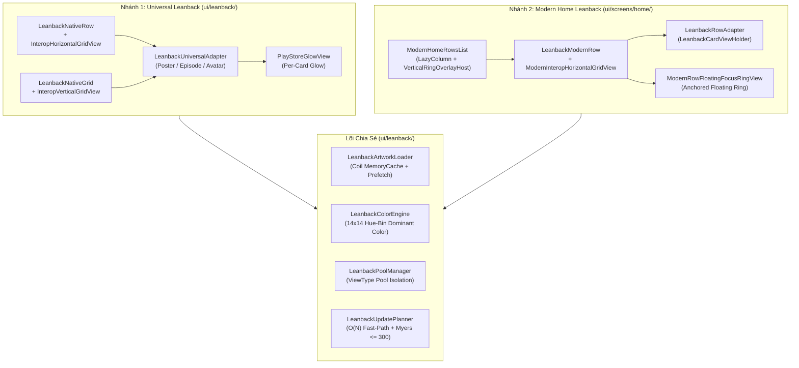
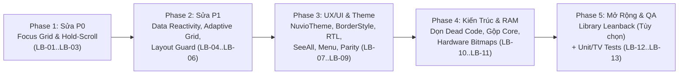

# Kế Hoạch Kiểm Toán & Tối Ưu Toàn Diện UX/UI Android Leanback (`tet2`)

> **Phạm vi kiểm toán**: Toàn bộ hệ thống Android Leanback Native (`ui/leanback/`), hệ thống Modern Home Leanback (`ui/screens/home/LeanbackModern*`, `ModernInteropHorizontalGridView`, `ModernRowFloatingFocusRingView`, `ModernHomeRowsList`), toàn bộ 11 điểm tích hợp trên ứng dụng và đối chiếu với các màn hình TV vẫn đang dùng Jetpack Compose Lists/Grids.
> **Nhánh khảo sát**: `tet2` (`HEAD = 0c6309047`) · **Mục tiêu**: Đánh giá trung thực mức độ tối ưu hiện tại, liệt kê đầy đủ **Lỗi / Thừa / Thiếu** có bằng chứng mã nguồn và lập lộ trình khắc phục theo thứ tự ưu tiên an toàn.

---

## 1. Tổng Quan Kiến Trúc & Độ Phủ Leanback Hiện Tại

Hiện tại dự án đang vận hành **song song 2 nhánh kiến trúc Leanback Native** cùng chia sẻ `LeanbackArtworkLoader`, `LeanbackColorEngine` và `LeanbackPoolManager`:

### Bảng Kiểm Kê Độ Phủ Màn Hình TV

| Màn hình / Thành phần | Công nghệ hiện tại | Trạng thái | Ghi chú kiểm toán |
| :--- | :--- | :---: | :--- |
| **Modern Home** (`ModernHomeRowsList` → `LeanbackModernRow`) | Leanback `HorizontalGridView` + Compose `LazyColumn` | ✅ Đã dùng | Có lỗi P0 kẹt `isHoldScrolling`, thiếu Watched/Blur/ClearLogo/CoverEmoji, bỏ qua `PosterBorderStyle` |
| **Classic Home — Catalog Rows** (`CatalogRowSection`) | `LeanbackNativeRow` | ✅ Đã dùng | Lỗi `remember` không cập nhật `isWatched`, thẻ `SeeAll` trống xám, 10 tham số thừa |
| **Classic Home — Continue Watching & Collections** | Compose `LazyRow` | ⚠️ Chưa đồng nhất | Trộn Compose `LazyRow` với Leanback `CatalogRowSection` trong cùng `LazyColumn` |
| **Grid Home** (`GridHomeContent`) | Compose `LazyVerticalGrid` | ⚠️ Chưa dùng | Cần giữ Compose do cấu trúc trộn Hero + CW + SectionDivider + Grid (`maxLineSpan`) hoặc tách riêng |
| **Catalog See All** (`CatalogSeeAllScreen`) | `LeanbackNativeGrid` | ✅ Đã dùng | Lỗi `isLastRow` khóa `DPAD_DOWN`, cố định cứng 4/6 cột tràn màn khi poster to, thiếu key `searchWatched*` |
| **Search — Kết quả tìm kiếm** (`SearchScreen` → `CatalogRowSection`) | `LeanbackNativeRow` | ✅ Đã dùng | Hưởng chung các lỗi của `CatalogRowSection` |
| **Search — Discover** (`SearchDiscoverSection`) | `LeanbackNativeGrid` | ✅ Đã dùng | Bị cướp focus từ thanh Filter khi nạp dữ liệu, lỗi `ACTION_UP` giật focus ngược về Grid |
| **Folder / Collection Detail** (`FolderDetailScreen`) | `LeanbackNativeGrid` | ✅ Đã dùng | Bị cướp focus khỏi thanh Tab khi chuyển tab, cố định cứng số cột |
| **Chi tiết phim** (`Episodes`, `Cast`, `Collection`, `MoreLikeThis`, `Trailers`) | `LeanbackNativeRow` | ✅ Đã dùng | Episode bị lỗi bo góc gradient dưới, Cast Avatar thiếu fallback khi không có ảnh, dư `listState` |
| **Cast Detail — Filmography** (`CastDetailScreen`) | `LeanbackNativeRow` | ✅ Đã dùng | Tích hợp tốt sau khi merge `FilmographyFilterTabs` |
| **TMDB Entity Browse** (`TmdbEntityBrowseScreen`) | `LeanbackNativeRow` | ✅ Đã dùng | Tích hợp tốt, phân trang `onLoadMore` thiếu debounce từ adapter |
| **Library — Saved Tab** (`LibraryScreen`) | Compose `LazyVerticalGrid` | ❌ Chưa dùng | Thư viện lớn (>200 mục) vẫn cuộn bằng Compose `LazyVerticalGrid`, tự throttle 80ms |
| **Live TV — Channel Grid & EPG Guide** (`LiveTvChannelGrid`, `LiveTvGuidePanels`) | Compose `LazyVerticalGrid`/`LazyColumn` + `PlayStoreGlowView` | ❌ Chưa dùng | Đã có kế hoạch riêng tại [PLAN-live-tv-leanback-integration.md](file:///f:/MyGithub/NuvioTV-Fast/PLAN-live-tv-leanback-integration.md) |

---

## 2. Kết Quả Kiểm Toán Chi Tiết: Đã Tối Ưu · Lỗi · Thừa · Thiếu

### 2.1. Những Phần ĐÃ Tối Ưu Tốt (Nên Bảo Toàn)
1. **Cập nhật danh sách `O(N)` thông minh**: [LeanbackUpdatePlanner.kt](file:///f:/MyGithub/NuvioTV-Fast/app/src/main/java/com/nuvio/tv/ui/leanback/adapter/LeanbackUpdatePlanner.kt) xử lý nhanh `NoOp`, `InPlaceChanges`, `AppendAndChange` trước khi rơi về Myers Diff (`<= 300` phần tử), tránh đơ UI thread trên danh sách lớn.
2. **Cache `BlurMaskFilter` & quản lý Software Layer theo vòng đời**: [PlayStoreGlowView.kt](file:///f:/MyGithub/NuvioTV-Fast/app/src/main/java/com/nuvio/tv/ui/leanback/core/PlayStoreGlowView.kt) và [ModernRowFloatingFocusRingView.kt](file:///f:/MyGithub/NuvioTV-Fast/app/src/main/java/com/nuvio/tv/ui/screens/home/ModernRowFloatingFocusRingView.kt) chỉ bật `LAYER_TYPE_SOFTWARE` khi `isAttachedToWindow && visibility == VISIBLE` rồi giải phóng ngay về `LAYER_TYPE_NONE`.
3. **Trích màu chủ đạo siêu nhẹ**: [LeanbackColorEngine.kt](file:///f:/MyGithub/NuvioTV-Fast/app/src/main/java/com/nuvio/tv/ui/leanback/core/LeanbackColorEngine.kt) giảm mẫu còn `14×14`, 1 lượt JNI `getPixels()`, `ThreadLocal<IntArray>`, gom trùng yêu cầu song song (in-flight coalescing).
4. **Đường dẫn ảnh đồng bộ MemoryCache**: [LeanbackArtworkLoader.kt](file:///f:/MyGithub/NuvioTV-Fast/app/src/main/java/com/nuvio/tv/ui/leanback/core/LeanbackArtworkLoader.kt) đọc `MemoryCache` đồng bộ 0ms khi cache hit, chuẩn hóa key khớp `CustomPosterFallbackInterceptor`, giới hạn bộ đệm `prefetchedKeysTracker` (`512`, trim `128`), chọn profile prefetch theo RAM (`8/2` vs `12/2`).
5. **Cô lập `RecycledViewPool` theo ViewType**: [LeanbackPoolManager.kt](file:///f:/MyGithub/NuvioTV-Fast/app/src/main/java/com/nuvio/tv/ui/leanback/pool/LeanbackPoolManager.kt) tách riêng `VIEW_TYPE_MODERN_CARD = 100` khỏi các ViewType Universal (`0..3`), ngăn crash ép kiểu `ClassCastException`.
6. **Phối hợp D-Pad Throttle**: [DpadThrottleModifier.kt](file:///f:/MyGithub/NuvioTV-Fast/app/src/main/java/com/nuvio/tv/ui/util/DpadThrottleModifier.kt) nhường sự kiện giữ phím trực tiếp cho `BaseGridView` khi focus nằm trong Leanback.
7. **Bảo vệ vòng đời AndroidView trong LazyColumn**: [ModernHomeRowsList.kt](file:///f:/MyGithub/NuvioTV-Fast/app/src/main/java/com/nuvio/tv/ui/screens/home/ModernHomeRowsList.kt#L828-L883) sơ tán focus trước `Operation$RemoveNode`, ngăn crash `ComposeRuntimeError ("pending composition has not been applied")`.

---

### 2.2. Các Lỗi / Bug Thực Tế Đang Tồn Tại (17 Lỗi)

> [!WARNING]
> **Nhóm lỗi P0 (3 lỗi nghiêm trọng)** gây ảnh hưởng trực tiếp tới khả năng điều hướng D-Pad và hiển thị ảnh trên Android TV thực tế — bắt buộc phải xử lý đầu tiên trước mọi cải tiến khác.

#### 🔴 Mức P0 — Nghiêm trọng (Critical)

| Mã lỗi | Vị trí mã nguồn | Mô tả lỗi & Tác động thực tế |
| :--- | :--- | :--- |
| **BUG-01** | [ModernHomeRowsList.kt](file:///f:/MyGithub/NuvioTV-Fast/app/src/main/java/com/nuvio/tv/ui/screens/home/ModernHomeRowsList.kt#L1085-L1110), [ModernHomeRowsList.kt](file:///f:/MyGithub/NuvioTV-Fast/app/src/main/java/com/nuvio/tv/ui/screens/home/ModernHomeRowsList.kt#L1151-L1215), [LeanbackUniversalAdapter.kt](file:///f:/MyGithub/NuvioTV-Fast/app/src/main/java/com/nuvio/tv/ui/leanback/adapter/LeanbackUniversalAdapter.kt#L348-L366), [LeanbackModernRowAdapter.kt](file:///f:/MyGithub/NuvioTV-Fast/app/src/main/java/com/nuvio/tv/ui/screens/home/LeanbackModernRowAdapter.kt#L512-L538) | **Poster đen trống vĩnh viễn sau khi giữ phím cuộn nhanh (`isHoldScrolling`)**: 1. `finishOverlayRingToCurrentGrid()` hủy `verticalHoldJobRef` khi người dùng bấm Trái/Phải ngắt cuộn dọc, nhưng **quên đặt `LeanbackArtworkLoader.isHoldScrolling = false`** → biến global singleton bị kẹt `true`, chặn tải MỌI ảnh uncached trên toàn ứng dụng. 2. `endVerticalHoldScroll()` chỉ gọi `triggerLandingRowImageRefresh(landingGrid)` cho duy nhất 1 hàng đích — các hàng còn lại đang hiển thị trên màn hình vẫn đen trống. 3. `onScrollSettled()` của cả 2 adapter không rebind các ViewHolder visible đang có `drawable == null && imageDisposable == null`. |
| **BUG-02** | [InteropVerticalGridView.kt](file:///f:/MyGithub/NuvioTV-Fast/app/src/main/java/com/nuvio/tv/ui/leanback/container/InteropVerticalGridView.kt#L163), [InteropVerticalGridView.kt](file:///f:/MyGithub/NuvioTV-Fast/app/src/main/java/com/nuvio/tv/ui/leanback/container/InteropVerticalGridView.kt#L342) | **Công thức `isLastRow` sai khóa cứng `DPAD_DOWN` ở hàng áp chót**: Code viết `actualPos >= (totalItems - cols)`. Với lưới 6 cột có 8 phim (hàng 0: `0..5`, hàng 1: `6..7`), khi đứng ở vị trí `2, 3, 4, 5` (vẫn là hàng 0), `8 - 6 = 2` → `isLastRow == true` → **không thể bấm Xuống để sang hàng 1**! Phải sửa thành `actualPos / cols >= (totalItems - 1) / cols`. |
| **BUG-03** | [InteropVerticalGridView.kt](file:///f:/MyGithub/NuvioTV-Fast/app/src/main/java/com/nuvio/tv/ui/leanback/container/InteropVerticalGridView.kt#L289-L326), [InteropVerticalGridView.kt](file:///f:/MyGithub/NuvioTV-Fast/app/src/main/java/com/nuvio/tv/ui/leanback/container/InteropVerticalGridView.kt#L350-L405) | **Giật ngược focus khi thoát Grid & nuốt phím biên**: 1. Ở `ACTION_UP` của 4 phím D-Pad, Grid không kiểm tra `hasFocus()` hay cờ thoát focus → ngay sau khi `onNavigateUpOnFirstRow` / `onNavigateLeftOnFirstColumn` chuyển focus sang Filter/Tab/Sidebar ở `ACTION_DOWN`, lúc nhả phím `ACTION_UP` Grid lại gọi `vh.itemView.requestFocus()` kéo focus giật ngược về Grid. 2. Ở `ACTION_DOWN`, khi callback biên trả `false`, hàm vẫn `return true` (nuốt sự kiện phím thay vì trả `false` cho Compose FocusManager tìm mục kế tiếp). |

#### 🟠 Mức P1 — Cao (High)

| Mã lỗi | Vị trí mã nguồn | Mô tả lỗi & Tác động thực tế |
| :--- | :--- | :--- |
| **BUG-04** | [CatalogRowSection.kt](file:///f:/MyGithub/NuvioTV-Fast/app/src/main/java/com/nuvio/tv/ui/components/CatalogRowSection.kt#L196-L218), [CatalogSeeAllScreen.kt](file:///f:/MyGithub/NuvioTV-Fast/app/src/main/java/com/nuvio/tv/ui/screens/CatalogSeeAllScreen.kt#L178-L197) | **Badge "Đã xem" (Watched) không tự cập nhật**: `CatalogRowSection` gọi `latestIsItemWatched(item)` bên trong `remember(catalogRow.items, showSeeAll, isLandscape, strSeeAll, showImdbRatings)` (thiếu key trạng thái watched). `CatalogSeeAllScreen` thiếu `searchWatchedSeriesIds?.value` và `searchWatchedMovieIds?.value` trong `remember(...)`. |
| **BUG-05** | [ModernHomeRowsList.kt](file:///f:/MyGithub/NuvioTV-Fast/app/src/main/java/com/nuvio/tv/ui/screens/home/ModernHomeRowsList.kt#L455-L499), [ModernHomeRows.kt](file:///f:/MyGithub/NuvioTV-Fast/app/src/main/java/com/nuvio/tv/ui/screens/home/ModernHomeRows.kt#L48-L88), [CatalogRowSection.kt](file:///f:/MyGithub/NuvioTV-Fast/app/src/main/java/com/nuvio/tv/ui/components/CatalogRowSection.kt#L57-L63) | **Tính năng cài đặt bị rơi rớt khi truyền xuống Leanback**: Trên Modern Home, `isCatalogItemWatched`, `blurUnwatchedEpisodes`, `useEpisodeThumbnails`, `continueWatchingCardStyle`, `alwaysShowLandscapeClearlogo`, `effectiveExpandEnabled`, `effectiveAutoplayEnabled` được nhận vào `ModernHomeRowsList` nhưng không truyền xuống `ModernRowSection` / `LeanbackCardViewHolder`. Trên Classic Home, `CatalogRowSection` bỏ qua 7 tham số Expand Backdrop / Trailer Preview (`@Suppress("UNUSED_PARAMETER")`). |
| **BUG-06** | [LeanbackNativeGrid.kt](file:///f:/MyGithub/NuvioTV-Fast/app/src/main/java/com/nuvio/tv/ui/leanback/LeanbackNativeGrid.kt#L157-L165) | **Tự động cướp focus không điều kiện khi lưới có dữ liệu**: `LaunchedEffect(gridKey, items.isNotEmpty(), gridViewRef)` luôn ép focus vào ô đầu lưới khi đổi `gridKey` (như đổi bộ lọc ở [SearchDiscoverSection.kt](file:///f:/MyGithub/NuvioTV-Fast/app/src/main/java/com/nuvio/tv/ui/screens/search/SearchDiscoverSection.kt#L578) hoặc đổi tab ở [FolderDetailScreen.kt](file:///f:/MyGithub/NuvioTV-Fast/app/src/main/java/com/nuvio/tv/ui/screens/collection/FolderDetailScreen.kt#L444)), giật focus khỏi nút Filter/Tab mà người dùng đang thao tác. Cần thêm cờ tường minh `requestInitialFocus: Boolean`. |
| **BUG-07** | [CatalogSeeAllScreen.kt](file:///f:/MyGithub/NuvioTV-Fast/app/src/main/java/com/nuvio/tv/ui/screens/CatalogSeeAllScreen.kt#L174), [SearchDiscoverSection.kt](file:///f:/MyGithub/NuvioTV-Fast/app/src/main/java/com/nuvio/tv/ui/screens/search/SearchDiscoverSection.kt#L545), [FolderDetailScreen.kt](file:///f:/MyGithub/NuvioTV-Fast/app/src/main/java/com/nuvio/tv/ui/screens/collection/FolderDetailScreen.kt#L447) | **Cố định cứng `numCols = 4 / 6` gây tràn màn hình**: Không tính số cột động theo chiều rộng thực (`BoxWithConstraints`) và `posterCardStyle.width` (như `GridHomeContent` đang làm). Khi người dùng chỉnh Poster Size lớn hơn trong Settings, cột cuối bị tràn/cắt ngoài khung TV. |
| **BUG-08** | [ModernRowFloatingFocusRingView.kt](file:///f:/MyGithub/NuvioTV-Fast/app/src/main/java/com/nuvio/tv/ui/screens/home/ModernRowFloatingFocusRingView.kt#L208-L212) | **Vẫn vẽ hiệu ứng Blur Glow khi người dùng đã tắt Animations**: `isGlowEnabled` luôn gán cứng `true`, bỏ qua `NuvioTheme.animationsEnabled == false`, khiến TV cấu hình yếu vẫn phải bật `LAYER_TYPE_SOFTWARE` vẽ Gaussian blur khi tắt hiệu ứng. |
| **BUG-09** | [LeanbackModernRowAdapter.kt](file:///f:/MyGithub/NuvioTV-Fast/app/src/main/java/com/nuvio/tv/ui/screens/home/LeanbackModernRowAdapter.kt#L131-L146), [LeanbackBaseViewHolder.kt](file:///f:/MyGithub/NuvioTV-Fast/app/src/main/java/com/nuvio/tv/ui/leanback/holder/LeanbackBaseViewHolder.kt#L172-L179) | **Gọi trùng callback điều hướng 2 lần trên 1 lần bấm phím**: `dispatchKeyEvent` ở `ModernInteropHorizontalGridView`/`InteropHorizontalGridView` và `root.setOnKeyListener` trong ViewHolder cùng gọi `onNavigateUp`/`onNavigateDown`/`onNavigateBack`. Khi callback ở `dispatchKeyEvent` trả `false`, sự kiện rơi xuống child ViewHolder và gọi callback thêm lần nữa. |
| **BUG-10** | [LeanbackUniversalAdapter.kt](file:///f:/MyGithub/NuvioTV-Fast/app/src/main/java/com/nuvio/tv/ui/leanback/adapter/LeanbackUniversalAdapter.kt#L122), [LeanbackModernRowAdapter.kt](file:///f:/MyGithub/NuvioTV-Fast/app/src/main/java/com/nuvio/tv/ui/screens/home/LeanbackModernRowAdapter.kt#L455) | **Gọi `notifyItemRangeChanged` không kiểm tra trạng thái layout**: `updateConfig()` gọi thẳng `notifyItemRangeChanged(0, items.size)` từ `AndroidView.update` mà không kiểm tra `rv.isComputingLayout || rv.isInLayout` → nguy cơ crash `IllegalStateException` khi đổi kích thước/label trong lúc RecyclerView đang đo vẽ. |

#### 🟡 Mức P2 — Trung bình (Medium)

| Mã lỗi | Vị trí mã nguồn | Mô tả lỗi & Tác động thực tế |
| :--- | :--- | :--- |
| **BUG-11** | [LeanbackEpisodeViewHolder.kt](file:///f:/MyGithub/NuvioTV-Fast/app/src/main/java/com/nuvio/tv/ui/leanback/holder/LeanbackEpisodeViewHolder.kt#L335-L350) | **Lỗi bo góc Gradient trên thẻ Tập phim (Episode)**: `gradientView` phủ phía trên `thumbnailImage` dùng `GradientDrawable` không thiết lập `cornerRadius` và không `clipToOutline = true` → 2 góc dưới màu đen đậm `#E6000000` lòi vuông sắc vượt ra ngoài góc bo tròn của ảnh. |
| **BUG-12** | [LeanbackNativeRow.kt](file:///f:/MyGithub/NuvioTV-Fast/app/src/main/java/com/nuvio/tv/ui/leanback/LeanbackNativeRow.kt#L279-L281), [LeanbackModernRow.kt](file:///f:/MyGithub/NuvioTV-Fast/app/src/main/java/com/nuvio/tv/ui/screens/home/LeanbackModernRow.kt#L270-L272) | **Giật ngược vị trí cuộn ngang khi recompose**: Trong `AndroidView.update`, nếu hàng không có focus và `selectedPosition != initialFocusPosition` (nhưng caller không đồng bộ lại `initialFocusPosition` theo thao tác cuộn gần nhất), hàng sẽ bị nhảy ngược về `initialFocusPosition`. |
| **BUG-13** | [LeanbackPosterViewHolder.kt](file:///f:/MyGithub/NuvioTV-Fast/app/src/main/java/com/nuvio/tv/ui/leanback/holder/LeanbackPosterViewHolder.kt#L355-L378), [LeanbackEpisodeViewHolder.kt](file:///f:/MyGithub/NuvioTV-Fast/app/src/main/java/com/nuvio/tv/ui/leanback/holder/LeanbackEpisodeViewHolder.kt#L451-L477) | **Lỗi lề RTL trên ngôn ngữ viết từ phải sang trái (`values-ar`)**: Dùng `Gravity.START`/`END` nhưng lại gán `leftMargin`/`rightMargin` thay vì `marginStart`/`marginEnd` khiến badge, chữ và khoảng đệm bị lệch lề ở giao diện RTL. |
| **BUG-14** | [LeanbackNativeRow.kt](file:///f:/MyGithub/NuvioTV-Fast/app/src/main/java/com/nuvio/tv/ui/leanback/LeanbackNativeRow.kt#L91), [LeanbackModernRow.kt](file:///f:/MyGithub/NuvioTV-Fast/app/src/main/java/com/nuvio/tv/ui/screens/home/LeanbackModernRow.kt#L67) | **Khóa cứng chiều cao vùng chữ (`44.dp` vs `26.dp`)**: Không nhân theo `fontScale` (nguy cơ cắt chữ khi Android TV bật cỡ chữ lớn), đồng thời gây thừa khoảng trống `44.dp` với `Episode` nếu caller quên đặt `showLabels = false`, và lệch chiều cao giữa Universal (`44.dp`) với Modern (`26.dp`). |
| **BUG-15** | [CatalogRowSection.kt](file:///f:/MyGithub/NuvioTV-Fast/app/src/main/java/com/nuvio/tv/ui/components/CatalogRowSection.kt#L220-L231) | **Thẻ "Xem tất cả" (See All) hiển thị sơ sài**: Dùng `LeanbackCardItem.Poster(imageUrl = null, badgeText = "ALL")` → hiển thị 1 ô màu xám đen trống rỗng, mất icon mũi tên `→`; khi tắt `showPosterLabels` thì mất hoàn toàn chữ "Xem tất cả". |
| **BUG-16** | [LeanbackUniversalAdapter.kt](file:///f:/MyGithub/NuvioTV-Fast/app/src/main/java/com/nuvio/tv/ui/leanback/adapter/LeanbackUniversalAdapter.kt#L368) | **Thiếu debounce `onLoadMore`**: Không có cơ chế chống gọi trùng (`250ms` + kiểm tra `itemCount`) như `LeanbackRowAdapter`, dẫn tới bắn lặp yêu cầu phân trang khi người dùng bấm nhanh gần cuối hàng/lưới. |
| **BUG-17** | [LeanbackArtworkLoader.kt](file:///f:/MyGithub/NuvioTV-Fast/app/src/main/java/com/nuvio/tv/ui/leanback/core/LeanbackArtworkLoader.kt#L246), [LeanbackArtworkLoader.kt](file:///f:/MyGithub/NuvioTV-Fast/app/src/main/java/com/nuvio/tv/ui/leanback/core/LeanbackArtworkLoader.kt#L322) | **Vô hiệu hóa cài đặt `Hardware Bitmaps` trên toàn bộ Leanback**: Gọi tường minh `.allowHardware(false)` khiến [HardwareBitmapSettingInterceptor.kt](file:///f:/MyGithub/NuvioTV-Fast/app/src/main/java/com/nuvio/tv/core/image/HardwareBitmapSettingInterceptor.kt#L13) bị bỏ qua (`extras[Extras.Key.allowHardware] != null`), tốn gấp đôi RAM bitmap trên Android TV Box RAM thấp. *(Cần lưu ý xử lý an toàn cho `LeanbackColorEngine` tránh đọc `getPixels()` trên `Config.HARDWARE`)* |

---

### 2.3. Các Phần THỪA / Trùng Lặp / Dead Code (8 Hạng Mục)

1. **Song song 2 bộ Leanback trùng ~80% logic**:
   - `InteropHorizontalGridView` vs `ModernInteropHorizontalGridView`
   - `LeanbackUniversalAdapter` vs `LeanbackRowAdapter`
   - `PlayStoreGlowView.filterCache` vs `ModernRowFloatingFocusRingView.ringFilterCache`
   - Logic `Placeholder-to-Data Focus Guard`, `applyItems`, `prefetchRowIndices`, `resolveLoadingProfile` đều bị sao chép nguyên khối giữa 2 nơi → sửa 1 bên dễ sót bên kia (điển hình là `BUG-01` và `BUG-16`).
2. **Lưu trùng dữ liệu trong `LeanbackColorEngine.kt`**: [LeanbackColorEngine.kt](file:///f:/MyGithub/NuvioTV-Fast/app/src/main/java/com/nuvio/tv/ui/leanback/core/LeanbackColorEngine.kt#L24-L25) khai báo cả `dominantColorCache: HashMap<String, Int>` lẫn `cacheOrder: LinkedHashMap<String, Int>` lưu y hệt cùng key/value, kèm `import android.util.LruCache` không sử dụng.
3. **Tham số & trường chết (Dead Parameters)**:
   - `isLandscape: Boolean` truyền xuyên suốt `ModernInteropHorizontalGridView.notifyCardFocused()` → `ModernRowFloatingFocusRingView.moveToTarget()` nhưng **không hề được sử dụng**.
   - `borderWidthPx`, `glowMarginPx` truyền vào `LeanbackCardViewHolder` nhưng không dùng (vì viền & glow vẽ hoàn toàn ở `ModernRowFloatingFocusRingView`).
   - `onNavigateRight` khai báo ở [LeanbackUniversalAdapter.kt](file:///f:/MyGithub/NuvioTV-Fast/app/src/main/java/com/nuvio/tv/ui/leanback/adapter/LeanbackUniversalAdapter.kt#L39) nhưng không bao giờ được gắn hay gọi.
4. **Ghi đè cấu hình `setItemViewCacheSize` dư thừa**: Constructor đặt `10` tại [InteropHorizontalGridView.kt](file:///f:/MyGithub/NuvioTV-Fast/app/src/main/java/com/nuvio/tv/ui/leanback/container/InteropHorizontalGridView.kt#L75) và [ModernInteropHorizontalGridView.kt](file:///f:/MyGithub/NuvioTV-Fast/app/src/main/java/com/nuvio/tv/ui/screens/home/ModernInteropHorizontalGridView.kt#L270), rồi `factory` của [LeanbackNativeRow.kt](file:///f:/MyGithub/NuvioTV-Fast/app/src/main/java/com/nuvio/tv/ui/leanback/LeanbackNativeRow.kt#L248) & [LeanbackModernRow.kt](file:///f:/MyGithub/NuvioTV-Fast/app/src/main/java/com/nuvio/tv/ui/screens/home/LeanbackModernRow.kt#L206) lập tức ghi đè thành `8`.
5. **Di sản tham số cũ trước khi chuyển Leanback**:
   - 10 tham số `@Suppress("UNUSED_PARAMETER")` trong [CatalogRowSection.kt](file:///f:/MyGithub/NuvioTV-Fast/app/src/main/java/com/nuvio/tv/ui/components/CatalogRowSection.kt#L57-L85).
   - Tham số `listState: LazyListState = rememberLazyListState()` cấp phát state thừa nhưng không dùng trong [CastSection.kt](file:///f:/MyGithub/NuvioTV-Fast/app/src/main/java/com/nuvio/tv/ui/screens/detail/CastSection.kt#L26), [CollectionSection.kt](file:///f:/MyGithub/NuvioTV-Fast/app/src/main/java/com/nuvio/tv/ui/screens/detail/CollectionSection.kt#L24), [MoreLikeThisSection.kt](file:///f:/MyGithub/NuvioTV-Fast/app/src/main/java/com/nuvio/tv/ui/screens/detail/MoreLikeThisSection.kt#L26), [TrailerSection.kt](file:///f:/MyGithub/NuvioTV-Fast/app/src/main/java/com/nuvio/tv/ui/screens/detail/TrailerSection.kt#L24).
   - `ModernHomeRowsList.kt` nhận các tham số `isCatalogItemWatched`, `enrichedPreviews`, `trailerPreviewUrls`, `trailerPreviewAudioUrls`, `alwaysShowLandscapeClearlogo`, `focusedPosterBackdropTrailerMuted`, `trailerPlaybackTarget`, `expandedTrailerPreviewUrl`, `expandedTrailerPreviewAudioUrl`, `blurUnwatchedEpisodes`, `useEpisodeThumbnails`, `continueWatchingCardStyle`, `onPreloadAdjacentItem`, `onBackdropInteraction`, `onExpandedCatalogFocusKeyChange`, `onExpansionInteractionNonceChange` nhưng không hề sử dụng trong thân hàm!
6. **Side-effect trong setter `canTakeFocus`**: [ModernInteropHorizontalGridView.kt](file:///f:/MyGithub/NuvioTV-Fast/app/src/main/java/com/nuvio/tv/ui/screens/home/ModernInteropHorizontalGridView.kt#L109-L123) thực thi `value?.invoke()` mỗi lần `AndroidView.update` gán lại lambda ở mọi recomposition.
7. **2 bộ `prefetchedKeys: LinkedHashSet<String>` riêng lẻ ở từng Adapter**: mỗi hàng tạo 1 set riêng mà không chuẩn hóa tiện ích dùng chung.
8. **Chú thích & cấu hình `nestedPrefetchStrategy` lỗi thời ở `ClassicHomeContent.kt`**: [ClassicHomeContent.kt](file:///f:/MyGithub/NuvioTV-Fast/app/src/main/java/com/nuvio/tv/ui/screens/home/ClassicHomeContent.kt#L181) vẫn dùng `LazyListPrefetchStrategy(nestedPrefetchItemCount = 2)` nhắm tới nested Compose `LazyRow` trong khi các hàng catalog đã chuyển sang `AndroidView(LeanbackNativeRow)`.

---

### 2.4. Các Phần THIẾU Về UX / UI / Accessibility / Độ Phủ (8 Hạng Mục)

1. **Chưa đồng bộ `NuvioTheme`, `PosterBorderStyle` & `AppFont`**:
   - Toàn bộ ViewHolder & Floating Focus Ring đang hardcode màu (`#38BDF8`, `#F59E0B`, `#1A1A1A`, `#9CA3AF`, `#222226`) và bỏ qua hoàn toàn thiết lập người dùng tại [FocusRingStyle.kt](file:///f:/MyGithub/NuvioTV-Fast/app/src/main/java/com/nuvio/tv/ui/theme/FocusRingStyle.kt) (`THEME`, `RAINBOW`, `SOLID_WHITE`, `SOLID_RED`, `SOLID_BLUE`, `SOLID_GOLD`, `NONE`) cũng như `AppTheme` / `amoledSurfacesMode` / `AppFont`.
   - Độ dày viền focus không nhất quán: Compose `PosterFocusedBorderWidth = 4.dp`, Universal Leanback = `2.5.dp`, Modern Leanback = `2.0.dp`.
2. **Thiếu hỗ trợ nút `KEYCODE_MENU` trên Remote TV**:
   - Người dùng TV quen bấm phím `Menu` (hoặc giữ `OK`) để mở tùy chọn Poster / Tập phim / Continue Watching; hiện Leanback chỉ xử lý `setOnLongClickListener`, chưa lắng nghe `KeyEvent.KEYCODE_MENU`.
3. **Thiếu hiệu ứng chạy chữ (Marquee) khi focus trên Poster**:
   - `LeanbackEpisodeViewHolder` đã bật `MARQUEE` khi focus, nhưng `LeanbackPosterViewHolder` và `LeanbackCardViewHolder` (Modern Home) đều cắt `END (...)` nên tên phim dài không bao giờ xem hết được.
4. **Thiếu trạng thái Fallback tinh tế khi ảnh thiếu hoặc lỗi**:
   - `LeanbackAvatarViewHolder`: Diễn viên chưa có ảnh chỉ hiện vòng tròn xám trống `#222226` (thiếu chữ cái đầu tên hoặc icon người).
   - `LeanbackPosterViewHolder` / `LeanbackCardViewHolder`: Khi ảnh lỗi tải và `showLabels == false`, thẻ trở thành ô xám hoàn toàn trống (thiếu tiêu đề fallback căn giữa bên trong khung poster).
5. **Thiếu kiểu hiển thị riêng cho thẻ `See All` và `CollectionFolder` (`coverEmoji`)**:
   - `LeanbackCardItem` cần loại `ActionTile` / `SeeAll` (vẽ icon mũi tên `→` + nhãn rõ ràng ở giữa, hoạt động đẹp cả khi `showLabels == false`).
   - `ModernPayload.CollectionFolder` đã mang `coverEmoji` nhưng `LeanbackCardViewHolder` chưa hiển thị emoji khi không có ảnh bìa.
6. **Thiếu tính năng hiển thị trên thẻ Modern Home (`LeanbackCardViewHolder`)**:
   - Chưa vẽ `Watched` checkmark badge, chưa vẽ `IMDb` / `AirDate` badge, chưa hỗ trợ `blurUnwatchedEpisodes` trên hàng Continue Watching, và chưa hỗ trợ lớp ClearLogo/gradient cho chế độ `alwaysShowLandscapeClearlogo`.
7. **Thiếu hoàn toàn Accessibility (`contentDescription`)**:
   - Cả 4 ViewHolder Native chưa gán `root.contentDescription` (tên phim, phụ đề, trạng thái đã xem, % tiến độ), làm giảm trải nghiệm với TalkBack / dịch vụ trợ năng trên Android TV.
8. **Khoảng trống độ phủ màn hình cần cân nhắc mở rộng**:
   - [LibraryScreen.kt](file:///f:/MyGithub/NuvioTV-Fast/app/src/main/java/com/nuvio/tv/ui/screens/library/LibraryScreen.kt#L307) (Tab Saved) vẫn dùng Compose `LazyVerticalGrid` — sẽ đạt lợi ích mượt 60fps rõ rệt nhất nếu chuyển sang `LeanbackNativeGrid` (sau khi sửa xong `BUG-02`, `BUG-03`, `BUG-06`, `BUG-07`).
   - [CollectionRowSection.kt](file:///f:/MyGithub/NuvioTV-Fast/app/src/main/java/com/nuvio/tv/ui/components/CollectionRowSection.kt) & [ContinueWatchingSection.kt](file:///f:/MyGithub/NuvioTV-Fast/app/src/main/java/com/nuvio/tv/ui/components/ContinueWatchingSection.kt) trên Classic Home vẫn là Compose `LazyRow`.
   - *(Live TV được tách riêng theo [PLAN-live-tv-leanback-integration.md](file:///f:/MyGithub/NuvioTV-Fast/PLAN-live-tv-leanback-integration.md), không gộp vào phạm vi kế hoạch này để tránh phình to rủi ro)*.

---

## 3. Rủi Ro & Lưu Ý Kiến Trúc Trước Khi Triển Khai

> [!IMPORTANT]
> **Bảo toàn tương thích khi đồng bộ `dev` định kỳ**: Các màn hình như `ModernHomeRowsList.kt`, `CatalogRowSection.kt`, `FolderDetailScreen.kt`, `CastDetailScreen.kt`, `LibraryScreen.kt` thường xuyên có commit mới từ `upstream/dev`. Mọi thay đổi nên ưu tiên **đóng gói sạch trong `ui/leanback/`** (adapter, container, theme config, helper) và hạn chế tối đa việc sửa dàn trải ở các file màn hình để giảm xung đột merge về sau.

> [!WARNING]
> **Rủi ro #1 — Crash `Config#HARDWARE` khi bật lại Hardware Bitmaps (`BUG-17`)**:
> `LeanbackColorEngine.extractDominantColorAsync` gọi `Bitmap.getPixels()`. Nếu `LeanbackArtworkLoader` cho phép `HardwareBitmapSettingInterceptor` decode ảnh dạng `Bitmap.Config.HARDWARE`, mọi cuộc gọi `getPixels()` trên ảnh đó sẽ ném `IllegalStateException`. **Bắt buộc**: trong `LeanbackColorEngine` phải kiểm tra `bitmap.config == Bitmap.Config.HARDWARE` và dùng software copy thu nhỏ (hoặc chỉ trích màu trên bản copy an toàn / fallback màu theme) trước khi gỡ `.allowHardware(false)`.

> [!WARNING]
> **Rủi ro #2 — Regression cuộn dọc siêu mượt (Vertical Glide) của Modern Home**:
> Cơ chế `VerticalRingOverlayHost` + `ModernRowFloatingFocusRingView` trong `ModernHomeRowsList.kt` cực kỳ nhạy cảm về thứ tự `requestFocus()`, `prepareForRowChange()`, và `handoffOverlayToGrid()`. Khi sửa `BUG-01` và `BUG-08`, tuyệt đối không thay đổi luồng trạng thái `overlayGenerationRef` hoặc phá vỡ việc giữ focus trên `VerticalRingOverlayHost` trong lúc cuộn dọc.

> [!NOTE]
> **Không đụng chạm các thay đổi TorrServer đang mở trên nhánh `tet2`**: Hiện nhánh `tet2` đang có 3 file modified chưa commit thuộc tính năng `seeds · peers` của TorrServer (`PlayerRuntimeControllerTorrent.kt`, `PlayerRuntimeControllerPlaybackEvents.kt`, `PlayerScreen.kt`). Khi thực thi kế hoạch này, giữ nguyên độc lập và không tác động tới 3 tệp đó.

---

## 4. Lộ Trình Triển Khai Theo Phase & Chuỗi Phụ Thuộc

### Phase 1: Khắc Phục Lỗi P0 Nghiêm Trọng (Focus & Ảnh Trống)
- **Mục tiêu**: Triệt tiêu 100% lỗi khóa phím `DPAD_DOWN`, giật focus ngược khỏi Filter/Tab/Sidebar và poster đen trống vĩnh viễn sau khi cuộn nhanh.
- **Công việc**:
  - **LB-01**: Khắc phục triệt để cơ chế `isHoldScrolling` & phục hồi ảnh sau khi dừng cuộn (`BUG-01`):
    - Reset `LeanbackArtworkLoader.isHoldScrolling = false` bên trong `finishOverlayRingToCurrentGrid()` tại [ModernHomeRowsList.kt](file:///f:/MyGithub/NuvioTV-Fast/app/src/main/java/com/nuvio/tv/ui/screens/home/ModernHomeRowsList.kt#L1085-L1110).
    - Khi `endVerticalHoldScroll()` kết thúc, refresh ảnh cho **tất cả các hàng đang visible** (không chỉ `landingGrid`).
    - Bổ sung `rebindMissingImages()` trong `onScrollSettled()` của cả [LeanbackUniversalAdapter.kt](file:///f:/MyGithub/NuvioTV-Fast/app/src/main/java/com/nuvio/tv/ui/leanback/adapter/LeanbackUniversalAdapter.kt) và [LeanbackModernRowAdapter.kt](file:///f:/MyGithub/NuvioTV-Fast/app/src/main/java/com/nuvio/tv/ui/screens/home/LeanbackModernRowAdapter.kt) cho mọi ViewHolder đang gắn có `drawable == null && imageDisposable == null`.
  - **LB-02**: Sửa toàn diện điều hướng biên & focus trên `InteropVerticalGridView` (`BUG-02`, `BUG-03`):
    - Sửa công thức `isLastRow` tại dòng 163 & 342 thành `totalItems > 0 && actualPos >= 0 && (actualPos / cols) >= (totalItems - 1) / cols`.
    - Thêm cờ `isNavigatingOutOfGrid` (reset khi `onFocusChanged(gainFocus = true)` hoặc `ACTION_DOWN` di chuyển nội bộ); ở `ACTION_UP` chỉ gọi `requestFocus()` khi `hasFocus() && !isNavigatingOutOfGrid`.
    - Khi callback biên (`onNavigateUpOnFirstRow`, `onNavigateDownOnLastRow`, `onNavigateLeftOnFirstColumn`, `onNavigateRightOnLastColumn`) trả `false` (và `repeatCount == 0`), trả `false` thay vì nuốt phím (hoặc chặn chọn lọc theo cấu hình biên) để tránh kẹt focus.
  - **LB-03**: Sửa lỗi gọi trùng callback điều hướng & `updateConfig` không an toàn layout (`BUG-09`, `BUG-10`):
    - Loại bỏ lời gọi trùng `onNavigateUp`/`onNavigateDown`/`onNavigateBack` trong `root.setOnKeyListener` của `LeanbackCardViewHolder` và `LeanbackBaseViewHolder` (chỉ để một nơi xử lý duy nhất tại container `dispatchKeyEvent`).
    - Bọc `notifyItemRangeChanged` trong `updateConfig()` bằng guard `if (rv.isComputingLayout || rv.isInLayout) rv.post { ... } else notifyItemRangeChanged(...)` ở cả 2 adapter.

### Phase 2: Ổn Định Dữ Liệu, Grid Thích Ứng & Tắt Hiệu Ứng Đúng Cài Đặt
- **Mục tiêu**: Đảm bảo dữ liệu Watched cập nhật tức thì, lưới tự chia cột không tràn màn hình, không cướp focus khỏi Filter/Tab, và tôn trọng cài đặt `animationsEnabled = false`.
- **Công việc**:
  - **LB-04**: Sửa reactivity trạng thái Watched & debounce phân trang (`BUG-04`, `BUG-16`, `BUG-12`):
    - Truyền rõ `isItemWatched` / `watchedMovieIds` / `watchedSeriesIds` vào key `remember(...)` của [CatalogRowSection.kt](file:///f:/MyGithub/NuvioTV-Fast/app/src/main/java/com/nuvio/tv/ui/components/CatalogRowSection.kt#L196) và [CatalogSeeAllScreen.kt](file:///f:/MyGithub/NuvioTV-Fast/app/src/main/java/com/nuvio/tv/ui/screens/CatalogSeeAllScreen.kt#L178).
    - Thêm debounce `250ms` + khóa `lastLoadMoreItemCount` cho `onLoadMore` trong [LeanbackUniversalAdapter.kt](file:///f:/MyGithub/NuvioTV-Fast/app/src/main/java/com/nuvio/tv/ui/leanback/adapter/LeanbackUniversalAdapter.kt).
    - Chỉ đồng bộ `setSelectedPosition(initialFocusPosition)` trong `AndroidView.update` của `LeanbackNativeRow` và `LeanbackModernRow` khi `initialFocusPosition` thực sự đổi giá trị (dùng tracker `lastAppliedInitialPosition`), tránh giật ngược cuộn khi recompose.
  - **LB-05**: Thêm `requestInitialFocus` có kiểm soát & tính `numColumns` thích ứng cho `LeanbackNativeGrid` (`BUG-06`, `BUG-07`):
    - Bổ sung tham số `requestInitialFocus: Boolean = true` cho `LeanbackNativeGrid`; đặt `false` (hoặc theo điều kiện tường minh `focusResults || shouldRestoreFocusedItem`) ở `SearchDiscoverSection` và `FolderDetailScreen` khi focus đang ở thanh Filter/Tab.
    - Tạo hàm dùng chung `computeAdaptiveGridColumns(availableWidth, cardWidth, horizontalSpacing, minCols = 2)` và áp dụng cho `CatalogSeeAllScreen`, `SearchDiscoverSection`, `FolderDetailScreen` thông qua `BoxWithConstraints`.
  - **LB-06**: Tôn trọng `animationsEnabled == false` trong `ModernRowFloatingFocusRingView` (`BUG-08`):
    - Truyền trạng thái `animationsEnabled` vào [ModernRowFloatingFocusRingView.kt](file:///f:/MyGithub/NuvioTV-Fast/app/src/main/java/com/nuvio/tv/ui/screens/home/ModernRowFloatingFocusRingView.kt) và `VerticalRingOverlayHost`: khi tắt animation, đặt `isGlowEnabled = false` (tắt software blur layer, chỉ giữ viền sắc nét 0-cost HWUI) và bỏ nội suy mượt.

### Phase 3: Hoàn Thiện UX/UI, Đồng Bộ `NuvioTheme` & Parity Tính Năng
- **Mục tiêu**: Biến mọi thẻ Leanback trông đồng nhất 100% với ngôn ngữ thiết kế `NuvioTheme`, hoàn thiện trải nghiệm Remote TV, RTL, chữ lớn, ảnh lỗi và Accessibility.
- **Công việc**:
  - **LB-07**: Tạo `LeanbackThemeStyle` đồng bộ `NuvioTheme`, `PosterBorderStyle` & `AppFont`:
    - Xây dựng data class `LeanbackThemeStyle` (đọc từ `NuvioTheme.colors`, `LocalPosterFocusRingStyle`, `PosterBorderStyle`, `AppFont`, `fontScale`) chứa: `surfacePlaceholderColor`, `titleColor`, `subtitleColor`, `accentProgressColor`, `badgeBgColor`, `watchedBadgeColor`, `posterBorderStyle`, `focusRingColors` (hỗ trợ cả solid, theme accent, rainbow `SweepGradient`/`LinearGradient`, và `NONE`), `focusBorderWidthPx`, `typeface`.
    - Áp dụng đồng bộ vào `LeanbackBaseViewHolder`, `LeanbackPosterViewHolder`, `LeanbackEpisodeViewHolder`, `LeanbackAvatarViewHolder`, `LeanbackCardViewHolder` và `ModernRowFloatingFocusRingView`.
    - Chuẩn hóa chiều cao vùng nhãn theo `fontScale` (loại bỏ khoảng trống thừa `44.dp` với Episode khi `showLabels = false`, ngăn cắt chữ ở cỡ chữ lớn `BUG-14`).
  - **LB-08**: Sửa lỗi hiển thị chi tiết (Episode Gradient, RTL, SeeAll Card, Fallback, Marquee, Menu Key, Accessibility) (`BUG-11`, `BUG-13`, `BUG-15`):
    - Bo góc cho `gradientView` (hoặc dùng `cardContainer.clipToOutline = true` tách lớp glow ra ngoài) trong `LeanbackEpisodeViewHolder.kt` để không còn lòi 2 góc vuông đen.
    - Thay toàn bộ `leftMargin`/`rightMargin` thành `marginStart`/`marginEnd` trong `LeanbackPosterViewHolder` và `LeanbackEpisodeViewHolder`.
    - Bổ sung nhánh/ViewType riêng cho thẻ **See All** (nền elevated có bo góc, icon mũi tên `→` rõ ràng và chữ căn giữa, đẹp ngay cả khi tắt `showLabels`).
    - Bổ sung Fallback chữ cái đầu (Initials) / icon người trên `LeanbackAvatarViewHolder` khi thiếu ảnh, và tiêu đề fallback trên Poster khi ảnh lỗi tải mà `showLabels == false`.
    - Bật `TextUtils.TruncateAt.MARQUEE` có độ trễ ngắn khi focus cho tiêu đề trong `LeanbackPosterViewHolder` và `LeanbackCardViewHolder`.
    - Hỗ trợ `KeyEvent.KEYCODE_MENU` trên container/ViewHolder để gọi `onItemLongClick` (mở Poster/Episode/CW Options).
    - Gán `contentDescription` đầy đủ cho TalkBack trên cả 4 ViewHolder.
  - **LB-09**: Khôi phục Parity hiển thị cho Modern Home (`LeanbackCardViewHolder`) (`BUG-05`):
    - Đưa trạng thái `isWatched`, `badgeText` (IMDb / AirDate), `blurThumbnail` (tôn trọng `blurUnwatchedEpisodes` trên hàng Continue Watching), và `coverEmoji` (cho `ModernPayload.CollectionFolder` không có ảnh bìa) vào `ModernCarouselItem` / `LeanbackCardViewHolder`.
    - Rà soát quyết định với các cài đặt Expand Backdrop / Trailer Autoplay trên Classic & Modern Home (làm rõ trong UI hoặc nối lại sạch sẽ, không để tham số chết gây hiểu nhầm).

### Phase 4: Tinh Gọn Kiến Trúc, Dọn Code Thừa & Tối Ưu RAM Ảnh
- **Mục tiêu**: Giảm chi phí bảo trì và nguy cơ lệch logic giữa 2 nhánh Leanback, giải phóng RAM bitmap trên TV Box yếu.
- **Công việc**:
  - **LB-10**: Hợp nhất tiện ích lõi & dọn toàn bộ Dead Code:
    - Tách `LeanbackBlurFilterCache` dùng chung giữa `PlayStoreGlowView` và `ModernRowFloatingFocusRingView`.
    - Tách `LeanbackPrefetchController` dùng chung cho `LeanbackUniversalAdapter` và `LeanbackRowAdapter`.
    - Rút gọn `LeanbackColorEngine.kt` còn 1 `LinkedHashMap` (access-order LRU) duy nhất, xóa `dominantColorCache` trùng lặp và unused import `LruCache`.
    - Xóa toàn bộ tham số/cờ chết: `isLandscape` trong `ModernRowFloatingFocusRingView`/`ModernInteropHorizontalGridView`, `borderWidthPx`/`glowMarginPx` ở `LeanbackCardViewHolder`, `onNavigateRight` ở `LeanbackUniversalAdapter`, 10 tham số thừa ở `CatalogRowSection` (sau khi thống nhất), `listState` thừa ở 4 Detail Sections, bỏ gọi trùng `setItemViewCacheSize`, và bỏ side-effect gọi `value?.invoke()` trong setter `canTakeFocus`.
  - **LB-11**: Tích hợp an toàn cài đặt `Hardware Bitmaps` cho `LeanbackArtworkLoader` (`BUG-17`):
    - Cập nhật `LeanbackColorEngine.extractDominantColorAsync` xử lý an toàn khi nhận `Bitmap.Config.HARDWARE` (thu nhỏ/copy software kích thước 14×14 qua `Bitmap.createScaledBitmap` hoặc `copy(ARGB_8888, false)` chỉ cho đúng 1 thẻ đang focus, hoặc bỏ qua nếu thất bại mà không crash).
    - Bỏ ép cứng `.allowHardware(false)` trong `LeanbackArtworkLoader.kt` (chỉ giữ `.allowHardware(false)` khi `blurred == true` vì `BlurTransformation` cần đọc pixel CPU), để `HardwareBitmapSettingInterceptor` tự động áp dụng theo cài đặt của người dùng.

### Phase 5: Mở Rộng Độ Phủ (Tùy Chọn) & Kiểm Thử Nghiệm Thu Toàn Diện
- **Mục tiêu**: Mở rộng Leanback sang màn hình mang lại hiệu quả lớn nhất còn lại và khóa chặt chất lượng bằng unit tests + checklist kiểm thử TV thực tế.
- **Công việc**:
  - **LB-12** *(Tùy chọn mở rộng)*: Đánh giá và chuyển Tab Saved của [LibraryScreen.kt](file:///f:/MyGithub/NuvioTV-Fast/app/src/main/java/com/nuvio/tv/ui/screens/library/LibraryScreen.kt) (hoặc tách thành phần lưới poster bên dưới thanh Header/Filter) sang `LeanbackNativeGrid` với adaptive columns + `requestInitialFocus = false` (chỉ bật khi user đồng ý mở rộng phạm vi ngoài core Leanback).
  - **LB-13**: Bổ sung bộ Unit Tests toàn diện & Nghiệm thu trên Android TV.

---

## 5. Kế Hoạch Kiểm Thử & Xác Minh (Verification Plan)

### 5.1. Kiểm Thử Tự Động (Unit Tests — `./gradlew :app:testFullDebugUnitTest`)
Mở rộng [LeanbackCoreOptimizationTest.kt](file:///f:/MyGithub/NuvioTV-Fast/app/src/test/java/com/nuvio/tv/ui/leanback/LeanbackCoreOptimizationTest.kt) và bổ sung các test mới:
1. **`InteropVerticalGridViewNavigationTest`**:
   - Kiểm tra công thức `isLastRow` với mọi tổ hợp `totalItems` và `cols` (VD: `cols=6, totalItems=7..13`, `cols=4, totalItems=5`, `totalItems=1`, `totalItems=0`).
   - Kiểm tra trạng thái `isNavigatingOutOfGrid`: khi `ACTION_DOWN` thoát biên trả `true`, `ACTION_UP` không được gọi `requestFocus()` kéo ngược về Grid.
2. **`LeanbackHoldScrollRecoveryTest`**:
   - Kiểm tra `finishOverlayRingToCurrentGrid` luôn đưa `LeanbackArtworkLoader.isHoldScrolling` về `false`.
   - Kiểm tra `onScrollSettled()` phát hiện và gọi lại tải ảnh cho mọi ViewHolder visible đang bị `drawable == null && imageDisposable == null`.
3. **`LeanbackAdaptiveColumnsTest`**:
   - Kiểm tra `computeAdaptiveGridColumns` ở các mức width `720dp`, `960dp`, `1280dp` với `posterWidth` từ `100dp` đến `260dp` (landscape) — bảo đảm tổng chiều rộng không vượt quá `availableWidth`.
4. **`LeanbackColorEngineHardwareBitmapTest`**:
   - Kiểm tra 1-map LRU eviction hoạt động chính xác với giới hạn 256 phần tử và không crash khi gặp bitmap `Config.HARDWARE`.
5. **`LeanbackLoadMoreDebounceTest`**:
   - Kiểm tra `LeanbackUniversalAdapter` không bắn `onLoadMore` lặp trong cửa sổ `250ms` hoặc khi `itemCount` chưa tăng.
6. **Build & Regression Check**:
   - Chạy `./gradlew :app:compileFullDebugKotlin :app:testFullDebugUnitTest` (xác nhận toàn bộ test cũ + mới đều pass 100%).

### 5.2. Kiểm Thử Thủ Công Trên Android TV / Emulator
- [ ] **Modern Home — Vertical Hold Scroll & Interrupt**: Giữ `DPAD_DOWN` lướt nhanh 10+ hàng rồi đang giữ bấm ngay `DPAD_RIGHT` → xác nhận mọi poster ở cả hàng đang đứng lẫn hàng bên dưới đều tải đầy đủ, không có ô đen trống.
- [ ] **Modern Home — Tắt Animations**: Vào `Settings → Advanced → Animations = OFF` → di chuyển trên Modern Home, kiểm tra không còn quầng mờ blur glow và không rớt khung hình.
- [ ] **Grid Navigation (`CatalogSeeAll`, `SearchDiscover`, `FolderDetail`)**:
  - Mở danh mục có số phim không chia hết cho số cột (VD: 7, 8, 13 phim) → bấm `DPAD_DOWN` từ mọi cột hàng áp chót đều xuống được hàng cuối.
  - Từ hàng đầu bấm `DPAD_UP` lên thanh Filter/Tab, thả nút → focus ở yên trên Filter/Tab, không giật ngược xuống Grid.
  - Từ cột đầu bấm `DPAD_LEFT` mở Sidebar, thả nút → Sidebar giữ focus ổn định.
  - Đổi Poster Size lên mức lớn nhất trong Settings → lưới tự giảm số cột hợp lý, không bị cắt mép phải.
- [ ] **Watched Badge & Menu Key**:
  - Bấm phím `MENU` (và giữ `OK`) trên poster ở Classic Home, Modern Home, Catalog See All, Search Discover → mở được Poster Options.
  - Đánh dấu "Đã xem" → dấu tích xanh hiện ngay lập tức mà không cần thoát màn hình.
- [ ] **Visual & Theme Parity**:
  - Đổi lần lượt `PosterBorderStyle` (`THEME`, `RAINBOW`, `SOLID_WHITE`, `SOLID_GOLD`, `NONE`) và `AppTheme` → viền focus trên cả Classic Home, Modern Home, Detail, Grid cập nhật đồng nhất.
  - Kiểm tra thẻ Episode trong Detail: 2 góc dưới bo tròn mượt, không lòi góc đen vuông.
  - Kiểm tra thẻ "Xem tất cả" trên Classic Home khi bật và tắt `Poster Labels`.
  - Chuyển ngôn ngữ sang tiếng Ả Rập (RTL) và tăng Android Font Scale `1.3x` → badge, lề và chữ không bị lệch hoặc cắt mất dòng.
- [ ] **Hardware Bitmaps Toggle**: Bật `Hardware Bitmaps = ON` trong `Settings → Advanced` → lướt nhanh Modern Home & Detail, không crash `IllegalStateException` và kiểm tra RAM giảm trên Android Studio Profiler.
