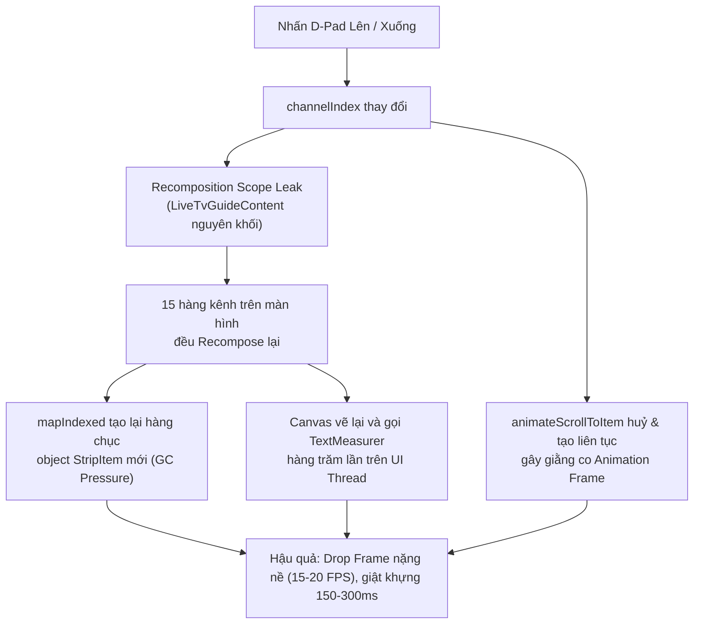

# Kế Hoạch Chiến Lược: Tối Ưu Toàn Diện Hiệu Năng Live TV Guide (60 FPS TV-Grade)

> **Mục tiêu**: Loại bỏ triệt để hiện tượng lag giật, khựng hình (frame drops) khi di chuyển phím điều hướng (D-Pad) và thao tác trong Live TV Guide; đạt tốc độ phản hồi tức thì 60 FPS trên mọi thiết bị Android TV (kể cả chip lõi tứ Amlogic/MediaTek cấu hình thấp).

---

## 🔍 I. Báo Cáo Khảo Sát & Phân Tích Nguyên Nhân Gốc Rễ (Root Causes)

Qua phân tích mã nguồn `LiveTvGuideScreen.kt`, `GuideRowStrip.kt`, `LiveTvViewModel.kt` và `LiveTvComponents.kt`, phát hiện 4 "nút thắt cổ chai" (bottlenecks) chính:

### 1. Rò rỉ phạm vi Recomposition (Recomposition Scope Leaks)
- Toàn bộ màn hình `LiveTvGuideContent` hiện là một Composable nguyên khối lớn (> 1.400 dòng).
- Mỗi khi nhấn phím Lên / Xuống, `channelIndex` thay đổi $\rightarrow$ **toàn bộ 15 hàng kênh trong `LazyColumn` đều bị recompose lại** (thay vì chỉ recompose 2 hàng: hàng cũ mất focus và hàng mới nhận focus).
- Khi recompose, từng hàng kênh phải chạy lại việc tạo modifier, layout Row, Box, kiểm tra trạng thái yêu thích, tính toán lại thời gian.

### 2. Tạo đối tượng dư thừa & tính toán đo đạc Text lặp lại trong Canvas
- Tại mỗi dòng kênh, `chPrograms.mapIndexed { ... StripItem(...) }` **hoàn toàn không được `remember`**. Mỗi lần recompose là tạo mới hàng chục đối tượng `StripItem`, gây áp lực thu gom rác (Garbage Collector pauses).
- Trong `GuideRowStrip.kt`, `TextMeasurer` của Compose thực hiện đo layout text nhiều lần trong `DrawScope` ngay trên Main UI thread mỗi frame cuộn.

### 3. Xung đột Animation cuộn (Animation Cancellation Thrashing)
- `LaunchedEffect(channelIndex, ...)` gọi `channelListState.animateScrollToItem(...)`. Khi người dùng bấm phím liên tục hoặc giữ phím để lướt kênh, animation cũ bị huỷ ngay lập tức để chạy animation mới, gây giật cục và làm chậm tốc độ đáp ứng của bàn phím.

### 4. Tải logo kênh qua Coil chưa tối ưu cho TV
- Khi cuộn nhanh qua hàng chục kênh, các instance `AsyncImage` kích hoạt tải và giải mã ảnh mà không giới hạn kích thước phần cứng (downsampling), làm tốn RAM và nghẽn CPU background thread.

---

## 🎯 II. Mục Tiêu & Tiêu Chí Thành Công (Success Criteria)

| Tiêu chí | Hiện tại | Mục tiêu sau tối ưu |
| :--- | :--- | :--- |
| **FPS khi duyệt kênh (D-Pad Zapping)** | 15 - 25 FPS (giật khựng) | **58 - 60 FPS mượt mà** |
| **Số hàng kênh Recompose khi đổi kênh** | 100% hàng trên màn hình (15 hàng) | **Chỉ đúng 2 hàng** (hàng cũ & hàng mới) |
| **Độ trễ phản hồi phím bấm** | ~150 - 300ms | **< 16ms (ngay trong 1 frame)** |
| **Cấp phát bộ nhớ khi lướt (GC Allocation)** | Hàng trăm object `StripItem`/lần bấm | **Gần như 0 (Zero Allocations)** |

---

## 🗺️ III. Kế Hoạch Triển Khai Chiến Lược (Phase-by-Phase)

### 🟢 GIAI ĐOẠN 1: Cô Lập Recomposition (Surgical Component Isolation)
> **Mục tiêu**: Khi `channelIndex` thay đổi, chỉ Recompose đúng 2 item liên quan, 13 item còn lại giữ nguyên (Skip Recomposition 100%).

- [ ] **1.1. Tách `ChannelRowItem` thành Composable độc lập**:
  - Chuyển toàn bộ UI hiển thị một hàng kênh (Channel Block + EPG Strip) ra hàm `@Composable private fun ChannelRowItem(...)`.
  - Sử dụng `@Stable` / Primitive parameters: truyền `isFocused: Boolean`, `isPlaying: Boolean`, `isFavorite: Boolean` thay vì truyền biến `channelIndex` hay danh sách lớn.
  - Nhờ Compose Smart Recomposition: khi bấm Lên/Xuống, các hàng không thay đổi `isFocused` sẽ được Skip hoàn toàn!
- [ ] **1.2. Tách `TopGuideHeader` thành Composable độc lập**:
  - Cô lập khu vực xem trước (Live Preview Player + thông tin chương trình trên cùng).
  - Chỉ recompose khu vực này khi kênh đang chọn thay đổi, không kéo theo việc recompose của bảng kênh phía dưới.
- [ ] **1.3. Tách `CategoryDrawer` thành Composable riêng biệt**:
  - Ngăn kéo danh mục bên trái chỉ recompose khi `drawerIndex` hoặc danh sách nhóm thay đổi.

---

### 🟡 GIAI ĐOẠN 2: Tối Ưu Canvas & Memoize EPG Strip (Zero Allocation)
> **Mục tiêu**: Loại bỏ hoàn toàn việc cấp phát bộ nhớ và tính toán lặp lại khi vẽ Canvas EPG.

- [ ] **2.1. Memoize danh sách `StripItem`**:
  - Bọc khối tạo `stripItems` bằng `remember(ch.key, chPrograms, startWindow, endWindow, isTimelineFocused, timelineProgramIndex)` hoặc đưa vào class trạng thái để không tạo lại object khi chỉ cuộn dọc.
- [ ] **2.2. Tối ưu hoá Text Layout Cache trong `GuideRowStrip`**:
  - Không khởi tạo lại các hàm đo đạc text bên trong `DrawScope`.
  - Tận dụng `TextMeasurer(cacheSize = 512)` và cache kết quả đo của các tiêu đề phổ biến.
  - Sử dụng tính toán tọa độ X và Width dạng Primitive Float trực tiếp, tránh chuyển đổi Dp $\leftrightarrow$ Px lặp đi lặp lại trong vòng lặp vẽ.
- [ ] **2.3. Bỏ qua vẽ các chương trình nằm ngoài màn hình (Viewport Culling)**:
  - Kiểm tra `left + w < 0f || left > size.width` ngay từ đầu vòng lặp để bỏ qua tính toán text cho các item khuất.

---

### 🔵 GIAI ĐOẠN 3: Tối Ưu Điều Hướng D-Pad & Cuộn Danh Sách Thông Minh (Fast Zapping)
> **Mục tiêu**: Duyệt kênh tốc độ cao không bị gián đoạn, không xung đột animation.

- [ ] **3.1. Phân tách chế độ cuộn: Lướt nhanh (Instant) vs Dừng (Smooth Snap)**:
  - Khi người dùng giữ phím D-Pad hoặc bấm nhanh liên tục (< 150ms giữa các lần bấm): sử dụng `scrollToItem` trực tiếp để lập tức cập nhật khung nhìn, không khởi tạo Coroutine Animation chồng chéo.
  - Khi người dùng dừng lại ở một kênh: kích hoạt `animateScrollToItem` đưa kênh vào vị trí đẹp (cách mép 2 item).
- [ ] **3.2. Giới hạn tần số debounce Preview Player**:
  - Giữ vững mức debounce 450ms trước khi gọi `viewModel.play()` để việc lướt kênh không bao giờ làm giật luồng giải mã video của ExoPlayer.

---

### 🟣 GIAI ĐOẠN 4: Tối Ưu Tải Logo & Quản Lý Bộ Nhớ (Coil Image Optimization)
> **Mục tiêu**: Logo tải mượt, không giật UI, không tốn RAM.

- [ ] **4.1. Tinh chỉnh `LivePosterImage` cho Android TV**:
  - Tắt hiệu ứng `crossfade(false)` trong Coil request (trên TV, crossfade là một trong những nguyên nhân chính gây drop frame khi cuộn danh sách).
  - Thêm `size(48, 48)` rõ ràng vào ImageRequest để Coil giải mã ảnh ở kích thước nhỏ (thumbnail), không tải ảnh gốc 1080p vào RAM.
  - Bật Disk Cache & Memory Cache cố định cho logo kênh.

---

## 🧪 IV. Kế Hoạch Xác Minh & Kiểm Thử (Verification Plan)

### 1. Kiểm thử Tự động (Automated Tests)
- **Biên dịch Gradle**:
  `.\gradlew :app:compileFullDebugKotlin` $\rightarrow$ Đảm bảo `BUILD SUCCESSFUL` 100% không cảnh báo lỗi cú pháp/kiểu dữ liệu.
- **Rà soát Recomposition Metrics**:
  Kiểm tra code bằng Compose Compiler Report (nếu cần) để đảm bảo các Composable mới đạt trạng thái `skippable` và các tham số đạt `stable`.

### 2. Kiểm thử Trải nghiệm Thực tế (Manual UX Testing trên TV / Emulator)
- [ ] **Test 1: Duyệt kênh nhanh (Fast Scrolling)**: Giữ phím Xuống liên tục qua 50 kênh $\rightarrow$ Danh sách cuộn mượt, không khựng giật, không crash out-of-memory.
- [ ] **Test 2: Chuyển danh mục (Drawer Navigation)**: Di chuyển giữa các danh mục $\rightarrow$ Phản hồi tức thì, không giật hình.
- [ ] **Test 3: Duyệt ngang EPG Timeline (Horizontal Navigation)**: Bấm phím Phải duyệt lịch phát sóng $\rightarrow$ Canvas vẽ dải chương trình 60 FPS, không chớp nháy.
- [ ] **Test 4: Kiểm tra tính đúng đắn**: Kênh vừa xem vẫn được ghi nhớ chính xác, Preview Player vẫn phát mượt mà sau 450ms.

---

> [!IMPORTANT]
> **Cam kết**: Quá trình tối ưu hoàn toàn giữ nguyên 100% các tính năng hiện tại (EPG 24h, ghi nhớ kênh vừa xem, yêu thích, fullscreen zapping, timeline catch-up), chỉ tái cấu trúc tầng rendering và recomposition để đạt tốc độ 60 FPS tối đa.
