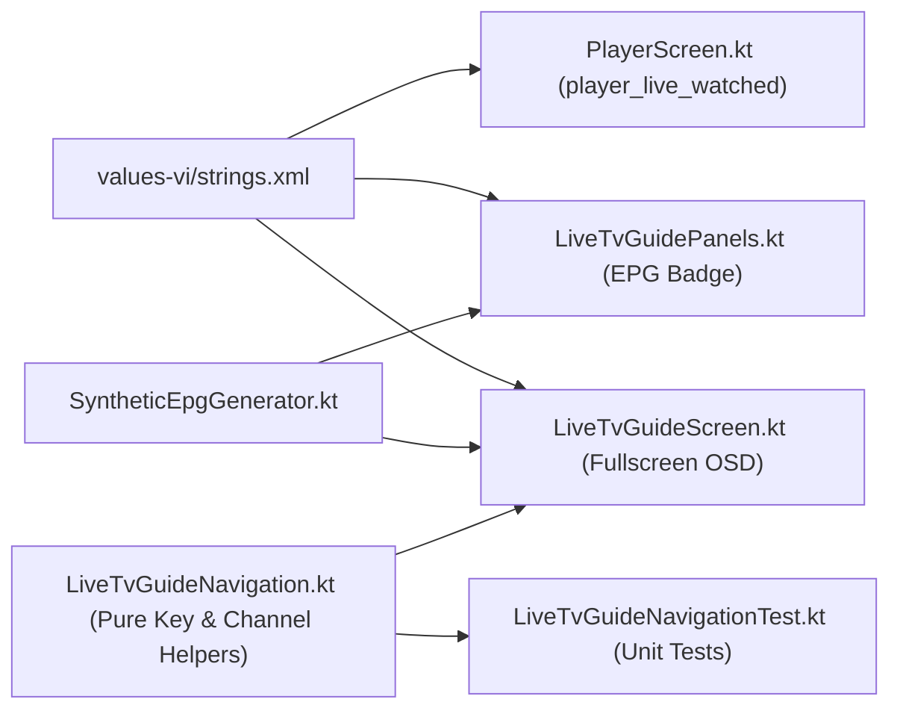

# PLAN: Đổi nhãn "TRỰC TIẾP" sang "ĐANG PHÁT" & Cập nhật phím Fullscreen Live TV

> [!IMPORTANT]
> Kế hoạch này chỉ tập trung vào chiến lược và thiết kế trước khi viết code (tuân thủ quy trình `/plan`). Mọi quyết định về từ ngữ hiển thị, phạm vi thay đổi và hành vi phím remote đã được xác nhận trực tiếp với người dùng.

---

## 1. Mục tiêu rõ ràng (Clear Goals)

1. **Loại bỏ sự hiểu lầm của nhãn `"TRỰC TIẾP"`**:
   - Đổi chữ `"TRỰC TIẾP"` thành **`"ĐANG PHÁT"`** để đồng bộ với hệ trạng thái lịch phát sóng hiện có (`ĐÃ PHÁT` / `ĐANG PHÁT` / `SẮP CHIẾU` / `XEM LẠI`), tránh gây nhầm lẫn với sự kiện truyền hình trực tiếp khi đang xem phim hoặc chương trình phát lại theo lịch.
   - Áp dụng cho **cả mục Live TV** (badge EPG, OSD xem toàn màn hình, mô tả EPG tự sinh) **và thanh Player chính** (`player_live_watched`).
2. **Cải thiện trải nghiệm phím remote khi xem Live TV toàn màn hình (`FullscreenPlayerOverlay`)**:
   - **D-Pad Lên (`DirectionUp`) / D-Pad Xuống (`DirectionDown`)** khi **không mở** danh sách kênh nhanh (`!showQuickChannels`): **ngừng tự động chuyển kênh**, thay bằng **chỉ hiện thanh thông tin OSD** và **reset bộ đếm tự ẩn sau 2 giây**.
   - **D-Pad Lên / Xuống** khi **đang mở** danh sách kênh nhanh (`showQuickChannels == true`, mở bằng phím Trái): **giữ nguyên** hành vi di chuyển chọn kênh trong danh sách.
   - **Phím vật lý `CH+` / `CH-` trên remote TV** (`KEYCODE_CHANNEL_UP` / `KEYCODE_CHANNEL_DOWN`): **vẫn chuyển kênh nhanh** (tăng/giảm kênh vòng tròn theo danh sách kênh hiện tại), đồng thời bật thanh thông tin OSD và tự ẩn sau 2 giây.
   - **Thời gian tự ẩn OSD toàn màn hình**: rút ngắn từ `5_000L` (5 giây) xuống **`2_000L` (2 giây)** và đảm bảo mỗi lần bấm phím hiện thông tin đều gia hạn lại đủ 2 giây.

### Phạm vi loại trừ (Out of Scope)

> [!NOTE]
> Các chuỗi tiếng Việt chứa từ `"trực tiếp"` mang nghĩa kỹ thuật *direct* (không phải *live broadcast*) sẽ **KHÔNG** bị sửa đổi để tránh sai nghĩa:
> - `servers_play_method_direct_play` (`Phát trực tiếp`) và `servers_play_method_direct_stream` (`Luồng trực tiếp`) trong `values-vi/strings_servers.xml`.
> - Các chuỗi cấu hình MPV / Audio / LibASS / Auth / TMDB / TorrServer trong `values-vi/strings.xml` (ví dụ: `giải mã phần cứng trực tiếp`, `Truyền tải âm thanh trực tiếp`, `Chạy TorrServer trực tiếp trên TV`).
> - Các tệp ngôn ngữ khác ngoài tiếng Việt (`values/strings.xml` vẫn giữ `LIVE` và `LIVE  %1$s`).
> - Hai dòng mô tả cài đặt nhắc tới tên mục chung (`livetv_nav_show_desc`: *"Hiển thị mục Truyền hình trực tiếp trên thanh menu chính"*, `layout_startup_tab_livetv_desc`: *"Mở Truyền hình trực tiếp khi khởi động"*) sẽ giữ nguyên trừ khi người dùng muốn đổi thêm sang `"Live TV"`.

---

## 2. Bản đồ phụ thuộc & Tệp tác động (Dependency Chains & Impact Map)



| Tệp mã nguồn | Vai trò | Thay đổi dự kiến |
|---|---|---|
| `app/src/main/res/values-vi/strings.xml` | Tài nguyên chuỗi tiếng Việt | Đổi `livetv_live_badge` (`TRỰC TIẾP` → `ĐANG PHÁT`) và `player_live_watched` (`TRỰC TIẾP  %1$s` → `ĐANG PHÁT  %1$s`). |
| `app/src/main/java/com/nuvio/tv/features/livetv/SyntheticEpgGenerator.kt` | Bộ sinh EPG dự phòng khi kênh thiếu XMLTV | Thay các cụm `"Trực tiếp"` / `"Phát sóng trực tiếp"` trong group fallback (`"Truyền hình"`) và mô tả chương trình (`"🔴 Đang phát: ..."`, `"Đang phát sóng liên tục trên ..."`). |
| `app/src/main/java/com/nuvio/tv/features/livetv/LiveTvGuideNavigation.kt` | Logic điều hướng thuần (dễ unit test) | Thêm hằng số `LIVE_TV_FULLSCREEN_OSD_AUTO_HIDE_MS = 2_000L` và hàm thuần tính kênh kế tiếp / trước đó cho phím `CH+` / `CH-` (hỗ trợ vòng tròn & bảo vệ danh sách rỗng) + mô hình hóa hành động phím fullscreen. |
| `app/src/main/java/com/nuvio/tv/features/livetv/LiveTvGuideScreen.kt` | Giao diện Live TV Guide & `FullscreenPlayerOverlay` | 1) Thêm `osdTrigger` và đổi timer tự ẩn OSD sang `2_000L`.<br>2) Đổi `DirectionUp` / `DirectionDown` khi `!showQuickChannels` thành chỉ hiện OSD + reset timer 2s.<br>3) Bổ sung xử lý `KEYCODE_CHANNEL_UP` / `KEYCODE_CHANNEL_DOWN` để chuyển kênh nhanh + hiện OSD 2s. |
| `app/src/test/java/com/nuvio/tv/features/livetv/LiveTvGuideNavigationTest.kt` | Kiểm thử đơn vị cho điều hướng Live TV | Thêm test cho bước chuyển kênh `CH+` / `CH-` (wrap-around, danh sách rỗng/1 kênh) và ma trận hành động phím fullscreen (`DirectionUp`, `DirectionDown`, `ChannelUp`, `ChannelDown` trong cả 2 trạng thái mở/đóng `showQuickChannels`). |

---

## 3. Phân rã theo giai đoạn & Phân bổ tác vụ (Phase-by-Phase Breakdown)

### Giai đoạn 1: Cập nhật chuỗi hiển thị tiếng Việt (`UI Copy & Localization`)

- **[T1.1]** Cập nhật `app/src/main/res/values-vi/strings.xml`:
  - Dòng 2648: `<string name="livetv_live_badge">ĐANG PHÁT</string>`
  - Dòng 1994: `<string name="player_live_watched">ĐANG PHÁT  %1$s</string>`
- **[T1.2]** Cập nhật `app/src/main/java/com/nuvio/tv/features/livetv/SyntheticEpgGenerator.kt`:
  - Dòng 119: đổi fallback tên nhóm khi `channel.group` rỗng từ `"Trực tiếp"` sang `"Truyền hình"`.
  - Dòng 143: đổi `"🔴 Trực tiếp: $cleanName · Nhóm: $groupName"` sang `"🔴 Đang phát: $cleanName · Nhóm: $groupName"`.
  - Dòng 174: đổi `"Phát sóng trực tiếp liên tục trên $cleanName · Nhóm: $groupName"` sang `"Đang phát sóng liên tục trên $cleanName · Nhóm: $groupName"`.

### Giai đoạn 2: Tách logic điều hướng phím Fullscreen (`Navigation Logic`)

- **[T2.1]** Cập nhật `app/src/main/java/com/nuvio/tv/features/livetv/LiveTvGuideNavigation.kt`:
  - Khai báo hằng số `internal const val LIVE_TV_FULLSCREEN_OSD_AUTO_HIDE_MS = 2_000L`.
  - Thêm hàm thuần `stepFullscreenChannelIndex(currentIndex: Int, totalCount: Int, forward: Boolean): Int?`:
    - Nếu `totalCount <= 0` trả về `null`.
    - `forward = true` (`CH+` / `KEYCODE_CHANNEL_UP`): `(safeIndex + 1) % totalCount` (tăng số kênh 1 → 2 → 3 → 1).
    - `forward = false` (`CH-` / `KEYCODE_CHANNEL_DOWN`): `if (safeIndex > 0) safeIndex - 1 else totalCount - 1` (giảm số kênh 3 → 2 → 1 → 3).
  - Thêm hàm thuần `resolveFullscreenDpadOrChannelAction(...)` trả về sealed interface (`ShowOsd`, `MoveQuickChannel(index)`, `SwitchChannel(index)`, `None`) để đảm bảo tách biệt hoàn toàn hành vi phím khỏi Composable và kiểm thử tự động 100%.

> [!WARNING]
> **Lưu ý về chiều phím `CH+` và `CH-`**:
> Theo quy ước TV truyền thống và đồng bộ với `PlayerScreen.kt` (nơi `KEYCODE_CHANNEL_UP` được xử lý là `forward = true`), **`CH+`** sẽ chuyển sang **kênh kế tiếp (`index + 1`)** và **`CH-`** chuyển về **kênh trước đó (`index - 1`)**. Ngược lại với thói quen cũ của D-Pad Lên (`index - 1`) / Xuống (`index + 1`) theo chiều dọc danh sách. Nếu bạn muốn `CH+` đi ngược lên đầu danh sách (`index - 1`), hãy báo lại trước khi thực thi.

### Giai đoạn 3: Cập nhật `FullscreenPlayerOverlay` & Timer OSD (`UI Interaction`)

- **[T3.1]** Cập nhật `LiveTvGuideContent` trong `app/src/main/java/com/nuvio/tv/features/livetv/LiveTvGuideScreen.kt`:
  - Thêm biến trạng thái `var osdTrigger by remember { mutableLongStateOf(0L) }` (hoặc `mutableIntStateOf(0)`).
  - Tạo callback `triggerOsd()` gán `showOsd = true` và tăng `osdTrigger++`.
  - Cập nhật `LaunchedEffect(showOsd, osdTrigger, channelIndex, isFullscreen, showQuickChannels)`:
    - Khi `isFullscreen && showOsd && !showQuickChannels`: `delay(LIVE_TV_FULLSCREEN_OSD_AUTO_HIDE_MS)` (`2_000L`) rồi đặt `showOsd = false`.
  - Gọi `triggerOsd()` mỗi khi vào fullscreen từ `playProgramOrCatchup` / `playChannelAction` để đảm bảo timer tự ẩn 2 giây luôn chạy nhất quán.
- **[T3.2]** Cập nhật bộ lắng nghe phím `onPreviewKeyEvent` trong `FullscreenPlayerOverlay`:
  - **`Key.DirectionUp`**:
    - Nếu `showQuickChannels`: di chuyển lên trong danh sách kênh nhanh (`channelIndex - 1` nếu `> 0`).
    - Nếu `!showQuickChannels`: **không chuyển kênh**, gọi `onTriggerOsd()` (hiện thông tin và reset timer 2s).
  - **`Key.DirectionDown`**:
    - Nếu `showQuickChannels`: di chuyển xuống trong danh sách kênh nhanh (`channelIndex + 1` nếu `< channels.lastIndex`).
    - Nếu `!showQuickChannels`: **không chuyển kênh**, gọi `onTriggerOsd()` (hiện thông tin và reset timer 2s).
  - **Phím vật lý `CH+` (`AndroidKeyEvent.KEYCODE_CHANNEL_UP`) & `CH-` (`AndroidKeyEvent.KEYCODE_CHANNEL_DOWN`)**:
    - Tính kênh đích bằng `stepFullscreenChannelIndex(...)` dựa trên kênh đang phát (ưu tiên đồng bộ với `playback.channelKey` nếu `showQuickChannels` đang mở để tránh nhảy lệch kênh).
    - Nếu `showQuickChannels` đang mở: đóng `showQuickChannels` trước.
    - Cập nhật `channelIndex`, gọi `viewModel.play(targetChannel, selectedGroupId)` và gọi `onTriggerOsd()` để hiện thông tin kênh mới trong 2 giây.
  - **`Key.DirectionRight` / `OK` (`DirectionCenter` / `Enter` / `NumPadEnter`)**:
    - Giữ nguyên hành vi hiện tại; riêng lúc bật OSD từ `false` → `true` thì gọi `onTriggerOsd()` để đồng bộ bộ đếm 2 giây.

> [!WARNING]
> **Rủi ro cạnh biên (Edge Cases) cần kiểm soát khi code**:
> 1. **Giữ phím lặp (`repeatCount > 0`) trên remote**: Khi người dùng lỡ bấm giữ D-Pad Lên/Xuống, `onTriggerOsd()` chỉ cập nhật `osdTrigger` mà không gọi `viewModel.play()`, nên không gây nghẽn player. Tuy nhiên với `CH+` / `CH-`, cần cân nhắc bỏ qua hoặc xử lý mượt nếu `KeyEventType.KeyDown` lặp quá nhanh (hiện tại `onPreviewKeyEvent` đang lọc `e.type != KeyEventType.KeyDown`).
> 2. **Danh sách chỉ có 1 kênh**: Nếu bấm `CH+`/`CH-` khi `channels.size == 1`, không nên gọi lại `viewModel.play()` làm tải lại luồng đang phát; chỉ cần hiện OSD thông tin 2 giây.
> 3. **Đồng bộ `channelIndex` khi chuyển kênh bằng `CH+`/`CH-`**: Đảm bảo khi nhấn `Back` thoát fullscreen về màn hình Guide, ô focus trên lưới kênh đang trỏ đúng kênh vừa chuyển.

### Giai đoạn 4: Kiểm thử tự động & Xác minh (`Testing & Verification`)

- **[T4.1]** Mở rộng `app/src/test/java/com/nuvio/tv/features/livetv/LiveTvGuideNavigationTest.kt`:
  - Test `stepFullscreenChannelIndex` cho các trường hợp: tiến/lùi giữa danh sách, wrap-around đầu/cuối, danh sách 1 phần tử, danh sách rỗng, `currentIndex` ngoài biên.
  - Test `resolveFullscreenDpadOrChannelAction`:
    - `!showQuickChannels` + `Up`/`Down` → `ShowOsd` (không đổi kênh).
    - `showQuickChannels` + `Up`/`Down` → `MoveQuickChannel` (không tự phát).
    - `ChannelUp` / `ChannelDown` → `SwitchChannel` (khi có > 1 kênh) hoặc `ShowOsd` (khi chỉ có 1 kênh).
- **[T4.2]** Chạy unit test và build kiểm tra không lỗi biên dịch.

---

## 4. Kế hoạch kiểm chứng (Verification Plan)

### A. Kiểm chứng tự động (Automated)
1. Chạy unit test Live TV:
   ```powershell
   .\gradlew.bat :app:testFullDebugUnitTest --tests "com.nuvio.tv.features.livetv.LiveTvGuideNavigationTest"
   ```
2. Kiểm tra biên dịch debug:
   ```powershell
   .\gradlew.bat :app:compileFullDebugKotlin
   ```
3. Kiểm tra lại toàn bộ chuỗi `"TRỰC TIẾP"` còn sót trong mục Live TV bằng lệnh tìm kiếm `Select-String`.

### B. Kiểm chứng thủ công trên TV / Android TV Emulator (Manual)
1. **Kiểm tra nhãn `"ĐANG PHÁT"`**:
   - Mở mục **Live TV** ở ngôn ngữ Tiếng Việt → kiểm tra cột **Lịch phát sóng (EPG)** bên phải hiển thị tag đỏ **`ĐANG PHÁT`** (cùng với `ĐÃ PHÁT`, `SẮP CHIẾU`, `XEM LẠI`).
   - Mở một kênh xem **toàn màn hình** → kiểm tra thanh OSD dưới đáy hiển thị tag đỏ **`ĐANG PHÁT`** cạnh tên kênh.
   - Mở một luồng live trên **Player chính** → kiểm tra thời gian xem hiển thị **`ĐANG PHÁT  00:xx`**.
2. **Kiểm tra điều khiển Fullscreen Live TV**:
   - Đang xem toàn màn hình (OSD đã ẩn): bấm **D-Pad Lên** → kênh **không đổi**, thanh thông tin OSD hiện lên và **tự ẩn đúng sau ~2 giây**.
   - Bấm **D-Pad Xuống** → kênh **không đổi**, thanh thông tin OSD hiện lên và **tự ẩn đúng sau ~2 giây**.
   - Khi OSD đang hiện (chưa hết 2 giây), bấm tiếp **D-Pad Lên/Xuống** → bộ đếm tự ẩn được gia hạn thêm 2 giây từ lần bấm cuối.
   - Bấm **D-Pad Trái** để mở **Danh sách kênh nhanh**, sau đó bấm **D-Pad Lên/Xuống** → di chuyển chọn kênh trong danh sách bình thường, bấm **OK** để phát kênh đã chọn.
   - Đang xem toàn màn hình: bấm phím vật lý **`CH+`** → chuyển ngay sang kênh kế tiếp, OSD hiện kênh mới và tự ẩn sau 2 giây; bấm **`CH-`** → chuyển về kênh trước đó, OSD hiện kênh mới và tự ẩn sau 2 giây.
   - Bấm **Back** thoát về Guide → lưới kênh focus đúng kênh đang phát.
