# PLAN: Tối Ưu Toàn Diện Player UI, Phụ Đề & AutoSync V2 Không Lag, Không Trễ Trên Android TV

> **Trạng thái**: Chờ phê duyệt (Strategy Only — Chưa sửa mã nguồn)  
> **Phạm vi**: `PlayerScreen.kt`, `PlayerSidecarSubtitles.kt`, `StyledSubtitle.kt`, `AutoSync*`, `AudioSyncFallback.kt`, `PlayerRuntimeControllerAutomaticSubtitleSync.kt`  
> **Mục tiêu cốt lõi**: Cho phép bật và sử dụng đầy đủ **100% tính năng** (AutoSync V2, Libass ASS/SSA, Styled Subtitles, Nâng phụ đề theo Controls, Thuyết minh TTS) trên Android TV / TV Box cấu hình thấp mà **KHÔNG giật lag UI** và **KHÔNG trễ/lệch phụ đề**.

---

## 1. Kiểm Toán Hiện Trạng (Discovery & Terrain Analysis)

### 1.1. Đánh giá 3 phần vừa sửa ở commit `725ce748a`

| Tính năng | Có còn hoạt động? | Có rủi ro / tồn đọng gì? |
|---|---|---|
| **AutoSync V2** (`AutoSyncPreferences.kt`) | **Có** (vẫn bật lại được trong *Cài đặt > Phụ đề*). | Chỉ mới đổi giá trị mặc định sang `false`. **Nếu người dùng bật lại**, toàn bộ điểm nghẽn Main Thread, tải 24MB range request và ép CPU vẫn còn nguyên $\rightarrow$ **sẽ bị lag và có nguy cơ trễ phụ đề trở lại**. Ngoài ra, nếu TV đã từng lưu `KEY_ENABLED = true` trong `SharedPreferences`, bản sửa mặc định không tự tắt trên máy đó. |
| **Libass Font Scale & Subtitle Lift** (`PlayerScreen.kt`) | **Có** (cỡ chữ Libass & nâng phụ đề hoạt động bình thường). | 1) **Edge case nhẹ**: `setTag(player_view_subtitle_style_tag, config)` được gọi trước `if (subView == null) return` — nếu `subView` gắn muộn mà không qua `onTracksChanged`, style Exo có thể bỏ lỡ. 2) **Chưa tách Typography khỏi LiftPx**: Với phụ đề ExoPlayer thường (`subView != null`), mỗi khi `liftPx` đổi lúc hiện/ẩn controls, code vẫn gọi lại `ResourcesCompat.getFont()`, `Typeface.create()`, `setStyle()` trên Main Thread. |
| **Thuyết minh TTS** (`PlayerRuntimeControllerObservers.kt`) | **Hoạt động 100%**. | Tối ưu tốt; không mất tính năng. Tuy nhiên, luồng sidecar vẫn duyệt toàn bộ danh sách phụ đề để tính `nextCueStartMs` cho TTS **ngay cả khi TTS đang tắt**. |

---

### 1.2. 6 Nút Thắt Cổ Chai Gốc Rễ Gây Lag UI & Trễ Phụ Đề (Đã Xác Minh Bằng Mã Nguồn)

> [!WARNING]
> Ngay cả khi **tắt cả AutoSync lẫn TTS**, Player vẫn còn 3 điểm nghẽn nội tại trên Main Thread (Nút thắt #4, #5, #6). Còn nếu **bật AutoSync**, 3 điểm nghẽn cực nặng (Nút thắt #1, #2, #3) sẽ kích hoạt đồng loạt.

1. **Nút thắt #1 (AutoSync chạy nặng trên Main Thread)**:
   - `PlayerRuntimeController.scope` chính là `viewModelScope` (`Dispatchers.Main.immediate`).
   - `EmbeddedSubtitleTimelineLoader.prefetch(scope, ...)` gọi `AutomaticSubtitleSync.warmIndexedReferences(loaded)` $\rightarrow$ `prepareIndexedReferences()` ([AutomaticSubtitleSync.kt](file:///f:/MyGithub/NuvioTV-Fast/app/src/main/java/com/nuvio/tv/ui/screens/player/autosync/AutomaticSubtitleSync.kt#L176-L206)) chạy `buildReferenceProfile`, `orderReferenceProfiles`, `deduplicateReferenceTracks` **trực tiếp trên Main Thread**.
   - `findTimelineRetime` ([AutomaticSubtitleSync.kt](file:///f:/MyGithub/NuvioTV-Fast/app/src/main/java/com/nuvio/tv/ui/screens/player/autosync/AutomaticSubtitleSync.kt#L272-L766)) chạy vòng điều phối, `awaitNearCompleteLiveReferences` (mỗi 500ms trong 12–60s), `constantTimelineShiftMs` (so sánh toàn bộ cues), `isSparseTarget` trên **Main Thread**.

2. **Nút thắt #2 (AutoSync tranh chấp băng thông & CPU TV khi vừa mở phim)**:
   - [EmbeddedSubtitleTimelineLoader.kt](file:///f:/MyGithub/NuvioTV-Fast/app/src/main/java/com/nuvio/tv/ui/screens/player/autosync/EmbeddedSubtitleTimelineLoader.kt#L53-L59): Ngay lúc mở phim, bắn tới **16 HTTP Range Requests tải tối đa 24 MB** (bao gồm `TAIL_PROBE_BYTES = 4MB` ở cuối file!) dùng chung `playbackHttpClient`. Với **TorrServer / Torrent**, yêu cầu đọc cuối file ngay lúc khởi phát làm kẹt băng thông và nghẽn buffer đầu phim.
   - [AutomaticSubtitleSync.kt](file:///f:/MyGithub/NuvioTV-Fast/app/src/main/java/com/nuvio/tv/ui/screens/player/autosync/AutomaticSubtitleSync.kt#L33-L38): `STARTUP_SEARCH` tải song song **6 phụ đề** (`MAX_PARALLEL_ALTERNATIVE_DOWNLOADS = 6`), parse **2 luồng**, chạy DP/FFT alignment **2 luồng** ở mức ưu tiên CPU mặc định (`Dispatchers.Default.limitedParallelism(2)`) — chiếm nửa số nhân CPU của Android TV 4 nhân.
   - [AutoSyncExtractorsFactory.kt](file:///f:/MyGithub/NuvioTV-Fast/app/src/main/java/com/nuvio/tv/ui/screens/player/autosync/AutoSyncExtractorsFactory.kt#L103-L158): Cấp phát `ByteArray(length)` và chạy `cueDecoder.decode` lần 2 trên mỗi sample phụ đề ngay trong luồng Extractor.

3. **Nút thắt #3 (Cơ chế Retime làm phụ đề chậm/lệch ngược trên AutoSync)**:
   - Khi AutoSync chạy ở chế độ `STARTUP_SEARCH` + `aggressiveMode`, hệ thống có thể khớp nhầm vào track tham chiếu lệch (Director's Cut / Commentary / PGS thiếu duration) hoặc áp dụng biến đổi tuyến tính (affine scale) làm lệch hàng chục giây mà không có ngưỡng chặn an toàn (Sanity Guard) hay nút hoàn tác tức thì.

4. **Nút thắt #4 (Recomposition lan rộng toàn màn hình Video khi đổi câu phụ đề)**:
   - Trong [PlayerScreen.kt](file:///f:/MyGithub/NuvioTV-Fast/app/src/main/java/com/nuvio/tv/ui/screens/player/PlayerScreen.kt#L1134-L1290), `val subtitleCueState by viewModel.controller.subtitleCueTracker.state.collectAsState()` nằm trong `Box(modifier = playerSurfaceModifier)` bọc trực tiếp quanh `ExoPlayerSurface`!
   - **Hậu quả**: Mỗi lần phụ đề chuyển câu (2–4 giây/lần), `ExoPlayerSurface` bị Recompose $\rightarrow$ `AndroidView.update` chạy lại (`syncLibassOverlay` + `syncLetterboxMask` + `bindExoSubtitleView` $\rightarrow$ gọi lại `renderSidecarCuesAtCurrentPosition()`). Đồng thời `measureSubtitleBlockPx` tạo mới `Typeface.create(...)` trên Main Thread mỗi câu phụ đề.

5. **Nút thắt #5 (Tải lại Font/Style khi nâng phụ đề & không cache TextMeasurer)**:
   - Trong [PlayerScreen.kt](file:///f:/MyGithub/NuvioTV-Fast/app/src/main/java/com/nuvio/tv/ui/screens/player/PlayerScreen.kt#L2679-L2789): Khi `liftPx` thay đổi (mở/đóng controls, Skip Intro, Seek), `applySubtitleStyleIfNeeded` chạy lại toàn bộ khối load `ResourcesCompat.getFont()`, `Typeface.create()`, `setStyle()` trên `SubtitleView`.
   - Trong [StyledSubtitle.kt](file:///f:/MyGithub/NuvioTV-Fast/app/src/main/java/com/nuvio/tv/ui/screens/player/StyledSubtitle.kt#L97-L125): `StyledSubtitleText` gọi `measurer.measure(...)` và `text.mapColors(...)` trực tiếp trong body không có `remember`, nên bất kỳ thay đổi vị trí `liftPx` nào cũng đo lại văn bản từ đầu.

6. **Nút thắt #6 (Duyệt tuyến tính $O(N)$ 10 lần/giây trên Main Thread ở Sidecar Subtitles)**:
   - Trong [PlayerSidecarSubtitles.kt](file:///f:/MyGithub/NuvioTV-Fast/app/src/main/java/com/nuvio/tv/ui/screens/player/PlayerSidecarSubtitles.kt#L256-L305) & [L448-L486](file:///f:/MyGithub/NuvioTV-Fast/app/src/main/java/com/nuvio/tv/ui/screens/player/PlayerSidecarSubtitles.kt#L448-L486):
     - Cứ mỗi `100ms`, `collectActiveSidecarCues` duyệt tuyến tính từ đầu danh sách `cues` (đến cuối phim ~2.000 câu = 20.000 bước/giây trên Main Thread).
     - Mỗi khi đổi câu, dòng 275 duyệt $O(N)$ lần 2 (`collectActiveSidecarTimedCues`) và dòng 287 (`cues.asSequence().filter...minOfOrNull`) duyệt $O(N)$ lần 3 để tìm `nextCueStartMs` cho TTS **ngay cả khi TTS đang TẮT**.

---

## 2. Kiến Trúc Đích (Target Zero-Jank Architecture)

```mermaid
flowchart TD
    subgraph UI["Main Thread (UI 60fps — Không chặn)"]
        PS["PlayerScreen"] --> |"Độc lập, KHÔNG đọc subtitleCueState"| EXO["ExoPlayerSurface (AndroidView)"]
        PS --> |"Chỉ recompose vùng nhỏ"| LIFT["SubtitleLiftController (isolated)"]
        PS --> |"Memoized TextLayout"| STY["StyledSubtitleOverlay"]
        EXO --> |"Tách 3 tầng Tag"| S1["1. Libass Scale (khi size đổi)"]
        EXO --> |"Cache Typeface"| S2["2. SubView Typography (khi font/màu đổi)"]
        EXO --> |"0.05ms"| S3["3. SubView Padding (khi liftPx đổi)"]
    end

    subgraph SIDECAR["Sidecar Subtitle Engine (O(log N) / O(1))"]
        TICK["Ticker thông minh / Binary Search Cursor"] --> |"Chỉ cấp phát khi cue đổi"| CUE["Hiển thị SubtitleView / Styled"]
        TICK --> |"Chỉ tính timingContext khi TTS=ON"| TTS["SubtitleTtsCoordinator"]
    end

    subgraph BG["Background Low-Priority Thread (THREAD_PRIORITY_BACKGROUND, 1 core)"]
        AS["AutoSync V2 (100% off-MainThread)"]
        AS --> |"Trì hoãn sau STATE_READY & Chặn Tail-Probe trên TorrServer"| IDX["EmbeddedSubtitleTimelineLoader (<= 6MB)"]
        AS --> |"Giới hạn 2 DL / 1 Worker"| MATCH["Delay-Only First + Sanity Guard"]
        MATCH --> |"Cho phép 1 chạm Revert về gốc"| COMMIT["Commit Sidecar Timeline"]
    end
```

---

## 3. Kế Hoạch Triển Khai Theo Giai Đoạn (Phase-by-Phase Breakdown)

> [!IMPORTANT]
> Kế hoạch được chia thành **4 Phase độc lập**, sắp xếp từ tác động lớn nhất tới UI mượt mà ngay lập tức (Phase 1 & 2) cho tới nâng cấp AutoSync/AudioSync chạy nền siêu nhẹ (Phase 3 & 4).

### Phase 1: Triệt Tiêu Lag Giao Diện Player & Tách Tầng Style (Zero-Jank UI)
**Mục tiêu**: Mở/đóng Controls, chuyển nút D-Pad, đổi câu phụ đề đạt ổn định 60fps trên mọi dòng Android TV.

- **Task 1.1 — Cách ly Recomposition trong `PlayerScreen.kt`**:
  - Tách logic đọc `subtitleCueTracker.state` + `prescannedTexts` + tính `subtitleLiftPx` ra khỏi `Box` trực tiếp bọc `ExoPlayerSurface` (dùng State Holder / composable riêng hoặc `LaunchedEffect` thu thập Flow mà không đẩy `subtitleCueState` vào phạm vi compose của `ExoPlayerSurface`).
  - Xác nhận: khi đổi câu phụ đề, `AndroidView.update` của `ExoPlayerSurface` **không chạy lại**.
- **Task 1.2 — Tách 3 tầng cập nhật & Cache Typeface trong `applySubtitleStyleIfNeeded` (`PlayerScreen.kt`, `ids.xml`)**:
  - Thêm cache `Map<Pair<SubtitleFontOption, Boolean>, Typeface>` cho font built-in (không gọi `ResourcesCompat.getFont()` & `Typeface.create()` lặp lại).
  - Tách 3 tag riêng trên `PlayerView`:
    1. `player_view_libass_font_scale_tag`: chỉ chạy `applyAssFontScaleCompat` + `invalidateSubtitles()` khi `size` đổi hoặc `force = true`.
    2. `player_view_subtitle_typography_tag`: chỉ chạy `setFixedTextSize` + `setStyle` + `setApplyEmbeddedStyles` khi style typography hoặc `isAss` đổi (**chỉ set tag này khi `subView != null`** $\rightarrow$ sửa triệt để edge case `subView == null`!).
    3. `player_view_subtitle_position_tag`: chỉ cập nhật `setPadding` + `setBottomPaddingFraction` + `reportSubtitleTextMetrics` khi `liftPx` hoặc `verticalOffset` đổi.
  - Cache `Typeface` trong `measureSubtitleBlockPx` thay vì gọi `Typeface.create(...)` mỗi câu phụ đề.
- **Task 1.3 — Memoize Layout trong `StyledSubtitle.kt`**:
  - Bọc `textStyle`, `fillText`, `layout`, `outlineLayout` trong `remember(text, style.textColor, style.fileColorBrightness, style.bold, textSizePx, maxTextWidth, fontFamily, horizontal)` để khi `liftPx` đổi hoặc overlay recompose, không phải đo lại text layout trên UI Thread.

### Phase 2: Tối Ưu Đường Ống Phụ Đề Sidecar ($O(\log N)$ & Không Làm Việc Thừa)
**Mục tiêu**: Phụ đề hiển thị tức thì (độ trễ < 20ms), giảm >95% tải CPU Main Thread khi xem phim dài.

- **Task 2.1 — Chuyển tìm kiếm cue từ $O(N)$ sang Binary Search + Cursor Cache (`PlayerSidecarSubtitles.kt`)**:
  - Thay vòng lặp duyệt từ index 0 trong `collectActiveSidecarCues` và `collectActiveSidecarTimedCues` bằng tìm kiếm nhị phân theo `startTimeUs` (kết hợp một `maxCueDurationUs` tính sẵn lúc parse để chặn cận dưới an toàn, vẫn xử lý chính xác 100% các câu phụ đề chồng lấn / overlapping cues!).
  - Trong trường hợp đang phát tiến tới bình thường, kiểm tra nhanh xem `positionUs` có còn nằm trong khoảng `[currentWindowStart, nextBoundaryUs)` hay không $\rightarrow$ $O(1)$ bỏ qua ngay nếu chưa tới mốc đổi câu!
- **Task 2.2 — Short-circuit tính `timingContext` khi TTS đang tắt (`PlayerSidecarSubtitles.kt`)**:
  - Chỉ tính `activeTimed`, `nextCueStartMs` (cũng dùng binary search từ index hiện tại thay vì quét `cues.asSequence().filter...minOfOrNull`), và `SubtitleTimelineTimingHelper.createTimingContext` khi `_uiState.value.ttsConfig.enabled == true`.
  - Khi TTS tắt: truyền `timingContext = null`, giữ `subtitleCueTracker.updateWithTiming` siêu nhẹ.

### Phase 3: Tái Thiết Kế AutoSync V2 Thành "Nền Siêu Nhẹ & Không Chặn Phim"
**Mục tiêu**: Cho phép người dùng **bật lại AutoSync V2** dùng bình thường trên Android TV mà giao diện vẫn mượt 60fps và không bóp mạng phim.

- **Task 3.1 — Tạo Dispatcher nền ưu tiên thấp chuyên dụng cho TV (`AutomaticSubtitleSync.kt`)**:
  - Thay `Dispatchers.Default.limitedParallelism(2)` bằng Executor đơn luồng (1 thread) có `Process.setThreadPriority(Process.THREAD_PRIORITY_BACKGROUND)` (hoặc `THREAD_PRIORITY_LOWEST`) để bộ lập lịch Linux/Android luôn nhường 100% CPU cho UI Thread, ExoPlayer video/audio và Subtitle Renderer.
  - Bọc **toàn bộ** thân hàm `warmIndexedReferences`, `prepareIndexedReferences`, `findTimelineRetime`, `awaitNearCompleteLiveReferences`, `admitLoadedCandidate` trong `withContext(autoSyncDispatcher)` — đảm bảo **0ms chạy tính toán trên Main Thread**.
- **Task 3.2 — Chống tranh chấp mạng Stream & TorrServer (`EmbeddedSubtitleTimelineLoader.kt`, `PlayerRuntimeControllerAutomaticSubtitleSync.kt`)**:
  - **Trì hoãn prefetch**: Không chạy `prefetchAutoSyncIndex` ngay khoảnh khắc mở stream; đợi player đạt `STATE_READY` và phát ổn định (hoặc buffer đủ >= 5 giây) mới bắt đầu tải index ngầm.
  - **Bảo vệ TorrServer / Local Torrent**: Khi phát qua TorrServer / loopback (`isTorrentStream || isLoopback(url)`), **bỏ qua tail probe 4MB cuối file** (`TAIL_PROBE_BYTES`) nếu không có `SeekHead` trỏ gần đầu file, tránh ép TorrServer tải mảnh cuối gây đứng phim/chậm phụ đề.
  - **Cấu hình giới hạn TV-safe**:
    - `MAX_TOTAL_DOWNLOAD_BYTES`: 24MB $\rightarrow$ 8MB.
    - `MAX_PARALLEL_ALTERNATIVE_DOWNLOADS`: 6 $\rightarrow$ 2.
    - `MAX_PARALLEL_ALTERNATIVE_PARSES` & `MAX_PARALLEL_ALTERNATIVE_MATCHES`: 2 $\rightarrow$ 1.
- **Task 3.3 — Giảm tải `AutoSyncExtractorsFactory.kt`**:
  - Tái sử dụng một scratch `ByteArray` thay vì `ByteArray(length)` cấp phát mới liên tục ở `sampleData`.
  - Ngừng thu thập `ObservingTextTrackOutput` ngay khi đã có đủ mẫu hoặc khi AutoSync cho stream hiện tại đã hoàn tất / không còn chạy (cờ `AtomicBoolean` per-source) $\rightarrow$ **0% overhead** trong phần còn lại của bộ phim!

### Phase 4: Cơ Chế Chống Trễ Phụ Đề Sai & Điều Khiển Chủ Động Cho Người Dùng
**Mục tiêu**: Khi bật AutoSync, phụ đề không bao giờ bị đẩy lệch ngược hàng chục giây mà không rõ nguyên nhân, và người dùng luôn kiểm soát được.

- **Task 4.1 — Bảo vệ Độ Tin Cậy (Sanity Guard) & Ưu tiên File Đang Chọn**:
  - Luôn tải và hiển thị phụ đề gốc của người dùng **ngay lập tức** (`downloadSubtitleBody` chạy độc lập, không xếp hàng sau candidate prefetch).
  - Bổ sung ngưỡng kiểm tra an toàn trước khi `applyAutoSyncSidecarTimeline`:
    - Nếu độ lệch lớn bất thường (ví dụ `maxAlignmentShiftMs > 25_000L`) hoặc dùng affine scale khác 1.0 đáng kể (`|scale - 1.0| > 0.05`) mà chỉ dựa trên reference thưa (`sparse`) hoặc điểm tin cậy < ngưỡng nghiêm ngặt (`0.90`), **từ chối áp dụng tự động** và giữ nguyên mốc thời gian gốc.
  - Giữ `aggressiveMode = false` mặc định (ưu tiên dịch chuyển hằng số Delay-Only an toàn, tránh bóp méo tốc độ timeline).
- **Task 4.2 — Khôi phục Timeline Gốc 1 Chạm (Undo / Revert AutoSync)**:
  - Lưu bản sao `originalSidecarTimedCues` trước khi AutoSync retime.
  - Khi AutoSync vừa áp dụng, cho phép người dùng bấm **"Khôi phục mốc gốc (Revert)"** ngay trong `SubtitleSelectionOverlay` (hoặc khi tắt AutoSync) để quay ngay về phụ đề gốc không cần tải lại file.
- **Task 4.3 — Kiểm soát AudioSync Fallback (ONNX/ASR)**:
  - Giữ mặc định **TẮT** trên TV. Khi bật, chỉ cho phép chạy khi người dùng bấm đồng bộ thủ công (hoặc sau khi video ổn định), không tự `arm()` bộ nhận diện giọng nói ONNX ngay lúc khởi động phim để tránh tràn RAM / giật hình TV Box.

---

## 4. Phân Bổ Tác Vụ & Phụ Thuộc (Dependency Map)

| ID | Phase | File mục tiêu | Chuyên trách | Phụ thuộc |
|---|---|---|---|---|
| `OPT-01` | Phase 1 | `PlayerScreen.kt`, `ids.xml` | Frontend / Compose TV | Không |
| `OPT-02` | Phase 1 | `StyledSubtitle.kt`, `StyledSubtitleOverlay.kt` | Frontend / Compose TV | Không |
| `OPT-03` | Phase 2 | `PlayerSidecarSubtitles.kt` | Media / Subtitle Core | Không |
| `OPT-04` | Phase 3 | `AutomaticSubtitleSync.kt`, `EmbeddedSubtitleTimelineLoader.kt`, `AutoSyncExtractorsFactory.kt`, `PlayerRuntimeControllerAutomaticSubtitleSync.kt` | Media / Concurrency | Không |
| `OPT-05` | Phase 4 | `AutoSyncSidecarBridge.kt`, `PlayerSidecarSubtitles.kt`, `SubtitleSelectionOverlay.kt`, `AudioSyncFallback.kt` | Media / UX Control | `OPT-03`, `OPT-04` |
| `OPT-06` | Verify | `app/src/test/...` + Build + Test thực tế TV | QA / Verification | Tất cả |

---

## 5. Kế Hoạch Kiểm Thử & Nghiệm Thu (Verification Plan)

### 5.1. Kiểm thử tự động (Unit Tests & Compile)
1. **Biên dịch sạch**: `.\gradlew.bat :app:compileFullDebugKotlin` — 0 lỗi.
2. **Unit Tests hiện hữu**: `.\gradlew.bat :app:testFullDebugUnitTest --tests "*Subtitle*" --tests "*AutoSync*" --tests "*Tts*"` — 100% Pass.
3. **Unit Tests bổ sung (viết mới khi triển khai)**:
   - `PlayerSidecarSubtitlesBinarySearchTest`: đối chiếu kết quả tìm kiếm Binary Search + Cursor 100% trùng khớp với bản duyệt tuyến tính trên tập 2.500 cues có overlapping cues, seek xuôi, seek ngược, đầu/cuối phim.
   - `AutoSyncSanityGuardTest`: xác nhận AutoSync từ chối áp dụng offset bất thường (>25s khi độ tin cậy thấp / sparse reference) và xác nhận nút Revert khôi phục chính xác `originalSidecarTimedCues`.
   - `AutoSyncOffMainThreadTest`: xác nhận `prepareIndexedReferences` và `findTimelineRetime` không chiếm dụng dispatcher gọi ban đầu.

### 5.2. Kiểm thử thủ công trên Android TV / TV Box thực tế
1. **Kịch bản 1 (Tắt AutoSync + Bật/Tắt TTS)**:
   - Mở phim 4K/1080p có phụ đề Add-on dài (>1.500 dòng) + thử cả phụ đề ASS/SSA (Libass) và Styled Subtitle.
   - Liên tục bấm D-Pad lên/xuống/trái/phải để hiện/ẩn Controls, tua nhanh, mở menu phụ đề/TTS.
   - **Tiêu chí đạt**: Giao diện phản hồi tức thì, thanh tiến trình & nút bấm mượt 60fps, phụ đề hiện khớp từng câu ngay lập tức.
2. **Kịch bản 2 (Bật AutoSync V2 trên Stream thường & TorrServer)**:
   - Vào Settings bật lại **AutoSync** (giữ `Thorough/Aggressive = Tắt`).
   - Mở phim qua HTTP Stream & qua **TorrServer**.
   - **Tiêu chí đạt**: Phim không bị đứng buffer lúc mở, D-Pad bấm vẫn mượt trong khi AutoSync chạy ngầm, phụ đề gốc hiện ngay lập tức, chỉ chỉnh mốc khi khớp tin cậy cao và có thể bấm **Revert** ngay nếu cần.
3. **Kịch bản 3 (Kiểm tra Soundbar Optical & Passthrough)**:
   - Xác nhận toàn bộ đường âm thanh (Optical AC-3 / PCM 2.0 / Passthrough) không bị đụng chạm và vẫn hoạt động bình thường.
