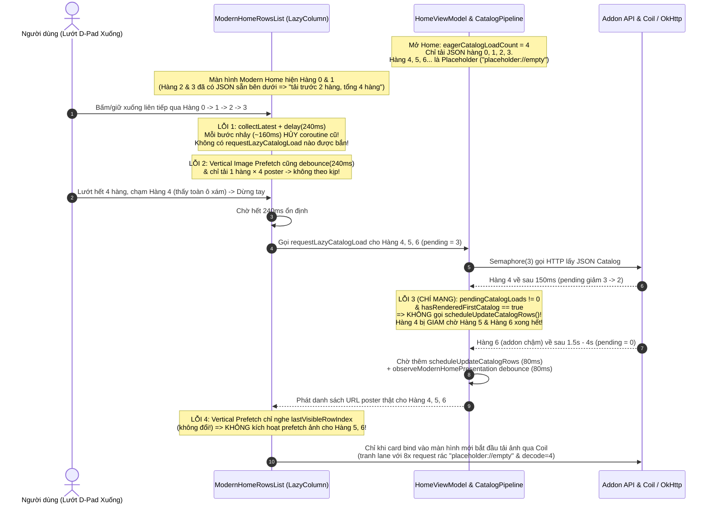

# Kế Hoạch Tối Ưu Cơ Chế Tải Catalog & Prefetch Poster Trên Màn Hình Home

> **Mục tiêu**: Giải thích rõ cơ chế tải poster của dự án gốc (`upstream/dev` — `NuvioMedia/NuvioTV`), chỉ ra toàn bộ nguyên nhân gốc rễ khiến dự án hiện tại (`NuvioTV-Fast`, nhánh `tet2`) tải poster chậm và chỉ dừng ở 4 hàng đầu (2 hàng hiển thị + 2 hàng tải trước), đồng thời thiết kế lộ trình tối ưu toàn diện từ tầng Catalog -> Prefetch -> Coil/OkHttp -> Leanback ViewHolder mà vẫn đảm bảo an toàn RAM cho TV Box cấu hình thấp.

---

## 1. Cơ Chế Tải Poster Của Dự Án Gốc (`upstream/dev`) Là Gì?

Dự án gốc (`NuvioMedia/NuvioTV`, nhánh `upstream/dev`) vận hành theo mô hình **4 tầng độc lập** (Catalog Lazy Loading -> Presentation Pipeline -> Compose UI Prefetch -> Coil 3 ImageLoader):

### 1.1. Tầng 1 — Tải Danh Sách Catalog Theo Kiểu "Eager 4 + Lazy Phía Sau"
- Tại `HomeViewModel.kt` và `HomeViewModelCatalogPipeline.kt`:
  - `eagerCatalogLoadCount = 4`: Khi mở Home, dự án gốc **chỉ tải dữ liệu JSON của đúng 4 hàng catalog đầu tiên** (`catalogsToLoad.take(4)`), chạy qua giới hạn song song `catalogLoadSemaphore = Semaphore(3)` (`MAX_CATALOG_LOAD_CONCURRENCY = 3`).
  - Toàn bộ các hàng từ **hàng thứ 5 trở đi** (`catalogsToLoad.drop(4)`) bị giữ lại trong `pendingLazyCatalogs` và hiển thị dưới dạng **hàng Placeholder Shimmer** (8 thẻ giả với URL `placeholder://empty`).
  - Khi người dùng cuộn dọc:
    - **Modern Home** (`ModernHomeRowsList.kt`): dùng `prefetchAheadForLazy = 2` kèm `collectLatest { delay(240) ... }` để gọi `requestLazyCatalogLoad` cho các hàng placeholder nằm trong vùng `firstVisible .. lastVisible + 2`.
    - **Classic Home** (`ClassicHomeContent.kt`): dùng `prefetchAhead = 1` kèm `delay(240)`.
  - Dữ liệu catalog có lớp đệm ở `CatalogRepositoryImpl`: In-memory cache 90 giây + Disk first-paint cache (`catalog_rows`, trả ngay dữ liệu cũ từ đĩa cho trang 1 rồi revalidate ngầm qua mạng).

### 1.2. Tầng 2 — Pipeline Ảnh Coil 3 (`NuvioApplication.kt` ở `upstream/dev`)
- **Mạng (OkHttp)**: `maxRequests = 32`, `maxRequestsPerHost = 16`, ConnectionPool mặc định của OkHttp (5 idle connections), `IPv4FirstDns`, `NoDelaySocketFactory` (`TCP_NODELAY`), timeout `connect=4s / read=5s / call=8s` (retry 1 lần khi `SocketTimeoutException`).
- **Chiến lược Cache**: Dùng `StaleWhileRevalidateCacheStrategy` với Disk Cache cố định `200 MB` và tuân theo header HTTP `Cache-Control`. **Không có TMDB URL downscaler** (addon trả về `w500` hoặc `original` nặng nhiều MB thì tải nguyên kích thước đó).
- **RAM Cache**: 1 LRU duy nhất (`15%` RAM <= 2GB, `20%` <= 3GB, `25%` > 3GB, giới hạn theo `MemoryBudget`).
- **Decode**: `allowHardware(false)`, `allowRgb565(rgb565Enabled)`, `bitmapFactoryMaxParallelism(4)`, `Precision.INEXACT`.

### 1.3. Tầng 3 — Hiển Thị & Prefetch Trong UI Của Dự Án Gốc (`ModernHomeRows.kt`, `ModernHomeRowsList.kt`)
- Dùng thuần **Compose `LazyColumn` + `LazyRow` + `AsyncImage`** (kèm `LazyListPrefetchStrategy(nestedPrefetchItemCount = 2)`).
- **Prefetch dọc**: `prefetchAheadRows = 1`, `prefetchItemsPerRow = 1` (chỉ tải trước đúng **1 poster đầu tiên** của 1 hàng dưới sau debounce `240ms`).
- **Prefetch ngang**: Chạy trên hàng đang active sau `delay(150)`, tải trước `POSTER_PREFETCH_DISTANCE = 1` poster ngoài mép phải `lastVisibleIndex`.
- **Điểm yếu sẵn có của dự án gốc**: `ModernHomeRowsList` prefetch với `memoryCacheKey = "${url}_${w}x${h}"`, nhưng `ModernCarouselCard` lại đọc `"${url}_${w}x${h}_v$revalidationKey"` (lệch key nên prefetch chỉ làm ấm disk cache, không trúng RAM cache).

---

## 2. So Sánh Dự Án Gốc vs Dự Án Hiện Tại (`NuvioTV-Fast` — nhánh `tet2`)

| Thành phần | Dự án gốc (`upstream/dev`) | Dự án hiện tại (`NuvioTV-Fast` / `tet2`) | Đánh giá hiện trạng |
| :--- | :--- | :--- | :--- |
| **Số hàng tải ngay (Eager Catalog)** | `eagerCatalogLoadCount = 4` | `eagerCatalogLoadCount = 4` (giữ nguyên) | **Nguyên nhân trực tiếp tạo mốc "tổng 4 hàng"** |
| **Luồng tải Catalog song song** | `MAX_CATALOG_LOAD_CONCURRENCY = 3` | `MAX_CATALOG_LOAD_CONCURRENCY = 3` | Chậm khi mở Home hoặc lướt qua nhiều hàng lazy |
| **Kích hoạt tải hàng Lazy** | `prefetchAheadForLazy = 2`, `collectLatest` + `delay(240)` | Giữ nguyên `prefetchAheadForLazy = 2` + `delay(240)` | **Bị hủy liên tục khi đang lướt, chỉ chạy khi dừng ở hàng 5** |
| **Cập nhật UI khi Lazy về** | Chỉ gọi `scheduleUpdateCatalogRows()` khi `pendingCatalogLoads == 0` | Giữ nguyên bug batching này | **Hàng tải xong bị giam chờ hàng chậm nhất cùng đợt** |
| **TMDB Downscaler** | Không có | Có (`sizedHomeArtworkUrl`: `w342`/`w500`/`w780`) | Tốt hơn bản gốc rõ rệt |
| **Disk & RAM Cache** | Disk `200 MB`, 1 LRU chung, `StaleWhileRevalidate` | Disk `200 MB–1 GB`, `ArtworkMemoryCache` (2 pool Small/Large, lên tới `176 MB`), FreshnessFloor `7 ngày`, `SavedCopyOnErrorFetcher` | Tốt hơn bản gốc rất nhiều |
| **UI Rendering** | Compose `LazyRow` + `AsyncImage` | Leanback `HorizontalGridView` + `LeanbackArtworkLoader` (sync RAM fast-path) | Cuộn mượt hơn, key prefetch khớp với bind |
| **Prefetch dọc (Poster)** | `1` hàng × `1` poster, debounce `240ms` | `1` hàng × `4` poster, debounce `240ms`, **chỉ nghe `lastVisibleRowIndex`** | **Thiếu nửa hàng (TV hiện 6–8 poster) & không chạy lại khi hàng lazy vừa load xong** |
| **Prefetch ngang (Poster)** | `1` poster sau `lastVisibleIndex` | `2` poster sau `position` đang focus (`pos+1..pos+2`) | **Vô tác dụng ở đầu hàng vì `pos+1, pos+2` đã hiện sẵn trên màn hình!** |
| **Xử lý Placeholder URL** | Bỏ qua `placeholder://empty` bằng nhánh Shimmer | **Ném thẳng `"placeholder://empty"` vào Coil** | Lãng phí CPU/pipeline Coil xử lý lỗi giả hàng loạt |
| **OkHttp & Decode** | `32/16` req, pool `5`, decode `4` | `32/16` req, pool `10`, decode `4` (đã từng nâng `64/48` ở `15048388d` rồi hạ lại ở `237082857`) | Dễ nghẽn hàng đợi khi nhiều poster cùng host (TMDB/RPDB) về 1 lúc |

---

## 3. Phân Tích Nguyên Nhân Gốc Rễ (Root Cause Analysis)



### 3.1. Nhóm Nguyên Nhân Gây Hiện Tượng *"Chỉ tải trước 2 hàng, tổng 4 hàng, lướt hết 4 hàng mới tải tiếp"*

1. **Chốt cứng `eagerCatalogLoadCount = 4` và không có nạp nền (Background Drip-Load)** ([HomeViewModel.kt](file:///f:/MyGithub/NuvioTV-Fast/app/src/main/java/com/nuvio/tv/ui/screens/home/HomeViewModel.kt#L340), [HomeViewModelCatalogPipeline.kt](file:///f:/MyGithub/NuvioTV-Fast/app/src/main/java/com/nuvio/tv/ui/screens/home/HomeViewModelCatalogPipeline.kt#L302-L303)):
   - Viewport của Modern Home (`rowsViewportHeight = 52%` chiều cao màn hình) hiển thị đúng **~2 hàng trên màn hình** (Hàng 0, 1).
   - Vì app chỉ load JSON cho 4 hàng đầu tiên, nên chỉ có **2 hàng đang hiện + 2 hàng phía dưới đã có dữ liệu (tổng 4 hàng)**. Hàng 4 trở đi chỉ là các thẻ placeholder không có URL ảnh.
2. **Bộ kích hoạt Lazy Load bị hủy liên tục khi cuộn (`collectLatest + delay(240)`) và cửa sổ nhìn trước quá hẹp (`prefetchAheadForLazy = 2`)** ([ModernHomeRowsList.kt](file:///f:/MyGithub/NuvioTV-Fast/app/src/main/java/com/nuvio/tv/ui/screens/home/ModernHomeRowsList.kt#L1406-L1431), [ClassicHomeContent.kt](file:///f:/MyGithub/NuvioTV-Fast/app/src/main/java/com/nuvio/tv/ui/screens/home/ClassicHomeContent.kt#L434-L462)):
   - Khi đứng ở đầu trang (`lastVisible = 1`), `1 + 2 = 3` vẫn nằm trong 4 hàng eager -> chưa hề tải trước hàng 4, 5.
   - Khi người dùng bấm xuống liên tiếp (`VERTICAL_STEP_DURATION_MS = 160ms`) hoặc nhấn giữ cuộn dọc, `collectLatest` hủy coroutine cũ trước khi `delay(240)` kịp chạy xong -> **không có lệnh tải lazy nào phát ra trong lúc lướt** cho tới khi bạn dừng lại ở hàng 5!
3. **Bug "Giam Hàng Lazy" trong batching của `loadCatalogPipeline`** ([HomeViewModelCatalogPipeline.kt](file:///f:/MyGithub/NuvioTV-Fast/app/src/main/java/com/nuvio/tv/ui/screens/home/HomeViewModelCatalogPipeline.kt#L469-L482)):
   - Khi nhiều hàng lazy được gọi cùng lúc (`pendingCatalogLoads > 1`) và `hasRenderedFirstCatalog` đã là `true`:
     - Một hàng tải xong sớm làm giảm `pendingCatalogLoads`, nhưng vì `pendingCatalogLoads > 0`, nhánh `if (pendingCatalogLoads == 0)` **không chạy** -> `scheduleUpdateCatalogRows()` **không được gọi**.
     - Hàng vừa xong phải **nằm chờ toàn bộ các hàng còn lại trong batch** hoàn thành hết (và `Safety flush 800ms` ở dòng 354 chỉ tồn tại trong `loadAllCatalogsPipeline`, hoàn toàn không tồn tại cho `requestLazyCatalogLoad`!).

### 3.2. Nhóm Nguyên Nhân Gây Hiện Tượng *"Tải poster chậm"*

4. **Vertical Image Prefetch "chết đứng" sau khi dữ liệu về & quá nông** ([ModernHomeRowsList.kt](file:///f:/MyGithub/NuvioTV-Fast/app/src/main/java/com/nuvio/tv/ui/screens/home/ModernHomeRowsList.kt#L524-L571)):
   - Chỉ prefetch `prefetchAheadRows = 1` và `prefetchItemsPerRow = 4` (trong khi 1 hàng trên màn hình TV hiển thị **6–8 poster** cùng lúc -> nửa sau hàng luôn phải chờ tới lúc vào khung hình mới bắt đầu tải).
   - `snapshotFlow` chỉ theo dõi `lastVisibleRowIndex` qua `distinctUntilChanged()`. Khi dữ liệu JSON của các hàng eager/lazy tải xong (thay `PlaceholderCatalog` bằng URL ảnh thật), `lastVisibleRowIndex` **không đổi** -> trình prefetch ảnh **không hề chạy lại** cho những hàng mới có dữ liệu!
   - Dùng `.debounce(240L)` nên khi cuộn nhanh cũng bị bỏ qua.
5. **Horizontal Image Prefetch tính sai điểm neo (`position` thay vì mép phải hiển thị)** ([LeanbackModernRowAdapter.kt](file:///f:/MyGithub/NuvioTV-Fast/app/src/main/java/com/nuvio/tv/ui/screens/home/LeanbackModernRowAdapter.kt#L688-L709), [LeanbackUniversalAdapter.kt](file:///f:/MyGithub/NuvioTV-Fast/app/src/main/java/com/nuvio/tv/ui/leanback/adapter/LeanbackUniversalAdapter.kt#L443-L452)):
   - Hàm `onFocusedPositionChanged(context, position)` chỉ prefetch `(position + 1)..(position + 2)`.
   - Vì màn hình TV đang hiển thị sẵn 6–8 card từ `position` về bên phải, các vị trí `position + 1` và `position + 2` **đã nằm trên màn hình và đang tải từ `onBindViewHolder` rồi**! Kết quả là prefetch ngang hầu như **không tải trước được card nào nằm ngoài màn hình** cho tới khi focus gần chạm mép phải.
6. **Gửi rác `"placeholder://empty"` vào Coil ImageLoader** ([LeanbackModernRowAdapter.kt](file:///f:/MyGithub/NuvioTV-Fast/app/src/main/java/com/nuvio/tv/ui/screens/home/LeanbackModernRowAdapter.kt#L266), [LeanbackPosterViewHolder.kt](file:///f:/MyGithub/NuvioTV-Fast/app/src/main/java/com/nuvio/tv/ui/leanback/holder/LeanbackPosterViewHolder.kt#L171), [ModernHomeRowsList.kt](file:///f:/MyGithub/NuvioTV-Fast/app/src/main/java/com/nuvio/tv/ui/screens/home/ModernHomeRowsList.kt#L549)):
   - Không kiểm tra `!imageUrl.isPlaceholder()`. Mỗi hàng placeholder đẩy 8 request vô nghĩa `"placeholder://empty"` đi qua toàn bộ chuỗi Interceptor/Fetcher của Coil rồi mới trả về lỗi.
7. **Nút thắt tài nguyên Mạng / Decode / Hậu xử lý Bitmap**:
   - `NuvioApplication.kt`: `maxRequestsPerHost = 16`, `ConnectionPool(10)`, `HOME_POSTER_BITMAP_PARALLELISM = 4` (tất cả TV dù RAM 4GB+ cũng bị ghìm ở mức 4 luồng decode song song và 16 request/host).
   - `LeanbackCardViewHolder.bind` và `LeanbackPosterViewHolder.bind`: gọi `LeanbackColorEngine.extractDominantColorAsync` (tạo scaled bitmap + `getPixels`) cho **mọi poster ngay khi tải xong**, kể cả những poster không hề được focus (tăng tranh chấp CPU/GC trong lúc tải ồ ạt đầu trang).
   - `CatalogRepositoryImpl.kt` (dòng 105–107): gọi `.first()` đọc DataStore cho `customPosterUrlPattern` và `customPosterEnabledScreens` lặp lại cho từng catalog thay vì dùng bản cache in-memory mới nhất.
   - `ClassicHomeContent.kt`: chưa có Vertical Image Prefetch cho hàng bên dưới.

---

## 4. Mục Tiêu & Ràng Buộc An Toàn (Goals & Guardrails)

### 4.1. Mục Tiêu Đạt Được (Clear Goals)
1. **Không còn khựng ở mốc 4 hàng**:
   - Nâng tải trước thông minh kết hợp **tải nền cuốn chiếu (Background Drip-Load)** sau khi 4 hàng đầu đã lên hình, giúp các hàng 5, 6, 7, 8... tự động sẵn sàng ngay cả trước khi người dùng lướt hết 4 hàng đầu.
   - Sửa triệt để bug "giam hàng lazy": bất kỳ hàng lazy nào tải xong đều lên UI ngay trong vòng **<= 100ms**, không chờ hàng chậm nhất cùng đợt.
   - Khi đang lướt dọc liên tục, cửa sổ lazy load vẫn tự động kích hoạt (throttle thay vì cancel sạch bằng `collectLatest + delay(240)`).
2. **Poster xuất hiện gần như tức thì khi cuộn dọc & cuộn ngang**:
   - Prefetch dọc phủ đủ **toàn bộ chiều rộng nhìn thấy (8 poster/hàng)** cho **2–3 hàng kế tiếp** (tự động co giãn theo phân hạng RAM), và tự động chạy lại ngay khi một hàng vừa chuyển từ Placeholder sang dữ liệu thật.
   - Prefetch ngang neo theo **mép phải đang hiển thị (`lastVisibleAdapterPosition`)** và tải trước **4–6 poster** ngoài màn hình.
   - Loại bỏ hoàn toàn request rác `"placeholder://empty"` đi vào Coil.
3. **Tối ưu thông lượng tải & giải mã ảnh theo phần cứng TV Box**:
   - Phân hạng thông số OkHttp / Decode parallelism / Prefetch depth dựa trên `MemoryBudget` & `BufferSizing.isSmallBox(totalRamBytes)` để TV Box RAM 3–4GB+ chạy hết công suất mà TV Stick RAM 1–2GB tuyệt đối không OOM hay tràn File Descriptor.

> [!IMPORTANT]
> **Ràng buộc chống OOM & tràn File Descriptor (FD) trên TV Box RAM thấp (1–2 GB)**:
> Commit `237082857` trước đây phải hạ `maxRequests`/`ConnectionPool` và tắt Hardware Bitmap vì việc mở quá nhiều kết nối + tải quá đà gây OOM/FD crash trên máy yếu. Do đó, **MỌI** thông số mở rộng (số hàng tải nền, độ sâu prefetch ảnh, số luồng decode song song, số kết nối OkHttp) **PHẢI được điều chỉnh theo phân hạng thiết bị (`ImageLoadingTier`: Low-RAM <= 2.3GB vs Standard > 2.3GB)** và tôn trọng `OpenFilesGuard.isHigh()`.

> [!WARNING]
> **Ràng buộc chống Rate-Limit Addon / TMDB / RPDB**:
> Không được bắn cùng lúc toàn bộ 20–30 catalog ngay lúc khởi động (sẽ bị addon Stremio/AIOStreams trả HTTP 429 hoặc làm chậm 4 hàng đầu). Thay vào đó: ưu tiên tuyệt đối cho 4–6 hàng đầu hiển thị tức thì, sau đó mới **drip-load cuốn chiếu từng đợt nhỏ (2–3 hàng/đợt, cách nhau nhẹ)** khi băng thông rảnh hoặc kích hoạt tức thì khi người dùng cuộn gần tới.

---

## 5. Kiến Trúc Đích & Chuỗi Phụ Thuộc (Architecture & Dependency Chain)

```mermaid
flowchart TD
    subgraph P1["Phase 1: Tầng Catalog (HomeViewModel & CatalogPipeline)"]
        A1["Sửa bug giam hàng Lazy:\nFlush UI ngay khi từng hàng lazy xong"]
        A2["Tăng catalogLoadSemaphore theo tier\n(4 trên Low-RAM, 6 trên Standard)"]
        A3["Chế độ Background Drip-Load:\nSau khi hàng eager xong, tự động nạp cuốn chiếu\ncác hàng lazy kế tiếp (tối đa +6 hàng sẵn)"]
        A4["Cache in-memory customPosterPattern\ntrong CatalogRepositoryImpl"]
    end

    subgraph P2["Phase 2: Tầng Kích Hoạt Lazy (Modern & Classic)"]
        B1["Đổi collectLatest+delay(240) sang\nThrottle / Leading-edge Trigger (tối đa 80ms)"]
        B2["Mở rộng prefetchAheadForLazy:\nModern 2 -> 4 hàng, Classic 1 -> 3 hàng"]
        B3["Kích hoạt ngay khi stepVerticalRow / hold-scroll\nvượt gần ranh giới placeholder"]
    end

    subgraph P3["Phase 3: Tầng Prefetch Poster & Lọc Rác"]
        C1["Chặn 100% URL isPlaceholder()\ntại LeanbackArtworkLoader & ViewHolders"]
        C2["Sửa Vertical Image Prefetch:\nTheo dõi CẢ lastVisibleRowIndex LẪN\nrevision/trạng thái đã load của các hàng phía dưới"]
        C3["Mở rộng Vertical Prefetch:\n2-3 hàng × 8 poster (1-2 hàng × 6 trên Low-RAM)\n+ Bổ sung cho ClassicHomeContent"]
        C4["Sửa Horizontal Prefetch:\nNeo từ lastVisibleAdapterPosition + 1..+5\nthay vì focusedPosition + 1..+2"]
    end

    subgraph P4["Phase 4: Tầng Mạng, Decode & Color Engine"]
        D1["Tiered Coil/OkHttp config:\nStandard: 48/32 req, Pool 20, Decode 6\nLow-RAM: 32/16 req, Pool 10, Decode 4"]
        D2["Tối ưu LeanbackColorEngine:\nTrích màu ưu tiên card đang focus / đầu hàng,\ntránh trích màu ồ ạt cho card off-focus lúc mới load"]
        D3["CustomPosterFallbackInterceptor:\nGhi nhớ negative cache ngắn hạn cho custom URL lỗi\nđể tránh chờ timeout lặp lại"]
    end

    subgraph P5["Phase 5: Verification & Telemetry"]
        E1["Unit Tests cho CatalogPipeline,\nLeanbackArtworkLoader, HomePosterLoading"]
        E2["Đo thực tế bằng adb log.tag.NuvioArtwork VERBOSE\n& Profiling RAM trên máy Low-RAM / Standard"]
    end

    P1 --> P2 --> P3 --> P4 --> P5
```



---

## 6. Kế Hoạch Triển Khai Chi Tiết Theo Từng Phase (Phase-by-Phase Breakdown)

### Phase 1: Khơi Thông Tầng Catalog & Sửa Bug Giam Hàng Lazy
- **Mục tiêu**: Xóa bỏ hoàn toàn nút thắt "dừng ở 4 hàng" và độ trễ chờ batch ở `HomeViewModel`.
- **Các file tác động**:
  - [HomeViewModel.kt](file:///f:/MyGithub/NuvioTV-Fast/app/src/main/java/com/nuvio/tv/ui/screens/home/HomeViewModel.kt)
  - [HomeViewModelCatalogPipeline.kt](file:///f:/MyGithub/NuvioTV-Fast/app/src/main/java/com/nuvio/tv/ui/screens/home/HomeViewModelCatalogPipeline.kt)
  - [HomeViewModelPresentationPipeline.kt](file:///f:/MyGithub/NuvioTV-Fast/app/src/main/java/com/nuvio/tv/ui/screens/home/HomeViewModelPresentationPipeline.kt)
  - [CatalogRepositoryImpl.kt](file:///f:/MyGithub/NuvioTV-Fast/app/src/main/java/com/nuvio/tv/data/repository/CatalogRepositoryImpl.kt)
- **Chi tiết thiết kế**:
  1. **Sửa bug giam hàng Lazy tại `loadCatalogPipeline` (dòng 473–481)**:
     - Bổ sung tham số/cờ phân biệt `isLazyLoad: Boolean` (hoặc luôn gọi `scheduleUpdateCatalogRows()` mỗi khi 1 hàng thành công sau khi đã qua pha khởi động đầu tiên, nhờ `scheduleUpdateCatalogRows()` vốn đã có cơ chế debounce/coalesce sẵn!).
     - Rút ngắn debounce trong `scheduleUpdateCatalogRows()` khi đang tải hàng lazy (`80ms` thay vì `200–300ms`) và hạ debounce của `observeModernHomePresentationPipeline()` xuống `40–60ms` sau khi lần render đầu hoàn tất.
  2. **Tăng thông lượng tải Catalog & Eager Count thích ứng**:
     - Nâng `MAX_CATALOG_LOAD_CONCURRENCY`: `4` (Low-RAM) / `6` (Standard RAM) thay vì `3`.
     - Nâng `eagerCatalogLoadCount`: từ `4` lên `6` trên Standard RAM (giữ `4` trên Low-RAM) để màn hình mở lên có sẵn 2 hàng hiển thị + 4 hàng phía dưới tức thì.
  3. **Bổ sung cơ chế Background Drip-Load (Tự động nạp cuốn chiếu phía dưới)**:
     - Ngay khi các hàng eager đầu tiên hoàn thành (`pendingCatalogLoads == 0`) và hết thời gian startup ngắn (~500ms), một coroutine nền (`dripLoadLazyCatalogsJob`) sẽ âm thầm gọi `requestLazyCatalogLoad` cho cửa sổ **tối đa 4–6 hàng lazy tiếp theo** phía sau hàng đang xem (tự dừng khi chạm giới hạn bộ đệm trước mặt `lastRequestedRow + dripWindow`, hoặc tạm nhường nếu `OpenFilesGuard.isHigh()`).
     - Nhờ đó, dù người dùng đứng xem Hero ở hàng 0 hay từ từ lướt qua 4 hàng đầu, các hàng 5–10 đã được tải xong JSON từ trước!
  4. **Giảm overhead đọc DataStore lặp lại trong `CatalogRepositoryImpl`**:
     - Quan sát `customPosterUrlPattern` và `customPosterEnabledScreens` bằng StateFlow/cache in-memory trong `CatalogRepositoryImpl` thay vì gọi `.first()` mỗi lần fetch từng hàng catalog.

---

### Phase 2: Sửa Cơ Chế Kích Hoạt Lazy Catalog Ở UI (Chống Hủy Khi Đang Lướt)
- **Mục tiêu**: Đảm bảo khi người dùng lướt nhanh hoặc nhấn giữ D-Pad xuống, các hàng phía dưới vẫn được yêu cầu tải ngay lập tức, không đợi dừng tay mới gọi.
- **Các file tác động**:
  - [ModernHomeRowsList.kt](file:///f:/MyGithub/NuvioTV-Fast/app/src/main/java/com/nuvio/tv/ui/screens/home/ModernHomeRowsList.kt)
  - [ClassicHomeContent.kt](file:///f:/MyGithub/NuvioTV-Fast/app/src/main/java/com/nuvio/tv/ui/screens/home/ClassicHomeContent.kt)
- **Chi tiết thiết kế**:
  1. **Thay `collectLatest { delay(240) }` bằng cơ chế Leading + Trailing Throttle (chu kỳ ~80–100ms)**:
     - Ngay khi `lastVisible` tăng lên trong lúc cuộn, kích hoạt yêu cầu lazy load cho cửa sổ phía trước nếu đã qua ít nhất `80ms` từ lần trước (không bị reset vô hạn khi đang lướt liên tục).
     - Khi dừng cuộn (`isScrollInProgress == false`), chạy thêm 1 pass cuối ngay lập tức để không bỏ sót hàng nào.
  2. **Mở rộng cửa sổ nhìn trước Lazy Catalog**:
     - Modern Home: tăng `PREFETCH_AHEAD_LAZY_ROWS` từ `2` lên `4` (Low-RAM: `3`).
     - Classic Home: tăng `PREFETCH_AHEAD_LAZY_ROWS` từ `1` lên `3` (Low-RAM: `2`).
  3. **Kích hoạt chủ động ngay khi chuyển hàng (`stepVerticalRow` / hold-scroll)**:
     - Khi `targetRowIndexTracker` tiến xuống, kiểm tra ngay các hàng từ `targetIdx` đến `targetIdx + PREFETCH_AHEAD_LAZY_ROWS` để gọi `onRequestLazyCatalogLoad` mà không cần chờ frame layout của `LazyColumn`.

---

### Phase 3: Tái Thiết Kế Tầng Prefetch Poster & Chặn Request Placeholder Rác
- **Mục tiêu**: Biến quá trình tải ảnh poster thành "đón đầu chính xác" — khi hàng hoặc thẻ mới lọt vào khung hình thì ảnh đã nằm sẵn trong `ArtworkMemoryCache` (RAM) và hiển thị tức thì ở frame đầu tiên (`onCacheHit`).
- **Các file tác động**:
  - [LeanbackArtworkLoader.kt](file:///f:/MyGithub/NuvioTV-Fast/app/src/main/java/com/nuvio/tv/ui/leanback/core/LeanbackArtworkLoader.kt)
  - [LeanbackModernRowAdapter.kt](file:///f:/MyGithub/NuvioTV-Fast/app/src/main/java/com/nuvio/tv/ui/screens/home/LeanbackModernRowAdapter.kt)
  - [LeanbackPosterViewHolder.kt](file:///f:/MyGithub/NuvioTV-Fast/app/src/main/java/com/nuvio/tv/ui/leanback/holder/LeanbackPosterViewHolder.kt)
  - [LeanbackUniversalAdapter.kt](file:///f:/MyGithub/NuvioTV-Fast/app/src/main/java/com/nuvio/tv/ui/leanback/adapter/LeanbackUniversalAdapter.kt)
  - [ModernHomeRowsList.kt](file:///f:/MyGithub/NuvioTV-Fast/app/src/main/java/com/nuvio/tv/ui/screens/home/ModernHomeRowsList.kt)
  - [ClassicHomeContent.kt](file:///f:/MyGithub/NuvioTV-Fast/app/src/main/java/com/nuvio/tv/ui/screens/home/ClassicHomeContent.kt)
- **Chi tiết thiết kế**:
  1. **Chặn triệt để `placeholder://empty` tại nguồn gốc**:
     - Trong `LeanbackArtworkLoader.loadIntoImageView()` và `LeanbackArtworkLoader.prefetch()`: nếu `imageUrl.isPlaceholder()` -> thoát ngay, trả về `null` (không bao giờ đẩy vào Coil).
     - Trong `LeanbackCardViewHolder.bind()` và `LeanbackPosterViewHolder.bind()`: nếu `imageUrl.isPlaceholder()` -> hiển thị nền placeholder/shimmer sạch, không tạo request Coil và không gọi `onAsyncError`.
  2. **Sửa lỗi "Chết Đứng" & Mở rộng Vertical Poster Prefetch (`ModernHomeRowsList.kt`)**:
     - Thay vì chỉ theo dõi `lastVisibleRowIndex`, `snapshotFlow` sẽ phát một chữ ký gọn của cửa sổ nhìn trước (gồm `lastVisibleRowIndex` + danh sách key/URL đại diện đầu hàng của các hàng `lastVisible + 1 .. lastVisible + prefetchAheadRows` khi các hàng đó không còn là placeholder).
     - Khi dữ liệu JSON của hàng 2, 3, 4, 5 vừa tải xong (đổi từ placeholder sang URL thật), **Vertical Prefetch tự động kích hoạt ngay lập tức** để tải sẵn ảnh vào RAM!
     - Tăng độ phủ prefetch dọc (phân hạng theo RAM):
       - **Standard RAM (> 2.3GB)**: `prefetchAheadRows = 3`, `prefetchItemsPerRow = 8` (phủ đủ toàn bộ chiều ngang màn hình TV 1920dp, tối đa 24 ảnh đầu hàng phía dưới).
       - **Low-RAM (<= 2.3GB)**: `prefetchAheadRows = 2`, `prefetchItemsPerRow = 6` (tối đa 12 ảnh).
     - Bỏ `debounce(240L)` cứng: dùng `throttle`/`delay(60L)` ngắn, và nếu hàng đó đã có trong `prefetchedUrls` của phiên hoặc trong `MemoryCache` thì bỏ qua tức thì (O(1)).
     - Dùng `focusedItemByRow[row.key] ?: 0` làm điểm bắt đầu của vòng lặp prefetch dọc thay vì luôn prefetch từ `0` (nếu người dùng đã cuộn ngang ở hàng đó trước đó, khi quay lại sẽ trúng ngay vị trí đang dừng!).
  3. **Bổ sung Vertical Poster Prefetch cho `ClassicHomeContent.kt`**:
     - Áp dụng đúng cơ chế trên cho danh sách hàng ở Classic Home (dùng đúng `LeanbackArtworkLoader.prefetch` và kích thước card của `ClassicHomeContent` để khớp 100% `memoryCacheKey` với `LeanbackPosterViewHolder`).
  4. **Sửa triệt để Horizontal Poster Prefetch (`LeanbackModernRowAdapter.kt` & `LeanbackUniversalAdapter.kt`)**:
     - Neo phạm vi prefetch theo **vị trí cuối cùng đang hiển thị trong `RecyclerView`** (tính từ `lastVisiblePos = maxOf(position + visibleCardsEstimate, maxBoundAdapterPosition)`), thay vì `position + 1 .. position + 2`!
     - Tải trước `4..6` poster kế tiếp ngoài mép phải (và `2` poster phía bên trái khi người dùng cuộn ngược về trái).
     - Kích hoạt prefetch ngang lần đầu ngay sau khi hàng nhận dữ liệu thật (`applyItemsInternal` cho hàng đang active hoặc vừa gắn cửa sổ) để các card 7..12 ngoài mép phải của hàng 0, 1 sẵn sàng ngay khi người dùng bấm Phải.

---

### Phase 4: Tinh Chỉnh Mạng OkHttp, Decode Song Song & Tối Ưu Hậu Xử Lý
- **Mục tiêu**: Rút ngắn thời gian tải thực tế (TTFB + download + decode) cho từng poster mà vẫn an toàn tuyệt đối trên TV Box RAM yếu.
- **Các file tác động**:
  - [HomePosterLoading.kt](file:///f:/MyGithub/NuvioTV-Fast/app/src/main/java/com/nuvio/tv/core/image/HomePosterLoading.kt)
  - [NuvioApplication.kt](file:///f:/MyGithub/NuvioTV-Fast/app/src/main/java/com/nuvio/tv/NuvioApplication.kt)
  - [CustomPosterFallbackInterceptor.kt](file:///f:/MyGithub/NuvioTV-Fast/app/src/main/java/com/nuvio/tv/core/image/CustomPosterFallbackInterceptor.kt)
  - [LeanbackModernRowAdapter.kt](file:///f:/MyGithub/NuvioTV-Fast/app/src/main/java/com/nuvio/tv/ui/screens/home/LeanbackModernRowAdapter.kt)
  - [LeanbackPosterViewHolder.kt](file:///f:/MyGithub/NuvioTV-Fast/app/src/main/java/com/nuvio/tv/ui/leanback/holder/LeanbackPosterViewHolder.kt)
- **Chi tiết thiết kế**:
  1. **Tạo cấu hình `HomeImageLoadingProfile` theo phân hạng RAM trong `HomePosterLoading.kt`**:
     - **Low-RAM (`BufferSizing.isSmallBox(totalRamBytes)` — <= 2.3GB)**:
       - `okHttpMaxRequests = 32`, `okHttpMaxRequestsPerHost = 16`, `connectionPoolMaxIdle = 12`
       - `bitmapDecodeParallelism = 4`
       - `eagerCatalogRows = 4`, `dripAheadRows = 3`, `verticalPrefetchRows = 2`, `verticalPrefetchItems = 6`, `horizontalPrefetchAhead = 4`
     - **Standard / High-RAM (> 2.3GB)**:
       - `okHttpMaxRequests = 48`, `okHttpMaxRequestsPerHost = 32`, `connectionPoolMaxIdle = 20`
       - `bitmapDecodeParallelism = 6`
       - `eagerCatalogRows = 6`, `dripAheadRows = 6`, `verticalPrefetchRows = 3`, `verticalPrefetchItems = 8`, `horizontalPrefetchAhead = 6`
     - > [!TIP]
       > Mức `48/32` với `ConnectionPool(20)` và `decode=6` trên thiết bị > 2.3GB cân bằng giữa tốc độ bùng nổ khi tải đồng loạt nhiều hàng trên cùng host `image.tmdb.org` (vốn dùng HTTP/2 multiplexing hoặc nhiều kết nối) mà vẫn giữ số lượng socket FD thấp hơn nhiều so với ngưỡng `64/48 + pool 32` từng gây áp lực FD.
  2. **Tối ưu thời điểm trích màu `LeanbackColorEngine`**:
     - Thay vì gọi `extractDominantColorAsync()` ngay cho mọi poster off-focus vừa load xong (tạo 20–30 scaled bitmap phụ cùng lúc), chỉ trích màu ngay khi:
       - Card đang giữ focus (`root.hasFocus()`), HOẶC
       - Card ở vị trí đầu hàng (`bindingAdapterPosition == 0` — phục vụ màu viền overlay khi lướt dọc).
     - Các card khác trong hàng sẽ trích màu on-demand khi nhận focus (vì trích màu từ bitmap 14×14 đã nằm trong RAM chỉ mất ~1–2ms!).
  3. **Bổ sung Negative Cache ngắn hạn trong `CustomPosterFallbackInterceptor`**:
     - Nếu 1 URL custom poster (ví dụ RPDB/TopPosters) bị lỗi 404/5xx/timeout, lưu key lỗi trong LRU ngắn hạn (ví dụ 10 phút) để các lần re-bind/prefetch sau chuyển thẳng sang `fallbackUrl` (`rawPosterUrl`) tức thì thay vì chờ lại timeout 8 giây.

---

### Phase 5: Kiểm Chứng & Đo Lường Hiệu Năng (Verification Plan)

#### 5.1. Kiểm Thử Tự Động (Automated Unit Tests)
- Chạy và bổ sung unit tests (Gradle `:app:testDebugUnitTest`):
  1. `HomePosterLoadingTest`: xác minh `HomeImageLoadingProfile.forDevice(totalRamBytes)` trả đúng giới hạn an toàn cho máy 1GB / 2GB / 3GB / 4GB+.
  2. `LeanbackArtworkLoaderTest`: xác minh `placeholder://empty` bị chặn hoàn toàn (không enqueue vào `ImageLoader`), key prefetch khớp 100% với key `loadIntoImageView`.
  3. `HomeViewModelCatalogPipelineTest`:
     - Xác minh khi 3 hàng lazy tải đồng thời và hàng đầu tiên xong trước -> UI nhận cập nhật ngay lập tức mà không chờ 2 hàng còn lại.
     - Xác minh Background Drip-Load tự nạp cuốn chiếu các hàng phía dưới sau khi hàng eager hoàn tất và dừng đúng ngưỡng `dripAheadRows`.
  4. `CustomPosterFallbackInterceptorTest`: xác minh negative cache bỏ qua URL custom đã lỗi trong thời gian TTL và chuyển ngay sang `rawPosterUrl`.
- Lệnh kiểm chứng:
  ```powershell
  .\gradlew :app:testDebugUnitTest --tests "com.nuvio.tv.core.image.*" --tests "com.nuvio.tv.ui.screens.home.*" --tests "com.nuvio.tv.ui.leanback.*"
  ```

#### 5.2. Kiểm Thử Thủ Công & Đo Đạc Trên Thiết Bị Thật (Manual + ADB Diagnostics)
- Bật hệ thống log chẩn đoán sẵn có của dự án ([ArtworkDiagnostics.kt](file:///f:/MyGithub/NuvioTV-Fast/app/src/main/java/com/nuvio/tv/core/image/ArtworkDiagnostics.kt)):
  ```powershell
  adb shell setprop log.tag.NuvioArtwork VERBOSE
  adb logcat -s NuvioArtwork HomeViewModel CatalogRepository
  ```
- **Bộ tiêu chí nghiệm thu (Acceptance Criteria)**:
  1. **Mở Home (Cold Start)**: 4–6 hàng đầu lên hình nhanh; trong vòng 1–2 giây sau đó log `HomeViewModel` ghi nhận drip-load tự tải sẵn các hàng 5–10 mà chưa cần bấm xuống.
  2. **Lướt liên tục qua hàng 1 -> 10 (Modern & Classic)**: Không còn cảm giác "khựng / trắng trơn sau hàng 4"; tỉ lệ `success=MEMORY` hoặc `success=DISK` trên các hàng đang cuộn vào tăng mạnh; không còn log lỗi từ `placeholder://empty`.
  3. **Lướt ngang trong hàng (Item 0 -> 20)**: Các poster mới lọt vào mép phải hiển thị tức thì (hit RAM cache do prefetch từ `lastVisiblePos + 1`).
  4. **Độ ổn định bộ nhớ (Stress Test)**: Lướt liên tục 20 hàng lên/xuống trong 2 phút, kiểm tra `adb shell dumpsys meminfo <package>` và số lượng open FD (`ls /proc/<pid>/fd | wc -l`) không tăng vô hạn, không OOM/crash.
