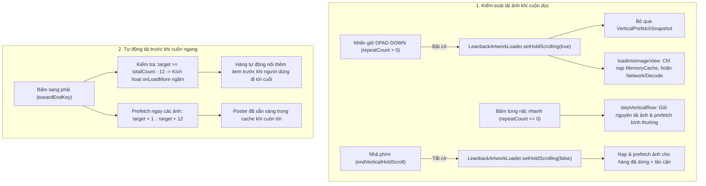
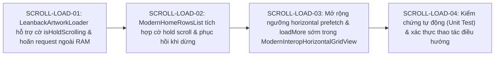

# PLAN: Tối Ưu Tải Ảnh Khi Nhấn Giữ Cuộn Dọc & Nạp Trước Poster Khi Di Chuyển Ngang

> **Slug**: `scroll-image-load-optimization` · **Ngày**: 2026-11-20 · **Task**: xem [task.md](file:///f:/MyGithub/NuvioTV-Fast/task.md) (mục `SCROLL-LOAD-*`)

---

## 1. Phân tích hiện trạng & Nguyên nhân gốc (Discovery)

### Vấn đề 1: Nhấn giữ cuộn dọc bị lag do tải ảnh liên tục
- **Hiện tượng**: Khi nhấn giữ DPAD DOWN để lướt nhanh qua các hàng, giao diện bị giật khựng (lag frame drop). Tuy nhiên, khi bấm từng nấc xuống nhanh thì người dùng muốn vẫn tải bình thường.
- **Nguyên nhân mã nguồn**:
  - Khi nhấn giữ (`repeatCount > 0`), [ModernHomeRowsList.kt#L1239-L1435](file:///f:/MyGithub/NuvioTV-Fast/app/src/main/java/com/nuvio/tv/ui/screens/home/ModernHomeRowsList.kt#L1239-L1435) kích hoạt `startOrExtendVerticalHoldScroll` với tốc độ lướt từ `520dp/s` đến `960dp/s`.
  - Trong suốt quá trình lướt này, các row bay qua viewport và hàng loạt `LeanbackCardViewHolder` liên tục gọi [LeanbackArtworkLoader.loadIntoImageView](file:///f:/MyGithub/NuvioTV-Fast/app/src/main/java/com/nuvio/tv/ui/leanback/core/LeanbackArtworkLoader.kt#L207).
  - Đồng thời, coroutine `VerticalPrefetchSnapshot` ([L722-L771](file:///f:/MyGithub/NuvioTV-Fast/app/src/main/java/com/nuvio/tv/ui/screens/home/ModernHomeRowsList.kt#L722-L771)) vẫn chạy mỗi 60ms để kích hoạt `LeanbackArtworkLoader.prefetch` cho hàng loạt card ở các hàng tiếp theo.
  - Hàng chục request ảnh (HTTP fetch + giải mã bitmap trên CPU/GPU) đổ dồn vào Coil cùng lúc với animation cuộn 60fps làm quá tải thread pool và kích hoạt GC liên tục, gây tụt khung hình nghiêm trọng.
  - Khi bấm nhấp từng hàng (`stepVerticalRow`), `repeatCount == 0`, không kích hoạt hold-scroll.

### Vấn đề 2: Di chuyển ngang không tự động tải trước như cuộn dọc ("phải xem hết ảnh rồi mới load")
- **Hiện tượng**: Khi cuộn dọc xuống dưới, các hàng tiếp theo tự động tải sẵn trước 3–4 hàng (cả data catalog lẫn ảnh poster). Nhưng khi bấm sang ngang trong một hàng, dữ liệu trang tiếp theo và ảnh poster không tải trước chủ động, người dùng cuộn đến gần cuối hàng phải đứng chờ hoặc thấy poster trống.
- **Nguyên nhân mã nguồn**:
  1. **Ngưỡng tải thêm trang catalog (Pagination) quá muộn**:
     - Tại [ModernInteropHorizontalGridView.kt#L334](file:///f:/MyGithub/NuvioTV-Fast/app/src/main/java/com/nuvio/tv/ui/screens/home/ModernInteropHorizontalGridView.kt#L334), `onLoadMore` chỉ được gọi khi `position >= totalCount - 5`.
     - Với màn hình TV 1080p, 5–7 poster đã hiển thị đồng thời trên màn hình. Khi người dùng bấm đến `totalCount - 5`, poster cuối cùng (`totalCount - 1`) **đã nằm sẵn trong tầm mắt**. Người dùng chỉ cần ấn 2–3 nhịp là chạm đáy hàng và phải đứng chờ API phản hồi.
     - Hơn nữa, `onLoadMore` chỉ kích hoạt bên trong `onChildViewHolderSelected` (chỉ chạy sau khi animation cuộn của view holder kết thúc), không kích hoạt chủ động trong `dispatchKeyEvent` khi bấm sang phải.
  2. **Cửa sổ nạp trước ảnh poster ngang quá hẹp & bị động**:
     - Trong [HomePosterLoading.kt#L74-L92](file:///f:/MyGithub/NuvioTV-Fast/app/src/main/java/com/nuvio/tv/core/image/HomePosterLoading.kt#L74-L92), `horizontalPrefetchAhead` chỉ là 4 (low RAM) hoặc 6 (standard). 6 thẻ chỉ vừa đủ số lượng hiển thị trên màn hình hiện tại.
     - Trong [ModernInteropHorizontalGridView.kt#L595-L661](file:///f:/MyGithub/NuvioTV-Fast/app/src/main/java/com/nuvio/tv/ui/screens/home/ModernInteropHorizontalGridView.kt#L595-L661), `dispatchKeyEvent` khi nhận phím sang phải (`towardEndKey`) không gọi lệnh prefetch ngay mà chờ `onChildViewHolderSelected` mới gọi `onFocusedPositionChanged`.
     - Khi người dùng bấm liên tục sang phải, các poster ở vị trí xa hơn chưa kịp đưa vào hàng đợi nạp trước, dẫn đến gặp placeholder chờ tải.

---

## 2. Mục tiêu kỹ thuật

1. **Khi nhấn giữ di chuyển xuống (Vertical Hold Scroll / Glide)**:
   - Tạm dừng (pause) toàn bộ request tải ảnh mới qua mạng / giải mã đĩa đắt tiền trong `LeanbackArtworkLoader`.
   - Các ảnh đã có sẵn trong `MemoryCache` vẫn hiển thị ngay lập tức (chi phí 0ms, không lag).
   - Tạm dừng coroutine `VerticalPrefetchSnapshot` trong lúc lướt.
   - Khi nhả phím nhấn giữ (`endVerticalHoldScroll`) và ring dừng tại hàng mục tiêu: tự động kích hoạt tải và nạp trước đầy đủ cho hàng hiện tại và các hàng lân cận.
2. **Khi bấm nhanh xuống từng hàng (`stepVerticalRow`)**:
   - Giữ nguyên cơ chế tải và prefetch bình thường, không bị ảnh hưởng hay trì hoãn.
3. **Khi di chuyển sang ngang trong một hàng (Horizontal Navigation)**:
   - **Tải trước danh mục sớm (Eager Pagination)**: Tăng ngưỡng gọi `onLoadMore` từ 5 lên `10–12` items (hoặc khi người dùng vượt quá nửa danh sách), và kích hoạt trực tiếp trong `dispatchKeyEvent` khi bấm sang phải để tải trang tiếp theo ngầm trước khi người dùng chạm tới cuối hàng.
   - **Tải trước ảnh poster ngang rộng hơn (Deep Horizontal Image Prefetch)**: Mở rộng `horizontalPrefetchAhead` lên 10–12 items và kích hoạt prefetch ngay lập tức khi con trỏ di chuyển sang phải trong `dispatchKeyEvent`.

---

## 3. Kiến trúc giải pháp (Architecture & Design)



### 3.1 Điều khiển tạm dừng tải ảnh khi nhấn giữ (`LeanbackArtworkLoader`)
- Thêm cờ `@Volatile var isHoldScrolling: Boolean = false` vào `LeanbackArtworkLoader`.
- Trong `LeanbackArtworkLoader.prefetch(...)`:
  - `if (isHoldScrolling) return` → Không chiếm dụng băng thông và CPU để nạp trước cho các hàng đang bay qua.
- Trong `LeanbackArtworkLoader.loadIntoImageView(...)`:
  - Kiểm tra `findInMemoryCache(...)`: Nếu trúng bộ nhớ đệm RAM thì gán luôn drawable vào `ImageView`.
  - Nếu không có trong RAM và `isHoldScrolling == true`:
    - Gán placeholder tạm thời và trả về một `DeferredDisposable` (hoặc đánh dấu trên ViewHolder).
    - Không gửi `ImageRequest` vào `imageLoader.enqueue(...)` trong lúc đang lướt tốc độ cao.
- Trong `ModernHomeRowsList.kt`:
  - Tại `startOrExtendVerticalHoldScroll`: gọi `LeanbackArtworkLoader.isHoldScrolling = true`.
  - Tại `endVerticalHoldScroll`:
    - Đặt lại `LeanbackArtworkLoader.isHoldScrolling = false`.
    - Gọi nạp lại ảnh cho các card đang hiển thị trên hàng đã đáp xuống (`landingGrid.post { rowAdapter?.prefetchFromVisibleRange(context) }` hoặc rebind các card hiển thị).
  - Trong `stepVerticalRow(sign)`: Đảm bảo `LeanbackArtworkLoader.isHoldScrolling = false` để việc bấm từng nấc đơn lẻ vẫn tải mượt mà.

### 3.2 Tải trang danh mục sớm hơn khi cuộn ngang (Eager Horizontal Pagination)
- Sửa [ModernInteropHorizontalGridView.kt#L334](file:///f:/MyGithub/NuvioTV-Fast/app/src/main/java/com/nuvio/tv/ui/screens/home/ModernInteropHorizontalGridView.kt#L334):
  - Định nghĩa ngưỡng `val loadMoreThreshold = maxOf(10, totalCount - 12)`.
  - Kiểm tra nếu `position >= totalCount - 12 && totalCount > 0`: gọi `rowAdapter?.onLoadMore?.invoke()`.
- Bổ sung kiểm tra ngay trong `dispatchKeyEvent` khi bấm phím sang phải (`towardEndKey`):
  - Khi `target >= total - 12`: gửi ngay `rowAdapter?.onLoadMore?.invoke()`, giúp request mạng xuất phát sớm hơn 200–500ms thay vì đợi cuộn kết thúc.

### 3.3 Tải trước ảnh poster ngang sâu hơn (Deep Horizontal Image Prefetch)
- Điều chỉnh thông số `HomeImageLoadingProfile` trong [HomePosterLoading.kt](file:///f:/MyGithub/NuvioTV-Fast/app/src/main/java/com/nuvio/tv/core/image/HomePosterLoading.kt):
  - `horizontalPrefetchAhead`: Tăng từ 4 lên **8** (Low RAM) và từ 6 lên **12** (Standard).
- Trong `ModernInteropHorizontalGridView.dispatchKeyEvent`:
  - Khi bấm sang phải (`towardEndKey`), gọi ngay `rowAdapter?.onFocusedPositionChanged(context, target)` (hoặc hàm kích hoạt prefetch ngang theo hướng đi) để đưa các poster từ `target + 1` đến `target + aheadCount` vào hàng đợi tải trước, thay vì chỉ đợi `onChildViewHolderSelected`.

---

## 4. Chuỗi phụ thuộc triển khai (Dependency Chain)



---

## 5. Rủi ro & Giải pháp phòng ngừa (Risks & Mitigations)

> [!WARNING]
> **Rủi ro ảnh bị trống khi nhả phím nhấn giữ**:
> Nếu người dùng nhả phím và hàng đáp xuống chưa có ảnh trong RAM, nếu không kích hoạt lại kịp thời thì card sẽ bị kẹt ở trạng thái placeholder.
> *Giải pháp*: Trong `endVerticalHoldScroll`, khi overlay ring chuyển giao focus về grid mục tiêu (`handoffOverlayToGrid`), gọi `landingGrid.post { rowAdapter?.onScrollSettled(); rowAdapter?.prefetchFromVisibleRange(context) }` để ngay lập tức nạp ảnh cho toàn bộ card trên màn hình.

> [!WARNING]
> **Rủi ro gọi API `onLoadMore` quá nhiều lần liên tiếp khi cuộn nhanh**:
> Nếu người dùng nhấn giữ sang phải, điều kiện `target >= total - 12` có thể bị quét qua nhiều lần trong vài chục mili-giây.
> *Giải pháp*: `ModernHomeRows.kt` đã có `loadMoreRequestedTotals[rowKey] = total` và `HomeViewModelCatalogPipeline` có `_loadingCatalogs` kiểm tra khóa trùng lặp; ngoài ra cần thêm debounce nhỏ (~300ms) trong adapter để ngăn gọi trùng request.

---

## 6. Kế hoạch kiểm chứng (Verification Plan)

### Kiểm tra tự động
```powershell
.\gradlew.bat :app:compileFullDebugKotlin
.\gradlew.bat :app:testFullDebugUnitTest
```

### Kịch bản kiểm thử thủ công
1. **Nhấn giữ DPAD DOWN cuộn nhanh**:
   - Nhấn giữ phím xuống qua 10–15 hàng catalog liên tục: Giao diện cuộn mượt mà không bị tụt FPS; các thẻ lướt qua không spawn hàng loạt request mạng.
   - Khi nhả phím: Hàng dừng lại ngay lập tức hiển thị ảnh sắc nét, không bị kẹt placeholder.
2. **Bấm nhấp từng hàng DPAD DOWN nhanh**:
   - Bấm nhấp từng nấc xuống liên tiếp: Ảnh poster của từng hàng vẫn tải và hiển thị bình thường như trước.
3. **Bấm sang ngang trên một hàng catalog dài**:
   - Bấm sang phải liên tục: Các poster tiếp theo đã được tải trước từ sớm, không bị tình trạng khung trống.
   - Khi đi đến gần cuối hàng (khoảng cách 10–12 card trước card cuối): Trang mới tự động được tải và nối thêm vào đuôi hàng mượt mà mà không phải chờ đến tận card cuối cùng mới thấy tải.
