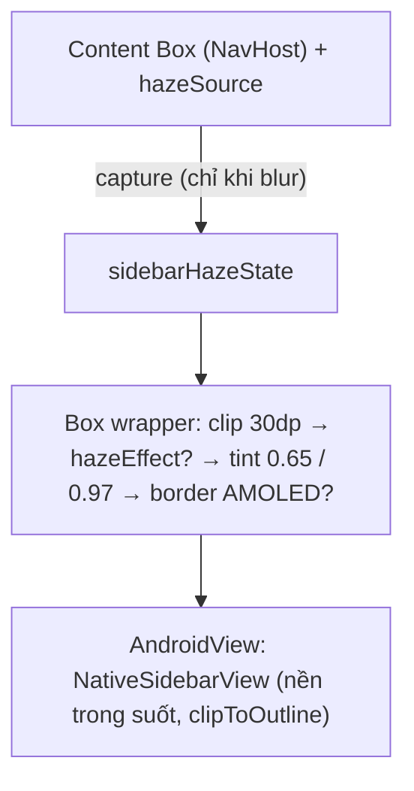
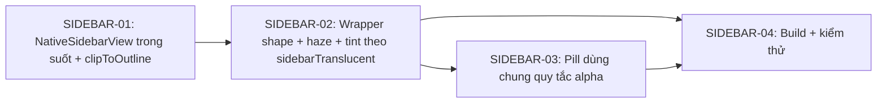

# PLAN: Khôi phục Sidebar bo tròn + hiệu ứng mờ (Blur) như bản gốc

> **Slug**: `sidebar-rounded-blur` · **Ngày**: 2026-11-20 (rev 2) · **Task**: xem [task.md](file:///f:/MyGithub/NuvioTV-Fast/task.md) (mục `SIDEBAR-*`)

---

## 1. Phân tích hiện trạng (Discovery)

### Bản gốc (upstream `NuvioMedia/NuvioTV` – `upstream/main`)
- Panel mở rộng là Compose `ModernSidebarBlurPanel` (`app/src/main/java/com/nuvio/tv/ModernSidebarBlurPanel.kt`).
- **Hình dạng**: `RoundedCornerShape(sidebarTokens.panelRadius)` → **bo đều 4 góc 30dp** (`ComponentTokens.kt:142`).
- **Blur** (setting *Modern sidebar blur* bật + API ≥ 31):
  ```kotlin
  Modifier.hazeEffect(state = sidebarHazeState) {
      blurRadius = NuvioTheme.effects.blurPanel * delayedBlurProgress   // 26dp
      noiseFactor = 0.04f * delayedBlurProgress
      inputScale = HazeInputScale.Fixed(0.66f)
  }
  // delayedBlurProgress = ((sidebarExpandProgress - 0.34f) / 0.66f).coerceIn(0f, 1f)
  ```
- **Màu nền**: `Color(0xFF161618)` (AMOLED: `Color.Black`), alpha `0.65` khi blur / `0.97` khi không blur / AMOLED không blur `1.0` + viền hairline.
- Thứ tự modifier: `clip(panelShape)` → `hazeEffect` → `background(brush, panelShape)` → `border?`.

### Bản hiện tại (NuvioTV-Fast)
- Panel là View thuần [NativeSidebarView.kt](file:///f:/MyGithub/NuvioTV-Fast/app/src/main/java/com/nuvio/tv/ui/components/NativeSidebarView.kt), nhúng qua `AndroidView` tại [MainActivity.kt#L1787-L1887](file:///f:/MyGithub/NuvioTV-Fast/app/src/main/java/com/nuvio/tv/MainActivity.kt#L1787-L1887).
- [applySidebarStyle()](file:///f:/MyGithub/NuvioTV-Fast/app/src/main/java/com/nuvio/tv/ui/components/NativeSidebarView.kt#L147-L171): `cornerRadii = 0, 24, 24, 0` (**chỉ bo góc phải**), nền `#FA141416` (~98%, **gần đặc**), **không blur**.
- Hạ tầng blur còn sẵn: `sidebarHazeState`, `hazeSource` ([L1697](file:///f:/MyGithub/NuvioTV-Fast/app/src/main/java/com/nuvio/tv/MainActivity.kt#L1697)), `shouldApplySidebarHaze` ([L1653](file:///f:/MyGithub/NuvioTV-Fast/app/src/main/java/com/nuvio/tv/MainActivity.kt#L1653)), `sidebarExpandProgress`.
- `modernSidebarBlurEnabled = modernSidebarBlurPref && SDK_INT >= S` ([L917-L918](file:///f:/MyGithub/NuvioTV-Fast/app/src/main/java/com/nuvio/tv/MainActivity.kt#L917-L918)).
- Toggle blur trong Cài đặt **bị ẩn trên API < 31** ([LayoutHomeSettings.kt#L211](file:///f:/MyGithub/NuvioTV-Fast/app/src/main/java/com/nuvio/tv/ui/screens/settings/LayoutHomeSettings.kt#L211)).

### Nguyên nhân gốc
Khi port sang `NativeSidebarView`, panel tự vẽ nền đặc bằng `GradientDrawable` (bo lệch) và bỏ lớp `hazeEffect` → mất cả bo tròn lẫn hiệu ứng mờ.

---

## 2. Mục tiêu (đã chốt với người dùng)

1. Panel sidebar mở rộng **bo tròn đều 4 góc** theo token `panelRadius` (30dp).
2. **Ma trận nền / blur**:

| Thiết bị | Setting *Modern sidebar blur* | Blur | Alpha nền |
|---|---|---|---|
| API ≥ 31 (Android 12+) | Bật | ✅ 26dp, noise 0.04 | **0.65** |
| API ≥ 31 | Tắt | ❌ | 0.97 (AMOLED 1.0 + viền) – như gốc |
| API < 31 | (toggle bị ẩn) | ❌ (không hỗ trợ) | **0.65 – luôn trong** |

3. Viên pill thu gọn (`CollapsedSidebarPill`) dùng **cùng quy tắc alpha** (0.65 khi trong suốt, 0.96 khi không) để đồng bộ với panel.
4. **Không** thêm hiệu ứng "nở" (scale) khi mở – giữ animation alpha hiện có.
5. Giữ nguyên toàn bộ logic focus/DPAD/back của `NativeSidebarView`; không ảnh hưởng chế độ Classic (`isFloating = false`).

> [!NOTE]
> Phạm vi chỉ gồm **hình dạng + độ trong/blur**. Divider, kích thước mục Cài đặt, avatar ảnh… so với ảnh tham chiếu **không** nằm trong plan này.

---

## 3. Thiết kế giải pháp

Chiến lược: **Compose wrapper chịu trách nhiệm "vỏ" (shape + blur + tint), View chỉ vẽ nội dung.**



### 3.1 Cờ mới trong `ModernSidebarScaffold`
```kotlin
// Translucent panel: follow blur setting on Android 12+, always translucent below 12
val sidebarTranslucent = modernSidebarBlurEnabled ||
    Build.VERSION.SDK_INT < Build.VERSION_CODES.S
```
- Tính cục bộ trong scaffold → **không cần thêm tham số** hay sửa DataStore/Settings.
- `modernSidebarBlurEnabled` vẫn là cờ duy nhất quyết định có `hazeEffect`/`hazeSource` hay không.

### 3.2 `NativeSidebarView` – bỏ nền tự vẽ ở chế độ floating
- `applySidebarStyle()` khi `isFloating == true`:
  - `background = null` (nền do Compose vẽ).
  - `outlineProvider` bo tròn theo `panelCornerRadiusPx` + `clipToOutline = true` để pill focus không tràn góc.
  - Thêm `var panelCornerRadiusPx: Float` (set từ Compose theo token, không hardcode).
- Chế độ classic giữ nguyên.

### 3.3 `MainActivity.ModernSidebarScaffold` – vỏ panel
Trong `if (showExpandedPanel) { ... }` (≈ L1798), bọc `AndroidView`:
```kotlin
val panelShape = RoundedCornerShape(sidebarTokens.panelRadius)
val delayedBlurProgress = ((sidebarExpandProgress - 0.34f) / 0.66f).coerceIn(0f, 1f)
val showPanelBlur = modernSidebarBlurEnabled && isSidebarExpanded &&
    !sidebarCollapsePending && delayedBlurProgress > 0f
// panelBackgroundBrush: base = AMOLED ? Black : 0xFF161618
//   alpha = sidebarTranslucent -> 0.65 ; AMOLED -> 1.0 ; else -> 0.97
// panelBorderColor: !sidebarTranslucent && AMOLED -> Border @0.9 ; else Transparent
Box(
    Modifier.fillMaxSize()
        .clip(panelShape)
        .then(if (showPanelBlur) Modifier.hazeEffect(sidebarHazeState) { ... } else Modifier)
        .background(panelBackgroundBrush, panelShape)
        .then(border nếu cần)
) { AndroidView(...) }
```

### 3.4 `CollapsedSidebarPill`
- Tách tham số: `translucent: Boolean` (quyết định alpha 0.65/0.96) và giữ `blurEnabled`/`hazeState` (quyết định `hazeEffect`).
- Call site truyền `translucent = sidebarTranslucent`.

> [!IMPORTANT]
> `hazeEffect` phải nằm **sau** `clip` và **trước** `background` (đúng thứ tự upstream); đảo thứ tự sẽ làm blur tràn khỏi góc bo hoặc bị tint che mất.

---

## 4. Chuỗi phụ thuộc



---

## 5. Rủi ro

> [!WARNING]
> **Độ đọc trên Android < 12**: nền 65% **không có blur** → poster/backdrop sáng phía sau có thể làm chữ trắng khó đọc. Đây là yêu cầu đã chốt; nếu thử thực tế thấy khó đọc, phương án dự phòng là tăng nhẹ alpha (vd 0.75) **chỉ** cho API < 31 – cần người dùng duyệt.

> [!WARNING]
> **Hiệu năng blur trên TV yếu (API ≥ 31)**: chỉ bật khi `isSidebarExpanded && !sidebarCollapsePending`, ramp theo `delayedBlurProgress`, `inputScale 0.66`; `hazeSource` chỉ gắn khi `shouldApplySidebarHaze` (đã có). API < 31 không chạy haze → không tốn thêm GPU.

> [!WARNING]
> **Nội dung phía sau là AndroidView (Leanback RecyclerView)**: `hazeSource` ghi draw của `AndroidViewHolder` vào GraphicsLayer – pill thu gọn đang dùng cùng cơ chế, nhưng cần xác nhận blur cập nhật khi Home cuộn/đổi backdrop. Nếu blur "đóng băng"/rỗng → báo lại để xử lý riêng.

> [!CAUTION]
> Không đổi `descendantFocusability`, key listener hay `requestSidebarFocus()` – phần này đã fix nhiều lần (commit `0365e77bf`, `8cccd5f09`).

---

## 6. Kế hoạch kiểm chứng

### Tự động
```powershell
.\gradlew.bat :app:compileFullDebugKotlin
.\gradlew.bat :app:assembleFullDebug
```

### Thủ công
| # | Thiết bị | Kịch bản | Kỳ vọng |
|---|---|---|---|
| 1 | Mọi API | Mở sidebar (Left / long-press Back) | 4 góc bo tròn 30dp, không còn góc vuông bên trái |
| 2 | API ≥ 31 | Bật *Modern sidebar blur*, mở sidebar trên Home có backdrop màu | Nội dung phía sau mờ + tint 65%, giống ảnh tham chiếu |
| 3 | API ≥ 31 | Tắt blur | Nền tối 97%, vẫn bo tròn |
| 4 | API < 31 | Mở sidebar | Không blur, nền trong 65% thấy nội dung phía sau, không crash |
| 5 | API ≥ 31 + AMOLED, blur tắt | Mở sidebar | Nền đen + viền hairline |
| 6 | API < 31 / blur bật | Pill thu gọn ở góc trên | Nền pill 65% đồng bộ với panel |
| 7 | Mọi API | DPAD Up/Down/Right/Back, chọn mục, chuyển profile | Hành vi focus không đổi |
| 8 | Mọi API | Pill focus ở mục đầu/cuối | Không tràn khỏi góc bo |
| 9 | Mọi API | Mở/đóng liên tục 10 lần | Không giật rõ rệt, không rò focus; không có hiệu ứng scale |
| 10 | Mọi API | Chế độ Classic sidebar | Không thay đổi |
