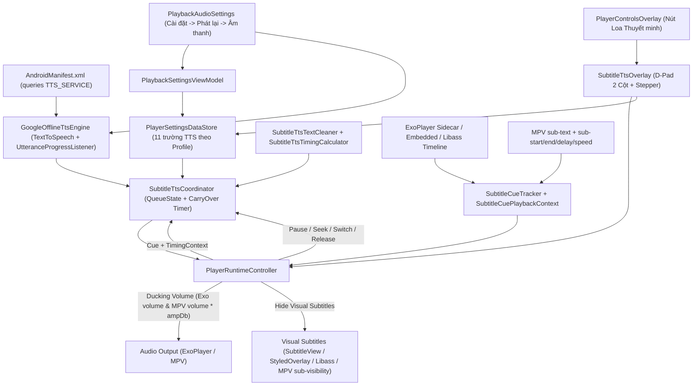

# PLAN: Tích hợp Chức năng Đọc Phụ đề bằng Google TTS Offline (Đồng bộ Cài đặt Mới nhất từ `NuvioMobile-Fast`)

> **Slug**: `subtitle-google-tts-offline`  
> **Dự án đích**: `NuvioTV-Fast` (Android TV / Google TV — nhánh `tet2`)  
> **Dự án tham khảo**: `NuvioMobile-Fast` (đã đối chiếu tới commit `802080dd2` — bao gồm `PLAN-subtitle-tts.md`, `PLAN-tts-offline-and-huggingface.md`, `PLAN-subtitle-tts-timing-sync.md` và mã nguồn `features/player/tts/`)  
> **Phạm vi**: **CHỈ tích hợp Google TTS Offline** qua Android `TextToSpeech` (không tích hợp Online Edge/Google Translate HTTP TTS, không tích hợp Piper ONNX / `sherpa-onnx` / HuggingFace)  
> **Ngày cập nhật**: 20/11/2026 (rev 2 — đồng bộ bộ cài đặt mới & căn nhịp thời gian phụ đề) · **Trạng thái**: Chờ duyệt (Pending Review)  
> **Task Tracker**: xem [task.md](file:///f:/MyGithub/NuvioTV-Fast/task.md) (mục `TTS-*`)

---

## 🎯 1. Mục tiêu Cốt lõi & Đối chiếu với `NuvioMobile-Fast` (Bản Mới Nhất)

### 1.1. Toàn bộ cài đặt & tính năng kế thừa từ `NuvioMobile-Fast` (tới commit `802080dd2`)
1. **Bộ lọc, chuẩn hóa dấu câu & tốc độ đọc căn nhịp (`SubtitleTtsTextCleaner` + `SubtitleTtsTimingCalculator`)**:
   - Lọc thẻ ASS/SSA (`{\an8}`, `{\i1}`...), thẻ HTML (`<i>`, `<font>`), ký hiệu âm nhạc (`♪`, `♫`), ghi chú SDH (`[tiếng cười]`, `(thở dài)`), gạch đầu dòng người nói (`- `), chuẩn hóa `\N`/`\n`/`\h`.
   - **Tự động thêm dấu kết câu (`ensureSentenceEndingPunctuation`)**: tự gắn dấu `.` nếu câu phụ đề chưa kết thúc bằng `.!?:;…` để Google TTS ngắt âm cuối tự nhiên, không bị hụt chữ.
   - **Tự động căn nhịp theo thời gian phụ đề (`ttsAutoSpeedEnabled`)**: tính `budgetMs` thực tế dựa trên `nextCueStartMs` (ưu tiên hơn `endMs` để tận dụng khoảng lặng trước câu kế tiếp), vị trí đang phát, `subtitleDelayMs` và `playbackSpeed`, ước lượng độ dài câu tiếng Việt tự nhiên ở `1.0x` (theo số từ, ký tự dài và dấu ngắt câu), chỉ tăng tốc khi câu không kịp lọt slot; fallback về công thức độ dài câu nếu là Live/HLS không có timeline.
2. **Dải Tốc độ Cơ bản Mở rộng & Giới hạn Trần Bắt nhịp (`ttsBaseSpeed` & `ttsMaxAutoSpeed`)**:
   - **Tốc độ đọc cơ bản (`ttsBaseSpeed`)**: mặc định **`1.0x`** (đã hạ từ `1.15x` theo bản Mobile mới), dải **`0.80x – 2.00x`** (bước `0.05x`).
   - **Tốc độ tối đa khi bắt nhịp (`ttsMaxAutoSpeed`)**: mặc định **`2.1x`** (`210%`), dải **`1.4x – 3.0x`** (bước `0.05x`, chỉ kích hoạt khi bật *Tự động căn nhịp*). Tầng `GoogleOfflineTtsEngine` cho phép `setSpeechRate` lên tới **`3.0f`**.
3. **Chờ đọc hết câu trước khi chuyển (`ttsWaitForCueCompletion`) & Ngắt câu an toàn (`SubtitleTtsCueQueueState` + `UtteranceProgressListener`)**:
   - **Mặc định (`false`)**: câu mới tới lập tức ngắt câu đang đọc (`QUEUE_FLUSH`) để bám sát hình ảnh.
   - **Khi bật (`true`)**: dùng `UtteranceProgressListener` (`onDone` / `onError` / `onStop`) kèm hàng đợi chờ 1 slot (`pendingCue`), giới hạn chờ tối đa `MAX_CARRY_OVER_MS = 1500ms` và tự hủy nếu trễ quá `MAX_QUEUE_STALE_MS = 2500ms`; khi chuyển sang câu chờ sẽ tự trừ phần thời gian đã lố (`overdueMs`) để bắt kịp nhịp cảnh phim.
   - Lọc trùng câu theo cả nội dung lẫn `cueStartMs` (`lastSpokenCueStartMs`) để không bỏ sót 2 câu thoại giống nhau ở 2 thời điểm khác nhau.
   - Khi tạm dừng (`Pause`), tua (`Seek`), đổi phụ đề, hoặc thoát Player: hủy toàn bộ timer carry-over/hàng đợi và gọi `stop()` ngay lập tức.
4. **Âm lượng độc lập 2 kênh (`Dual Volume Controls`)**:
   - **Âm lượng phim gốc (`ttsMovieVolume`: `0% – 100%`, mặc định `25%`)**: hạ âm lượng phim khi TTS bật và khôi phục về bình thường (`100%` hoặc đúng mức `audioAmplificationDb`) khi tắt TTS.
   - **Âm lượng giọng đọc (`ttsVoiceVolume`: `0% – 100%`, mặc định `100%`)**: truyền qua `TextToSpeech.Engine.KEY_PARAM_VOLUME`.
5. **Cao độ giọng (`ttsPitch`: `0.6x – 1.5x`, mặc định `1.0x`), Ẩn phụ đề (`ttsHideSubtitlesWhenEnabled`) & Nghe thử (`previewVoice`)**:
   - Cho phép chỉnh cao độ giọng Google TTS, ẩn chữ phụ đề trên màn hình trong khi phụ đề vẫn chạy ngầm cho TTS, và nút **Nghe thử giọng đọc** ngay trong Cài đặt lẫn Player Overlay.

### 1.2. Những điểm cắt bỏ & tinh chỉnh bắt buộc cho `NuvioTV-Fast`
| Thành phần ở `NuvioMobile-Fast` | Quyết định trên `NuvioTV-Fast` | Lý do kỹ thuật |
| :--- | :--- | :--- |
| Piper ONNX (`sherpa-onnx-1.13.8.aar` ~47.8 MiB, `PiperModelManager`, `OnnxMetadataInjector`, HuggingFace) & `SubtitleTtsPlayer` (`AudioTrack` PCM) | **KHÔNG tích hợp** | Yêu cầu chỉ dùng Google TTS Offline; giữ 0 MB phình APK, tránh tốn ~80–150 MB RAM + ~60.6 MB/giọng cho TV Box. |
| 2-Pass PCM Calibration (`computeRecalibratedSpeed`), Lookahead PCM Cache (`BoundedLruPcmCache`), `adaptiveTailMs` | **KHÔNG áp dụng** *(chỉ dùng cho mảng PCM của Piper)* | Android `TextToSpeech` tổng hợp trong tiến trình Google và không trả `FloatArray` PCM; vẫn giữ nguyên `SubtitleTtsTimingCalculator` (0 MB, 0 dep) để tính tốc độ theo `budgetMs` một lần cực chuẩn. |
| `SubtitleTtsSynthesizer` (Edge / Google Translate Online) | **KHÔNG tích hợp** | Không phụ thuộc mạng, không lỗi `403`, không tranh băng thông video 4K/Torrent. |
| `SystemTtsEngine` chọn mọi engine + cả giọng Online | **Chuyên biệt Google TTS Offline** | Mặc định trỏ thẳng `com.google.android.tts`; ưu tiên & mặc định lọc giọng **Offline** (`!voice.isNetworkConnectionRequired`), ưu tiên `vi-VN`/`vi`. Có tùy chọn dự phòng `ttsAllowNetworkVoiceFallback` (mặc định `false`) + cảnh báo rõ nếu TV ROM thiếu Google Speech hoặc chưa tải gói giọng offline. |
| `SubtitleTtsStorage` (`SharedPreferences` riêng) | **Tích hợp vào `PlayerSettingsDataStore` (DataStore theo Profile)** | Đồng bộ kiến trúc Hilt + Flow + Profile Scoping sẵn có của `NuvioTV-Fast` (`PlayerSettings`). |
| UI Mobile chạm (`Slider`, `SubtitleTtsModal`, `PlaybackAudioTtsSettings`) | **Thiết kế chuẩn Android TV D-Pad** | Dùng `SettingsSectionLabel`, `SettingsToggleRow`, `SettingsActionRow`, `SliderSettingsItem`, `SettingsSingleChoiceDialog` trong Cài đặt; và `SubtitleTtsOverlay` dùng `- / +` steppers + focus management trong Player. |

---

## ⚠️ 2. Phân tích Rủi ro & Điểm Cần Lưu ý Đặc thù trên Android TV (`NuvioTV-Fast`)

> [!IMPORTANT]
> **1. Khai báo `<queries>` trong `AndroidManifest.xml` cho Android 11+ (`targetSdk = 36`)**:
> - [AndroidManifest.xml](file:///f:/MyGithub/NuvioTV-Fast/app/src/main/AndroidManifest.xml#L7-L11) hiện mới khai báo `android.speech.RecognitionService` trong `<queries>`, **chưa khai báo `android.intent.action.TTS_SERVICE`**.
> - Trên Android 11+ (TV Box chạy Android TV 11/12/13/14+), nếu thiếu intent query `android.intent.action.TTS_SERVICE`, lời gọi `TextToSpeech(context, listener, "com.google.android.tts")` và `tts.engines` có thể không nhìn thấy Google Speech Services. **Bắt buộc bổ sung vào `<queries>`**.

> [!WARNING]
> **2. Xung đột Âm lượng trên MPV (`applyAudioAmplificationDb`) & HDMI Passthrough trên ExoPlayer**:
> - **Trên MPV**: [NuvioMpvSurfaceView.kt](file:///f:/MyGithub/NuvioTV-Fast/app/src/main/java/com/nuvio/tv/ui/screens/player/NuvioMpvSurfaceView.kt#L320-L330) đang dùng `mpv.setPropertyDouble("volume", targetVolumePercent)` để khuếch đại âm thanh (`audioAmplificationDb`). Nếu TTS ghi đè trực tiếp `"volume"` sẽ phá hỏng mức khuếch đại (hoặc bị `observeSubtitleSettings` ghi đè lại). **Giải pháp**: Hợp nhất thành `applyAudioOutputLevel(amplificationDb, volumeScale)` tính `100.0 * 10^(db / 20.0) * volumeScale`.
> - **Trên ExoPlayer**: Dùng `_exoPlayer?.volume = if (ttsEnabled) ttsMovieVolume else 1.0f`. Nếu người dùng bật **IEC / System HDMI Passthrough** (`playbackSpeedAwareAudioSink?.isDirectPlaybackActive() == true`), `exoPlayer.volume` có thể không làm nhỏ bitstream trên một số TV/AVR. **Giải pháp**: Hiển thị ghi chú cảnh báo nhẹ trên Overlay khi phát hiện Passthrough trực tiếp.

> [!WARNING]
> **3. Audio Focus giữa `ExoPlayer` và `TextToSpeech` + Độ ổn định `setSpeechRate` cao (`> 2.2x`)**:
> - Trong [PlayerRuntimeControllerInitialization.kt](file:///f:/MyGithub/NuvioTV-Fast/app/src/main/java/com/nuvio/tv/ui/screens/player/PlayerRuntimeControllerInitialization.kt#L1100-L1104), ExoPlayer bật `setAudioAttributes(..., true)` (`handleAudioFocus = true`). Cần gán `AudioAttributes(USAGE_MEDIA, CONTENT_TYPE_SPEECH)` cho `TextToSpeech` và tuyệt đối không xin `AUDIOFOCUS_GAIN` riêng để tránh ExoPlayer bị tự Pause khi TTS đọc.
> - Một số ROM TV / phiên bản Google TTS có thể giữ khoảng đệm nhỏ ở `setSpeechRate` quá cao (`2.5x–3.0x`) hoặc bắn `onStop(..., interrupted = true)` khi bị `QUEUE_FLUSH` — trong `GoogleOfflineTtsEngine` phải phân biệt rõ `onDone` vs `onStop(interrupted = true)` theo từng `utteranceId` (như `SystemTtsEngine.android.kt` mới của Mobile) để không kích hoạt nhầm `pendingCue` khi đang flush hoặc seek!

> [!IMPORTANT]
> **4. Trích xuất Timeline Phụ đề (`TimedSpeechCue`) qua cả 3 đường kết xuất (`ExoPlayer`, `Libass`, `MPV`)**:
> - **ExoPlayer Sidecar (`SRT`/`VTT`/`TTML`)**: [PlayerSidecarSubtitles.kt](file:///f:/MyGithub/NuvioTV-Fast/app/src/main/java/com/nuvio/tv/ui/screens/player/PlayerSidecarSubtitles.kt) đã có sẵn `sidecarTimedCues: List<CuesWithTiming>`. Có thể trích xuất trực tiếp `startMs`, `endMs`, `nextCueStartMs` (bỏ qua cue SDH/trống) kèm `subtitleDelayUs` và `audioDelayUs`.
> - **ExoPlayer Embedded & Libass (`useLibass = true` cho ASS/SSA)**: Tận dụng [EmbeddedSubtitleTimelineLoader.kt](file:///f:/MyGithub/NuvioTV-Fast/app/src/main/java/com/nuvio/tv/ui/screens/player/autosync/EmbeddedSubtitleTimelineLoader.kt) / `PlayerSubtitleCueParser` sẵn có trong `NuvioTV-Fast` để lấy `SubtitleSyncCue` timeline khi TTS bật (đồng thời xử lý polling nhẹ theo `currentPosition` cho `.ass` chạy qua `AssHandler` nếu `AssSubtitleParserFactory` không đẩy text ra `TextOutput`). Với Live/HLS không có timeline, `resolveSpeechBudgetMs` trả `null` và lùi an toàn về công thức độ dài câu kết hợp `ttsMaxAutoSpeed`.
> - **MPV**: Đọc `sub-start`, `sub-end`, `time-pos`, `sub-delay`, `speed` trong [NuvioMpvSurfaceView.kt](file:///f:/MyGithub/NuvioTV-Fast/app/src/main/java/com/nuvio/tv/ui/screens/player/NuvioMpvSurfaceView.kt) khi `MPV_SUB_TEXT_PROPERTY` thay đổi (kết hợp timeline file ngoài nếu có) để có `nextCueStartMs` chính xác.
> - **Ẩn chữ hiển thị (`shouldHideVisualSubtitles`)**: Chặn output sau tầng `CueTrackingTextOutput` (trên ExoPlayer) và đặt `sub-visibility = false` trên MPV (`sub-text` vẫn đọc được bình thường), đồng thời ẩn `AssSubtitleSurfaceView` / `AssVideoEffectAsync` khi `useLibass = true`.

> [!NOTE]
> **5. Hạn chế đặc thù của TV Box & Bảo toàn Test Cấu trúc Settings**:
> - Một số TV Box nội địa/AOSP không cài sẵn `com.google.android.tts` hoặc ẩn `com.android.settings.TTS_SETTINGS` (`ActivityNotFoundException`). Cần thứ tự fallback Intent: `ACTION_INSTALL_TTS_DATA` (package `com.google.android.tts`) → `com.android.settings.TTS_SETTINGS` → dialog/Toast hướng dẫn đường dẫn trong Cài đặt Android TV.
> - **Sửa lỗi bị nuốt ở `PlaybackAudioSettings.kt` dòng 98**: Trong [PlaybackAudioSettings.kt](file:///f:/MyGithub/NuvioTV-Fast/app/src/main/java/com/nuvio/tv/ui/screens/settings/PlaybackAudioSettings.kt#L98), câu lệnh `if (!isExoEngine) return` sẽ cắt mất UI phía dưới khi dùng MPV. Mục TTS **bắt buộc phải đặt phía trên** dòng này.
> - **Bảo toàn Test cấu trúc**: Không thêm phần tử mới vào enum `PlaybackSection` để giữ PASS 100% cho [SettingsStructureTest.kt](file:///f:/MyGithub/NuvioTV-Fast/app/src/test/java/com/nuvio/tv/ui/screens/settings/SettingsStructureTest.kt) và [SettingsIconsTest.kt](file:///f:/MyGithub/NuvioTV-Fast/app/src/test/java/com/nuvio/tv/ui/screens/settings/SettingsIconsTest.kt).

---

## 🗺️ 3. Chuỗi Phụ thuộc & Kiến trúc Kỹ thuật (Dependency Chain)



---

## 📋 4. Kế hoạch Triển khai Theo Giai đoạn (Phase-by-Phase Breakdown)

### 🔹 Giai đoạn 1: Quyền hệ thống, DataStore Profile & Google TTS Offline + Bộ Căn Nhịp
**Mục tiêu**: Hoàn thiện tầng lõi Google TTS Offline, bộ tính ngân sách thời gian phụ đề (`SubtitleTtsTimingCalculator`), hàng đợi `waitForCueCompletion`, và lưu trữ theo Profile.

1. **Cập nhật Manifest (`app/src/main/AndroidManifest.xml`)**:
   - Thêm `<intent><action android:name="android.intent.action.TTS_SERVICE" /></intent>` vào block `<queries>`.

2. **Mở rộng `PlayerSettings` & `PlayerSettingsDataStore` ([PlayerSettingsDataStore.kt](file:///f:/MyGithub/NuvioTV-Fast/app/src/main/java/com/nuvio/tv/data/local/PlayerSettingsDataStore.kt))**:
   - Bổ sung **11 trường TTS** vào `data class PlayerSettings`:
     - `val ttsEnabled: Boolean = false`
     - `val ttsVoiceName: String? = null` (`null` = tự động chọn giọng Tiếng Việt Offline tốt nhất)
     - `val ttsAllowNetworkVoiceFallback: Boolean = false` (mặc định `false` để **chỉ dùng giọng offline**)
     - `val ttsMovieVolume: Float = 0.25f` (`0.0f..1.0f`)
     - `val ttsVoiceVolume: Float = 1.0f` (`0.0f..1.0f`)
     - `val ttsBaseSpeed: Float = 1.0f` (`0.8f..2.0f` — cập nhật theo Mobile `DEFAULT_BASE_SPEED = 1.0f`, `MAX_BASE_SPEED = 2.0f`)
     - `val ttsPitch: Float = 1.0f` (`0.6f..1.5f`)
     - `val ttsAutoSpeedEnabled: Boolean = true` (*Tự động căn nhịp theo thời gian phụ đề*)
     - `val ttsMaxAutoSpeed: Float = 2.1f` (`1.4f..3.0f` — *Tốc độ tối đa khi bắt nhịp*)
     - `val ttsWaitForCueCompletion: Boolean = false` (*Chờ đọc hết câu trước khi chuyển*)
     - `val ttsHideSubtitlesWhenEnabled: Boolean = false` (*Ẩn phụ đề khi TTS đọc*)
   - Thêm các `Preferences.Key` + hàm `suspend fun setTts...(...)` với `coerceIn` / `isFinite` an toàn.

3. **Tạo package `app/src/main/java/com/nuvio/tv/core/tts/`**:
   - **`SubtitleTtsModels.kt`**:
     - `GoogleTtsVoiceInfo(name, displayName, localeTag, isOffline)`
     - `enum class GoogleTtsAvailability { READY, INITIALIZING, ENGINE_MISSING, NO_OFFLINE_VOICE, ERROR }`
     - `data class TimedSpeechCue(rawText, startMs, endMs = null, nextCueStartMs = null)`
     - `data class SubtitleCuePlaybackContext(currentCue, upcomingCues = emptyList(), playbackSpeed = 1.0f, positionMs = currentCue.startMs)`
     - `data class SubtitleTtsConfig(...)` (projection gọn 11 cấu hình từ `PlayerSettings`).
   - **`SubtitleTtsTextCleaner.kt`** (port bản mới nhất từ `NuvioMobile-Fast`):
     - `clean(rawText)`: lọc ASS/HTML/SDH/nhạc/gạch đầu dòng.
     - `ensureSentenceEndingPunctuation(text)`: thêm dấu `.` kết câu khi thiếu.
     - `calculateEffectiveSpeed(cleanText, baseSpeed, autoSpeedEnabled, maxAutoSpeed)`: fallback theo độ dài câu khi không có timeline.
   - **`SubtitleTtsTimingCalculator.kt`** (port logic thuần Kotlin từ `NuvioMobile-Fast`, bỏ các hàm dành riêng cho Piper PCM):
     - Các hằng số: `MIN_BASE_SPEED = 0.7f`, `MAX_BASE_SPEED = 2.0f`, `DEFAULT_BASE_SPEED = 1.0f`, `MIN_MAX_AUTO_SPEED = 1.4f`, `MAX_MAX_AUTO_SPEED = 3.0f`, `DEFAULT_MAX_AUTO_SPEED = 2.1f`, `MIN_SPEECH_BUDGET_MS = 250L`, `SAFETY_BREATH_MARGIN_MS = 80L`.
     - `resolveSpeechBudgetMs(context: SubtitleCuePlaybackContext?): Long?`
     - `estimateNaturalDurationMs(cleanText: String): Long`
     - `calculateTimingAwareSpeed(cleanText, budgetMs, baseSpeed, autoSpeedEnabled, maxAutoSpeed): Float`
   - **`GoogleOfflineTtsVoiceSelector.kt`** (thuần Kotlin, test JVM):
     - Lọc offline (`!isNetworkRequired`), trừ khi `allowNetworkFallback == true`; ưu tiên `vi`/`vi-VN` lên đầu; chuẩn hóa tên hiển thị giọng Google.
   - **`GoogleOfflineTtsEngine.kt`** (`@Singleton` Hilt):
     - Khởi tạo `TextToSpeech` với `GOOGLE_TTS_PACKAGE = "com.google.android.tts"`, `AudioAttributes(USAGE_MEDIA, CONTENT_TYPE_SPEECH)`.
     - Gắn `UtteranceProgressListener` (`onDone`, `onError`, `onStop`) với `activeUtteranceId` + `utteranceSeq` chống callback lệch thế hệ; hỗ trợ `setSpeechRate(speed.coerceIn(0.7f, MAX_MAX_AUTO_SPEED))` tới **`3.0f`**.
     - `openInstallOfflineVoiceData(context): Boolean` xử lý an toàn `ActivityNotFoundException` trên TV Box.
   - **`SubtitleTtsCueQueueState.kt` & `SubtitleTtsCoordinator.kt`** (`@Singleton` Hilt):
     - Port logic `SubtitleTtsCueQueueState` (`onCueArrived`, `beginPlayback`, `onPlaybackCompleted`, `onCarryOverTimeout`, `MAX_CARRY_OVER_MS = 1500L`, `MAX_QUEUE_STALE_MS = 2500L`, lọc trùng theo `cleanText` + `cueStartMs`).
     - Điều phối đọc qua `GoogleOfflineTtsEngine`, `onPlaybackPaused()`, `onSeek()`, `onSubtitleTrackChanged()`, `previewVoice()`, `stopSession()`.

---

### 🔹 Giai đoạn 2: Tích hợp vào `PlayerRuntimeController` (ExoPlayer / Libass / MPV, Timeline & Ducking)
**Mục tiêu**: Truyền đủ timeline phụ đề sang Coordinator, giữ tương thích tuyệt đối `audioAmplificationDb` và hỗ trợ ẩn chữ trên mọi renderer.

1. **Cập nhật `PlayerUiState` & `PlayerEvent` ([PlayerUiState.kt](file:///f:/MyGithub/NuvioTV-Fast/app/src/main/java/com/nuvio/tv/ui/screens/player/PlayerUiState.kt))**:
   - Thêm vào `PlayerUiState`: `showTtsOverlay`, `ttsConfig: SubtitleTtsConfig`, `ttsAvailability`, `ttsVoices`, `isDirectPassthroughActive`, `shouldHideVisualSubtitles`.
   - Thêm đầy đủ `PlayerEvent`: `OnShowTtsOverlay`, `OnSetTtsEnabled`, `OnSelectTtsVoice`, `OnSetTtsMovieVolume`, `OnSetTtsVoiceVolume`, `OnSetTtsBaseSpeed`, `OnSetTtsPitch`, `OnSetTtsAutoSpeed`, `OnSetTtsMaxAutoSpeed`, `OnSetTtsWaitForCueCompletion`, `OnSetTtsHideSubtitles`, `OnSetTtsAllowNetworkFallback`, `OnPreviewTtsVoice`, `OnOpenSystemTtsSettings`.

2. **Ducking Âm lượng 2 Kênh (`PlayerTtsVolumeDucking`)**:
   - Tạo `PlayerRuntimeController.applyEffectiveMovieVolume()`:
     - ExoPlayer: `_exoPlayer?.volume = duckFactor`.
     - MPV: Nâng cấp [NuvioMpvSurfaceView.kt](file:///f:/MyGithub/NuvioTV-Fast/app/src/main/java/com/nuvio/tv/ui/screens/player/NuvioMpvSurfaceView.kt#L320) thành `applyAudioOutputLevel(amplificationDb, volumeScale)` để giữ nguyên `audioAmplificationDb` khi ducking.
     - Cập nhật trạng thái `isDirectPassthroughActive` khi `playbackSpeedAwareAudioSink?.isDirectPlaybackActive() == true`.

3. **Trích xuất Timeline Phụ đề & Kết nối `SubtitleCueTracker`**:
   - Mở rộng `SubtitleCueState` trong [SubtitleCueTracker.kt](file:///f:/MyGithub/NuvioTV-Fast/app/src/main/java/com/nuvio/tv/ui/screens/player/SubtitleCueTracker.kt) để mang thêm `timingContext: SubtitleCuePlaybackContext? = null` (giữ tương thích ngược cho mọi nơi hiện tại chỉ đọc `.visible`/`.text`/`.version`).
   - **ExoPlayer Sidecar ([PlayerSidecarSubtitles.kt](file:///f:/MyGithub/NuvioTV-Fast/app/src/main/java/com/nuvio/tv/ui/screens/player/PlayerSidecarSubtitles.kt))**: trích `startMs`, `endMs`, `nextCueStartMs` từ `sidecarTimedCues` và `playbackParameters.speed`.
   - **ExoPlayer Embedded / Libass**: khi TTS bật, tra cứu timeline từ `EmbeddedSubtitleTimelineLoader` / `SubtitleSyncCue` (và poll `PlayerSubtitleCueParser` cho addon `.ass` chạy qua `AssHandler` nếu `TextOutput` không nhận cue).
   - **MPV ([NuvioMpvSurfaceView.kt](file:///f:/MyGithub/NuvioTV-Fast/app/src/main/java/com/nuvio/tv/ui/screens/player/NuvioMpvSurfaceView.kt) & [PlayerRuntimeControllerStyledSubtitles.kt](file:///f:/MyGithub/NuvioTV-Fast/app/src/main/java/com/nuvio/tv/ui/screens/player/PlayerRuntimeControllerStyledSubtitles.kt))**: đọc `sub-start`, `sub-end`, `time-pos`, `sub-delay`, `speed` trong `syncMpvStyledSubtitles()` để đẩy `SubtitleCuePlaybackContext` tức thì theo event `MPV_SUB_TEXT_PROPERTY`.
   - **Ẩn phụ đề hiển thị**: xử lý đồng bộ trên `SubtitleView`, `StyledSubtitleOverlay`, `AssSubtitleSurfaceView` / `AssVideoEffectAsync` và `mpv sub-visibility`, đồng thời gắn hook dừng TTS ở Pause / Seek / Đổi track / `releasePlayer()`.

---

### 🔹 Giai đoạn 3: Giao diện Người dùng TV (`PlayerScreen` + `SubtitleTtsOverlay`)
**Mục tiêu**: Nút truy cập nhanh trên Player và bảng điều khiển 2 cột D-Pad đầy đủ mọi cài đặt mới.

1. **Nút Thuyết minh trên Thanh Điều khiển ([PlayerScreen.kt](file:///f:/MyGithub/NuvioTV-Fast/app/src/main/java/com/nuvio/tv/ui/screens/player/PlayerScreen.kt#L3061-L3241))**:
   - Đặt `ControlButton` **Thuyết minh** (`Icons.Rounded.RecordVoiceOver`) ngay cạnh nút Phụ đề & Âm thanh; đổi màu nhấn `NuvioTheme.colors.Secondary` khi `uiState.ttsConfig.enabled`.

2. **Tạo `SubtitleTtsOverlay.kt` (`app/src/main/java/com/nuvio/tv/ui/screens/player/SubtitleTtsOverlay.kt`)**:
   - Dùng `PlayerOverlayScaffold` + `FocusRequester` + `requestFocusAfterFrames()` (chuẩn như `AudioSelectionOverlay.kt`), chia **2 cột (~760.dp, `Alignment.BottomStart`)**:
     - **Cột trái (~360.dp) — Bật/Tắt & Giọng Google TTS Offline**:
       1. Toggle Card: **Thuyết minh phụ đề (Google TTS Offline)**.
       2. Action Card: **Nghe thử giọng đọc**.
       3. Banner cảnh báo + Nút mở cài đặt tải giọng (nếu thiếu Google TTS / thiếu gói Offline / đang HDMI Passthrough).
       4. `LazyColumn` danh sách giọng Offline (ưu tiên `vi-VN` lên đầu, tự động cuộn tới giọng đang chọn).
     - **Cột phải (~380.dp) — Âm lượng & Nhịp đọc (D-Pad `- / +` Stepper & Toggle)**:
       1. **Âm lượng phim gốc**: `0% – 100%` (bước `5%`).
       2. **Âm lượng giọng đọc**: `0% – 100%` (bước `5%`).
       3. **Tốc độ đọc cơ bản**: `0.80x – 2.00x` (bước `0.05x`).
       4. **Cao độ giọng (Pitch)**: `0.60x – 1.50x` (bước `0.05x`).
       5. Toggle: **Tự động căn nhịp theo thời gian phụ đề**.
       6. **Tốc độ tối đa khi bắt nhịp** *(chỉ hiển thị/focus khi bật Tự động căn nhịp)*: `1.40x – 3.00x` (bước `0.05x`).
       7. Toggle: **Chờ đọc hết câu trước khi chuyển**.
       8. Toggle: **Ẩn phụ đề khi TTS đọc**.

---

### 🔹 Giai đoạn 4: Tích hợp vào `Cài đặt -> Phát lại -> Âm thanh` & Đa ngôn ngữ
**Mục tiêu**: Đồng bộ cấu hình đầy đủ với Mobile trong Cài đặt TV.

1. **Cập nhật `PlaybackDialog` & `PlaybackSettingsViewModel`**:
   - [PlaybackSettingsModel.kt](file:///f:/MyGithub/NuvioTV-Fast/app/src/main/java/com/nuvio/tv/ui/screens/settings/PlaybackSettingsModel.kt#L52): thêm `PlaybackDialog.TTS_VOICE` (giữ nguyên enum `PlaybackSection`).
   - [PlaybackSettingsViewModel.kt](file:///f:/MyGithub/NuvioTV-Fast/app/src/main/java/com/nuvio/tv/ui/screens/settings/PlaybackSettingsViewModel.kt): inject `GoogleOfflineTtsEngine` & `SubtitleTtsCoordinator`, expose `ttsVoices`, `ttsAvailability`, các hàm `setTts...(...)`, `previewTtsVoice()`.

2. **Tích hợp UI vào `PlaybackAudioSettings.kt` ([PlaybackAudioSettings.kt](file:///f:/MyGithub/NuvioTV-Fast/app/src/main/java/com/nuvio/tv/ui/screens/settings/PlaybackAudioSettings.kt))**:
   - **Đặt TRƯỚC dòng `if (!isExoEngine) return` (`L98`)** để hiển thị cho cả ExoPlayer và MPV.
   - Đầy đủ toàn bộ điều khiển khớp với Mobile mới nhất:
     - `SettingsToggleRow`: Bật thuyết minh phụ đề mặc định (`ttsEnabled`).
     - `SettingsNote`: Trạng thái Google TTS Offline.
     - `SettingsActionRow`: Giọng đọc Google TTS Offline (mở `SettingsSingleChoiceDialog` `PlaybackDialog.TTS_VOICE`).
     - `SettingsActionRow`: Nghe thử giọng đọc.
     - `SliderSettingsItem`: Âm lượng phim gốc (`0..100`, step `5`).
     - `SliderSettingsItem`: Âm lượng giọng đọc (`0..100`, step `5`).
     - `SliderSettingsItem`: Tốc độ đọc cơ bản (`80..200`, step `5`, hiển thị `1.0x`–`2.0x`).
     - `SliderSettingsItem`: Cao độ giọng (`60..150`, step `5`).
     - `SettingsToggleRow`: Tự động căn nhịp theo thời gian phụ đề (`ttsAutoSpeedEnabled`).
     - `SliderSettingsItem` (`enabled = settings.ttsAutoSpeedEnabled`): Tốc độ tối đa khi bắt nhịp (`140..300`, step `5`, hiển thị `1.4x`–`3.0x`).
     - `SettingsToggleRow`: Chờ đọc hết câu trước khi chuyển (`ttsWaitForCueCompletion`).
     - `SettingsToggleRow`: Ẩn phụ đề khi TTS đọc (`ttsHideSubtitlesWhenEnabled`).
     - `SettingsToggleRow`: Cho phép giọng Google Online nếu thiếu gói Offline (`ttsAllowNetworkVoiceFallback`, mặc định Tắt).
     - `SettingsActionRow`: Tải / Quản lý dữ liệu giọng Google TTS Offline.

3. **Tài nguyên Chuỗi Đa ngôn ngữ (`res/values/strings.xml` & `res/values-vi/strings.xml`)**:
   - Khai báo đầy đủ toàn bộ chuỗi Anh/Việt chuẩn hóa.

---

## 🧪 5. Kế hoạch Kiểm thử & Nghiệm thu (Verification Plan)

### A. Kiểm thử Tự động (Automated Verification)
- [ ] **Unit Test `SubtitleTtsTextCleanerTest.kt`**:
  - Kiểm tra lọc ASS/HTML/SDH/nốt nhạc/gạch đầu dòng, `ensureSentenceEndingPunctuation` và `calculateEffectiveSpeed` với `maxAutoSpeed` lên tới `3.0f`.
- [ ] **Unit Test `SubtitleTtsTimingCalculatorTest.kt`** (port từ Mobile):
  - Kiểm tra `resolveSpeechBudgetMs` ưu tiên `nextCueStartMs`, chia cho `playbackSpeed`, trừ `SAFETY_BREATH_MARGIN_MS`.
  - Kiểm tra câu dài nhưng slot rộng (`6000ms`) giữ nguyên `1.0x`; câu ngắn vào slot hẹp (`1600ms`) tự tăng tốc đúng trong `[baseSpeed .. maxAutoSpeed]`; thiếu timeline fallback an toàn.
- [ ] **Unit Test `SubtitleTtsCueQueueStateTest.kt`**:
  - Kiểm tra lọc trùng theo `(cleanText, cueStartMs)`, cơ chế `waitForCueCompletion` xếp hàng 1 slot, trừ `overdueMs` khi chuyển câu, tự hủy khi quá `MAX_QUEUE_STALE_MS`, và `resetAllHistory` khi Seek.
- [ ] **Unit Test `GoogleOfflineTtsVoiceSelectorTest.kt` & `PlayerTtsVolumeDuckingPolicyTest.kt`**:
  - Kiểm tra lọc chỉ giữ Offline khi `allowNetworkFallback == false`, ưu tiên `vi-VN`, và công thức âm lượng MPV kết hợp `audioAmplificationDb`.
- [ ] **Chạy kiểm tra biên dịch & toàn bộ Unit Tests**:
  ```powershell
  .\gradlew :app:compileFullDebugKotlin :app:testFullDebugUnitTest
  ```

### B. Kiểm thử Thủ công trên Android TV / Google TV (Manual Verification)
1. **Kiểm tra trong Cài đặt (`Cài đặt ➔ Phát lại ➔ Âm thanh`)**:
   - Xác nhận hiển thị đủ 11 tùy chỉnh mới trên cả **ExoPlayer** và **MPV**, dùng D-Pad Trái/Phải chỉnh `Tốc độ đọc cơ bản` (`0.8x–2.0x`) và `Tốc độ tối đa khi bắt nhịp` (`1.4x–3.0x`), bấm **Nghe thử giọng đọc**.
2. **Kiểm tra trên Player (ExoPlayer / Sidecar / Libass / MPV)**:
   - Thử đoạn hội thoại nhanh (nhiều câu cách `1.0s–1.8s`) và câu có khoảng nghỉ dài ở cả 2 chế độ:
     - `Chờ đọc hết câu = Tắt` (mặc định): câu tự tăng tốc kịp nhịp trong giới hạn `maxAutoSpeed` và cắt sạch khi sang câu mới.
     - `Chờ đọc hết câu = Bật`: câu đọc nốt (trong ngưỡng `1.5s`) qua `UtteranceProgressListener` rồi tự đọc tiếp câu chờ với tốc độ bắt nhịp lại.
   - Bật **Ẩn phụ đề**, thử **Pause / Seek / Đổi phụ đề / Thoát Player**, và ngắt mạng hoàn toàn để xác nhận **100% Google TTS Offline** ổn định.
