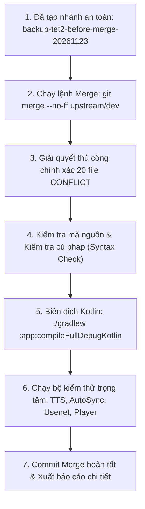

# Kế Hoạch Đồng Bộ Nhánh `dev` (Upstream) → `tet2` (2026-11-22 Đến 2026-11-23)

> **Trạng thái**: Chờ người dùng xem xét và phê duyệt trước khi thực thi (`PRE-MERGE PLAN`).  
> **Nguyên tắc**: Giữ nguyên 100% các tính năng tùy chỉnh đã thêm; tiếp nhận các tính năng và cải tiến hiệu năng mới hơn từ nhánh `dev`.

---

## 1. Tóm Tắt Điều Hành (Executive Summary)

| Hạng mục | Chi tiết |
| :--- | :--- |
| **Nhánh đích (Target)** | `tet2` (HEAD: `41501dfb3`) |
| **Nguồn đồng bộ (Source)** | `upstream/dev` (HEAD: `a740755e0`) |
| **Điểm phân nhánh chung (Merge Base)** | `d2eeb3d0e` (Mốc ngày 21-11-2026) |
| **Phạm vi commit đồng bộ** | Từ ngày **22-11-2026** đến **23-11-2026** (toàn bộ 73 commit mới nhất) |
| **Tổng số commit từ `upstream/dev`** | **73 commit** (gồm 14 Pull Requests & các commits thành phần) |
| **Nhánh dự phòng an toàn đã tạo** | `backup-tet2-before-merge-20261123` |
| **Số file giao thoa giữa 2 nhánh** | **48 file** |
| **Số file xung đột cần xử lý (`CONFLICT`)** | **20 file** |
| **Thời gian chạy kiểm thử dự kiến** | ~2–3 phút (sau khi giải quyết conflict) |

---

## 2. Các Tính Năng & Tối Ưu Mới Từ Upstream (`dev`) Cần Tiếp Nhận

> [!NOTE]
> Các cải tiến sau đây từ cộng đồng upstream mang lại hiệu năng và tính năng vượt trội, sẽ được tích hợp đầy đủ vào nhánh `tet2`:

1. **Hiệu Năng Cuộn Màn Hình Chi Tiết (PR #4781 - `e4b4286f6`, `485c8a07c`)**:
   - `fix(details)`: Tự động compose trước các hàng xung quanh để khi cuộn nhanh bằng D-pad không bị khựng/stall khung hình.
   - `perf(trailer)`: Làm mờ (fade) video trailer nền trực tiếp không cần tạo thêm offscreen GPU layer, tiết kiệm bộ nhớ đồ họa và mượt hơn.
2. **Tăng Tốc Đồng Bộ Phụ Đề Tự Động (PR #4775 - `2a2c4849f`)**:
   - `perf(autosync)`: Quá trình phân tích và đồng bộ phụ đề nhúng (embedded subtitles) chạy nhanh hơn gấp nhiều lần trên chip xử lý của TV Box / Android TV.
3. **Hỗ Trợ Định Dạng Đĩa Blu-ray (PR #4756 & PR #696 - `da2fdbbb7`, `4bd2502d2`...)**:
   - Khả năng đọc và phát các luồng BDAV/BDMV (Blu-ray folder/ISO clips).
   - Tự động nhận diện danh sách tập/clip phụ (Disc Titles, Extras, Features) và hiển thị menu chọn đĩa trên giao diện player controls.
   - Hỗ trợ phụ đề PGS và âm thanh Dolby TrueHD trong các luồng BDAV.
4. **Sửa Hiển Thị & Định Cỡ Phụ Đề ASS/SSA (PR #4768 - `233dd1f3b`)**:
   - Khôi phục tính năng định cỡ chữ và tùy chọn styling trên libass và MPV surface.
5. **Tích Hợp Bộ Máy Nguồn Phát Usenet Độc Lập (PR #4679 - `d0aaeced1`...)**:
   - Hỗ trợ giải mã và phát trực tiếp Usenet (NNTP providers, Newznab indexers, auto-tuning kết nối).
6. **Tinh Chỉnh Nút Skip Intro (PR #4780 - `695a51e9c`)**:
   - Giữ nút bo tròn mềm mại trong suốt hiệu ứng mờ dần khi ẩn.

---

## 3. Các Tùy Chỉnh Riêng Trên `tet2` Bắt Buộc Giữ Nguyên 100%

> [!IMPORTANT]
> Toàn bộ các tính năng người dùng đã phát triển và tùy biến phải được bảo toàn tuyệt đối, không bị code upstream ghi đè:

1. **Hệ Thống Thuyết Minh Subtitle TTS (Google TTS Offline)**:
   - Bộ máy `GoogleOfflineTtsEngine`, `SubtitleTtsCoordinator`, `SubtitleTtsTextCleaner`, `SubtitleTtsTimingCalculator`.
   - **Phiên âm tên riêng/từ tiếng Anh sang tiếng Việt (Zero Latency)**: `EnglishToVietnameseTransliterator`, `TtsPhoneticDictionary`, từ điển `tts_en_vi_dict.tsv`.
   - **Giá trị tốc độ mặc định mới**: `DEFAULT_BASE_SPEED = 1.40f`, `DEFAULT_MAX_AUTO_SPEED = 2.50f`.
   - Giao diện `SubtitleTtsOverlay`, toggle trong `PlaybackAudioSettings`, các sự kiện `PlayerEvent` và DataStore lưu trữ.
2. **Android Leanback Native UI & Focus Stability**:
   - Toàn bộ các thành phần Leanback Native row, VerticalGrid, Holder, Adapter và cơ chế chống crash D-pad.
3. **Bộ Nguồn Phát TorrServer**:
   - `TorrServerStreamProvider`, `TorrServerRemoteApi`, `TorrServerAddonConfig`, cơ chế stream Torrent P2P.
4. **Live TV & EPG Custom Storage**:
   - `LiveTvRepository`, `LiveTvStorage`, `LiveTvConfigServer`, trình phân tích M3U/XMLTV.
5. **Âm Thanh & Codec Chuyên Nghiệp**:
   - Audio Passthrough IEC 61937, FFmpeg downmix LFE level, ClearKey DRM support trong `PlayerMediaSourceFactory`.
   - Bộ đệm tối ưu hóa Low-RAM tier và buffer sizing.

---

## 4. Bảng Phân Tích & Giải Pháp Xử Lý 20 File Xung Đột (Conflict Resolution)

| # | File Xung Đột | Nguyên Nhân Xung Đột | Giải Pháp Hợp Nhất Cụ Thể |
| :--- | :--- | :--- | :--- |
| **1** | `.github/workflows/android-release.yml` | `our` đổi tên APK release; `their` thêm bước verify Usenet test | Giữ bước verify Usenet của upstream đặt trước, sau đó chạy lệnh build release và đổi tên APK chuẩn của `our`. |
| **2** | `app/build.gradle.kts` | `our` có `okhttp-dnsoverhttps`; `their` thêm `libs.re2j` | **Giữ cả hai**: Thêm `libs.re2j` bên cạnh `libs.okhttp.dnsoverhttps`. |
| **3** | `app/src/main/java/com/nuvio/tv/NuvioApplication.kt` | `our` khởi tạo `LiveTvStorage`; `their` đăng ký `UsenetAppLifecycle` | **Giữ cả hai**: Chạy cả `LiveTvStorage.init(this)` và `registerActivityLifecycleCallbacks(UsenetAppLifecycle())`. |
| **4** | `app/src/main/java/com/nuvio/tv/data/mapper/StreamMapper.kt` | `our` xử lý proxy headers/TorrServer; `their` map các trường Usenet (`nzbUrl`, `servers`...) | Kết hợp đầy đủ các trường mới của Usenet, đồng thời giữ nguyên xử lý `effectiveBehaviorHints` và `proxyHeaders` của `our`. |
| **5** | `app/src/main/java/com/nuvio/tv/data/repository/StreamRepositoryImpl.kt` | `our` inject `TorrServerStreamProvider`; `their` inject `UsenetSourceSettings` và `BuiltInUsenetService` | **Inject cả hai**: Khởi tạo job song song gồm: Stream addons + 1 (TorrServer nếu bật) + 1 (Usenet) + Media Server sources. |
| **6** | `app/src/main/java/com/nuvio/tv/ui/screens/addon/AddonManagerScreen.kt` | Xung đột import Compose animation | Gộp import `animateColorAsState` của upstream và giữ các animation của `our`. |
| **7** | `app/src/main/java/com/nuvio/tv/ui/screens/player/NuvioMpvSurfaceView.kt` | `our` chỉnh outline width; `their` thêm `applyAssSubtitleOverride` và codec checking | Tiếp nhận `applyAssSubtitleOverride` từ upstream (rất quan trọng để sửa lỗi phụ đề ASS trên MPV), kết hợp với dải `OUTLINE_WIDTH_MIN..MAX` của `our`. |
| **8** | `app/src/main/java/com/nuvio/tv/ui/screens/player/PlayerMediaSourceFactory.kt` | `our` có `drmType`, `drmKey`, TorrServer check; `their` thêm `bluray` và `nativeUsenet` | **Hợp nhất đầy đủ**: Giữ tham số `drmType`, `drmKey` và logic TorrServer của `our`, bổ sung nhánh xử lý Blu-ray playlist và Usenet sidecar của upstream. |
| **9** | `app/src/main/java/com/nuvio/tv/ui/screens/player/PlayerRuntimeControllerInitialization.kt` | Lời gọi tạo MediaSource truyền khác tham số | Truyền đầy đủ cả `drmType = currentDrmType`, `drmKey = currentDrmKey`, `cacheKey = currentStreamCacheKey` VÀ `bluray = currentStreamBluray`. |
| **10** | `app/src/main/java/com/nuvio/tv/ui/screens/player/PlayerRuntimeControllerPlaybackEvents.kt` | Điều kiện ẩn controls: `our` kiểm tra `showTtsOverlay`; `their` kiểm tra `showDiscTitlesDialog` | **Gộp điều kiện**: Thêm cả `s.showDiscTitlesDialog` VÀ `s.showTtsOverlay`. |
| **11** | `app/src/main/java/com/nuvio/tv/ui/screens/player/PlayerRuntimeControllerTrackSelection.kt` | Lời gọi `createMediaSource` trong quá trình đổi track | Truyền cả `drmType`, `drmKey`, `cacheKey` và `bluray`. |
| **12** | `app/src/main/java/com/nuvio/tv/ui/screens/player/PlayerScreen.kt` | `our` có `SubtitleTtsOverlay`; `their` thêm `DiscTitlesDialog` và nút Disc Titles trên thanh điều khiển | **Bảo toàn & Bổ sung**: Giữ nguyên vẹn toàn bộ khối `SubtitleTtsOverlay` và sự kiện TTS của `our`, đồng thời bổ sung `DiscTitlesDialog` và nút `ControlButton` đĩa Blu-ray của upstream. |
| **13** | `app/src/main/java/com/nuvio/tv/ui/screens/player/PlayerViewModel.kt` | `our` inject `SubtitleTtsCoordinator`; `their` inject `UsenetSourceSettings` | **Inject cả hai**: Giữ nguyên `subtitleTtsCoordinator` và bổ sung `usenetSourceSettings`. |
| **14** | `app/src/main/java/com/nuvio/tv/ui/screens/player/SubtitleSelectionOverlay.kt` | Khóa focus phím phụ đề: `our` có outline width; `their` có `supportsAssStyleCustomization` | Kết hợp cả 2 logic điều hướng focus. |
| **15** | `app/src/main/java/com/nuvio/tv/ui/screens/player/SubtitleStyleSidePanel.kt` | Tùy chỉnh outline viền phụ đề | Giữ cả logic tự bật outline khi đổi màu của upstream và các nút chỉnh độ dày viền của `our`. |
| **16** | `app/src/main/java/com/nuvio/tv/ui/screens/settings/AdvancedSettingsViewModel.kt` | State settings: `our` có `animationsEnabled`, `gpuOffscreenCompositingEnabled`; `their` có `usenet` | **Gộp state**: Giữ tất cả các trường cấu hình của cả hai. |
| **17** | `app/src/main/java/com/nuvio/tv/ui/screens/settings/PlaybackSettingsViewModel.kt` | `our` inject `torrentModeCoordinator`, `subtitleTtsCoordinator`; `their` inject `usenetSourceSettings` | **Inject đầy đủ**: Giữ nguyên các coordinator của `our` và thêm `usenetSourceSettings`. |
| **18** | `app/src/main/java/com/nuvio/tv/ui/screens/stream/StreamScreenViewModel.kt` | `our` inject các service TorrServer; `their` inject `usenetSourceSettings` | **Inject đầy đủ**: Giữ các service TorrServer và thêm `usenetSourceSettings`. |
| **19** | `app/src/main/res/values/strings.xml` | Xung đột phần cuối file: `our` có các chuỗi TTS; `their` có chuỗi `player_disc_titles` | **Giữ cả hai**: Đặt các chuỗi Disc Titles mới của upstream ngay trước khối Subtitle TTS của `our`. |
| **20** | `StreamRepositoryPluginIsolationTest.kt` | Mock dependencies trong unit test | Cung cấp mock cho cả `torrServerStreamProvider`, `usenetSourceSettings` và `builtInUsenetService`. |

---

## 5. Quy Trình Thực Thi Dự Kiến (Execution Workflow)

1. **Bước 1**: Nhánh an toàn `backup-tet2-before-merge-20261123` đã sẵn sàng, đảm bảo có thể rollback tức thì bất kỳ lúc nào.
2. **Bước 2**: Thực hiện `git merge --no-ff upstream/dev`.
3. **Bước 3**: Lần lượt áp dụng giải pháp chi tiết đã định hình cho từng file trong số 20 file conflict.
4. **Bước 4**: Kiểm tra biên dịch Kotlin (`compileFullDebugKotlin`).
5. **Bước 5**: Chạy toàn bộ Unit test của TTS (`com.nuvio.tv.core.tts.*`) và các unit test liên quan.
6. **Bước 6**: Commit kết quả merge và tạo báo cáo nghiệm thu chi tiết cho người dùng.

---

> [!WARNING]
> Kế hoạch này đã được lập chi tiết ở mức từng dòng code và sẵn sàng thực thi. Xin vui lòng xem xét các nội dung trên và phản hồi để tôi tiến hành bước hợp nhất code!
