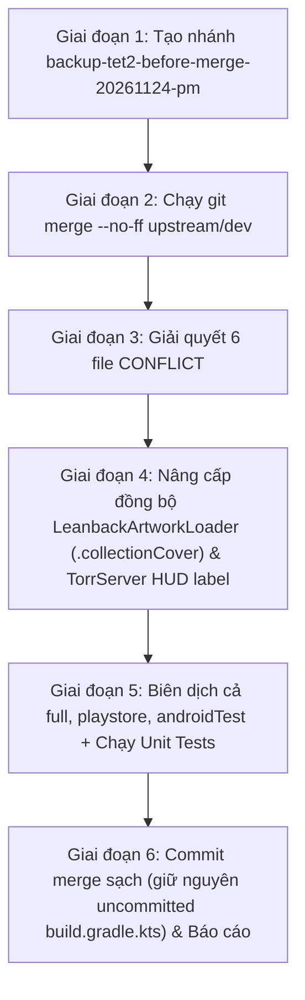

# PLAN: Đồng Bộ Nhánh `upstream/dev` → `tet2` (Đợt 2 Ngày 24-11-2026: `b70adbb83` → `11859c5d9`)

> [!IMPORTANT]
> **Trạng thái**: Chờ người dùng duyệt trước khi thực thi (`PRE-MERGE PLAN` — chưa thay đổi nhánh `tet2` hay working tree).  
> **Nguyên tắc**: Bảo toàn **100%** các tùy chỉnh riêng trên `tet2` (kể cả thay đổi `versionCode = 1217` / `1.7.5` đang có trong `app/build.gradle.kts`); tiếp nhận đầy đủ 21 commit mới từ `upstream/dev`; báo cáo minh bạch mọi điểm thay thế hoặc nâng cấp kiến trúc.

---

## 1. Tóm Tắt Điều Hành (Executive Summary)

| Hạng mục | Chi tiết |
| :--- | :--- |
| **Nhánh đích (Target)** | `tet2` (HEAD: `f422b1ee9` — đợt đồng bộ sáng 24-11-2026) |
| **Nguồn đồng bộ (Source)** | `upstream/dev` (HEAD mới nhất sau fetch: `11859c5d9`) |
| **Điểm phân nhánh chung (Merge Base)** | `b70adbb83` |
| **Phạm vi commit mới** | **21 commit mới** (gồm **7 Pull Requests**: `#4735`, `#4755`, `#4778`, `#4795`, `#4798`, `#4799`, `#4802`) |
| **Tổng số file upstream thay đổi** | **29 file** (`+966 / -137` dòng + nâng cấp `nuvio-libass-release.aar`) |
| **Số file xung đột trực tiếp (`CONFLICT`)** | **6 file** (đã xác minh chính xác bằng `git merge-tree --write-tree`) |
| **Thay đổi cục bộ chưa commit được bảo vệ** | `app/build.gradle.kts` (`versionCode = 1217`, `versionName = "1.7.5"`), `ERRORS.md`, `PLAN-sync-dev-2026-11-24.md` (không giao thoa với upstream) |
| **Nhánh dự phòng dự kiến tạo trước khi merge** | `backup-tet2-before-merge-20261124-pm` |

---

## 2. Các Tính Năng & Tối Ưu Mới Từ `upstream/dev` Cần Tiếp Nhận

1. **Nâng cấp thư viện `nuvio-libass` lên v0.0.14 (PR #4799 — `1a1871023`, `d91e9069b`)**:
   - Cập nhật `app/libs/nuvio-libass-release.aar` tích hợp bản fork libass tối ưu của Laskco, tăng tốc độ dựng hình phụ đề ASS/SSA phức tạp trên TV Box.
2. **Giảm Overdraw trên màn hình Chi tiết phim (PR #4802 — `54c505452`, `11859c5d9`)**:
   - Trong `MetaDetailsScreen.kt`: chỉ vẽ nền đặc một lần duy nhất và chỉ vẽ đúng phần hiển thị (`LEFT_GRADIENT_FADE_FRACTION = 0.78f`) của dải gradient trái trên Hero Backdrop, giảm tải fill-rate cho GPU.
3. **Sửa lỗi mất hình video Trailer khi mở trang Chi tiết lồng nhau từ *More like this* (PR #4798 — `558d65df7`, `1d055a434`)**:
   - Giữ tham chiếu state mới nhất `currentHasRenderedFirstFrameState` trong `TrailerPlayer.kt` và bỏ lớp nền che khuất `BackgroundTrailerLayer` khi điều hướng child detail trong `DetailChildHost.kt`.
4. **Tối ưu tải ảnh bìa Bộ sưu tập & Focus Glow không tải kép (PR #4755 — `98264d32f`, `9f753b3b1`, `61e54f7d0`, `e0be1a8e7`)**:
   - Thêm `CollectionCoverNetworkClient`: giới hạn tối đa 4 lượt tải mạng đồng thời cho ảnh bìa bộ sưu tập lạnh, trong khi ảnh đã nằm trong disk cache vẫn giải mã ngay lập tức (không bị nghẽn hàng đợi mạng).
   - Cập nhật `CollectionCardGlow.kt`: lấy mẫu màu glow trực tiếp từ `Bitmap` ảnh bìa đã hiển thị trên thẻ (hỗ trợ cả `Bitmap.Config.HARDWARE`), loại bỏ hoàn toàn request Coil `96x96` thứ hai gây tải trùng trên cold cache.
5. **HUD Thống kê luồng phát & Usenet trực tiếp trong Player (PR #4778 — `dc89d4bec`...)**:
   - Thêm `PlayerStreamType.kt`, `UsenetLiveStats.kt` và nâng cấp `PlayerDebugStatsOverlay.kt`: hiển thị loại luồng (`P2P`, `Usenet`, `Server`, `Cloud`, `Local`, `Direct · <Addon>`), trạng thái `seeking` / `stalled` kèm nguyên nhân cụ thể, và thông số trực tiếp từng máy chủ Usenet (tỉ lệ hoàn thành bài viết, TTFB, lỗi NNTP).
6. **Đồng bộ tức thì kênh Continue Watching trên Android TV Launcher (PR #4735 — `02a9afc85`, `92d038561`)**:
   - Sửa lỗi kênh Continue Watching ngoài màn hình chính TV không cập nhật ngay khi dữ liệu CW thay đổi.
7. **Sửa lỗi nhảy cóc Focus trong Trình chỉnh sửa Bộ sưu tập khi chỉ có 1 thư mục / 1 nguồn (PR #4795 — `bf210ec51`, `9c6f31531`)**:
   - Neo rõ ràng `focusProperties { up / down }` trong `CollectionEditorScreen.kt` và `CollectionEditorFolderContent.kt`.

---

## 3. Các Tùy Chỉnh Riêng Trên `tet2` Bắt Buộc Bảo Toàn 100%

- **Android Leanback Native Home Rows (`LeanbackModernRow`, `LeanbackModernRowAdapter`, `LeanbackArtworkLoader`)**: Giữ nguyên kiến trúc RecyclerView/HorizontalGridView gốc 60fps trên trang chủ Modern Home cùng hiệu ứng `posterFocusRing`.
- **Hệ thống tải ảnh an toàn (`SavedCopyOnErrorFetcher` & `imageCacheStrategy`)**: Phục vụ ảnh đã lưu ngay lập tức và giữ lại ảnh cũ khi mạng chập chờn/timeout thay vì hiện ô trống, kết hợp TMDB size downscaler & `HomeImageLoadingProfile`.
- **Chế độ môi trường xung quanh (Ambient Mode) phát Trailer** (tham số `showSubtitles: Boolean = true` trong `TrailerPlayer.kt`, `AmbientSlideshow`, `AmbientTrailerResolver`, `AmbientIdleController`).
- **Live TV (`ĐANG PHÁT`, điều khiển D-Pad OSD 2s & `CH+`/`CH-`), Google Offline TTS, Zero-Jank Subtitle Tier 1/2, ASS style độc lập & TorrServer**.
- **Version bump cục bộ trong `app/build.gradle.kts`** (`versionCode = 1217`, `versionName = "1.7.5"`).

---

## 4. Báo Cáo Chi Tiết Xử Lý 6 File Xung Đột & Các Điểm Thay Thế / Cải Tiến

### A. 6 File Xung Đột Trực Tiếp (`CONFLICT`)

| # | File Xung Đột | Nguyên Nhân Xung Đột | Giải Pháp Hợp Nhất Chi Tiết |
| :---: | :--- | :--- | :--- |
| **1** | `app/src/main/java/com/nuvio/tv/NuvioApplication.kt` | `our` dùng `SavedCopyOnErrorFetcher.Factory(imageNetworkFetcherFactory(...))` với `imageCacheStrategy` của `tet2`; `their` đổi sang `NetworkFetcher.Factory(networkClient = { CollectionCoverNetworkClient(...) }, ...)`. | **Kết hợp cả hai tầng bảo vệ**: Giữ lớp vỏ `SavedCopyOnErrorFetcher.Factory(...)` và `com.nuvio.tv.core.image.imageCacheStrategy` của `tet2`, nhưng nâng cấp fetcher bên trong thành `NetworkFetcher.Factory` dùng `CollectionCoverNetworkClient(imageOkHttpClient.asNetworkClient())` và `::imageConnectivityChecker` của upstream. Vừa chống mất ảnh khi lỗi mạng, vừa giới hạn 4-slot tải ảnh bìa bộ sưu tập! |
| **2** | `app/src/main/java/com/nuvio/tv/core/sync/androidtv/AndroidTvChannelSyncService.kt` | `our` gọi `TvChannelRefreshJobService.schedulePeriodic(context)` trong `scope.launch`; `their` xóa `schedulePeriodic` + bỏ cổng chặn `appInForeground` và gọi `TvChannelRefreshJobService.cancelPeriodic(context)`. | **Thay thế theo code mới tốt hơn của upstream (PR #4735)** — xem giải thích chi tiết ở Mục 4.B.1 bên dưới. |
| **3** | `app/src/main/java/com/nuvio/tv/ui/components/CollectionRowSection.kt` | `our` có `posterFocusRing = rememberPosterFocusRingStyle(...)` cho viền thẻ; `their` thêm `coverRequest = rememberCollectionFolderCover(activeImageUrl)` + `loadedCover` cho `AsyncImage` và `rememberArtworkBackedCardGlow`. | **Giữ cả hai**: Bảo toàn `posterFocusRing` cho `border` của `Card`, đồng thời dùng `coverRequest` + `loadedCover` mới của upstream cho `AsyncImage` và `cardGlow` (không còn tải ảnh lần 2 để lấy màu glow). |
| **4** | `app/src/main/java/com/nuvio/tv/ui/components/TrailerPlayer.kt` | `our` có dòng `val playerAlpha = if (isPlaying && hasRenderedFirstFrame) 1f else 0f` và tham số `showSubtitles: Boolean = true`; `their` đổi `hasRenderedFirstFrame` sang delegate `hasRenderedFirstFrameState` + `currentHasRenderedFirstFrameState`. | **Hợp nhất đầy đủ**: Dùng `hasRenderedFirstFrameState` + `var hasRenderedFirstFrame by hasRenderedFirstFrameState` + `currentHasRenderedFirstFrameState` của upstream (sửa lỗi mất video ở nested detail), đồng thời giữ nguyên `playerAlpha` và `showSubtitles` cho Ambient Mode của `tet2`. |
| **5** | `app/src/main/java/com/nuvio/tv/ui/screens/home/GridHomeContent.kt` | Giống file #3 trong `GridCollectionFolderCard`: `our` có `posterFocusRing`; `their` thêm `coverRequest` + `loadedCover` cho `AsyncImage` & `cardGlow`. | **Giữ cả hai**: Giữ `posterFocusRing` cho viền focus và dùng `coverRequest` + `loadedCover` của upstream cho `AsyncImage` & `cardGlow`. |
| **6** | `app/src/main/java/com/nuvio/tv/ui/screens/home/ModernHomeRows.kt` | `our` đã chuyển hoàn toàn sang `LeanbackModernRow` (Android Leanback Native); `their` sửa các hàm Compose `ModernCarouselCard` cũ (vốn đã bị xóa trên `tet2`) để gắn `.collectionCover()` và `loadedCover`. | **Giữ nguyên 100% kiến trúc `LeanbackModernRow` của `tet2`**, và **chuyển tính năng `.collectionCover()` sang `LeanbackArtworkLoader` + `LeanbackModernRowAdapter`** — xem chi tiết ở Mục 4.B.2 bên dưới. |

---

### B. Báo Cáo Chi Tiết Các Điểm Thay Thế / Nâng Cấp Kiến Trúc

> [!WARNING]
> Đúng theo yêu cầu *"nếu code mới có công dụng tốt hơn thì có thể thay thế hoặc sửa nhưng phải báo cáo chi tiết"*, dưới đây là **3 điểm điều chỉnh/thay thế chủ động**:

1. **Thay thế cơ chế đồng bộ kênh Android TV Launcher (`AndroidTvChannelSyncService.kt`, `TvChannelRefreshJobService.kt`, `MainActivity.kt` — PR #4735)**:
   - **Code cũ**: Chặn đồng bộ khi app đang mở (`if (appInForeground) return@collect`), chỉ đồng bộ khi `MainActivity.onStop()` hoặc chờ `JobScheduler` định kỳ 15 phút (`schedulePeriodic`). Hệ quả là khi xóa/thêm mục Continue Watching hoặc thoát nhanh ra màn hình chính Android TV, kênh CW ngoài Launcher bị trễ hoặc không cập nhật.
   - **Code mới của upstream**: Bỏ chặn `appInForeground`, hủy job định kỳ 15 phút cũ (`cancelPeriodic`), đồng bộ trực tiếp có debounce ngay khi cache CW thay đổi và dọn bỏ biến `androidTvChannelSyncService` không còn cần trong `MainActivity.kt`.
   - **Quyết định**: **Thay thế hoàn toàn theo upstream** vì gọn nhẹ hơn và khắc phục dứt điểm lỗi trễ đồng bộ kênh ngoài Launcher (lưu ý các tùy chỉnh Ambient Mode trong `MainActivity.kt` nằm ở vùng khác, được giữ nguyên 100%).
2. **Chuyển cơ chế điều tiết tải ảnh bìa bộ sưu tập (`.collectionCover()`) sang Leanback Native của `tet2` (`LeanbackArtworkLoader.kt` & `LeanbackModernRowAdapter.kt`)**:
   - **Bối cảnh**: Upstream thêm `.collectionCover()` vào `ModernHomeRows.kt` (phiên bản Compose), nhưng `tet2` dùng `LeanbackModernRow` + `LeanbackArtworkLoader` để cuộn mượt hơn. Bản thân `LeanbackModernRowAdapter` đã lấy màu glow trực tiếp từ ảnh vừa tải (`resolveCardColorFromImage`), nên đã miễn nhiễm lỗi tải kép.
   - **Nâng cấp đồng bộ**: Thêm tham số tùy chọn `isCollectionCover: Boolean = false` vào `LeanbackArtworkLoader.loadIntoImageView(...)` và `LeanbackArtworkLoader.prefetch(...)` (gọi `.collectionCover()` trên `ImageRequest.Builder` khi `true`), rồi truyền `isCollectionCover = item.payload is ModernPayload.CollectionFolder` từ `LeanbackModernRowAdapter.kt` (cả khi bind lẫn khi prefetch ngang). Nhờ đó hàng Collection trên Modern Home của `tet2` cũng được bảo vệ bởi bộ giới hạn 4-slot `CollectionCoverNetworkClient` mới!
3. **Bổ sung nhận diện luồng `TorrServer` cho nhãn loại luồng trên HUD Stats mới (`PlayerStreamType.kt`)**:
   - **Bối cảnh**: File `PlayerStreamType.kt` mới của upstream phân loại `P2P`, `Usenet`, `Server`, `Cloud`, `Local`, `Direct · <Addon>`. Trên `tet2` có thêm nguồn phát riêng `TorrServer` (`isTorrServerStream = true`, `isTorrentStream = true`, `addonName = "TorrServer"`).
   - **Tinh chỉnh nhỏ**: Trong `streamTypeLabel(type, addonName)` (hoặc `PlayerStreamType`), giữ nguyên 100% hành vi chuẩn của upstream cho mọi unit test `PlayerStreamTypeTest`, đồng thời khi `type == PlayerStreamType.P2P` và `_uiState.value.isTorrServerStream` là `true` (trong `PlayerViewModel.getStreamTypeLabel()`), hiển thị rõ **`P2P · TorrServer`** trên bảng HUD Stats để dễ phân biệt giữa P2P nội bộ và TorrServer!

---

## 5. Quy Trình Thực Thi Từng Giai Đoạn (Phase-by-Phase Breakdown)



- **Giai đoạn 1 (`[T1.1]`)**: Tạo nhánh dự phòng `backup-tet2-before-merge-20261124-pm` tại `HEAD` (`f422b1ee9`).
- **Giai đoạn 2 (`[T2.1]`)**: Thực hiện `git merge --no-ff upstream/dev` (không đụng chạm thay đổi chưa commit trong `app/build.gradle.kts`).
- **Giai đoạn 3 (`[T3.1]`–`[T3.6]`)**: Giải quyết chính xác 6 file xung đột (`NuvioApplication.kt`, `AndroidTvChannelSyncService.kt`, `CollectionRowSection.kt`, `TrailerPlayer.kt`, `GridHomeContent.kt`, `ModernHomeRows.kt`).
- **Giai đoạn 4 (`[T4.1]`–`[T4.2]`)**:
  - `[T4.1]` Tích hợp `isCollectionCover` (`.collectionCover()`) vào `LeanbackArtworkLoader.kt` & `LeanbackModernRowAdapter.kt`.
  - `[T4.2]` Tinh chỉnh `PlayerViewModel.getStreamTypeLabel()` hiển thị `P2P · TorrServer` khi `uiState.value.isTorrServerStream == true`.
- **Giai đoạn 5 (`[T5.1]`–`[T5.2]`) — Kiểm chứng tự động**:
  - Biên dịch cả `full`, `playstore`, và `androidTest` (để xác minh cả 2 bài instrumentation test mới `CollectionCoverRequestsTest` & `CollectionCoverNetworkClientTest` của upstream biên dịch sạch 100%):
    ```powershell
    .\gradlew.bat :app:compileFullDebugKotlin :app:compilePlaystoreDebugKotlin :app:compileFullDebugAndroidTestKotlin
    ```
  - Chạy toàn bộ Unit Tests mới & các tính năng tùy chỉnh trọng tâm:
    ```powershell
    .\gradlew.bat :app:testFullDebugUnitTest `
      --tests "com.nuvio.tv.core.usenet.*" `
      --tests "com.nuvio.tv.ui.screens.player.PlayerStreamTypeTest" `
      --tests "com.nuvio.tv.core.image.*" `
      --tests "com.nuvio.tv.ui.leanback.*" `
      --tests "com.nuvio.tv.ui.screens.ambient.*" `
      --tests "com.nuvio.tv.features.livetv.LiveTvGuideNavigationTest" `
      --tests "com.nuvio.tv.core.tts.*"
    ```
- **Giai đoạn 6 (`[T6.1]`)**: Chỉ stage các file thuộc phạm vi merge để tạo commit merge sạch (giữ nguyên trạng thái chưa commit của `app/build.gradle.kts`, `ERRORS.md`, `PLAN-*.md` trừ khi người dùng muốn commit luôn) và xuất báo cáo nghiệm thu chi tiết.
