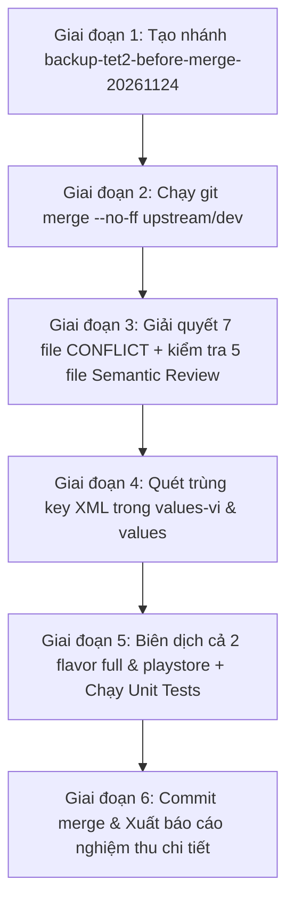

# PLAN: Đồng Bộ Nhánh `upstream/dev` → `tet2` (2026-11-23 Đến 2026-11-24)

> [!IMPORTANT]
> **Trạng thái**: Chờ người dùng duyệt trước khi thực thi (`PRE-MERGE PLAN` — chưa thay đổi nhánh `tet2` hay working tree).  
> **Nguyên tắc**: Bảo toàn **100%** các tùy chỉnh riêng trên `tet2`; tiếp nhận đầy đủ tính năng/sửa lỗi mới từ `upstream/dev`; mọi điểm thay thế hoặc điều chỉnh đều được báo cáo rõ ràng từng dòng bên dưới.

---

## 1. Tóm Tắt Điều Hành (Executive Summary)

| Hạng mục | Chi tiết |
| :--- | :--- |
| **Nhánh đích (Target)** | `tet2` (HEAD: `3b048dfe7`, working tree sạch) |
| **Nguồn đồng bộ (Source)** | `upstream/dev` (HEAD mới nhất sau fetch: `b70adbb83`) |
| **Điểm phân nhánh chung (Merge Base)** | `a740755e0` (đã hợp nhất tại commit `3f799390e` ngày 23-11-2026) |
| **Phạm vi commit đồng bộ** | **25 commit mới** trên `upstream/dev` (gồm 10 Pull Requests: `#4748`, `#4749`, `#4750`, `#4753`, `#4757`, `#4761`, `#4779`, `#4790`, `#4793`, `#4794`) |
| **Tổng số file upstream thay đổi** | **34 file** (`+1246 / -425` dòng) |
| **Số file giao thoa giữa 2 nhánh** | **20 file** |
| **Số file xung đột trực tiếp (`CONFLICT`)** | **7 file** (6 content conflict + 1 add/add conflict, đã xác minh bằng `git merge-tree --write-tree`) |
| **Nhánh dự phòng dự kiến tạo trước khi merge** | `backup-tet2-before-merge-20261124` |

---

## 2. Các Tính Năng & Sửa Lỗi Mới Từ `upstream/dev` Cần Tiếp Nhận

1. **Tách riêng kiểu hiển thị cho phụ đề ASS/SSA (PR #4794 — `8ce69c2a1`, `42e34876f`)**:
   - Lưu riêng `assSubtitleStyle` độc lập với `subtitleStyle` của phụ đề SRT/VTT (mặc định `ASS_SIZE_DEFAULT = 100`, bộ key `ass_subtitle_*`).
   - Khi đang xem phụ đề ASS/SSA trên MPV hoặc Libass, mọi chỉnh sửa trong `SubtitleStyleSidePanel` (cỡ chữ, viền, màu, bóng, vị trí, nút Đặt lại) chỉ tác động vào `assSubtitleStyle`, không làm lệch kiểu phụ đề thường.
2. **Hiển thị nhãn định dạng phụ đề & sửa tên track built-in (PR #4779 — `4db6cbabd`, `8efa5ca57`, `23850e9d5`)**:
   - Hiển thị pill badge gọn đẹp (**`ASS`**, **`PGS`**, **`VobSub`**, **`DVB`**) trên từng thẻ phụ đề trong `SubtitleSelectionOverlay` thay vì ghép chuỗi codec thô trong dòng mô tả.
   - Bổ sung nhận diện `MimeTypes.APPLICATION_VOBSUB -> "VobSub"` trong `CustomDefaultTrackNameProvider`, fallback đọc codec từ `format.codecs`, và ưu tiên hiển thị `track.label` làm tiêu đề track phụ đề nhúng.
3. **Tăng độ bền AutoSync cho ASS legacy, HTTP/2 fallback 403 & CDN giới hạn chunk 206 (PR #4790 — `80b1b33db`, `2ed752298`, `b70adbb83`)**:
   - Tách `PlayerPlaybackNetworking.withHttp2On403Fallback(...)` và áp dụng cho `EmbeddedSubtitleTimelineLoader` để không bị lỗi `403` trên máy chủ từ chối HTTP/1.1.
   - Hỗ trợ codec Matroska ASS/SSA cũ (`S_ASS`, `S_SSA`), giải mã đúng EBML unsigned 0-byte (`0 ms`), và trả về `null` thay vì cache nhầm "không có phụ đề" khi tải `Tracks` thất bại.
   - Vòng lặp tải nối đuôi `fetchElementAt` để đọc trọn vẹn `Tracks`/`Cues` trên proxy/CDN giới hạn kích thước mỗi phản hồi HTTP 206.
   - Sửa `AutoSyncSubtitleCueParser` & `AutoSyncSubtitleTextRetimer` xử lý file ASS có xuống dòng `\r` / `\r\n`, header `[Events]` thụt lề sau `[Fonts]`, và chặn crash khi `startIndex == endIndex`.
   - Bổ sung bộ Unit Test mới cho `EmbeddedSubtitleTimelineLoaderTest`, `AutoSyncSubtitleCueParserTest`, `AutoSyncSubtitleTextRetimerTest`, `ProxyHeadersProtocolTest`.
4. **Sửa lỗi race condition trong test Usenet NNTP (PR #4793 — `eef42e173`, `7d602f9fd`)**:
   - Đợi thread fake NNTP server hoàn tất (`worker.join(5_000)`) trước khi kiểm tra danh sách lệnh trong `NntpProviderTesterTest`.
5. **Cập nhật bản địa hóa đa ngôn ngữ (PR #4748, #4749, #4750, #4753, #4757, #4761)**:
   - Bổ sung chuỗi dịch cho Tiếng Ả Rập (`values-ar`), Tiếng Pháp (`values-fr`), Tiếng Ba Lan (`values-pl`), Tiếng Bồ Đào Nha (`values-pt-rPT`) và Tiếng Việt (`values-vi`).

---

## 3. Các Tùy Chỉnh Riêng Trên `tet2` Bắt Buộc Bảo Toàn 100%

> [!IMPORTANT]
> Toàn bộ tính năng và tối ưu đã xây dựng trên `tet2` (bao gồm cả các commit mới nhất ngày 23-11-2026) phải giữ nguyên vẹn sau merge:

1. **Chế độ môi trường xung quanh (Ambient Mode) phát Trailer** (`b7bd80cd1`): `AmbientDisplayMode`, `trailerAudioEnabled`, `AmbientTrailerResolver`, `AmbientSlideshow`, `AmbientIdleController` pass-through phím âm lượng, guard chống tự thoát trong `MainActivity`.
2. **Live TV Guide & Fullscreen D-Pad/CH Controls** (`e509a534b`): Nhãn **`ĐANG PHÁT`** (thay cho `TRỰC TIẾP`), D-Pad Lên/Xuống chỉ hiện OSD 2 giây, phím vật lý `CH+`/`CH-` chuyển kênh, cùng toàn bộ `LiveTvRepository` / `LiveTvStorage`.
3. **Tối ưu hiệu năng Player, Zero-Jank Subtitle & TTS** (`725ce748a`, `da6b7fa0a`, `b88070ef8`):
   - Tối ưu Tier 1 / Tier 2 trong `applySubtitleStyleIfNeeded` (`player_view_libass_font_scale_tag`, `resolveCachedSubtitleTypeface`, tách position vs typography để không giật khi `liftPx` đổi).
   - Cơ chế `hideVisualSubtitles` (ẩn phụ đề hình khi bật Google TTS), `SubtitleTtsCoordinator`, `EnglishToVietnameseTransliterator`, `TtsPhoneticDictionary`.
   - Tối ưu AutoSync V2 TV-safe trên `EmbeddedSubtitleTimelineLoader` (`skipTailProbe`, `initialDelayMs`, `autoSyncDispatcher`, `MAX_CUES_BYTES = 4 MiB`, `MAX_TOTAL_DOWNLOAD_BYTES = 8 MiB`), `O(log N)` sidecar lookup và nút `OnRevertAutoSyncSubtitle`.
   - Bộ font phụ đề tùy chỉnh (`PhimMoi`, `Inter`, `Open Sans`, `DM Sans`, `Oswald`, Custom font import) và biên độ `OUTLINE_WIDTH_MAX = 15`.
4. **TorrServer, Leanback Native UI, Audio Passthrough nâng cao & Cấu hình build** (`d6f96f139`, `3b048dfe7`).

---

## 4. Báo Cáo Chi Tiết Xử Lý 7 File Xung Đột & Các Điểm Thay Thế / Cải Tiến

### A. 7 File Xung Đột Trực Tiếp (`CONFLICT`)

| # | File Xung Đột | Nguyên Nhân | Phương Án Hợp Nhất Chi Tiết |
| :---: | :--- | :--- | :--- |
| **1** | `app/src/main/java/com/nuvio/tv/data/local/PlayerSettingsDataStore.kt` | **Hunk 1**: `our` đọc các trường `tts*` cuối constructor `PlayerSettings(...)`; `their` gắn `.withAssSubtitleStyle(prefs)`.<br>**Hunk 2**: `our` đồng bộ thêm `subtitleFontKey` (`PHIMMOI`/`OSWALD`/`DEFAULT`) trong `setSubtitleFontId(fontId)`; `their` thêm tham số `ass: Boolean = false` để ghi vào `assSubtitleFontIdKey`. | **Hợp nhất cả hai**:<br>1) Giữ toàn bộ các trường `tts*` của `our` trong `PlayerSettings(...)` và nối `.withAssSubtitleStyle(prefs)` ngay sau dấu `)`.<br>2) Nâng cấp `setSubtitleFontId(fontId: String, ass: Boolean = false)`: khi `ass == true` ghi `assSubtitleFontIdKey`; khi `ass == false` ghi `subtitleFontIdKey` **và** giữ nguyên khối `when (fontId)` đồng bộ `subtitleFontKey` của `our`.<br>3) Giữ `OUTLINE_WIDTH_MAX = 15`, `textColor = Yellow`, `SubtitleFontOption`, và các setter/reset ASS mới của upstream. |
| **2** | `app/src/main/java/com/nuvio/tv/ui/screens/player/NuvioMpvSurfaceView.kt` | `our` tính `fontName` (PhimMoi/Inter/OpenSans/DMSans/Oswald) và dùng `OUTLINE_WIDTH_MIN..OUTLINE_WIDTH_MAX` (1..15) trong `applySubtitleStyle(style)`; `their` tách thành `applySubtitleStyle(style, assStyle)` gọi `applySubtitleStyleForCodec(codec)` với cache `appliedStyleIsAss`. | **Tiếp nhận cấu trúc tốt hơn của upstream + giữ tùy chỉnh `our`**:<br>Chuyển khối chọn `fontName` và `mpv.setPropertyString("sub-font", fontName)` của `our` vào bên trong `applySubtitleStyleForCodec(codec)` mới của upstream, đồng thời giữ giới hạn `OUTLINE_WIDTH_MIN..OUTLINE_WIDTH_MAX` (1..15) thay vì `coerceIn(1, 6)` của upstream. |
| **3** | `app/src/main/java/com/nuvio/tv/ui/screens/player/PlayerRuntimeControllerPlaybackEvents.kt` | Trong `PlayerEvent.OnSetSubtitleFont`: `our` gọi cả `setSubtitleFontId(event.fontId)` và `setSubtitleFont(event.fontId)`; `their` truyền `ass = _uiState.value.isAssSubtitleStyleActive` vào `setSubtitleFontId(event.fontId, ass = ass)`. | **Hợp nhất thông minh**:<br>Gọi `setSubtitleFontId(event.fontId, ass = ass)` và chỉ gọi `setSubtitleFont(event.fontId)` khi `!ass` để chỉnh font cho ASS không ghi đè font của phụ đề SRT/VTT thường. Giữ toàn bộ tối ưu TTS/progress throttling và `OnRevertAutoSyncSubtitle` của `our`. |
| **4** | `app/src/main/java/com/nuvio/tv/ui/screens/player/PlayerScreen.kt` | **Hunk 1 (MpvPlayerSurface)**: `our` có `LaunchedEffect(mpvView, hideVisualSubtitles)`; `their` thêm `assSubtitleStyle` vào `LaunchedEffect(mpvView, subtitleStyle, assSubtitleStyle, subtitleLiftPx)`.<br>**Hunk 2 (ExoPlayerSurface `onTracksChanged`)**: `our` set `subtitleView?.visibility` theo `latestHideVisualSubtitles`; `their` truyền thêm `latestAssSubtitleStyle` vào `applySubtitleStyleIfNeeded`.<br>**Hunk 3 (`applySubtitleStyleIfNeeded`)**: `our` tách Tier 1 (`player_view_libass_font_scale_tag` cached) & Tier 2 (zero-jank typography cache); `their` đổi Libass scale sang `assSubtitleStyle.size` và thêm `assSize` vào `SubtitleAppliedConfig`. | **Giữ nguyên kiến trúc Zero-Jank Tier 1/2 của `our` + tích hợp `assSubtitleStyle` của upstream**:<br>1) Giữ nguyên `hideVisualSubtitles` ở cả `MpvPlayerSurface` và `ExoPlayerSurface`.<br>2) Trong `applySubtitleStyleIfNeeded`: **giữ nguyên cơ chế cache Tier 1 (`player_view_libass_font_scale_tag`) và Tier 2 (`resolveCachedSubtitleTypeface`)** của `our`, nhưng đổi `targetAssScale = (assSubtitleStyle.size / 100f).coerceIn(0.5f, 3.0f)` và cập nhật `SubtitleAppliedConfig(subtitleStyle, assSubtitleStyle.size, isAss, liftPx)`. Vừa hỗ trợ style ASS độc lập, vừa giữ 100% độ mượt 0-jank! |
| **5** | `app/src/main/java/com/nuvio/tv/ui/screens/player/PlayerUiState.kt` | Xung đột vùng import đầu file (`C`, `MimeTypes`, `TrackGroup`). | Gộp đầy đủ import của cả hai; kiểm tra các thuộc tính mới (`assSubtitleStyle`, `effectiveAssSubtitleStyle`, `isAssSubtitleSelected`, `isAssSubtitleStyleActive`, `editableSubtitleStyle`) đi cùng `shouldHideVisualSubtitles` và các trường TTS/TorrServer của `our`. |
| **6** | `app/src/main/res/values-vi/audio_sync_strings.xml` | `add/add` conflict: `tet2` đã tự thêm bản dịch tiếng Việt trước; upstream (PR #4753) vừa thêm cùng file 22 chuỗi. | **Đề xuất giữ bản dịch tiếng Việt hiện tại của `tet2`**: cả 2 file có đủ 100% cùng 20 key (`audio_sync_*` & `licenses_attributions_audio_sync_*`), bản `tet2` dịch thuật ngữ *"voice activity detection"* (*phát hiện giọng nói / lời thoại*) chuẩn xác và ngắn gọn hơn trên màn hình TV so với bản upstream (*nhận diện giọng nói* dễ nhầm với Speech Recognition). |
| **7** | `app/src/main/res/values-vi/strings.xml` | Cuối khối `autosync_*`: `our` có `<!-- Player Startup Watchdog Errors -->` (`player_error_startup_*`); `their` bổ sung 7 chuỗi `autosync_status_*`. Ngoài ra upstream còn thêm 24 chuỗi dịch tiếng Việt còn thiếu ở các mục khác. | **Giữ cả hai + kiểm tra trùng key**:<br>- Giữ 100% chuỗi custom của `tet2`: `livetv_live_badge` (**`ĐANG PHÁT`**), `player_live_watched` (**`ĐANG PHÁT  %1$s`**), `ambient_mode_display_mode*`, `ambient_mode_trailer_audio*`, `player_error_startup_*`, `tts_*`, `torrserver_*`, `livetv_*`.<br>- Tiếp nhận các chuỗi dịch mới còn thiếu từ upstream (`autosync_status_*`, `advanced_hardware_bitmaps*`, `plugin_repo_delete_confirm_*`, `cd_reorder`, `collections_pinned`, `collections_editor_unsaved_*`, `collections_editor_folder_unsaved_*`) và rà soát loại bỏ mọi key trùng lặp nếu có. |

---

### B. Báo Cáo Các Điểm Thay Thế / Xung Đột Ngữ Nghĩa Quan Trọng (Semantic Review)

> [!WARNING]
> Những điểm sau **không báo conflict Git** (hoặc có thay đổi hành vi tinh tế) nhưng ảnh hưởng trực tiếp đến chức năng và test — cần báo cáo minh bạch cho người dùng:

1. **Bỏ tùy chọn `Customize ASS/SSA styling` khỏi Cài đặt chung (`SubtitleAppearanceEditor.kt`, `PlaybackSettingsViewModel.kt`, `values/strings.xml`)**:
   - **Thay đổi của upstream (PR #4794)**: Gỡ toggle `customize_ass` ở màn hình *Settings → Playback → Subtitle Appearance* vì kiểu phụ đề ASS/SSA giờ đã tách riêng hoàn toàn khỏi phụ đề thường (chỉnh trực tiếp trong bảng *Subtitle Style* khi đang phát phụ đề ASS/SSA).
   - **Đánh giá**: Hợp lý và sạch hơn, tránh người dùng chỉnh nhầm ảnh hưởng lẫn nhau. → **Tiếp nhận thay đổi này của upstream** (vẫn giữ nút `subtitle_style_customize_ass` trong `SubtitleStyleSidePanel` khi xem phim có ASS trên MPV, và giữ `subtitle_style_customize_ass_sub` trong `values-vi` nếu cần hoặc đồng bộ sạch theo upstream).
2. **Tương thích giữa giới hạn `MAX_RANGE_REQUESTS = 10` (của `tet2`) và hỗ trợ CDN 206 chunk-capped (PR #4790) trong `EmbeddedSubtitleTimelineLoader.kt`**:
   - **Phát hiện**: Commit `da6b7fa0a` trên `tet2` đã giảm `MAX_RANGE_REQUESTS` từ `16` → `10` (và `MAX_TOTAL_DOWNLOAD_BYTES` từ `24 MiB` → `8 MiB`, `MAX_CUES_BYTES` từ `8 MiB` → `4 MiB`, thêm `skipTailProbe`).
   - Tuy nhiên PR #4790 của upstream thêm vòng lặp tải nhiều chunk HTTP 206 cho proxy/CDN cắt gói 32 KiB cùng test `chunkCapped206ServerLoadsLargeTracksAndCues()`. Với trần `10` request, kịch bản CDN cắt chunk 32 KiB (~28 KiB Tracks + ~180 KiB Cues) có nguy cơ chạm trần 10 request và fail!
   - **Đề xuất**: Giữ nguyên toàn bộ tối ưu TV-safe của `tet2` (`skipTailProbe`, `initialDelayMs`, `autoSyncDispatcher`, `MAX_TOTAL_DOWNLOAD_BYTES = 8 MiB`, `MAX_CUES_BYTES = 4 MiB`), nhưng **nâng lại `MAX_RANGE_REQUESTS` lên `16`** nếu bài test `chunkCapped206ServerLoadsLargeTracksAndCues()` yêu cầu nhiều hơn 10 chunk nhỏ (vì trần tổng dung lượng 8 MiB vẫn bảo vệ RAM/băng thông tuyệt đối). Sẽ kiểm chứng thực tế bằng Unit Test và báo cáo kết quả cụ thể.
3. **Kiểm tra `values-vi/strings.xml` sau auto-merge cho các key có thể trùng**:
   - Do `tet2` từng dịch sẵn một số chuỗi tiếng Việt trước khi cộng đồng upstream gửi PR #4753 (`advanced_hardware_bitmaps`, `collections_editor_unsaved_*`, `plugin_repo_delete_confirm_*`...), bước auto-merge có thể tạo ra **trùng tên `<string name="...">`** ở hai vị trí khác nhau trong file, gây lỗi ở task `:app:mergeFullDebugResources`!
   - **Giải pháp**: Sau merge sẽ chạy script kiểm tra trùng `name` trong `values-vi/strings.xml` (và `values/strings.xml`), giữ lại đúng 1 bản dịch chất lượng nhất cho mỗi key.

---

## 5. Quy Trình Thực Thi Từng Giai Đoạn (Phase-by-Phase Breakdown)



- **Giai đoạn 1 — Sao lưu an toàn (`[T1.1]`)**: Tạo nhánh `backup-tet2-before-merge-20261124` tại HEAD `3b048dfe7`.
- **Giai đoạn 2 — Khởi chạy Merge (`[T2.1]`)**: Thực hiện `git merge --no-ff upstream/dev` (không fast-forward để giữ lịch sử rõ ràng).
- **Giai đoạn 3 — Giải quyết 7 file Conflict & Review ngữ nghĩa (`[T3.1]`–`[T3.8]`)**:
  - `[T3.1]` `PlayerSettingsDataStore.kt`
  - `[T3.2]` `NuvioMpvSurfaceView.kt`
  - `[T3.3]` `PlayerRuntimeControllerPlaybackEvents.kt`
  - `[T3.4]` `PlayerScreen.kt`
  - `[T3.5]` `PlayerUiState.kt`
  - `[T3.6]` `values-vi/audio_sync_strings.xml`
  - `[T3.7]` `values-vi/strings.xml` (kèm quét trùng `<string name=...>`)
  - `[T3.8]` Kiểm tra semantic trên `EmbeddedSubtitleTimelineLoader.kt`, `SubtitleSelectionOverlay.kt`, `PlayerRuntimeControllerInitialization.kt`, `PlayerRuntimeControllerObservers.kt`, `SubtitleAppearanceEditor.kt`, `PlaybackSettingsViewModel.kt`.
- **Giai đoạn 4 — Kiểm chứng tự động (`[T4.1]`–`[T4.2]`)**:
  - Biên dịch cả 2 flavor `full` và `playstore`:
    ```powershell
    .\gradlew.bat :app:compileFullDebugKotlin :app:compilePlaystoreDebugKotlin
    ```
  - Chạy toàn bộ Unit Tests trọng tâm (AutoSync mới + cũ, ProxyHeaders, Usenet NNTP, TTS, Live TV, Ambient Mode):
    ```powershell
    .\gradlew.bat :app:testFullDebugUnitTest `
      --tests "com.nuvio.tv.ui.screens.player.autosync.*" `
      --tests "com.nuvio.tv.ui.screens.player.ProxyHeadersProtocolTest" `
      --tests "com.nuvio.tv.core.usenet.NntpProviderTesterTest" `
      --tests "com.nuvio.tv.core.tts.*" `
      --tests "com.nuvio.tv.features.livetv.LiveTvGuideNavigationTest" `
      --tests "com.nuvio.tv.ui.screens.ambient.*"
    ```
- **Giai đoạn 5 — Hoàn tất Commit & Báo cáo (`[T5.1]`)**:
  - Tạo commit merge gọn gàng với thông điệp rõ ràng.
  - Báo cáo chi tiết cho người dùng: từng conflict đã xử lý, mọi điểm thay thế/cải tiến so với code cũ, kết quả test và kiểm chứng thủ công khuyến nghị trên TV.

---

## 6. Kế Hoạch Kiểm Chứng Thủ Công Khuyến Nghị Sau Khi Merge (Manual Checklist)

1. **Phụ đề ASS/SSA tách kiểu độc lập**: Mở phim có phụ đề ASS trên MPV hoặc ExoPlayer+Libass → mở *Subtitle Style* chỉnh cỡ chữ/màu/viền → chuyển sang phim phụ đề SRT → xác nhận kiểu phụ đề SRT **không bị thay đổi** theo ASS.
2. **Badge định dạng phụ đề**: Mở danh sách phụ đề trong Player → xác nhận các track ASS / PGS / VobSub / DVB hiển thị pill badge gọn gàng và tiêu đề track nhúng hiển thị đúng.
3. **Zero-Jank & TTS**: Bật Google TTS + ẩn phụ đề hình trên cả ExoPlayer và MPV → xác nhận không giật khung hình khi thanh điều khiển hiện/ẩn (`liftPx`) và phụ đề hình ẩn đúng.
4. **Live TV & Ambient Mode**: Xác nhận nhãn `ĐANG PHÁT` trên Live TV & Player, phím D-Pad/CH+ trên Live TV fullscreen, và tùy chọn phát Trailer trong Ambient Mode vẫn hoạt động bình thường.
