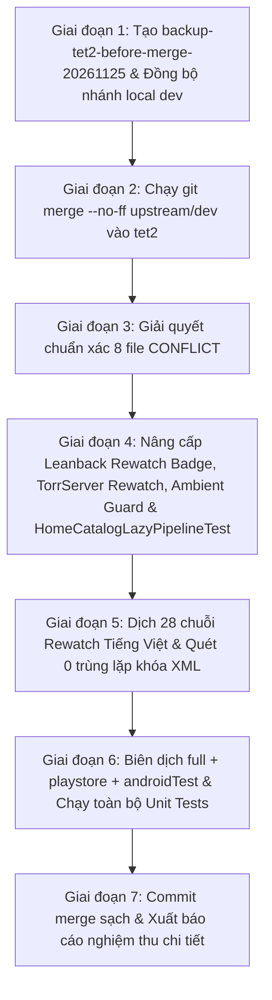

# PLAN: Đồng Bộ Nhánh `upstream/dev` → `tet2` (Từ 24-11-2026 Đến 25-11-2026: `11859c5d9` → `77cc0bb5f`)

> [!IMPORTANT]
> **Trạng thái**: Chờ người dùng duyệt trước khi thực thi (`PRE-MERGE PLAN` — chưa thay đổi nhánh `tet2` hay bất kỳ file mã nguồn nào).  
> **Nguyên tắc**: Bảo toàn **100%** mọi tùy chỉnh riêng đã xây dựng trên `tet2` (bao gồm cả 3 commit mới nhất chiều/tối 24-11-2026 về Trailer 1080p, Home Loading Boost, Leanback Smooth Hold, Ambient Mode, Live TV, Google TTS, TorrServer); tiếp nhận trọn vẹn toàn bộ PR mới từ `upstream/dev`; báo cáo minh bạch mọi điểm thay thế bằng code mới tốt hơn hoặc nâng cấp tương thích.

---

## 1. Tóm Tắt Điều Hành (Executive Summary)

| Hạng mục | Chi tiết |
| :--- | :--- |
| **Nhánh đích (Target)** | `tet2` (HEAD: `88c11eb98`, working tree sạch) |
| **Nguồn đồng bộ (Source)** | `upstream/dev` & `origin/dev` (cùng trỏ tới HEAD mới nhất: `77cc0bb5f`) |
| **Nhánh `dev` cục bộ** | Đang ở `d2eeb3d0e` (cũ hơn 328 commit) → Sẽ đồng bộ fast-forward lên `77cc0bb5f` khi thực thi |
| **Điểm phân nhánh chung (Merge Base)** | `11859c5d9` (điểm cuối đợt đồng bộ ngày 24-11-2026 tại commit `d7d056a19`) |
| **Phạm vi commit mới** | **10 commit đầu nhánh** trên `dev` (**9 Pull Requests**: `#4803`, `#4507`, `#4806`, `#4807`, `#4809`, `#4811`, `#4805`, `#3653`, `#4813` + **1 commit bump version** `77cc0bb5f`), tổng cộng **209 commit lịch sử** |
| **Tổng số file upstream thay đổi** | **137 file** (`+14,568 / -1,396` dòng) |
| **Số file xung đột trực tiếp (`CONFLICT`)** | **8 file** (đã mô phỏng và xác minh chính xác từng dòng bằng `git merge-tree --write-tree`) |
| **Số điểm điều chỉnh ngữ nghĩa / nâng cấp đồng bộ** | **6 hạng mục** (phát hiện qua rà soát chéo 27 file auto-merge & hệ thống Unit Test riêng của `tet2`) |
| **Nhánh dự phòng an toàn trước khi merge** | `backup-tet2-before-merge-20261125` |

---

## 2. Các Tính Năng & Sửa Lỗi Mới Từ `upstream/dev` Cần Tiếp Nhận

1. **Hệ thống Theo Dõi Xem Lại (Simkl Rewatch Sessions) & Ngưỡng Đã Xem Động (PR #3653 — `e8f4a8f05`)**:
   - Hỗ trợ ghi nhận các phiên xem lại (*Rewatch Sessions*) cho phim/series đã hoàn thành trên 48 giờ (tài khoản Simkl PRO/VIP) với 3 chế độ trong *Settings → Tracking*: **Tắt (`OFF`)**, **Bán tự động (`SEMI_AUTOMATIC` — hỏi qua `RewatchPromptOverlay` trước khi phát)**, và **Tự động (`AUTOMATIC`)**.
   - Đưa các loạt phim đang trong phiên xem lại (*Active Rewatch Runs*) lên hàng **Continue Watching** và đồng bộ nút **Play** ở màn hình Chi tiết phim; đóng phiên xem lại khi xóa thẻ khỏi Continue Watching.
   - Hiển thị huy hiệu **Đã xem lại** (`RewatchMarker` — biểu tượng mũi tên xoay tròn) cạnh dấu tích Đã xem trên thẻ tập phim, kèm thao tác *Đánh dấu đã xem lại / Bỏ đánh dấu xem lại* trong `EpisodeOptionsOverlay`.
   - Bổ sung thanh trượt **Ngưỡng hoàn thành đã xem (`Watched threshold` %)** trong *Settings → Tracking* và ưu tiên mốc End-Credits thực tế từ Player (`PlayerContentEndPolicy`).
   - Đi kèm hơn **25 bộ Unit Test mới** kiểm chứng toàn diện Simkl Sync, Rewatch Runs, Scrobble Policy & Content End Policy.
2. **Hỗ trợ âm thanh LPCM & đọc track DTS-HD trên đĩa Blu-ray BDAV (PR #4809 — `1edcb5a47`, `927e81575`)**:
   - Khắc phục lỗi khởi chạy các clip Blu-ray chứa luồng âm thanh LPCM và bổ sung [BdavDtsHdReader.kt](file:///f:/MyGithub/NuvioTV-Fast/app/src/main/java/com/nuvio/tv/ui/screens/player/BdavDtsHdReader.kt) để nhận diện, liệt kê đầy đủ các track DTS-HD / DTS-HD MA.
3. **Hỗ trợ phím cứng Audio Track (`KEYCODE_MEDIA_AUDIO_TRACK`) trên điều khiển TV (PR #4507 — `ff09b664e`, `928244de2`, `8b6ac91b1`)**:
   - Bấm phím chuyển kênh âm thanh trên remote TV sẽ mở ngay bảng chọn Audio trong [PlayerScreen.kt](file:///f:/MyGithub/NuvioTV-Fast/app/src/main/java/com/nuvio/tv/ui/screens/player/PlayerScreen.kt), đồng thời chặn mở đè khi đang mở hộp thoại chọn nội dung đĩa Blu-ray (`showDiscTitlesDialog`).
4. **Ánh xạ chính xác ID Anime nhiều mùa cho Built-in Usenet (PR #4805 — `1086d1530`, `170be2eb8`, `de0616228`)**:
   - Thêm `BuiltInUsenetVideoIds.kt`: ánh xạ mã catalog Anime theo thứ tự ưu tiên IMDb ID của tiêu đề → Meta → Simkl và dùng số thứ tự tập từ Meta để tìm kiếm chính xác trên Newznab.
5. **Khớp tên tệp Debrid chứa biến thể ký tự `&` và `and` (PR #4807 — `6e4a3cf1e`, `4b71d71ae`)**:
   - Nâng cấp [DebridFileSelection.kt](file:///f:/MyGithub/NuvioTV-Fast/app/src/main/java/com/nuvio/tv/core/debrid/DebridFileSelection.kt) để chọn đúng tệp phim trong gói multi-file khi tên release dùng `&` nhưng metadata dùng `and` (hoặc ngược lại).
6. **Bản địa hóa Tiếng Việt cho Usenet & Cập nhật đa ngôn ngữ (PR #4811, #4803, #4806, #4813)**:
   - Bổ sung 3 tệp dịch Tiếng Việt mới (`values-vi/usenet.xml`, `values-vi/usenet_ranking.xml`, `values-vi/usenet_sources.xml`) và 22 chuỗi Tiếng Việt cho P2P, Usenet, Disc Titles trong [strings.xml (vi)](file:///f:/MyGithub/NuvioTV-Fast/app/src/main/res/values-vi/strings.xml).
   - Sửa lỗi chính tả `advanced_rgb565_subtitle` trong [strings.xml](file:///f:/MyGithub/NuvioTV-Fast/app/src/main/res/values/strings.xml) và cập nhật ngôn ngữ `values-hu`, `values-sk`, `values-iw`.

---

## 3. Các Tùy Chỉnh Riêng Trên `tet2` Bắt Buộc Bảo Toàn 100%

- **Chính sách mặc định Trailer 1080p & Bộ trích xuất YouTube gia cố (`88c11eb98` — tối 24-11-2026)**:
  - Mặc định `allow4k = false` (1080p) trong [TrailerVideoPolicy.kt](file:///f:/MyGithub/NuvioTV-Fast/app/src/main/java/com/nuvio/tv/core/player/TrailerVideoPolicy.kt), [TrailerSettingsDataStore.kt](file:///f:/MyGithub/NuvioTV-Fast/app/src/main/java/com/nuvio/tv/data/local/TrailerSettingsDataStore.kt), [TrailerService.kt](file:///f:/MyGithub/NuvioTV-Fast/app/src/main/java/com/nuvio/tv/data/trailer/TrailerService.kt), [LayoutSettingsViewModel.kt](file:///f:/MyGithub/NuvioTV-Fast/app/src/main/java/com/nuvio/tv/ui/screens/settings/LayoutSettingsViewModel.kt).
  - Sửa header `Range`, khôi phục `visitorData` qua `/youtubei/v1/visitor_id`, chọn đa ứng viên Adaptive 1080p trong [InAppYouTubeExtractor.kt](file:///f:/MyGithub/NuvioTV-Fast/app/src/main/java/com/nuvio/tv/data/trailer/InAppYouTubeExtractor.kt), khóa `DefaultTrackSelector` trong [TrailerPlayerPool.kt](file:///f:/MyGithub/NuvioTV-Fast/app/src/main/java/com/nuvio/tv/core/player/TrailerPlayerPool.kt), và giữ độ nét 1:1 cho trailer trong [AmbientSlideshow.kt](file:///f:/MyGithub/NuvioTV-Fast/app/src/main/java/com/nuvio/tv/ui/screens/ambient/AmbientSlideshow.kt).
- **Tăng tốc tải Trang Chủ & Tối ưu Cache Ảnh (`08a27ec77` — chiều 24-11-2026)**:
  - Giữ nguyên [HomePosterLoading.kt](file:///f:/MyGithub/NuvioTV-Fast/app/src/main/java/com/nuvio/tv/core/image/HomePosterLoading.kt), [PictureDiet.kt](file:///f:/MyGithub/NuvioTV-Fast/app/src/main/java/com/nuvio/tv/core/image/PictureDiet.kt), `SavedCopyOnErrorFetcher` + `CollectionCoverNetworkClient`, và pipeline nạp catalog lười trong [HomeViewModelCatalogPipeline.kt](file:///f:/MyGithub/NuvioTV-Fast/app/src/main/java/com/nuvio/tv/ui/screens/home/HomeViewModelCatalogPipeline.kt).
- **Hệ thống Android Leanback Native 60fps (`LeanbackModernRow`, `LeanbackNativeRow`, `LeanbackNativeGrid`, `HSCROLL` mượt khi giữ phím ngang)**.
- **Ambient Mode phát Trailer (`AmbientModeHost`, guard `!isPlayerActive && !isLiveTvActive`), Live TV (`ĐANG PHÁT`, D-Pad OSD 2s, `CH+`/`CH-`), Google Offline TTS + phiên âm tên riêng Tiếng Anh, Zero-Jank Subtitle Tier 1/2, AutoSync V2 TV-safe & TorrServer**.
- **Định danh gói & Phiên bản của nhánh `tet2`**: Giữ `applicationId = "com.nuvio.tv.fast"`, `versionCode = 1218`, `versionName = "1.7.6"` trong [build.gradle.kts](file:///f:/MyGithub/NuvioTV-Fast/app/build.gradle.kts).

---

## 4. Báo Cáo Chi Tiết Xử Lý 8 File Xung Đột & Các Điểm Thay Thế / Nâng Cấp

### A. Phương Án Giải Quyết 8 File Xung Đột Trực Tiếp (`CONFLICT`)

| # | File Xung Đột | Nguyên Nhân Xung Đột | Giải Pháp Hợp Nhất Chi Tiết |
| :---: | :--- | :--- | :--- |
| **1** | [app/build.gradle.kts](file:///f:/MyGithub/NuvioTV-Fast/app/build.gradle.kts) | `tet2` đặt `versionCode = 1218`, `versionName = "1.7.6"`; `upstream/dev` (`77cc0bb5f`) đặt `versionCode = 1083`, `versionName = "1.2.0-beta.4"`. | **Giữ nguyên `1218` / `"1.7.6"` của `tet2`** để bảo toàn chuỗi phiên bản của gói `com.nuvio.tv.fast` và đảm bảo cài đặt cập nhật đè không lỗi hạ cấp (`INSTALL_FAILED_VERSION_DOWNGRADE`). |
| **2** | [MainActivity.kt](file:///f:/MyGithub/NuvioTV-Fast/app/src/main/java/com/nuvio/tv/MainActivity.kt) | **Hunk 1 (Imports)**: `tet2` có `LocalGpuOffscreenCompositing`; `upstream/dev` thêm `ProfileAvatarCircle`, `RewatchPromptOverlay`.<br>**Hunk 2 (Root Overlays)**: `tet2` tính `isPlayerActive` & `isLiveTvActive` cho `AmbientModeHost`; `upstream/dev` gắn `RewatchPromptOverlay(repository = rewatchConsentRepository)`. | **Hợp nhất đầy đủ cả hai**:<br>1) Giữ toàn bộ import của cả hai nhánh.<br>2) Đặt `RewatchPromptOverlay(repository = rewatchConsentRepository)` ngay trên `AmbientModeHost`, giữ nguyên `isPlayerActive` & `isLiveTvActive` của `tet2`, đồng thời thêm điều kiện `rewatchPromptQuestion == null` vào `AmbientModeHost(allowed = ...)` (xem Mục 4.B.4). |
| **3** | [EpisodesSection.kt](file:///f:/MyGithub/NuvioTV-Fast/app/src/main/java/com/nuvio/tv/ui/screens/detail/EpisodesSection.kt) | `tet2` đã chuyển danh sách tập sang `LeanbackNativeRow` (`LeanbackCardItem.Episode`) và xóa hàm `EpisodeCard` Compose cũ; `upstream/dev` thêm `rewatchedEpisodes`, `onMarkEpisodeRewatched`, `onUnmarkEpisodeRewatched` và vẽ `RewatchMarker` trong `EpisodeCard` Compose cũ. | **Giữ kiến trúc `LeanbackNativeRow` 60fps của `tet2` + Cấy đầy đủ tính năng Rewatch của `upstream/dev`**:<br>1) Không khôi phục hàm `EpisodeCard` Compose cũ đã bỏ (bỏ Hunk 1 & Hunk 3 của upstream).<br>2) Giữ trọn vẹn các tham số Rewatch mới trên `EpisodesRow` & `EpisodeOptionsOverlay`.<br>3) Đưa `rewatchedEpisodes` vào `remember(...)` của `leanbackEpisodes`, tính `isMarkedRewatched` và truyền `isRewatched = isMarkedWatched && isMarkedRewatched` xuống `LeanbackCardItem.Episode` + `LeanbackEpisodeViewHolder` (xem Mục 4.B.3). |
| **4** | [PlayerRuntimeControllerPlaybackEvents.kt](file:///f:/MyGithub/NuvioTV-Fast/app/src/main/java/com/nuvio/tv/ui/screens/player/PlayerRuntimeControllerPlaybackEvents.kt) | Trong `emitSeekScrobbleRestart`: `tet2` dùng `progressPercent >= 80f` và `if (isShortPlaceholderStream() || isLiveTv) return`; `upstream/dev` đổi `80f` thành hằng số `TRACKING_COMPLETION_BAR_PERCENT` nhưng không có `|| isLiveTv`. | **Kết hợp cả hai**: Dùng hằng số chuẩn hóa `TRACKING_COMPLETION_BAR_PERCENT` của `upstream/dev` thay cho số cứng `80f`, **và giữ nguyên bảo vệ `|| isLiveTv`** của `tet2` để kênh Live TV không bao giờ gửi nhầm tín hiệu scrobble khi tua/chuyển luồng. |
| **5** | [StreamScreen.kt](file:///f:/MyGithub/NuvioTV-Fast/app/src/main/java/com/nuvio/tv/ui/screens/stream/StreamScreen.kt) | Trong `onStreamSelected`: `tet2` rẽ nhánh `if (viewModel.isTorrServerStream(stream))` mở `prepareTorrServerFilePicker(stream)`; `upstream/dev` truyền `progressPercent = (resumePercent?.toDouble() ?: 0.0) * 100.0` vào `resolveStreamForPlayback(...)`. | **Hợp nhất sạch cả hai**: Giữ nhánh `if (viewModel.isTorrServerStream(stream))` cho TorrServer của `tet2`, cập nhật nhánh `else` truyền đủ `progressPercent = (resumePercent?.toDouble() ?: 0.0) * 100.0` theo `upstream/dev`, đồng thời bổ sung truyền `progressPercent` cho `resolveTorrServerPlayback` (xem Mục 4.B.4). |
| **6** | [values-hu/strings.xml](file:///f:/MyGithub/NuvioTV-Fast/app/src/main/res/values-hu/strings.xml) | 3 vùng khác biệt giữa bản `tet2` cũ (từng thiếu 6 chuỗi `p2p_consent_*` và bị sót chữ `"hoặc"` trong câu tiếng Hungary) với bản hiệu đính toàn diện từ PR #4806 của `upstream/dev`. | **Thay thế hoàn toàn bằng bản mới của `upstream/dev` (PR #4806)** — xem báo cáo chi tiết ở Mục 4.B.2. |
| **7** | [values-vi/strings.xml](file:///f:/MyGithub/NuvioTV-Fast/app/src/main/res/values-vi/strings.xml) | Cả hai nhánh cùng thêm chuỗi ở cuối file: `tet2` có khối `TorrServer`, `Torrent File Picker`, `Subtitle TTS`, `autosync_revert_original`; `upstream/dev` (PR #4811) thêm khối `player_finding_next_stream`, `usenet_builtin_*`, `usenet_fallback*`, `player_disc_title*`. | **Giữ đầy đủ 100% cả hai khối** (bảo toàn mọi chuỗi tùy chỉnh của `tet2` + nhận trọn bộ chuỗi Usenet/Disc Titles của `upstream/dev`), đồng thời dịch bổ sung 28 chuỗi Tiếng Việt cho tính năng Rewatch mới (xem Mục 4.B.6). |
| **8** | [SimklAuthRepositoryTest.kt](file:///f:/MyGithub/NuvioTV-Fast/app/src/test/java/com/nuvio/tv/data/simkl/SimklAuthRepositoryTest.kt) | `tet2` có 4 bài test OAuth2 v2 PIN poll (`v2 pending`, `v2 approved`, `v2 expired`, `v2 access_denied`); `upstream/dev` thêm 9 bài test quản lý gói cước `accountType` (`pro`/`vip`/`free`) cho Rewatch ở cuối class. | **Giữ nối tiếp đầy đủ cả 13 bài test** (4 bài test OAuth2 v2 của `tet2` + 9 bài test Rewatch Plan của `upstream/dev`, khôi phục annotation `@Test` bị gối ở ranh giới xung đột). |

---

### B. Báo Cáo Minh Bạch Các Điểm Thay Thế Tốt Hơn & Nâng Cấp Tương Thích Kiến Trúc

> [!WARNING]
> Theo đúng yêu cầu *"giữ nguyên các tùy chỉnh mà tôi đã thêm, nếu code mới có công dụng tốt hơn thì có thể thay thế hoặc sửa nhưng phải báo cáo chi tiết"*, dưới đây là **6 điểm thay thế / điều chỉnh chủ động**:

1. **[Thay thế bằng cơ chế mới tốt hơn của Upstream] Hệ thống Ngưỡng Đã Xem Động & Ưu Tiên End-Credits (`PlayerScrobblePolicy.kt`, `PlayerContentEndPolicy.kt`, `PlayerRuntimeControllerPlaybackEvents.kt` — PR #3653)**:
   - **Trước đây**: Ngưỡng hoàn thành phim để đánh dấu "Đã xem" bị đóng cứng (80%) trong luồng sự kiện Player.
   - **Code mới của upstream**: Cho phép người dùng tự cấu hình phần trăm hoàn thành (`Watched threshold`) trong *Settings → Tracking*, đồng thời tự động ưu tiên mốc End-Credits thực tế (sớm 5 giây) nếu tập phim có dữ liệu credits, và giữ đúng phiên scrobble qua `scrobblePlaybackId` / `scrobbleStartProgressPercent`.
   - **Quyết định**: **Tiếp nhận cơ chế mới của upstream** thay cho ngưỡng cứng cũ, đồng thời bảo toàn tuyệt đối cờ chặn `isLiveTv`, bộ điều phối Google TTS và cơ chế throttling UI của `tet2`.
2. **[Thay thế bằng bản chuẩn của Upstream] Chuỗi bản địa hóa Tiếng Hungary (`app/src/main/res/values-hu/strings.xml` — PR #4806)**:
   - **Trước đây trên `tet2`**: Ở đợt merge cũ, file `values-hu/strings.xml` từng bị khuyết 6 chuỗi `p2p_consent_*` và lẫn từ tiếng Việt `"hoặc"` trong chuỗi `settings_p2p_profile_fast_description`.
   - **Code mới của upstream**: Chuẩn hóa toàn bộ 1.991 dòng Tiếng Hungary khớp với NuvioMobile, khôi phục đủ khối `p2p_consent_*` và sửa sạch câu chữ.
   - **Quyết định**: **Thay thế 3 hunk xung đột trong `values-hu/strings.xml` bằng 100% bản mới của upstream**. (Lưu ý: file này không chứa bất kỳ chuỗi tùy chỉnh riêng nào của `tet2`).
3. **[Nâng cấp đồng bộ cho Tùy chỉnh `tet2`] Tích hợp Huy Hiệu Xem Lại (`Rewatch Badge`) vào Thẻ Tập Phim Android Leanback Native ([LeanbackCardItem.kt](file:///f:/MyGithub/NuvioTV-Fast/app/src/main/java/com/nuvio/tv/ui/leanback/model/LeanbackCardItem.kt) & [LeanbackEpisodeViewHolder.kt](file:///f:/MyGithub/NuvioTV-Fast/app/src/main/java/com/nuvio/tv/ui/leanback/holder/LeanbackEpisodeViewHolder.kt))**:
   - **Bối cảnh**: Upstream vẽ `RewatchMarker` trên `EpisodeCard` Compose, nhưng `tet2` sử dụng `LeanbackNativeRow` + `LeanbackEpisodeViewHolder` để cuộn ngang mượt 60fps trên TV. Nếu không cấy sang Leanback, người dùng `tet2` sẽ không thấy huy hiệu xem lại trên danh sách tập phim.
   - **Giải pháp**: Thêm `val isRewatched: Boolean = false` vào `LeanbackCardItem.Episode`; trong `LeanbackEpisodeViewHolder.kt`, tạo huy hiệu tròn `rewatchBadgeView` (dùng vector icon Refresh sắc nét đặt ngay bên trái `watchedBadgeView` ở góc trên bên phải) chỉ hiển thị khi `epItem.isWatched && epItem.isRewatched`, kèm cập nhật `contentDescription` trợ năng.
4. **[Nâng cấp đồng bộ cho Tùy chỉnh `tet2`] Hỗ trợ Hộp Thoại Simkl Rewatch trên Luồng TorrServer & Bảo Vệ Hộp Thoại Khỏi Ambient Mode ([StreamScreen.kt](file:///f:/MyGithub/NuvioTV-Fast/app/src/main/java/com/nuvio/tv/ui/screens/stream/StreamScreen.kt), [StreamScreenViewModel.kt](file:///f:/MyGithub/NuvioTV-Fast/app/src/main/java/com/nuvio/tv/ui/screens/stream/StreamScreenViewModel.kt), [MainActivity.kt](file:///f:/MyGithub/NuvioTV-Fast/app/src/main/java/com/nuvio/tv/MainActivity.kt))**:
   - **TorrServer + Rewatch**: Bổ sung tham số `progressPercent: Double = 0.0` vào `StreamScreenViewModel.resolveTorrServerPlayback(fileId, progressPercent)` và gọi `preparePlaybackForStream(progressPercent)` (cũng như truyền từ `StreamScreen.kt` khi người dùng chọn file trong `TorrentFilePickerDialog`). Nhờ đó khi xem lại một bộ phim đã hoàn thành qua **TorrServer**, ứng dụng vẫn hỏi và mở phiên Simkl Rewatch chuẩn xác như mọi nguồn phát khác.
   - **Ambient Mode + Rewatch Prompt**: Trong `MainActivity.kt`, thu thập `val rewatchPromptQuestion by rewatchConsentRepository.question.collectAsState()` và bổ sung `&& rewatchPromptQuestion == null` vào tham số `allowed` của `AmbientModeHost(...)` để trình bảo vệ màn hình Ambient Mode không tự kích hoạt đè lên khi hộp thoại hỏi Rewatch đang chờ người dùng chọn.
5. **[Sửa lỗi biên dịch ngữ nghĩa phát hiện sớm] Cập nhật Constructor `HomeViewModel` trong Bài Test Độc Quyền [HomeCatalogLazyPipelineTest.kt](file:///f:/MyGithub/NuvioTV-Fast/app/src/test/java/com/nuvio/tv/ui/screens/home/HomeCatalogLazyPipelineTest.kt)**:
   - **Phát hiện**: PR #3653 thêm 2 dependency mới (`simklSyncRepository` và `simklRewatchWriter`) vào constructor của `HomeViewModel`. Upstream đã cập nhật 3 bài test của họ, nhưng `HomeCatalogLazyPipelineTest.kt` là bài test riêng của `tet2` (tạo ngày 24-11-2026) nên Git auto-merge không cảnh báo.
   - **Giải pháp**: Truyền bổ sung `simklSyncRepository = mockk(relaxed = true)` và `simklRewatchWriter = mockk(relaxed = true)` tại dòng 466 của `HomeCatalogLazyPipelineTest.kt`.
6. **[Hoàn thiện Bản địa hóa Tiếng Việt] Dịch bổ sung 28 chuỗi Tiếng Việt cho tính năng Simkl Rewatch & Watched Threshold trong [values-vi/strings.xml](file:///f:/MyGithub/NuvioTV-Fast/app/src/main/res/values-vi/strings.xml)**:
   - **Phát hiện**: 28 chuỗi mới của PR #3653 (`episodes_cd_rewatched`, `episodes_mark_rewatched`, `episodes_mark_not_rewatched`, `detail_episode_marked_rewatched`, `detail_episode_marked_not_rewatched`, `detail_rewatch_too_soon`, `detail_rewatch_not_recorded`, `settings_tracking_completion_*`, `settings_tracking_rewatch_*`, `rewatch_prompt_*`) hiện mới có trong `values/strings.xml` tiếng Anh, chưa có trong `values-vi/strings.xml` của upstream.
   - **Giải pháp**: Bổ sung trọn bộ 28 bản dịch Tiếng Việt chuẩn xác, tự nhiên trên màn hình TV và chạy kiểm tra tự động đảm bảo **0 khóa XML trùng lặp** trên cả `values/strings.xml` lẫn `values-vi/strings.xml`.

---

## 5. Quy Trình Thực Thi Phẫu Thuật Từng Giai Đoạn (Phase-by-Phase Breakdown)



- **Giai đoạn 1 — Sao lưu & Chuẩn bị nhánh (`SYNC1125-01`)**:
  - Tạo nhánh dự phòng `backup-tet2-before-merge-20261125` tại HEAD hiện tại (`88c11eb98`).
  - Cập nhật nhánh `dev` cục bộ khớp với `upstream/dev` (`git branch -f dev upstream/dev`) để mọi tham chiếu `dev` / `upstream/dev` / `origin/dev` đồng nhất tại `77cc0bb5f`.
- **Giai đoạn 2 — Khởi chạy Merge (`SYNC1125-02`)**:
  - Thực hiện `git merge --no-ff upstream/dev` trên nhánh `tet2`.
- **Giai đoạn 3 — Giải quyết 8 file Xung đột trực tiếp (`SYNC1125-03`, `SYNC1125-04`)**:
  - Xử lý nhóm cấu hình, màn hình & Player: `app/build.gradle.kts`, `MainActivity.kt`, `EpisodesSection.kt`, `PlayerRuntimeControllerPlaybackEvents.kt`, `StreamScreen.kt`.
  - Xử lý nhóm tài nguyên & kiểm thử: `values-hu/strings.xml`, `values-vi/strings.xml`, `SimklAuthRepositoryTest.kt`.
- **Giai đoạn 4 — Nâng cấp Tương thích Kiến trúc `tet2` (`SYNC1125-05`, `SYNC1125-06`)**:
  - Cấy huy hiệu `isRewatched` vào `LeanbackCardItem.Episode` & `LeanbackEpisodeViewHolder.kt` (đồng bộ với `EpisodesSection.kt`).
  - Tích hợp `preparePlaybackForStream(progressPercent)` vào `StreamScreenViewModel.resolveTorrServerPlayback` và cập nhật constructor `HomeViewModel` trong `HomeCatalogLazyPipelineTest.kt`.
- **Giai đoạn 5 — Hoàn thiện Bản địa hóa Tiếng Việt & Kiểm tra Tài nguyên (`SYNC1125-07`)**:
  - Bổ sung 28 chuỗi Tiếng Việt cho Simkl Rewatch & Watched Threshold vào `values-vi/strings.xml`.
  - Chạy kiểm tra trùng `<string name="...">` và `<plurals name="...">` trên `values/strings.xml`, `values-vi/strings.xml`, `values-hu/strings.xml`.
- **Giai đoạn 6 — Kế hoạch Kiểm chứng Tự động & Thủ công (`SYNC1125-08`)**:
  - **Biên dịch đa biến thể & AndroidTest**:
    ```powershell
    .\gradlew.bat :app:compileFullDebugKotlin :app:compilePlaystoreDebugKotlin :app:compileFullDebugAndroidTestKotlin :app:mergeFullDebugResources
    ```
  - **Chạy Unit Tests cho cả tính năng mới của Upstream lẫn toàn bộ tùy chỉnh cốt lõi của `tet2`**:
    ```powershell
    .\gradlew.bat :app:testFullDebugUnitTest `
      --tests "com.nuvio.tv.data.simkl.*" `
      --tests "com.nuvio.tv.core.tracking.*" `
      --tests "com.nuvio.tv.ui.screens.detail.RewatchRunEpisodeSelectionTest" `
      --tests "com.nuvio.tv.ui.screens.home.*" `
      --tests "com.nuvio.tv.ui.screens.player.BdavDtsHdReaderTest" `
      --tests "com.nuvio.tv.ui.screens.player.PlayerContentEndPolicyTest" `
      --tests "com.nuvio.tv.ui.screens.player.PlayerScrobblePolicyTest" `
      --tests "com.nuvio.tv.core.usenet.*" `
      --tests "com.nuvio.tv.core.debrid.DebridFileSelectorParityTest" `
      --tests "com.nuvio.tv.data.trailer.*" `
      --tests "com.nuvio.tv.core.player.TrailerVideoPolicyTest" `
      --tests "com.nuvio.tv.ui.leanback.*" `
      --tests "com.nuvio.tv.core.tts.*" `
      --tests "com.nuvio.tv.features.livetv.LiveTvGuideNavigationTest"
    ```
  - **Danh sách Kiểm chứng Thủ công trên TV sau khi hoàn tất**:
    1. Mở *Cài đặt → Theo dõi (Tracking)*: kiểm tra thanh trượt **Ngưỡng đã xem (%)** và mục **Theo dõi xem lại (Track Rewatches)** hiển thị Tiếng Việt đầy đủ.
    2. Mở trang Chi tiết một bộ Series có tập đã xem lại (hoặc nhấn giữ tập đã xem khi đang có phiên Rewatch): xác nhận menu tập phim có tùy chọn đánh dấu xem lại và thẻ tập phim Leanback hiện huy hiệu xoay tròn cạnh dấu tích xanh.
    3. Kiểm tra phát Trailer mặc định **1080p** trên Trang Chủ & Ambient Mode, cuộn giữ phím ngang trên Modern Home Leanback, phát luồng **TorrServer**, **Google TTS**, và **Live TV (`ĐANG PHÁT`)**.
- **Giai đoạn 7 — Đóng gói Commit Merge & Báo cáo Nghiệm thu (`SYNC1125-09`)**:
  - Tạo commit merge sạch với thông điệp chuẩn Conventional/Merge format và gửi báo cáo nghiệm thu chi tiết từng tệp.
