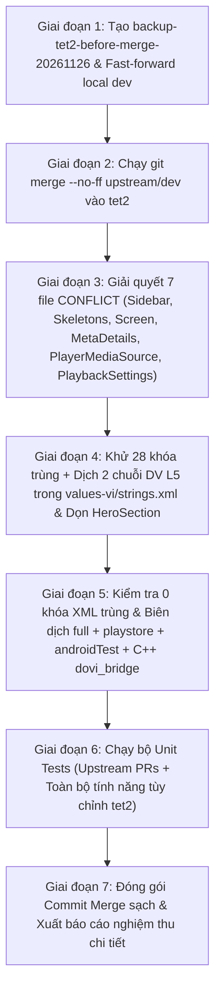

# PLAN: Đồng Bộ Nhánh `upstream/dev` → `tet2` (Từ 25-11-2026 Đến 26-11-2026: `77cc0bb5f` → `9eb83996f`)

> [!IMPORTANT]
> **Trạng thái**: Chờ người dùng duyệt trước khi thực thi (`PRE-MERGE PLAN` — chưa thay đổi nhánh `tet2` hay bất kỳ file mã nguồn nào).  
> **Nguyên tắc**: Bảo toàn **100%** mọi tùy chỉnh riêng đã xây dựng trên `tet2` (bao gồm toàn bộ 9 commit mới ngày 25–26/11/2026 về Auto Stereo 2.0 cho TTS, chống lặp/chặn đọc sớm Offline TTS, Modern Home Leanback 60fps + Floating Focus Ring + Poster Expand, Ambient Mode & Trailer 1080p, Native Sidebar + Legacy Blur Android <12, TorrServer, Live TV, AutoSync V2 TV-safe); tiếp nhận trọn vẹn **19 PR / 47 commit** mới từ `upstream/dev`; báo cáo minh bạch mọi điểm thay thế bằng code mới tốt hơn hoặc điều chỉnh tương thích.

---

## 1. Tóm Tắt Điều Hành (Executive Summary)

| Hạng mục | Chi tiết |
| :--- | :--- |
| **Nhánh đích (Target)** | `tet2` (HEAD: `6fa0e9ba1`, working tree sạch, `com.nuvio.tv.fast`, `versionCode = 1223`, `versionName = "1.7.9"`) |
| **Nguồn đồng bộ (Source)** | `upstream/dev` & `origin/dev` (đã fetch, cùng trỏ tới HEAD mới nhất: `9eb83996f`) |
| **Nhánh `dev` cục bộ** | Đang ở `77cc0bb5f` (mốc đồng bộ ngày 25-11-2026) → Sẽ đồng bộ fast-forward lên `9eb83996f` khi thực thi |
| **Điểm phân nhánh chung (Merge Base)** | `77cc0bb5f` (điểm cuối đợt đồng bộ ngày 25-11-2026 tại commit merge `f31d98e3b`) |
| **Phạm vi commit mới từ `dev`** | **19 Pull Requests** (`#4831`, `#4830`, `#4828`, `#4827`, `#4826`, `#4825`, `#4821`, `#4822`, `#4833`, `#4835`, `#4837`, `#4836`, `#4834`, `#4847`, `#4846`, `#4840`, `#4838`, `#4845`, `#4844`), tổng cộng **47 commit** |
| **Tổng số file upstream thay đổi** | **75 file** (`+4,104 / -291` dòng), trong đó có **26 file giao nhau** với `tet2` |
| **Số file xung đột trực tiếp (`CONFLICT`)** | **7 file** (6 xung đột nội dung + 1 xung đột `modify/delete` ở `ModernSidebarBlurPanel.kt`), đã mô phỏng chính xác từng dòng bằng `git merge-tree --write-tree` |
| **Số điểm thay thế tốt hơn / vá lỗi ẩn auto-merge** | **6 hạng mục** (nổi bật: phát hiện sớm **28 khóa XML trùng lặp** sau auto-merge trong `values-vi/strings.xml`, port bản sửa lỗi tắt đột ngột blur sidebar PR #4833 vào `MainActivity.kt`, tích hợp zero-recomposition `SkeletonShimmer` PR #4826 và kết hợp PR #4825 vào `MetaDetailsScreen.kt`) |
| **Nhánh dự phòng an toàn trước khi merge** | `backup-tet2-before-merge-20261126` (tạo tại `6fa0e9ba1`) |

---

## 2. Các Tính Năng & Sửa Lỗi Mới Từ `upstream/dev` (19 PRs) Cần Tiếp Nhận

1. **Tùy chọn bỏ qua siêu dữ liệu viền đen Dolby Vision Level 5 (`PR #4846` — `c2d3317b4`, `7ab33be7a`, `4d7bf07bd`)**:
   - Bổ sung cài đặt cục bộ theo thiết bị (`DeviceLocalPlayerPreferences.zeroDoviLevel5`, mặc định tắt) trong *Cài đặt phát lại → Video* (`Ignore Dolby Vision Letterbox Metadata (L5)`).
   - Nâng cấp [dovi_bridge.cpp](file:///f:/MyGithub/NuvioTV-Fast/app/src/main/cpp/dovi_bridge.cpp), [DoviBridge.kt](file:///f:/MyGithub/NuvioTV-Fast/app/src/main/java/com/nuvio/tv/core/player/DoviBridge.kt), [DolbyVisionMatroskaTransformer.kt](file:///f:/MyGithub/NuvioTV-Fast/app/src/main/java/com/nuvio/tv/core/player/DolbyVisionMatroskaTransformer.kt) và [DolbyVisionExtractorsFactory.kt](file:///f:/MyGithub/NuvioTV-Fast/app/src/main/java/com/nuvio/tv/core/player/DolbyVisionExtractorsFactory.kt) để đưa độ lệch active-area L5 khác 0 về 0 ngay trên RPU NAL (kể cả luồng không chuyển đổi DV7→DV8.1), khắc phục dải mờ/tối dọc viền đen letterbox trên các file có L5 lỗi.
   - Đã xác minh toàn bộ hàm C `libdovi` mới gọi (`dovi_rpu_get_vdr_dm_data`, `dovi_rpu_free_vdr_dm_data`, `dovi_rpu_set_active_area_offsets`, ...) đều đã có sẵn trong `DV7/libdovi/*/include/libdovi/rpu_parser.h` và đi kèm bộ test `DolbyVisionLevel5SanitizationTest.kt`.
2. **Tôn trọng định dạng luồng (`streamType`) do Plugin khai báo & dò MIME qua HTTP client phát lại (`PR #4844` — `9eb83996f`, `PR #4845` — `9c2fadae2`)**:
   - Truyền `declaredType` (`hls`/`m3u8`, `dash`/`mpd`) xuyên suốt từ `Plugin` → `Stream` → `StreamRepositoryImpl` → `StreamScreenViewModel` → `Screen.Player` → `NuvioNavHost` → `PlayerNavigationArgs` → `PlayerRuntimeController` → `PlayerMediaSourceFactory.inferMimeType(...)`, ưu tiên loại luồng plugin khai báo khi server trả `Content-Type` chung chung (như `text/html`).
   - Đảm bảo `probeNetworkMimeType` chạy qua HTTP client có cấu hình header/proxy của trình phát (`PlayerPlaybackNetworking.createHttpClient`).
3. **Nút Đánh Dấu Đã Xem cho Phim Bộ ngay tại Hero Màn Hình Chi Tiết (`PR #4835` — `05bcd5ead`)**:
   - Thêm `Meta.isSeriesWithWatchableEpisodes()` trong [Meta.kt](file:///f:/MyGithub/NuvioTV-Fast/app/src/main/java/com/nuvio/tv/domain/model/Meta.kt), hiển thị nút mắt (Đã xem / Chưa xem) cho cả Series tại [HeroSection.kt](file:///f:/MyGithub/NuvioTV-Fast/app/src/main/java/com/nuvio/tv/ui/screens/detail/HeroSection.kt) và xử lý đánh dấu/bỏ đánh dấu hàng loạt toàn bộ tập phim trong [MetaDetailsViewModel.kt](file:///f:/MyGithub/NuvioTV-Fast/app/src/main/java/com/nuvio/tv/ui/screens/detail/MetaDetailsViewModel.kt).
4. **Cải Thiện UI & Hiệu Năng TV (`PR #4825`, `#4826`, `#4833`)**:
   - `PR #4825` (`fd8e8d957`): Giữ hàng tab Mùa (`SeasonTabs`) và hàng Tập phim (`EpisodesRow`) luôn hiển thị cùng nhau trên khung hình khi focus trong [MetaDetailsScreen.kt](file:///f:/MyGithub/NuvioTV-Fast/app/src/main/java/com/nuvio/tv/ui/screens/detail/MetaDetailsScreen.kt).
   - `PR #4826` (`f85557674`): Vẽ hiệu ứng shimmer của `MetaDetailsSkeleton` hoàn toàn ở pha Draw (`drawBehind` + `@Stable class SkeletonShimmer`) không gây recompose mỗi khung hình, tránh giật trailer đang phát nền trên `TextureView`.
   - `PR #4833` (`b48e8d8d3`): Làm mờ mượt hiệu ứng blur của Modern Sidebar theo tiến độ thu gọn thay vì tắt cái rụp trước khi đóng; thu nhỏ đều các ngôi sao đánh giá trong [RatingStars.kt](file:///f:/MyGithub/NuvioTV-Fast/app/src/main/java/com/nuvio/tv/ui/screens/detail/RatingStars.kt) khi hộp thoại hẹp.
5. **Nâng Cấp Built-in Usenet & Engine 32-bit (`PR #4821` — `8729105c1`, `PR #4837` — `d9ca7a1b6`)**:
   - Thêm `UsenetReleaseLabels.kt` + `UsenetReleaseLabelsTest.kt`: hiển thị chi tiết codec/nguồn/tối đa 2 ngôn ngữ từ tên release Usenet, tách riêng dung lượng sang badge size và tối ưu xếp hạng trong [StreamRanking.kt](file:///f:/MyGithub/NuvioTV-Fast/app/src/main/java/com/nuvio/tv/core/streams/StreamRanking.kt) / [BuiltInUsenetService.kt](file:///f:/MyGithub/NuvioTV-Fast/app/src/main/java/com/nuvio/tv/core/usenet/BuiltInUsenetService.kt).
   - Cập nhật Usenet native engine lên commit `7a9ae7d` (`native/usenet/engine-source.json`, `native/usenet/prebuilt/manifest.json`) sửa lỗi không khởi động trên Android 8–10 32-bit (`time32`).
6. **Sửa Lỗi AudioSync & Cloud Sync (`PR #4831` — `4df14575d`, `PR #4834` — `f656d5452`)**:
   - `PR #4831`: Lọc thẻ HTML/lời bài hát nhiều dòng trong [SubtitleSpeechTrack.kt](file:///f:/MyGithub/NuvioTV-Fast/app/src/main/java/com/nuvio/tv/ui/screens/player/audiosync/SubtitleSpeechTrack.kt) và thêm cờ `isModelConfirmed` / `lockConfirmed` trong [AudioSubtitleSyncController.kt](file:///f:/MyGithub/NuvioTV-Fast/app/src/main/java/com/nuvio/tv/ui/screens/player/audiosync/AudioSubtitleSyncController.kt) & [AudioSyncFallback.kt](file:///f:/MyGithub/NuvioTV-Fast/app/src/main/java/com/nuvio/tv/ui/screens/player/audiosync/AudioSyncFallback.kt) để dứt điểm tình trạng spinner quay vô tận khi mới có mô hình tạm thời.
   - `PR #4834`: Khôi phục đồng bộ đám mây cho tùy chọn `exo_chapters_enabled` (*Hiển thị chương*) trong [ProfileSettingsSyncService.kt](file:///f:/MyGithub/NuvioTV-Fast/app/src/main/java/com/nuvio/tv/core/sync/ProfileSettingsSyncService.kt).
7. **Bản Địa Hóa Đa Ngôn Ngữ (`PR #4828`, `#4822`, `#4827`, `#4830`, `#4836`, `#4838`, `#4840`, `#4847`)**:
   - Cập nhật bản dịch Tiếng Việt chính thức (`PR #4828` — `values-vi/strings.xml`, `values-vi/usenet_sources.xml`) cùng các ngôn ngữ `fr`, `iw`, `hr`, `tr`, `es-419`.

---

## 3. Các Tùy Chỉnh Riêng Trên `tet2` Bắt Buộc Bảo Toàn 100%

- **9 commit phát triển mới nhất ngày 25–26/11/2026 trên `tet2` (`2864588ec` → `6fa0e9ba1`)**:
  - **Tự động hạ kênh Stereo 2.0 cho Google TTS (`2864588ec`)**: `TtsAudioStereoPolicy`, `TtsStereoDownmixAudioProcessor`, `PlaybackSpeedAwareAudioSink` (hot-switch PCM 2.0 trên ExoPlayer & MPV, tự khôi phục kênh 5.1/7.1 gốc khi tắt TTS).
  - **Chống lặp thuyết minh & chặn đọc sớm trước khung hình đầu tiên (`cb6f09423`)**: `SubtitleTtsTextCleaner`, `SubtitleTtsCueQueueState`, `GoogleOfflineTtsEngine`, `SubtitleTtsCoordinator`, `SubtitleCueTracker`, `syncTtsPlaybackActive()`.
  - **Hệ thống Modern Home Leanback 60fps & Poster Expand (`a3bea0725`, `0c752191f`, `82d3528d3`, `92c065962`, `0ddd08cea`)**: `ModernHomeRowsList`, `ModernInteropHorizontalGridView`, `ModernRowFloatingFocusRingView`, `LeanbackUniversalAdapter`, hiệu ứng mở rộng poster & focus ring mượt.
  - **Ambient Mode & Trailer 1080p mượt (`0b1758c93`, `6fa0e9ba1`)**: `TrailerPlayerPool`, letterbox detection, `AmbientSlideshow`, chính sách mặc định 1080p.
- **Các nền tảng tùy chỉnh xuyên suốt của `tet2`**:
  - **Native Sidebar & Legacy Snapshot Blur Android <12** tích hợp trực tiếp trong [MainActivity.kt](file:///f:/MyGithub/NuvioTV-Fast/app/src/main/java/com/nuvio/tv/MainActivity.kt) (không dùng lại `ModernSidebarBlurPanel.kt` đã bỏ từ ngày 02-11-2026).
  - **Live TV + DRM (`drmType`, `drmKey`)**, **TorrServer (`isTorrServerUrl`, Torrent File Picker)**, **bảo vệ URL presigned S3/R2** trong `PlayerMediaSourceFactory.probeNetworkMimeType`.
  - **Custom Subtitle Font (`customFontName`, `onPickCustomFont`, `onClearCustomFont`)** & **Google TTS Voice Picker** trong `PlaybackSettingsSections.kt`.
  - **Trì hoãn nạp Sherpa/ONNX recognizer** tới khi `takeOver()` trong `AudioSyncFallback.kt`.
  - **Định danh gói & Phiên bản**: `applicationId = "com.nuvio.tv.fast"`, `versionCode = 1223`, `versionName = "1.7.9"` trong [app/build.gradle.kts](file:///f:/MyGithub/NuvioTV-Fast/app/build.gradle.kts) (không có xung đột ở đợt merge này).

---

## 4. Báo Cáo Chi Tiết Xử Lý 7 File Xung Đột & 6 Điểm Thay Thế / Vá Lỗi Chủ Động

### A. Phương Án Giải Quyết 7 File Xung Đột Trực Tiếp (`CONFLICT`)

| # | File Xung Đột | Loại & Nguyên Nhân Xung Đột | Giải Pháp Hợp Nhất Chi Tiết |
| :---: | :--- | :--- | :--- |
| **1** | [ModernSidebarBlurPanel.kt](file:///f:/MyGithub/NuvioTV-Fast/app/src/main/java/com/nuvio/tv/ModernSidebarBlurPanel.kt) | **`modify/delete`**: `tet2` đã xóa file này (02-11-2026) để gộp Native Sidebar + Legacy Blur Android <12 vào `MainActivity.kt`; `upstream/dev` (PR #4833) sửa `showPanelBlur` trong file này. | **Giữ trạng thái ĐÃ XÓA (`git rm`)** để không đưa mã chết quay lại dự án, đồng thời **port chính xác bản sửa blur PR #4833 vào `MainActivity.kt`** (xem Hạng mục #2 và Mục 4.B.1). |
| **2** | [MainActivity.kt](file:///f:/MyGithub/NuvioTV-Fast/app/src/main/java/com/nuvio/tv/MainActivity.kt) | **`content`**: `tet2` render trực tiếp panel sidebar (kèm `useRealtimeHazeBlur` cho Android 12+ và `useLegacySnapshotBlur` cho Android <12); `upstream/dev` (PR #4833) bỏ truyền `isSidebarExpanded` & `sidebarCollapsePending` vào `ModernSidebarBlurPanel(...)`. | **Giữ nguyên 100% khối Native Sidebar + Legacy Snapshot Blur của `tet2`** và **thay thế điều kiện `showRealtimePanelBlur`** (dòng 1899) theo bản sửa tốt hơn của PR #4833: `val showRealtimePanelBlur = useRealtimeHazeBlur && delayedBlurProgress > 0f` (xem Mục 4.B.1). |
| **3** | [Skeletons.kt](file:///f:/MyGithub/NuvioTV-Fast/app/src/main/java/com/nuvio/tv/ui/components/Skeletons.kt) | **`content`**: `tet2` đổi `rememberShimmerBrush` sang `SolidColor` tĩnh để tránh recompose 60fps; `upstream/dev` (PR #4826) thiết kế mới `@Stable class SkeletonShimmer` + `Modifier.shimmerBackground` dùng `drawBehind` cho `MetaDetailsSkeleton` (0 recompose mỗi frame), còn `rememberShimmerBrush` vẫn dùng animation cũ. | **Hợp nhất lai tối ưu nhất của cả hai bên**:<br>1) **Tiếp nhận `SkeletonShimmer` (`drawBehind`, 0 recompose) của PR #4826** cho `MetaDetailsSkeleton` (vừa có hiệu ứng shimmer mượt mà hơn ô xám tĩnh, vừa không gây giật trailer nền).<br>2) **Giữ nguyên `SolidColor` tĩnh của `tet2` trong `rememberShimmerBrush()`** cho `StreamCardSkeleton`, `AuthQrSignInScreen`, `CastDetailScreen` (vì các màn hình này chưa đổi sang `drawBehind`, giữ tĩnh giúp không bị hồi quy recompose 60fps). *(Xem báo cáo chi tiết tại Mục 4.B.2).* |
| **4** | [Screen.kt](file:///f:/MyGithub/NuvioTV-Fast/app/src/main/java/com/nuvio/tv/ui/navigation/Screen.kt) | **`content` (2 hunks)**: `tet2` có tham số Live TV DRM (`drmType={drmType}&drmKey={drmKey}`); `upstream/dev` (PR #4844) thêm `&streamType={streamType}` cho định dạng luồng plugin. | **Hợp nhất đầy đủ cả hai**: Giữ nguyên `drmType={drmType}&drmKey={drmKey}` của `tet2` và nối thêm `&streamType={streamType}` (kèm tham số `streamType: String? = null` và `encodedStreamType`) trong cả route template lẫn `Screen.Player.createRoute(...)`. |
| **5** | [MetaDetailsScreen.kt](file:///f:/MyGithub/NuvioTV-Fast/app/src/main/java/com/nuvio/tv/ui/screens/detail/MetaDetailsScreen.kt) | **`content` (2 hunks)**: `tet2` chặn `detailRowBringIntoViewResponder` (`Rect.Zero`) để điều phối cuộn chủ động với `LeanbackNativeRow` và kiểm tra `episodesFullyVisible` + `rememberUpdatedState` trong `episodeRowStayVerticalResponder`; `upstream/dev` (PR #4825) đo `seasonTabsHeightPx` & `episodesRowHeightPx` để báo khung gộp cả 2 hàng khi đưa vào tầm nhìn. | **Kết hợp chặt chẽ cả hai cơ chế**:<br>1) Giữ nguyên `detailRowBringIntoViewResponder` trả `Rect.Zero` của `tet2` (tránh nảy trang khi bấm Xuống từ Hero sang SeasonTabs).<br>2) Thêm `seasonTabsHeightPx`, `episodesRowHeightPx` và `.onSizeChanged` trên `season_tabs` / `episodes_row` của PR #4825.<br>3) Trong `episodeRowStayVerticalResponder`, giữ nguyên `remember` ổn định + `currentLastDetailDpadKey` + `episodesFullyVisible` của `tet2`, và thay nhánh `else` bằng khung gộp `Rect(localRect.left, -seasonTabsHeightPx.toFloat(), localRect.right, episodesRowHeightPx.toFloat())` của PR #4825 (kết hợp giữ `&& !showSeasonTabs` ở `onEpisodeFocused`). *(Xem Mục 4.B.3).* |
| **6** | [PlayerMediaSourceFactory.kt](file:///f:/MyGithub/NuvioTV-Fast/app/src/main/java/com/nuvio/tv/ui/screens/player/PlayerMediaSourceFactory.kt) | **`content` (2 hunks)**:<br>• Hunk 1: `tet2` có `isTorrServerUrl()`; `upstream/dev` (PR #4844) thêm `mimeTypeFromDeclaredType()` ngay cùng vị trí.<br>• Hunk 2 (`probeNetworkMimeType`): `upstream/dev` (PR #4845) chuyển từ `playbackHttpClient` sang `createHttpClient(defaultHeaders = sanitizedHeaders)`, nhưng `tet2` **đã có sẵn** `createHttpClient(effectiveHeaders)` kèm bảo vệ `isPresignedOrR2Url` (`GET`-only + bỏ `Authorization`). | **Giữ trọn vẹn cả hai**:<br>• Hunk 1: Giữ cả `isTorrServerUrl()` của `tet2` lẫn `mimeTypeFromDeclaredType()` và logic `declaredType` của PR #4844.<br>• Hunk 2: Giữ phiên bản bao hàm đầy đủ của `tet2` (`isPresignedOrR2Url`, `effectiveHeaders`, `methods`, và `PlayerPlaybackNetworking.createHttpClient(defaultHeaders = effectiveHeaders)`) — đã thỏa mãn 100% mục tiêu PR #4845 mà không làm mất bảo vệ presigned S3/R2. |
| **7** | [PlaybackSettingsSections.kt](file:///f:/MyGithub/NuvioTV-Fast/app/src/main/java/com/nuvio/tv/ui/screens/settings/PlaybackSettingsSections.kt) | **`content` (1 hunk)**: `tet2` truyền `customFontName` vào `PlaybackSubtitlesSection(...)`; `upstream/dev` (PR #4846) truyền `zeroDoviLevel5` vào `PlaybackVideoSection(...)`. | **Hợp nhất sạch cả hai dòng**: Giữ `PlaybackSubtitlesSection(playerSettings, onUpdate, onOpenDialog, customFontName)` của `tet2` VÀ `PlaybackVideoSection(playerSettings, transparentLetterbox, zeroDoviLevel5, onUpdate, onOpenDialog)` của upstream. |

---

### B. Báo Cáo Minh Bạch Các Điểm Thay Thế Tốt Hơn & Vá Lỗi Ẩn Trong Auto-Merge

> [!WARNING]
> Theo đúng yêu cầu *"giữ nguyên các tùy chỉnh mà tôi đã thêm, nếu code mới có công dụng tốt hơn thì có thể thay thế hoặc sửa nhưng phải báo cáo chi tiết"*, dưới đây là **6 điểm thay thế / hiệu chỉnh chủ động** (trong đó có **1 lỗi gãy build ẩn cực nghiêm trọng** ở file auto-merge):

1. **[Thay thế bằng logic tốt hơn của Upstream — PR #4833] Sửa lỗi blur Modern Sidebar bị tắt đột ngột khi đóng trong [MainActivity.kt](file:///f:/MyGithub/NuvioTV-Fast/app/src/main/java/com/nuvio/tv/MainActivity.kt)**:
   - **Trước đây trên `tet2`** (dòng 1899): `showRealtimePanelBlur = useRealtimeHazeBlur && isSidebarExpanded && !sidebarCollapsePending && delayedBlurProgress > 0f`. Ngay khi người dùng yêu cầu đóng sidebar (95ms trước khi animation thu gọn chạy), blur biến mất ngay trong 1 khung hình gây chớp gắt.
   - **Code mới của upstream (PR #4833)**: Chỉ điều khiển blur theo `delayedBlurProgress > 0f` (`useRealtimeHazeBlur && delayedBlurProgress > 0f`), giúp blur mờ dần theo đúng đường cong animation đóng giống như lúc mở.
   - **Đã xác minh an toàn với `tet2`**: Biến `shouldApplySidebarHaze` (dòng 1686) của `tet2` đã giữ `Modifier.hazeSource` sống xuyên suốt quá trình thu gọn (`isSidebarExpanded || sidebarShowExpandedPanel`), và nhánh Android <12 (`useLegacySnapshotBlur`) hoàn toàn tách biệt.
   - **Quyết định**: **Áp dụng bản sửa của PR #4833 trực tiếp vào `MainActivity.kt`** (giữ `ModernSidebarBlurPanel.kt` ở trạng thái đã xóa).

2. **[Nâng cấp bằng kiến trúc tốt hơn của Upstream — PR #4826] Áp dụng `SkeletonShimmer` pha Draw (0 recompose) cho `MetaDetailsSkeleton` trong [Skeletons.kt](file:///f:/MyGithub/NuvioTV-Fast/app/src/main/java/com/nuvio/tv/ui/components/Skeletons.kt)**:
   - **Trước đây trên `tet2`**: Ngày 01-09-2026 (`5e9a4b627`), `tet2` phải tắt hẳn hiệu ứng shimmer trong `rememberShimmerBrush` về `SolidColor` tĩnh vì shimmer cũ của upstream đọc `translate` ở pha Composition, làm recompose toàn bộ cây skeleton 60 lần/giây và gây giật trailer.
   - **Code mới của upstream (PR #4826)**: Tách `MetaDetailsSkeleton` sang `@Stable class SkeletonShimmer` + `Modifier.shimmerBackground` dùng `drawBehind { drawRect(shimmer.brush) }`, đọc giá trị animation hoàn toàn ở pha Draw → **0 recomposition/frame**, không tranh chấp với khung hình trailer `TextureView` mà vẫn giữ được giao diện loading sinh động.
   - **Quyết định**: **Thay thế `MetaDetailsSkeleton` bằng `SkeletonShimmer` pha Draw của PR #4826**, đồng thời **giữ nguyên `SolidColor` tĩnh của `tet2` bên trong `rememberShimmerBrush()`** cho các màn hình chưa chuyển sang `drawBehind` (`StreamCardSkeleton`, `AuthQrSignInScreen`, `CastDetailScreen`) để bảo vệ tối đa hiệu năng TV Box yếu. *(Lưu ý: Nếu bạn muốn giữ 100% khung chờ tĩnh không chuyển động kể cả trên `MetaDetailsSkeleton`, chỉ cần báo lại trước khi chạy thực thi).*

3. **[Kết hợp nâng cấp — PR #4825] Giữ `SeasonTabs` + `EpisodesRow` đồng hiển thị khi quay ngược từ dưới lên trong [MetaDetailsScreen.kt](file:///f:/MyGithub/NuvioTV-Fast/app/src/main/java/com/nuvio/tv/ui/screens/detail/MetaDetailsScreen.kt)**:
   - **Trước đây trên `tet2`**: Khi nhấn Lên từ mục Cast / More Like This về hàng Tập phim (`EpisodesRow`), `episodeRowStayVerticalResponder` trả `localRect` của riêng hàng tập và `onEpisodeFocused` cuộn thẳng hàng tập lên đỉnh màn hình, vô tình đẩy hàng `SeasonTabs` (đặc biệt khi dùng poster mùa cao) khuất lên trên khung hình.
   - **Code mới của upstream (PR #4825)**: Đo chiều cao thực tế `seasonTabsHeightPx` và `episodesRowHeightPx` bằng `.onSizeChanged`, khai báo khung gộp `-seasonTabsHeightPx .. episodesRowHeightPx` cho `EpisodesRow` và chặn fallback scroll `onEpisodeFocused` khi `showSeasonTabs == true`.
   - **Quyết định**: **Giữ nguyên 100% cơ chế chống nảy trang Hero → SeasonTabs (`detailRowBringIntoViewResponder = Rect.Zero`) và `episodesFullyVisible` của `tet2`**, đồng thời **cấy thêm khung gộp `seasonTabsHeightPx`/`episodesRowHeightPx` của PR #4825** vào nhánh `else` của `episodeRowStayVerticalResponder` + `&& !showSeasonTabs` ở `onEpisodeFocused`.

4. **[PHÁT HIỆN SỚM LỖI GÃY BUILD ẨN TRONG AUTO-MERGE — PR #4828] Khử 28 khóa XML trùng lặp trong [values-vi/strings.xml](file:///f:/MyGithub/NuvioTV-Fast/app/src/main/res/values-vi/strings.xml)**:
   - **Phát hiện qua mô phỏng `merge-tree`**: Git **tự động merge không báo conflict** file `values-vi/strings.xml`, nhưng lại sinh ra **28 khóa `<string>` bị khai báo 2 lần** (do ở đợt sync ngày 25-11-2026 `tet2` đã tự dịch 28 chuỗi Simkl Rewatch & Watched Threshold ở cuối file dòng 3798–3826, nay PR #4828 của `blueocean2308` cũng chèn đúng 28 chuỗi đó vào giữa file). Nếu không xử lý, bước `AAPT2` (`:app:mergeFullDebugResources`) sẽ **lỗi biên dịch ngay lập tức**.
   - **Quyết định**: Gỡ bỏ khối 28 chuỗi trùng lặp ở cuối file (dòng 3798–3826), giữ lại bộ bản dịch chính thức đã đặt đúng nhóm chức năng từ PR #4828 (giữ nguyên toàn bộ 100% các chuỗi tùy chỉnh độc quyền của `tet2`: TorrServer, TTS, AutoSync Revert, Live TV, Ambient Mode, v.v.).

5. **[Hoàn thiện Bản địa hóa Tiếng Việt — PR #4846] Bổ sung 2 chuỗi Tiếng Việt mới cho Dolby Vision Level 5 trong [values-vi/strings.xml](file:///f:/MyGithub/NuvioTV-Fast/app/src/main/res/values-vi/strings.xml)**:
   - **Phát hiện**: `values/strings.xml` có thêm 2 chuỗi mới `audio_zero_dovi_l5_title` và `audio_zero_dovi_l5_sub` chưa có trong `values-vi/strings.xml` của upstream.
   - **Giải pháp**: Bổ sung ngay bên dưới `audio_dv5_to_dv81_sub` trong `values-vi/strings.xml`:
     - `audio_zero_dovi_l5_title`: *"Bỏ qua siêu dữ liệu viền đen Dolby Vision (L5)"*
     - `audio_zero_dovi_l5_sub`: *"Đặt các độ lệch vùng hiển thị Dolby Vision L5 về 0 khi phát. Khắc phục hiện tượng dải tối hoặc mờ dọc theo mép viền đen trên các tệp có siêu dữ liệu L5 bị lỗi."*
   - Chạy kiểm tra tự động chứng minh **0 khóa XML trùng lặp** trên tất cả các tệp `values*/strings*.xml` bị chạm tới.

6. **[Rà soát sạch các file Auto-Merge trọng yếu] Xác minh không có xung đột ngữ nghĩa trên `AudioSyncFallback.kt`, `HeroSection.kt`, `NuvioNavHost.kt`, `DolbyVision*`, `native/usenet`**:
   - [AudioSyncFallback.kt](file:///f:/MyGithub/NuvioTV-Fast/app/src/main/java/com/nuvio/tv/ui/screens/player/audiosync/AudioSyncFallback.kt): Auto-merge bảo toàn nguyên vẹn tùy chỉnh trì hoãn `controller.prepareRecognizer()` vào `takeOver()` của `tet2`, đồng thời tiếp nhận đầy đủ cơ chế `lockConfirmed` của PR #4831.
   - [HeroSection.kt](file:///f:/MyGithub/NuvioTV-Fast/app/src/main/java/com/nuvio/tv/ui/screens/detail/HeroSection.kt): Nút Đã xem mới cho Series nằm trong `Row` đã gắn sẵn `.onPreviewKeyEvent` xử lý `DPAD_DOWN -> onNavigateDown()` của `tet2` nên điều hướng Hero → SeasonTabs vẫn khớp hoàn hảo; đồng thời dọn lỗi thiếu dấu cách nhỏ `val logoModel =remember(...)` từ upstream.
   - [PlayerRuntimeControllerInitialization.kt](file:///f:/MyGithub/NuvioTV-Fast/app/src/main/java/com/nuvio/tv/ui/screens/player/PlayerRuntimeControllerInitialization.kt): Tự động nối `zeroDoviLevel5` vào `DolbyVisionExtractorsFactory` mà không đụng chạm pipeline `TtsStereoDownmixAudioProcessor` / `PlaybackSpeedAwareAudioSink` / `syncTtsPlaybackActive` mới của `tet2`.
   - [native/usenet/prebuilt/manifest.json](file:///f:/MyGithub/NuvioTV-Fast/native/usenet/prebuilt/manifest.json) & [dovi_bridge.cpp](file:///f:/MyGithub/NuvioTV-Fast/app/src/main/cpp/dovi_bridge.cpp): Sẽ xác minh biên dịch thực tế cả NDK CMake (`dovi_bridge`) lẫn tải/kiểm tra `libnuvio_usenet.so` bản `7a9ae7d` trong bước kiểm thử Gradle.

---

## 5. Quy Trình Thực Thi Phẫu Thuật Từng Giai Đoạn (Phase-by-Phase Breakdown)



- **Giai đoạn 1 — Sao lưu & Đồng bộ nhánh cơ sở (`SYNC1126-01`)**:
  - Tạo nhánh dự phòng `backup-tet2-before-merge-20261126` tại HEAD hiện tại (`6fa0e9ba1`).
  - Cập nhật nhánh `dev` cục bộ khớp với `upstream/dev` (`git branch -f dev upstream/dev` → `9eb83996f`).
- **Giai đoạn 2 — Khởi chạy Merge (`SYNC1126-02`)**:
  - Thực hiện `git merge --no-ff upstream/dev` trên nhánh `tet2` và đối chiếu khớp đúng danh sách 7 file `CONFLICT`.
- **Giai đoạn 3 — Giải quyết phẫu thuật 7 file `CONFLICT` (`SYNC1126-03`, `SYNC1126-04`)**:
  - Nhóm UI & Điều hướng (`SYNC1126-03`): Xóa `ModernSidebarBlurPanel.kt`; hợp nhất `MainActivity.kt` (giữ Native Sidebar + Legacy Blur và port fix `showRealtimePanelBlur` PR #4833); hợp nhất `Skeletons.kt` (tiếp nhận `SkeletonShimmer` `drawBehind` cho `MetaDetailsSkeleton` + giữ `SolidColor` cho `rememberShimmerBrush`); hợp nhất `MetaDetailsScreen.kt` (giữ `detailRowBringIntoViewResponder = Rect.Zero` + `episodesFullyVisible` và kết hợp khung gộp `seasonTabsHeightPx`/`episodesRowHeightPx` PR #4825).
  - Nhóm Phát lại & Cài đặt (`SYNC1126-04`): Hợp nhất `Screen.kt` (giữ `drmType`/`drmKey` + thêm `streamType`); hợp nhất `PlayerMediaSourceFactory.kt` (giữ `isTorrServerUrl` + `isPresignedOrR2Url` + thêm `mimeTypeFromDeclaredType` & `createHttpClient(defaultHeaders = effectiveHeaders)`); hợp nhất `PlaybackSettingsSections.kt` (giữ `customFontName` + thêm `zeroDoviLevel5`).
- **Giai đoạn 4 — Xử lý Lỗi Ẩn Auto-Merge & Bản địa hóa Tiếng Việt (`SYNC1126-05`)**:
  - Khử sạch **28 khóa XML trùng lặp** cuối file `values-vi/strings.xml`, bổ sung 2 chuỗi Tiếng Việt cho Dolby Vision L5 (`audio_zero_dovi_l5_title`, `audio_zero_dovi_l5_sub`), kiểm tra 0 trùng khóa trên toàn bộ `values*/strings*.xml`, và dọn khoảng trắng nhỏ ở `HeroSection.kt`.
- **Giai đoạn 5 — Kế hoạch Kiểm chứng Tự động (`SYNC1126-06`, `SYNC1126-07`)**:
  - **Biên dịch đa biến thể, tài nguyên AAPT2, AndroidTest & Native CMake**:
    ```powershell
    .\gradlew.bat :app:compileFullDebugKotlin :app:compilePlaystoreDebugKotlin :app:compileFullDebugAndroidTestKotlin :app:mergeFullDebugResources :app:externalNativeBuildFullDebug
    ```
  - **Chạy Unit Tests cho cả tính năng mới từ 19 PRs lẫn toàn bộ tùy chỉnh cốt lõi của `tet2`**:
    ```powershell
    .\gradlew.bat :app:testFullDebugUnitTest `
      --tests "com.nuvio.tv.core.player.DolbyVisionLevel5SanitizationTest" `
      --tests "com.nuvio.tv.core.player.TrailerVideoPolicyTest" `
      --tests "com.nuvio.tv.data.local.DeviceLocalPlayerPreferencesTest" `
      --tests "com.nuvio.tv.core.usenet.*" `
      --tests "com.nuvio.tv.core.sync.ProfileSettingsCredentialPolicyTest" `
      --tests "com.nuvio.tv.core.sync.ProfileSettingsPluginSyncTest" `
      --tests "com.nuvio.tv.ui.screens.player.PlayerMediaSourceFactoryTest" `
      --tests "com.nuvio.tv.ui.screens.player.audiosync.*" `
      --tests "com.nuvio.tv.ui.screens.player.TtsStereoDownmixAudioProcessorTest" `
      --tests "com.nuvio.tv.ui.screens.player.TtsAudioStereoPolicyTest" `
      --tests "com.nuvio.tv.ui.screens.player.PlaybackSpeedAwareAudioSinkTtsTest" `
      --tests "com.nuvio.tv.ui.screens.player.PlaybackProfileRouteTest" `
      --tests "com.nuvio.tv.ui.screens.settings.PlaybackSettingsTorrServerMutualExclusionTest" `
      --tests "com.nuvio.tv.ui.leanback.*" `
      --tests "com.nuvio.tv.core.tts.*" `
      --tests "com.nuvio.tv.ui.screens.ambient.AmbientModeSettingsDefaultsTest"
    ```
  - **Danh sách Kiểm chứng Thủ công trên TV sau khi hoàn tất**:
    1. **Modern Sidebar**: Mở và đóng sidebar trên Android 12+ (blur mờ dần mượt theo animation đóng, không tắt đột ngột) và kiểm tra không lỗi nền trên Android <12.
    2. **Màn hình Chi tiết Phim Bộ**: Xác nhận xuất hiện nút Đã xem ở Hero (bấm để đánh dấu/bỏ đánh dấu toàn bộ series); di chuyển Xuống từ Hero → SeasonTabs → EpisodesRow và Lên từ Cast → EpisodesRow để xác nhận `SeasonTabs` + `EpisodesRow` hiển thị cùng nhau, không nảy trang; mở chi tiết khi có trailer nền xác nhận `MetaDetailsSkeleton` mượt, không giật trailer.
    3. **Cài đặt Phát lại → Video & Phụ đề**: Xác nhận tùy chọn mới *"Bỏ qua siêu dữ liệu viền đen Dolby Vision (L5)"* hiển thị Tiếng Việt đầy đủ cạnh các tùy chọn DV; xác nhận mục Phông chữ tùy chỉnh (`customFontName`) và Thuyết minh Google TTS + Auto Stereo 2.0 vẫn nguyên vẹn.
    4. **Nguồn phát & Luồng tùy chỉnh**: Kiểm tra phát nguồn Plugin khai báo `hls`/`dash`, kiểm tra **TorrServer**, **Live TV (DRM)**, **Modern Home Leanback 60fps** và **Ambient Mode**.
- **Giai đoạn 6 — Đóng gói Commit Merge & Báo cáo Nghiệm thu (`SYNC1126-08`)**:
  - Tạo commit merge sạch với thông điệp chuẩn mô tả rõ 19 PRs, 7 file xung đột, 6 điểm thay thế/hiệu chỉnh chủ động và gửi báo cáo nghiệm thu chi tiết.
