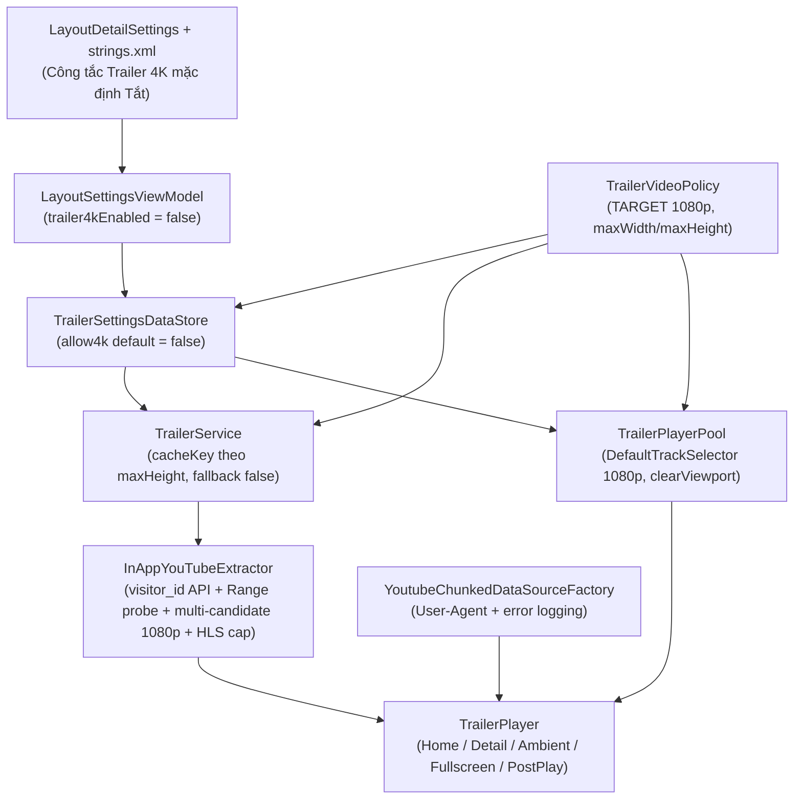

# PLAN: Mặc định phát Trailer 1080p & Khắc phục lỗi tụt độ phân giải thấp (`trailer-default-1080p`)

> [!IMPORTANT]
> Kế hoạch này chỉ phục vụ chiến lược thiết kế trước khi viết mã nguồn (tuân thủ quy trình `/plan`). Mọi quyết định về chính sách chất lượng (mặc định khóa **1080p**, vẫn giữ công tắc **Trailer 4K** ở trạng thái mặc định **Tắt**; hạ bậc trên đúng video gốc `1080p → 720p → 480p → 360p` và giữ nguyên thứ tự xếp hạng TMDB; áp dụng đồng bộ cho mọi khu vực Home, Trang chi tiết, Ambient Mode và Toàn màn hình) đã được thống nhất với người dùng.

---

## 1. Phân tích nguyên nhân gốc rễ (Root-Cause Analysis)

Qua kiểm tra mã nguồn và thực nghiệm trực tiếp với API YouTube Innertube, hiện tượng trailer bị tụt xuống độ phân giải rất thấp (thậm chí **360p**) xuất phát từ **4 nguyên nhân kết hợp**:

1. **Lỗi OkHttp `.headers(...)` xóa sạch `Range: bytes=0-0` trong `InAppYouTubeExtractor.isUrlReachable()`** (`InAppYouTubeExtractor.kt:1027-1032`):
   - Code gọi `.header("Range", "bytes=0-0")` rồi gọi tiếp `.headers(buildHeaders(DEFAULT_HEADERS))` — trong OkHttp, `.headers(...)` **thay thế toàn bộ header trước đó**, làm mất hoàn toàn header `Range`.
   - Kiểm chứng thực tế: mọi luồng Adaptive 1080p/4K (`itag=137`, `itag=313`) và Audio (`itag=140`, `itag=251`) của client `android` và `ios` đều trả **HTTP 403 Forbidden** khi không có `Range`, nhưng trả **HTTP 206** khi có `Range: bytes=0-0`.
   - Trong khi đó, luồng Progressive `itag=18` (**640×360 — 360p**) lại trả **HTTP 200** kể cả khi không có `Range`. Ngoài ra, việc bỏ mất `Range: bytes=0-0` khiến request probe kéo cả file thay vì 1 byte, dễ chạm ngưỡng timeout `2_000ms` trên mạng TV chậm.
2. **Mất `visitorData` bị cache 3 tiếng & làm chết client chính `visionos`** (`InAppYouTubeExtractor.kt:255-314`):
   - Khi trang `youtube.com/watch` trả về HTML không có `VISITOR_DATA` (trang đồng ý cookie/consent hoặc phản hồi rút gọn) nhưng vẫn HTTP 200, `ensureWatchConfig()` lưu `CachedConfig(visitorData = null)` với TTL **3 giờ (`CONFIG_TTL_MS`)**.
   - Kiểm chứng thực tế: khi thiếu `visitorData`, client `visionos` trả lỗi/không có stream; còn khi gọi `POST /youtubei/v1/visitor_id?key=...`, YouTube trả ngay `responseContext.visitorData` hợp lệ giúp `visionos` trả đủ **Adaptive 1080p + Audio + HLS 1080p**.
3. **Kẹt vào đúng 1 ứng viên Adaptive đầu tiên & lỗi ghép audio câm** (`InAppYouTubeExtractor.kt:496-504, 617-629, 961-967`):
   - Nhánh `ADAPTIVE` chỉ lấy **duy nhất 1 URL** từ `pickBestForClient(..., "visionos")`. Nếu URL đó thất bại `resolveReachableUrl()`, extractor không thử codec 1080p khác (`avc1` / `vp9` / `av01`).
   - Khi vòng fallback dòng 500 hỏi thêm `android` và `ios` rồi gọi lại `pickPlaybackSource()`, hàm `pickBestForClient(..., "visionos")` thấy vẫn còn ứng viên `visionos` trong danh sách nên **chọn lại đúng URL `visionos` vừa chết**, bỏ qua mọi ứng viên khác rồi rơi xuống `PROGRESSIVE` **360p**.
   - Ngoài ra, nếu `resolvedVideo != null` nhưng `resolvedAudio == null`, code vẫn trả về video không tiếng thay vì thử audio candidate khác hoặc chuyển sang `HLS_MANIFEST` (vốn luôn có sẵn 1080p kèm audio).
   - Lưu ý thực nghiệm quan trọng: luồng audio Adaptive của client `android`/`ios` bị YouTube trả **403** khi đọc dải byte dữ liệu lớn (`&range=0-10485759`), trong khi **cả video lẫn audio Adaptive và HLS 1080p của `visionos` hoạt động 100%**. Do đó, cần ưu tiên tối đa khôi phục `visitorData` cho `visionos` và ưu tiên **HLS 1080p** trước khi rơi xuống `PROGRESSIVE` 360p.
4. **Chính sách mặc định `allow4k` & cấu hình Track Selection trên `TrailerPlayerPool`**:
   - Hiện `TrailerVideoPolicy.default4kTrailers()` mặc định bật 4K trên máy > 2 GB RAM, chưa mặc định khóa mục tiêu **1080p**.
   - Khi phát qua `HLS_MANIFEST` (ví dụ nội dung trẻ em/COPPA hoặc khi Adaptive lỗi), HLS Master Playlist của YouTube đặt `426x240` lên đầu tiên. `TrailerPlayerPool` tuy có `setForceHighestSupportedBitrate(true)` và `setMaxVideoSize(...)`, nhưng chưa xóa cứng viewport constraint (`clearViewportSizeConstraints()`) cho khung trailer nhỏ (Expanded Card / Hero frame) và chưa cập nhật lại `trackSelectionParameters` tức thì khi người dùng bật/tắt công tắc 4K trong phiên chạy.

---

## 2. Mục tiêu rõ ràng (Clear Goals)

1. **Mặc định luôn ưu tiên phát Trailer ở 1080p trên mọi thiết bị và mọi màn hình**:
   - Đổi mặc định `TrailerVideoPolicy.default4kTrailers()` và `TrailerSettings.allow4k` thành **`false`** (trần mặc định **1080p**, tương đương khung `1920×1080` gồm cả tỷ lệ điện ảnh widescreen `1920×804`).
   - Giữ nguyên công tắc **Trailer 4K** (*Cài đặt → Giao diện → Trang chi tiết → Trailer*) ở trạng thái mặc định **Tắt** để người dùng nào muốn xem trailer > 1080p (1440p/2160p) vẫn tự bật được.
   - Áp dụng đồng bộ 100% qua trục chung `TrailerService → InAppYouTubeExtractor → TrailerPlayerPool → TrailerPlayer` cho tất cả các khu vực: **Trang chủ (Hero & Expanded Card)**, **Thư mục (FolderDetail)**, **Trang chi tiết (nền & toàn màn hình `SharedTrailerOverlay`)**, **Ambient Mode**, và **Post-Play Recommendation**.
2. **Hạ bậc có kiểm soát trên đúng video gốc khi không có 1080p**:
   - Luôn chọn đúng **1080p** cao nhất phát được (`avc1` H.264 / `vp9` / `av01` SDR tương thích decoder thiết bị); nếu video gốc YouTube không có bản 1080p, hạ bậc lần lượt `720p → 480p → 360p`.
   - Giữ nguyên hoàn toàn thuật toán xếp hạng video TMDB (`rankTmdbVideoCandidates`) hiện tại.
3. **Chặn triệt để mọi tình huống tụt oan xuống 360p**:
   - Sửa bug xóa header `Range: bytes=0-0` trong `isUrlReachable()`.
   - Tự động lấy `visitorData` qua endpoint Innertube `/youtubei/v1/visitor_id` khi watch page thiếu `VISITOR_DATA` và không bao giờ cache `visitorData = null` quá 10 phút.
   - Cho phép xoay vòng nhiều ứng viên Adaptive (video + audio đều phải reachable, tránh URL vừa lỗi, không kẹt `visionos`), ưu tiên `HLS_MANIFEST` 1080p trước `PROGRESSIVE` 360p.
   - Siết chặt `DefaultTrackSelector` của `TrailerPlayerPool` cho HLS (`1920×1080` khi tắt 4K, `clearViewportSizeConstraints()`, `setForceHighestSupportedBitrate(true)`, cập nhật động ngay khi đổi cài đặt).

---

## 3. Chuỗi phụ thuộc & Bản đồ tệp tác động (Dependency Chains & Impact Map)



> [!WARNING]
> **4 rủi ro kỹ thuật cần kiểm soát chặt khi triển khai**:
> 1. **Tương thích Unit Test & MockK trên `TrailerService` (`TrailerServiceYouTubeSessionCacheTest.kt`)**:
>    Các test cũ gọi `coEvery { extractor.extractPlaybackSource(any()) }` (1 tham số, dựa vào default `maxVideoHeight = Int.MAX_VALUE` của `InAppYouTubeExtractor.extractPlaybackSource`). Vì vậy, **phải giữ nguyên** default `maxVideoHeight: Int = Int.MAX_VALUE` trên chữ ký `InAppYouTubeExtractor.extractPlaybackSource(...)` và default `maxTrailerVideoHeight = { Int.MAX_VALUE }` trên constructor 7 tham số dùng cho test của `TrailerService`; chỉ đặt trần mặc định `1080` trong `trailerHeightCap(trailerSettingsDataStore)` (`@Inject constructor` dùng thực tế trong app).
> 2. **Video `android`/`ios` Adaptive có audio trả HTTP 403 trên chunk dữ liệu lớn**:
>    Qua thực nghiệm live, `android`/`ios` audio (`itag=140`, `itag=139`, `itag=249`) chỉ trả `206` cho `Range: bytes=0-0` nhưng trả **403** cho `range=0-10485759` hoặc `Range: bytes=0-10485759`. Vì vậy:
>    - Bắt buộc ưu tiên khôi phục `visitorData` cho `visionos` (cả Adaptive video/audio lẫn HLS đều trả 200 ổn định).
>    - Khi probe `isUrlReachable()` cho luồng audio của client không phải `visionos` (hoặc nói chung cho mọi Adaptive audio), kiểm tra bằng dải nhỏ thực tế (ví dụ `bytes=0-1023` hoặc query `&range=0-1023`) để phát hiện sớm audio bị chặn 403 ngay lúc trích xuất — nếu audio Adaptive bị 403, extractor lập tức chuyển sang **HLS 1080p** thay vì giao luồng lỗi cho ExoPlayer làm hỏng trailer!
> 3. **Không làm tăng số request YouTube khi bị Rate Limit (`YouTubeRateLimitGate`)**:
>    - Giữ nguyên nguyên tắc hỏi tuần tự bắt đầu từ `visionos`, chỉ gọi `/youtubei/v1/visitor_id` khi `watchConfig` thiếu `visitorData` (và vẫn chịu bảo vệ bởi `configMutex` + `rateLimitGate`).
>    - Giới hạn số lượng ứng viên Adaptive thử probe tối đa (ví dụ tối đa **3 video** và **2 audio** mỗi lần trích xuất) để không kéo dài thời gian khởi phát trailer và không gây spam CDN.
> 4. **Không ảnh hưởng trình phát chính `YouTubeStreamResolver` & giữ tương thích đồng bộ Profile**:
>    - `YouTubeStreamResolver` gọi `extractSingleUrl(youtubeUrl)` vẫn truyền `maxVideoHeight = Int.MAX_VALUE` (không ép trần 1080p lên video YouTube mở trong trình phát chính).
>    - Giữ nguyên khóa `trailer_allow_4k` trong `localOnlyTrailerProfileSettingsKeys` của `ProfileSettingsSyncService.kt` để không phá `ProfileSettingsCredentialPolicyTest`.

### Bảng tệp tác động

| Tệp mã nguồn | Loại | Thay đổi dự kiến |
|---|---|---|
| `app/src/main/java/com/nuvio/tv/core/player/TrailerVideoPolicy.kt` | Sửa | Đổi `default4kTrailers(context)` mặc định trả về `false` (ưu tiên 1080p trên mọi thiết bị); bổ sung hằng số `DEFAULT_TRAILER_HEIGHT = 1080` và helper `maxTrailerVideoWidth(maxHeight)`. |
| `app/src/main/java/com/nuvio/tv/data/local/TrailerSettingsDataStore.kt` | Sửa | Đổi giá trị mặc định `TrailerSettings.allow4k = false` để đồng bộ với `TrailerVideoPolicy`. |
| `app/src/main/java/com/nuvio/tv/data/trailer/TrailerService.kt` | Sửa | Đổi fallback trong `trailerHeightCap()` từ `.getOrDefault(true)` sang `.getOrDefault(false)` để lỗi đọc DataStore không âm thầm bật 4K. |
| `app/src/main/java/com/nuvio/tv/ui/screens/settings/LayoutSettingsViewModel.kt` | Sửa | Đổi giá trị khởi tạo `LayoutSettingsUiState.trailer4kEnabled = false` tránh nháy UI trước khi DataStore phát giá trị. |
| `app/src/main/res/values/strings.xml` & `app/src/main/res/values-vi/strings.xml` | Sửa | Cập nhật phụ đề `layout_trailer_4k_sub` (EN + VI) ghi rõ mặc định trailer luôn ở 1080p và công tắc này dùng để cho phép phát trên 1080p (4K). |
| `app/src/main/java/com/nuvio/tv/data/trailer/InAppYouTubeExtractor.kt` | Sửa | (1) Sửa bug `.headers(...)` xóa mất `Range: bytes=0-0` trong `isUrlReachable()` + tăng timeout probe lên `3_500ms`; (2) Bổ sung `fetchVisitorData()` gọi `/youtubei/v1/visitor_id` khi watch page thiếu `VISITOR_DATA` và không cache `visitorData = null` với TTL 3 tiếng; (3) Nâng cấp chọn Adaptive đa ứng viên (ưu tiên đúng trần 1080p, thử lần lượt codec/client, tránh lặp URL đã chết, yêu cầu cả video + audio đều reachable, probe dải audio thực tế `bytes=0-1023` chống 403 giả); (4) Truyền `maxVideoHeight` vào `pickBestManifest()` để chọn HLS manifest tốt nhất trong trần 1080p; (5) Bổ sung log chẩn đoán nguồn & độ phân giải đã chọn. |
| `app/src/main/java/com/nuvio/tv/data/trailer/YoutubeChunkedDataSourceFactory.kt` | Sửa | Gắn User-Agent chuẩn vào `DefaultHttpDataSource.Factory` và ghi log chẩn đoán rõ khi mở chunk đầu/kế tiếp gặp lỗi HTTP. |
| `app/src/main/java/com/nuvio/tv/core/player/TrailerPlayerPool.kt` | Sửa | Bỏ dòng thừa `.setMaxVideoSizeSd()`, thêm `clearViewportSizeConstraints()`, `setForceHighestSupportedBitrate(true)`, `setExceedVideoConstraintsIfNecessary(true)`, `setExceedRendererCapabilitiesIfNecessary(false)` trong `createPlayer()` & `applyVideoSizeCap()`; tự áp lại cap ngay trên `mainScope` khi `trailerSettingsDataStore` đổi `allow4k`. |
| `app/src/main/java/com/nuvio/tv/ui/components/TrailerPlayer.kt` | Sửa (nhẹ) | Thêm debug log `onVideoSizeChanged` (chỉ khi `BuildConfig.DEBUG`) để xác minh độ phân giải thực tế ExoPlayer giải mã ở mọi màn hình. |
| `app/src/test/java/com/nuvio/tv/data/trailer/InAppYouTubeExtractorVideoCapTest.kt` | Sửa | Mở rộng test cho chọn 1080p mặc định, hạ bậc `1080p → 720p → 480p → 360p`, ưu tiên `avc1`/`vp9` tương thích, bỏ qua URL chết sang ứng viên kế tiếp, và `pickAdaptiveCandidates` không bị kẹt client cũ. |
| `app/src/test/java/com/nuvio/tv/data/trailer/InAppYouTubeExtractorProbeAndVisitorTest.kt` | Mới | Dùng `MockWebServer` kiểm chứng `isUrlReachable()` gửi đúng header `Range`, `fetchVisitorData()` khôi phục `visitorData` từ `/youtubei/v1/visitor_id` khi watch page thiếu, và không cache `visitorData = null` suốt 3 giờ. |
| `app/src/test/java/com/nuvio/tv/core/player/TrailerVideoPolicyTest.kt` | Mới | Kiểm chứng `default4kTrailers` mặc định `false`, `maxTrailerVideoHeight(false) == 1080`, `maxTrailerVideoWidth(1080) == 1920`, `maxTrailerVideoHeight(true) == Int.MAX_VALUE`. |

---

## 4. Phân rã theo giai đoạn & Phân bổ tác vụ (Phase-by-Phase Breakdown)

### Giai đoạn 1: Chính sách mặc định 1080p, DataStore & Giao diện Cài đặt (`Policy & Settings`)
- **[TR1080-01]** Cập nhật `TrailerVideoPolicy.kt`, `TrailerSettingsDataStore.kt`, `TrailerService.kt`, `LayoutSettingsViewModel.kt`, `values/strings.xml`, `values-vi/strings.xml`:
  - Đặt `TrailerVideoPolicy.default4kTrailers(context)` luôn trả về `false` và cung cấp helper `maxTrailerVideoWidth(maxHeight: Int)`.
  - Đồng bộ mặc định `allow4k = false` ở `TrailerSettings`, `trailerHeightCap()` fallback `.getOrDefault(false)`, và `LayoutSettingsUiState.trailer4kEnabled = false`.
  - Cập nhật chuỗi mô tả `layout_trailer_4k_sub` (EN + VI) rõ ràng rằng mặc định trailer luôn ở **1080p**, chỉ bật công tắc nếu muốn lên 4K.

### Giai đoạn 2: Sửa gốc rễ trích xuất YouTube 1080p (`Extractor Core`)
- **[TR1080-02]** Sửa lỗi probe header `Range` & khôi phục `visitorData` trong `InAppYouTubeExtractor.kt`:
  - Sửa `isUrlReachable(url, probeRangeBytes)` bằng cách gọi `.header("Range", "bytes=0-$probeRangeBytes")` **sau** `.headers(buildHeaders(DEFAULT_HEADERS))` (hoặc đưa vào `buildHeaders`), tách hằng số `VIDEO_PROBE_END_BYTE = 0` và `AUDIO_PROBE_END_BYTE = 1023` (để phát hiện sớm audio bị chặn 403 trên dải byte thực).
  - Tăng timeout `resolveReachableUrl()` từ `2_000L` lên `3_500L` và xử lý ổn định khi `mn` chỉ có 1 server (vẫn probe nhanh để tránh giao URL 403 cho ExoPlayer).
  - Trong `ensureWatchConfig()`: thêm bước gọi `fetchVisitorData(apiKey)` tới `https://www.youtube.com/youtubei/v1/visitor_id?key=...` mỗi khi watch page thất bại hoặc không chứa `VISITOR_DATA`; nếu vẫn không có `visitorData` thì chỉ cache với `FALLBACK_CONFIG_TTL_MS` (10 phút) thay vì `CONFIG_TTL_MS` (3 giờ).
- **[TR1080-03]** Nâng cấp thuật toán chọn đa ứng viên Adaptive 1080p & HLS cap trong `InAppYouTubeExtractor.kt`:
  - Tách hàm thuần (dễ unit test) `rankAdaptiveVideos(items, maxVideoHeight, preferredClient, failedUrls)` và `rankAdaptiveAudios(items, preferredClient, failedUrls)`:
    - Lọc `playableVideo()` → `capVideoHeight(..., maxVideoHeight)` (với `1080`, giữ mọi luồng `<= 1920×1080`, hạ dần `1080p → 720p → 480p → 360p` khi video gốc không có 1080p).
    - Không bao giờ lặp lại URL đã nằm trong `failedUrls`.
    - Thử tối đa 3 ứng viên video đầu tiên, với mỗi video reachable sẽ tìm audio reachable tương ứng (ưu tiên cùng client, tối đa 2 ứng viên audio). Nếu không có cặp `(video, audio)` cùng reachable, không trả video câm mà rơi sang bước tiếp theo (`HLS_MANIFEST` 1080p trước, rồi mới tới `PROGRESSIVE`).
  - Trong `extractPlaybackSourceInternal()`:
    - Nếu vòng đầu (`visionos`) không tìm được nguồn phát hợp lệ, đánh dấu URL lỗi vào `failedUrls`, truy vấn các client còn lại và chạy lại `pickPlaybackSource()` mà không bị kẹt vào URL `visionos` đã chết.
  - Cập nhật `pickBestManifest(manifestUrls, maxVideoHeight)` để đánh giá biến thể tốt nhất nằm trong trần `<= maxVideoHeight` (`1080p`) thay vì ưu tiên vô điều kiện 4K khi đang khóa 1080p.
  - Bổ sung log chẩn đoán rõ loại nguồn (`ADAPTIVE` / `HLS_MANIFEST` / `PROGRESSIVE`), `client`, `width×height`, `fps`, `itag`, `codecs`.

### Giai đoạn 3: Khóa Track Selection 1080p trên `TrailerPlayerPool`, Gia cố DataSource & Khắc phục Mờ Ambient Mode (`Playback Engine`)
- **[TR1080-04]** Nâng cấp `TrailerPlayerPool.kt`, `YoutubeChunkedDataSourceFactory.kt` và debug log `TrailerPlayer.kt`:
  - Trong `TrailerPlayerPool.createPlayer()` và `applyVideoSizeCap()`:
    - Xóa `.setMaxVideoSizeSd()` thừa; áp dụng rõ `clearViewportSizeConstraints()`, `setForceHighestSupportedBitrate(true)`, `setMaxVideoSize(maxWidth, maxHeight)`, `setExceedVideoConstraintsIfNecessary(true)`, `setExceedRendererCapabilitiesIfNecessary(false)`.
    - Khi `trailerSettingsDataStore.settings` phát giá trị `allow4k` mới, chủ động gọi `mainScope.launch { _player?.let(::applyVideoSizeCap) }` để có hiệu lực ngay lập tức.
  - Trong `YoutubeChunkedDataSourceFactory.kt`:
    - Đặt User-Agent trình duyệt chuẩn trên `DefaultHttpDataSource.Factory` và log cảnh báo rõ khi `open()`/`openNextChunk()` gặp lỗi HTTP (403/timeout).
  - Trong `TrailerPlayer.kt`:
    - Bổ sung `onVideoSizeChanged(videoSize)` chỉ log khi `BuildConfig.DEBUG` (`Log.d("TrailerPlayer", "Playing trailer video size: ${videoSize.width}x${videoSize.height}")`) để dễ kiểm chứng độ phân giải thực tế trên mọi màn hình.
- **[TR1080-05]** Khắc phục hiện tượng mờ trailer trong Ambient Mode (`AmbientSlideshow.kt`):
  - Vô hiệu hóa việc phóng to ảnh nội suy trên `TextureView` trong `AmbientSlideshow` bằng cách tắt `cropToFill = false` và `autoCropLetterbox = false`, `detectLetterbox = false`; giữ nguyên độ phân giải 1:1 pixel native 1080p của YouTube.
  - Tách biệt lớp video với ảnh nền tĩnh bằng công thức alpha `backdropAlpha.value * (1f - videoAlpha.value)` và `CompositingStrategy.ModulateAlpha` tránh làm đục màu video khi fade in.

### Giai đoạn 4: Kiểm thử tự động & Nghiệm thu (`Testing & Verification`)
- **[TR1080-06]** Viết & cập nhật Unit Tests:
  - Tạo `TrailerVideoPolicyTest.kt`.
  - Tạo `InAppYouTubeExtractorProbeAndVisitorTest.kt` (dùng `MockWebServer` kiểm tra header `Range` trong probe, fallback `/youtubei/v1/visitor_id`, và TTL cache khi thiếu `visitorData`).
  - Mở rộng `InAppYouTubeExtractorVideoCapTest.kt` (test chọn 1080p mặc định, hạ dần `720p → 480p → 360p`, loại bỏ URL trong `failedUrls`, xoay ứng viên khi URL đầu lỗi, không kẹt `visionos`).
- **[TR1080-07]** Chạy toàn bộ bộ test liên quan & kiểm tra biên dịch cả 2 build flavor (`full` & `playstore`).

---

## 5. Kế hoạch kiểm chứng (Verification Plan)

### A. Kiểm chứng tự động (Automated)
1. Chạy toàn bộ Unit Test của hệ thống Trailer, YouTube Stream và Profile Sync:
   ```powershell
   .\gradlew.bat :app:testFullDebugUnitTest --tests "com.nuvio.tv.data.trailer.*" --tests "com.nuvio.tv.core.player.TrailerVideoPolicyTest" --tests "com.nuvio.tv.core.streams.YouTubeStreamResolverTest" --tests "com.nuvio.tv.core.sync.ProfileSettingsCredentialPolicyTest" --tests "com.nuvio.tv.ui.screens.ambient.AmbientTrailerResolverTest"
   ```
2. Xác minh biên dịch sạch trên cả 2 build flavor (`full` và `playstore`):
   ```powershell
   .\gradlew.bat :app:compileFullDebugKotlin :app:compilePlaystoreDebugKotlin
   ```

### B. Kiểm chứng thủ công trên Android TV / Emulator (Manual)
1. **Kiểm tra mặc định Cài đặt**:
   - Mở *Cài đặt → Giao diện → Trang chi tiết → Trailer* trên profile mới/chưa chỉnh tay: xác nhận công tắc **Trailer 4K** mặc định ở trạng thái **Tắt** với mô tả mới (ưu tiên 1080p).
2. **Kiểm tra độ phân giải thực tế qua Logcat trên cả 4 khu vực**:
   - Lọc logcat theo tag `InAppYouTubeExtractor|TrailerPlayer|TrailerPlayerPool`:
     - **Trang chủ (Hero & Expanded Card)**: xác nhận log chọn `ADAPTIVE` `1920x1080` (hoặc `1920x804` widescreen) kèm `audioPresent=true`, và `Playing trailer video size: 1920x1080`.
     - **Trang chi tiết (nền & bấm nút Trailer toàn màn hình)**: xác nhận chạy đúng **1080p**, kể cả khi handoff từ Home sang Chi tiết không bị tụt độ phân giải.
     - **Ambient Mode (chế độ Trailer)**: xác nhận trailer toàn màn hình chạy sắc nét **1080p**.
     - **Phim cũ chỉ có 720p/480p trên YouTube**: xác nhận tự hạ bậc mượt về `1280x720` hoặc `854x480` và phát bình thường có tiếng.
3. **Kiểm tra chuyển đổi bật/tắt 4K**:
   - Bật **Trailer 4K** → mở lại trailer có bản 4K (ví dụ *Superman* / *Inside Out 2*) → xác nhận có thể lên `3840x2160` (nếu decoder hỗ trợ); tắt lại **Trailer 4K** → lập tức quay về khóa **1080p** mà không cần khởi động lại ứng dụng (nhờ `cacheKey` chứa `maxHeight` và `applyVideoSizeCap` cập nhật động).
4. **Kiểm tra khả năng chống tụt 360p**:
   - Với trailer COPPA/trẻ em hoặc khi mô phỏng `visionos` fallback sang HLS: xác nhận phát qua `HLS_MANIFEST` khóa ở `1920x1080`, không tụt về `240p/360p`.
