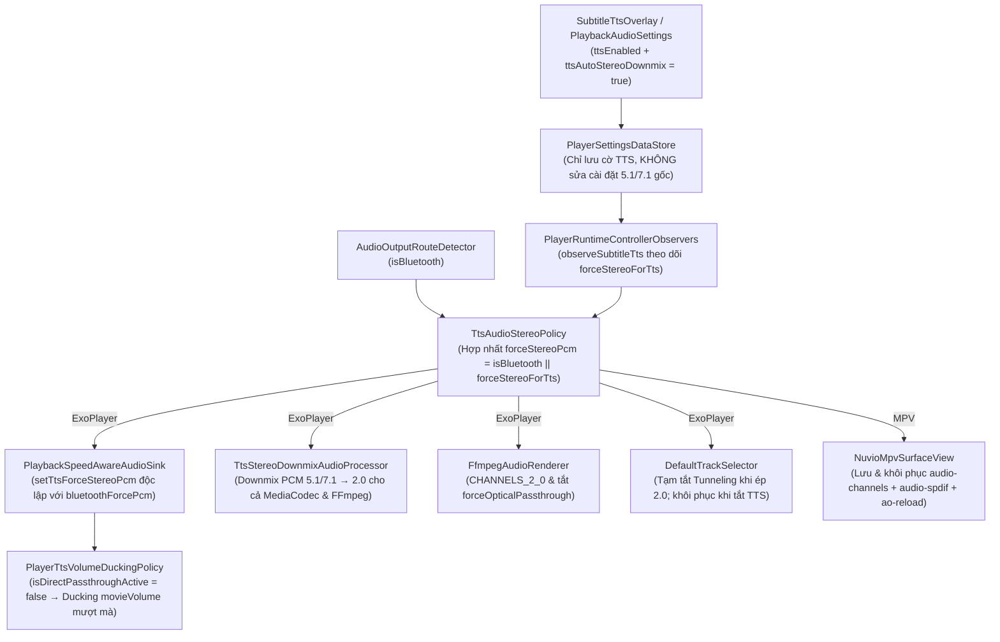

# PLAN: Tự Động Chuyển Kênh Âm Thanh Về Stereo 2.0 Khi Bật Thuyết Minh (TTS) & Trả Lại Kênh Gốc Khi Tắt

> [!IMPORTANT]
> **Trạng thái**: Kế hoạch chiến lược chờ duyệt (`STRATEGY PLAN` — **chưa thay đổi bất kỳ tệp mã nguồn nào**).  
> **Kết luận tính khả thi**: **HOÀN TOÀN LÀM ĐƯỢC VÀ RẤT MƯỢT** trên cả **ExoPlayer** lẫn **MPV**, hỗ trợ chuyển đổi nóng tại chỗ (*In-Place Hot-Switch*) mà **không cần tải lại hay gián đoạn video** ở hầu hết mọi cấu hình, đồng thời **bảo toàn 100%** cài đặt âm thanh đa kênh (5.1 / 7.1 / Passthrough) gốc của người dùng khi tắt thuyết minh.

---

## 1. Tại Sao Hiện Tại Phải Chuyển Về 2.0 Mới Nghe Được Thuyết Minh?

Khi phát phim âm thanh vòm trên Android TV / TV Box (nối TV, Soundbar hoặc AVR qua HDMI/Optical):
1. **Xung đột trộn âm ở tầng Android `AudioFlinger`**:
   - Khi ExoPlayer hoặc MPV mở luồng **Bitstream Passthrough** (AC3, EAC3, Dolby Atmos, TrueHD, DTS, DTS-HD) hoặc **Direct Multi-channel PCM (5.1/7.1)**, luồng âm thanh chiếm kênh xuất trực tiếp nên `AudioFlinger` **không trộn được** luồng giọng nói PCM của `GoogleOfflineTtsEngine` (`USAGE_MEDIA`, `CONTENT_TYPE_SPEECH`) → tiếng thuyết minh bị câm hoặc đứt quãng.
2. **Không thể giảm âm lượng phim nền (`Audio Ducking`)**:
   - Ở chế độ passthrough, [PlayerTtsVolumeDuckingPolicy.kt](file:///f:/MyGithub/NuvioTV-Fast/app/src/main/java/com/nuvio/tv/ui/screens/player/PlayerTtsVolumeDuckingPolicy.kt) buộc phải giữ mức âm lượng `1.0f` (không thể giảm `movieVolume`) để tránh hỏng khung bitstream.
3. **Nền tảng sẵn có trong codebase**:
   - Dự án đã có sẵn cơ chế hot-switch Stereo 2.0 cho tai nghe Bluetooth trong [PlaybackSpeedAwareAudioSink.kt](file:///f:/MyGithub/NuvioTV-Fast/app/src/main/java/com/nuvio/tv/ui/screens/player/PlaybackSpeedAwareAudioSink.kt), [PlayerRuntimeControllerAudioDelayRoutes.kt](file:///f:/MyGithub/NuvioTV-Fast/app/src/main/java/com/nuvio/tv/ui/screens/player/PlayerRuntimeControllerAudioDelayRoutes.kt) và [NuvioMpvSurfaceView.kt](file:///f:/MyGithub/NuvioTV-Fast/app/src/main/java/com/nuvio/tv/ui/screens/player/NuvioMpvSurfaceView.kt). Tuy nhiên, để hoạt động hoàn hảo cho TTS mà **trả lại đúng kênh gốc khi tắt**, cần bổ sung 4 mảnh ghép kiến trúc then chốt bên dưới.

---

## 2. Mục Tiêu & Nguyên Tắc Thiết Kế (Clear Goals)

1. **Khi bật Thuyết minh (`ttsEnabled = true`)** *(cùng công tắc `ttsAutoStereoDownmix` mặc định **BẬT**)*:
   - Tạm thời tắt toàn bộ Passthrough (HDMI / Optical / IEC / Offload) và trộn mọi nguồn âm thanh đa kênh (3.0, 4.0, 5.1, 7.1, Atmos, TrueHD, DTS, DTS-HD, LPCM đa kênh) xuống đúng **PCM Stereo 2.0**.
   - Áp dụng trên **cả 2 trình phát**: **ExoPlayer** (mọi bộ giải mã MediaCodec & FFmpeg) và **MPV**.
   - Tự động mở khóa cơ chế giảm âm lượng phim nền (`movieVolume` ducking) khi giọng thuyết minh đang đọc.
2. **Khi tắt Thuyết minh (`ttsEnabled = false`)**:
   - Tự động trả về **nguyên trạng 100%** kênh âm thanh gốc (5.1 / 7.1 / Passthrough AC3 / EAC3 / Atmos / TrueHD / DTS / DTS-HD / Optical / cấu hình Downmix người dùng đặt sẵn).
   - **Không bao giờ ghi đè cài đặt gốc trong `PlayerSettingsDataStore`**: Mọi thay đổi sang 2.0 chỉ là *runtime override* tạm thời theo trạng thái TTS — nếu app đóng đột ngột hoặc đổi phim, cài đặt 5.1/7.1 gốc của bạn vẫn còn nguyên vẹn tuyệt đối.
3. **Không xung đột với Bluetooth & Tự động dò HDMI**:
   - Nếu đang nghe qua tai nghe Bluetooth rồi bật/tắt TTS → vẫn giữ Stereo 2.0 cho Bluetooth, không chuyển nhầm sang passthrough.
   - Khi TTS đang bật, bộ tự dò HDMI (`rebuildForReturnedPassthroughIfNeeded` / `applySurroundResolutionInPlace`) không được phá ngang để kéo âm thanh ngược về bitstream.

---

## 3. Kiến Trúc Giải Pháp & Luồng Phụ Thuộc (Architecture & Dependency Chains)



> [!WARNING]
> **4 Bẫy Kỹ Thuật Quan Trọng Đã Được Tính Trước Trong Thiết Kế**:
> 1. **MediaCodec vẫn xuất PCM 5.1/7.1 nếu không có AudioProcessor chung**: Khi người dùng để `decoderPriority = 1` (mặc định) và xem phim AAC 5.1 / EAC3 5.1 / LPCM 7.1, `MediaCodecAudioRenderer` có thể giải mã ra PCM 6–8 kênh mà không đi qua `FfmpegAudioRenderer`. Do đó, **`TtsStereoDownmixAudioProcessor`** (gắn ngay đầu chuỗi `AudioProcessor` trong `DefaultAudioSink`) đảm bảo **100% đầu ra luôn là Stereo 2.0** kể cả từ MediaCodec; khi tắt TTS hoặc khi đầu vào đã là ≤ 2 kênh, processor tự tắt (`isActive() == false`) với **0% chi phí CPU**.
> 2. **Giữ nguyên `AudioCapabilities` thật của HDMI/TV khi mở phim lúc TTS đang bật**: Khác với Bluetooth (vốn pin cứng `bluetoothPcmOnlyCapabilities()`), khi mở phim mới lúc TTS đang bật trên HDMI/TV, `DefaultAudioSink` **vẫn giữ `AudioCapabilities` gốc của TV/AVR** và chỉ chặn passthrough ở lớp `PlaybackSpeedAwareAudioSink.ttsForceStereoPcm = true`. Nhờ đó, khi tắt TTS giữa phim, Passthrough 5.1/7.1/Atmos/DTS-HD sẽ **phục hồi tức thì tại chỗ mà không phải rebuild ExoPlayer**.
> 3. **Trường hợp đặc biệt: `Tunneled Playback` hoặc `decoderPriority == 0` (tắt hoàn toàn FFmpeg)**:
>    - Nếu đang bật **Tunneling**: tạm tắt `setTunnelingEnabled(false)` trên `trackSelector` khi TTS ép 2.0 (vì AudioProcessor đổi số kênh không tương thích tunneling trên một số SoC Amlogic/Shield), và khôi phục lại `tunnelingActive` ngay khi tắt TTS.
>    - Nếu `decoderPriority == 0` (chỉ dùng MediaCodec) và phim đang phát **TrueHD / DTS / DTS-HD** (codec không có bộ giải mã MediaCodec phần cứng):
>      - Lúc khởi tạo phim mới khi TTS đã bật: tự nâng `effectiveDecoderPriority = EXTENSION_RENDERER_MODE_ON` (`preferSoftwareAudioOnly = true`) để `FfmpegAudioRenderer` sẵn sàng giải mã.
>      - Nếu bật TTS giữa phim lúc `cachedDecoderPriority == 0` trên track TrueHD/DTS: thực hiện fallback khôi phục mượt `scheduleOwnedPlaybackRecovery(currentPosition, 0L)` đúng tại giây đang xem để gắn FFmpeg giải mã ra 2.0 (với `decoderPriority` mặc định `1` hoặc `2`, chuyển đổi diễn ra **100% tại chỗ không rebuild**).
> 4. **Khôi phục `audio-spdif` gốc trên MPV**: Hàm `applyBluetoothAudioRoute` hiện tại trên [NuvioMpvSurfaceView.kt](file:///f:/MyGithub/NuvioTV-Fast/app/src/main/java/com/nuvio/tv/ui/screens/player/NuvioMpvSurfaceView.kt#L504-L521) chỉ xóa `audio-spdif = ""` mà chưa lưu lại giá trị gốc trước khi xóa. Kế hoạch sẽ lưu lại `originalAudioChannels` & `originalAudioSpdif` trước lần ép 2.0 đầu tiên và khôi phục chính xác + `ao-reload` khi tắt TTS (và không đang dùng Bluetooth).

---

## 4. Quy Trình Thực Thi Từng Giai Đoạn (Phase-by-Phase Breakdown)

### Phase 1: Tầng Chính Sách Thuần & Bộ Trộn DSP Stereo 2.0 (`TTS20-01`, `TTS20-02`)
- **Tạo mới `TtsAudioStereoPolicy.kt`** (`app/src/main/java/com/nuvio/tv/ui/screens/player/TtsAudioStereoPolicy.kt`):
  - Hàm thuần `resolveEffectiveAudioOutput(...)`: nhận `isBluetooth`, `ttsEnabled`, `ttsAutoStereoDownmix`, `settings: PlayerSettings`, `lastSurround: SurroundResolveResult?`, `cachedDecoderPriority`, `activeAudioMimeType` → trả về cấu hình đích (`forcePcm`, `forceStereoDownmix`, `downmixEnabled`, `audioOutputChannels`, `forceOpticalPassthrough`, `deniedTranscodeMimes`, `disableTunneling`, `requiresRebuildForSoftwareDecoder`).
  - Quy tắc bất biến: `forceStereoForTts = ttsEnabled && ttsAutoStereoDownmix`; `forceStereoPcm = isBluetooth || forceStereoForTts`.
- **Tạo mới `TtsStereoDownmixAudioProcessor.kt`** (`app/src/main/java/com/nuvio/tv/ui/screens/player/TtsStereoDownmixAudioProcessor.kt`):
  - Kế thừa `BaseAudioProcessor`, có biến `@Volatile private var enabled: Boolean = false` và phương thức `setEnabled(enabled: Boolean): Boolean`.
  - Hỗ trợ `C.ENCODING_PCM_16BIT` và `C.ENCODING_PCM_FLOAT`; chỉ kích hoạt khi `enabled && inputAudioFormat.channelCount > 2` (xuất `AudioFormat(sampleRate, 2, encoding)`).
  - Áp dụng ma trận downmix ITU-R BS.775 chuẩn (3ch, 4ch, 5ch, 5.1=6ch, 7.1=8ch, tổng quát cho N kênh) kèm chống clipping mềm (`coerceIn`), **không cấp phát object tạm trong `queueInput`**.

### Phase 2: Tích Hợp ExoPlayer Hot-Switch & Khôi Phục Kênh Gốc (`TTS20-03`, `TTS20-04`)
- **[PlaybackSpeedAwareAudioSink.kt](file:///f:/MyGithub/NuvioTV-Fast/app/src/main/java/com/nuvio/tv/ui/screens/player/PlaybackSpeedAwareAudioSink.kt)**:
  - Thêm cờ độc lập `ttsForceStereoPcm: Boolean` + `setTtsForceStereoPcm(enabled: Boolean): Boolean` và `isTtsForceStereoPcm(): Boolean`.
  - Cập nhật `shouldRejectDirectPlayback(format)` và `setPlaybackParameters(...)` để `ttsForceStereoPcm` ép PCM độc lập với `bluetoothForcePcm` và `playbackSpeed`; khi `setTtsForceStereoPcm(false)` mà `!bluetoothForcePcm && !startedWithForcedPcm && playbackSpeed == 1f`, mở khóa lại passthrough ngay lập tức.
- **[PlayerRuntimeController.kt](file:///f:/MyGithub/NuvioTV-Fast/app/src/main/java/com/nuvio/tv/ui/screens/player/PlayerRuntimeController.kt)** & **[PlayerRuntimeControllerInitialization.kt](file:///f:/MyGithub/NuvioTV-Fast/app/src/main/java/com/nuvio/tv/ui/screens/player/PlayerRuntimeControllerInitialization.kt)**:
  - Khai báo `internal val ttsStereoDownmixAudioProcessor = TtsStereoDownmixAudioProcessor()` cạnh `gainAudioProcessor` & `nightModeAudioProcessor`.
  - Gắn `setAudioProcessors(arrayOf(ttsStereoDownmixAudioProcessor, gainAudioProcessor, nightModeAudioProcessor))` trong `SubtitleOffsetRenderersFactory.buildAudioSink(...)`.
  - Tại startup ExoPlayer: tính `forceStereoForTts = playerSettings.ttsEnabled && playerSettings.ttsAutoStereoDownmix`; truyền `ttsForceStereoPcm = forceStereoForTts` vào `PlaybackSpeedAwareAudioSink`, cấu hình `ttsStereoDownmixAudioProcessor.setEnabled(forceStereoForTts)`, giữ nguyên `AudioCapabilities` thật của TV/HDMI khi `!isBluetoothAudioOutput`, và tắt tạm tunneling / đảm bảo có FFmpeg decoder nếu `decoderPriority == 0`.
- **[PlayerRuntimeControllerAudioDelayRoutes.kt](file:///f:/MyGithub/NuvioTV-Fast/app/src/main/java/com/nuvio/tv/ui/screens/player/PlayerRuntimeControllerAudioDelayRoutes.kt)**, **[PlayerRuntimeControllerSurroundResolve.kt](file:///f:/MyGithub/NuvioTV-Fast/app/src/main/java/com/nuvio/tv/ui/screens/player/PlayerRuntimeControllerSurroundResolve.kt)** & **[PlayerRuntimeControllerObservers.kt](file:///f:/MyGithub/NuvioTV-Fast/app/src/main/java/com/nuvio/tv/ui/screens/player/PlayerRuntimeControllerObservers.kt)**:
  - Tạo hàm hợp nhất `applyEffectiveAudioStereoModeInPlace(reason: String)` dùng chung cho cả Bluetooth lẫn TTS (cập nhật `sink`, `ttsStereoDownmixAudioProcessor`, `ffmpegAudioRenderer`, `trackSelector` tunneling/reselect, và đồng bộ `isDirectPassthroughActive` + `PlayerTtsVolumeDuckingPolicy`).
  - Trong `observeSubtitleTts()`: theo dõi thay đổi `config.shouldForceStereoDownmix` (bỏ qua phát xạ khởi tạo trùng trạng thái) → gọi `applyEffectiveAudioStereoModeInPlace("tts_toggle")`.
  - Guard `!isTtsStereoForceActive()` trong `rebuildForReturnedPassthroughIfNeeded(...)` và `applySurroundResolutionInPlace(...)`; khi tắt TTS về kênh gốc, kích hoạt khôi phục `lastAppliedSurroundResolve` và `schedulePassthroughReturnCheck("tts disabled")` nếu cần.

### Phase 3: Tích Hợp MPV Hot-Switch & Khôi Phục Kênh Gốc (`TTS20-05`)
- **[NuvioMpvSurfaceView.kt](file:///f:/MyGithub/NuvioTV-Fast/app/src/main/java/com/nuvio/tv/ui/screens/player/NuvioMpvSurfaceView.kt)** & **[PlayerRuntimeControllerMpv.kt](file:///f:/MyGithub/NuvioTV-Fast/app/src/main/java/com/nuvio/tv/ui/screens/player/PlayerRuntimeControllerMpv.kt)**:
  - Lưu trữ `originalAudioChannels` và `originalAudioSpdif` trước lần ép 2.0 đầu tiên.
  - Tổng quát hóa `applyBluetoothAudioRoute` → `applyStereoPcmOverride(forceStereo: Boolean, reloadOutput: Boolean = false)` (giữ wrapper tương thích cho Bluetooth): khi `forceStereo = true` đặt `audio-channels = "stereo"` + `audio-spdif = ""`; khi `forceStereo = false` khôi phục `audio-channels` & `audio-spdif` gốc và gọi `reloadAudioOutput()`, sau đó re-pin `audioDelayMs`, `audioAmplificationDb`, `duckingVolumeScale` và trạng thái `pause`.
  - Tại `initializeMpvPlayer(...)`: áp dụng `forceStereo = (currentAudioOutputRoute?.isBluetooth == true) || isTtsStereoForceActive()`.

### Phase 4: Lưu Trữ Cài Đặt & Giao Diện Tùy Chọn (`TTS20-06`)
- **[SubtitleTtsModels.kt](file:///f:/MyGithub/NuvioTV-Fast/app/src/main/java/com/nuvio/tv/core/tts/SubtitleTtsModels.kt)**: Thêm `val autoStereoDownmix: Boolean = true` và `val shouldForceStereoDownmix: Boolean get() = enabled && autoStereoDownmix`.
- **[PlayerSettingsDataStore.kt](file:///f:/MyGithub/NuvioTV-Fast/app/src/main/java/com/nuvio/tv/data/local/PlayerSettingsDataStore.kt)**: Thêm `ttsAutoStereoDownmix: Boolean = true`, key `tts_auto_stereo_downmix` và setter `setTtsAutoStereoDownmix(enabled: Boolean)`.
- **[PlayerUiState.kt](file:///f:/MyGithub/NuvioTV-Fast/app/src/main/java/com/nuvio/tv/ui/screens/player/PlayerUiState.kt)**, **[PlayerRuntimeControllerPlaybackEvents.kt](file:///f:/MyGithub/NuvioTV-Fast/app/src/main/java/com/nuvio/tv/ui/screens/player/PlayerRuntimeControllerPlaybackEvents.kt)**, **[PlayerScreen.kt](file:///f:/MyGithub/NuvioTV-Fast/app/src/main/java/com/nuvio/tv/ui/screens/player/PlayerScreen.kt)**, **[SubtitleTtsOverlay.kt](file:///f:/MyGithub/NuvioTV-Fast/app/src/main/java/com/nuvio/tv/ui/screens/player/SubtitleTtsOverlay.kt)**, **[PlaybackAudioSettings.kt](file:///f:/MyGithub/NuvioTV-Fast/app/src/main/java/com/nuvio/tv/ui/screens/settings/PlaybackAudioSettings.kt)**, **[PlaybackSettingsViewModel.kt](file:///f:/MyGithub/NuvioTV-Fast/app/src/main/java/com/nuvio/tv/ui/screens/settings/PlaybackSettingsViewModel.kt)**, **[strings.xml](file:///f:/MyGithub/NuvioTV-Fast/app/src/main/res/values/strings.xml)** & **[strings.xml (vi)](file:///f:/MyGithub/NuvioTV-Fast/app/src/main/res/values-vi/strings.xml)**:
  - Thêm công tắc **"Tự động chuyển âm thanh về 2.0"** (EN: *"Auto switch audio to 2.0 Stereo"*) mặc định **BẬT** ở cả bảng TTS trong Player lẫn mục Cài đặt Phát lại.

### Phase 5: Kế Hoạch Kiểm Chứng Tự Động & Thủ Công (`TTS20-07`)
1. **Kiểm thử tự động (Unit Tests — Red → Green)**:
   - Tạo `TtsStereoDownmixAudioProcessorTest.kt`: kiểm chứng ma trận downmix 5.1 (6ch) & 7.1 (8ch) → 2.0 cho cả `PCM_16BIT` và `PCM_FLOAT`, không tràn biên (anti-clipping), không xử lý khi tắt hoặc khi nguồn ≤ 2 kênh.
   - Tạo `TtsAudioStereoPolicyTest.kt`: kiểm chứng toàn bộ ma trận kết hợp `TTS ON/OFF`, `Bluetooth ON/OFF`, `autoStereoDownmix ON/OFF`, `Tunneling ON/OFF`, `decoderPriority 0/1/2`, `SurroundResolve 5.1/7.1` và đảm bảo khôi phục 100% cấu hình gốc khi tắt TTS.
   - Tạo `PlaybackSpeedAwareAudioSinkTtsTest.kt`: kiểm chứng `setTtsForceStereoPcm(true)` từ chối passthrough AC3/EAC3/TrueHD/DTS/DTS-HD, không xung đột với `setBluetoothForcePcm`, và `setTtsForceStereoPcm(false)` trả về trạng thái passthrough ban đầu.
   - Lệnh xác minh:
     ```powershell
     .\gradlew.bat :app:compileFullDebugKotlin :app:compilePlaystoreDebugKotlin :app:testFullDebugUnitTest `
       --tests "com.nuvio.tv.core.tts.*" `
       --tests "com.nuvio.tv.ui.screens.player.Tts*" `
       --tests "com.nuvio.tv.ui.screens.player.PlaybackSpeedAwareAudioSink*" `
       --tests "com.nuvio.tv.ui.screens.player.PlayerTtsVolumeDuckingPolicyTest"
     ```
2. **Kiểm thử thủ công trên Android TV + AVR/Soundbar**:
   - **Kịch bản 1 (ExoPlayer — Passthrough 5.1/7.1/Atmos/TrueHD/DTS)**: Phát phim có âm thanh 5.1/7.1 (AVR/Soundbar báo Dolby/DTS/Atmos) → mở bảng TTS bật thuyết minh → xác nhận video không reload, AVR/Soundbar chuyển sang PCM 2.0, nghe rõ giọng Google TTS và tiếng phim nền giảm xuống theo `movieVolume` → tắt thuyết minh → xác nhận AVR/Soundbar nhảy trở lại Dolby/DTS/5.1/7.1 gốc.
   - **Kịch bản 2 (Mở phim khi TTS đang bật sẵn)**: Để TTS đang bật → mở phim 5.1/7.1 mới → xác nhận nghe thuyết minh ngay từ đầu → tắt TTS giữa phim → xác nhận khôi phục passthrough/5.1 gốc tức thì.
   - **Kịch bản 3 (MPV Engine)**: Chuyển trình phát sang MPV trên phim 5.1/7.1 → bật TTS → xác nhận chuyển 2.0 mượt và nghe rõ thuyết minh → tắt TTS → xác nhận trả về kênh gốc.
   - **Kịch bản 4 (Không mất cài đặt gốc)**: Bật TTS rồi thoát hẳn Player → mở *Cài đặt → Phát lại* → xác nhận toàn bộ cài đặt Downmix / Passthrough / Kênh đầu ra gốc không hề bị thay đổi.
